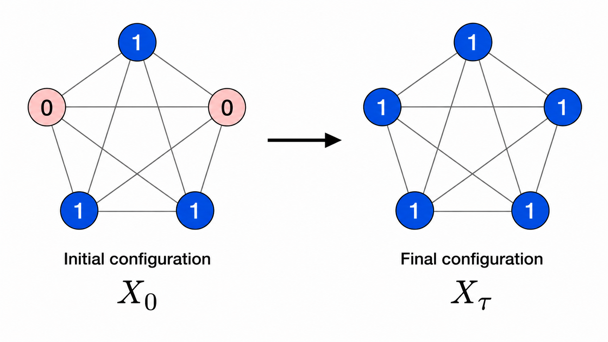
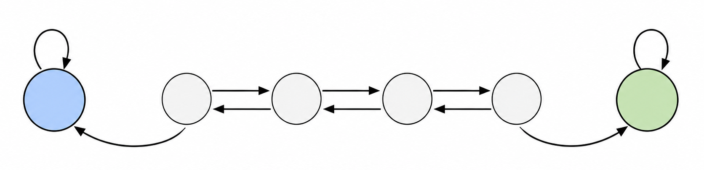

## Introduzione al Problema

Uno dei problemi principali nelle reti distribuite è far convergere le entità verso un parametro comune, che chiameremo opinione. 

Prima di definire formalmente il problema, enunciamo le restrizioni sotto le quali lo abbiamo affrontato:
$$
R = \text{Restrizioni Standard} =
\left\{
\begin{array}{l}
\mathrm{BL} \quad \text{(ossia, è possibile modellare la rete distribuita come fosse un grafo non diretto)} \\
\mathrm{CN} \quad \text{(restrizione topologia per cui il grafo è connesso)} \\
\mathrm{TR} \quad \text{(restrizione per cui assumiamo non vi siano guasti dei nodi o dei canali di comunicazione)}
\end{array}
\right.
$$

e le due restrizioni più forti:
$$SY = \text{Sincronia} = \text{il tempo è discretizzato da un clock globale, tramite il quale tutti i nodi sono sincronizzati}$$
$$KT = \text{Known (Clique) Topology} = \text{si assume che la rete distribuita sia sempre modellabile come un grafo completo}$$

Affronteremo il problema di **Majority Consensus** assumendo inoltre un numero di opinioni binarie. Descrivendo informalmente il problema, si assume che in ogni istante di tempo $t$ ogni nodo abbia un'opinione in $\{0,1\}$ e che al primissimo istante di tempo $t=0$ esista uno sbilanciamento tra le due opinioni (detto **bias**), ossia che una delle due opinioni sia maggioritaria. L'obiettivo è far sì che tutti i nodi arrivino in tempo finito al consenso sull'opinione maggioritaria iniziale.

Definiamo formalmente il problema. Sia $C = \{0,1\}$ l'insieme delle opinioni binarie. Definiamo come **configurazione** del sistema distribuito al tempo $t$ come la funzione suriettiva $X_t: V \to C$ che associa ad ogni nodo $v \in V$ la sua opinione al tempo $t$. Definiamo come $a(X_t) = a_t$ il numero di nodi colorati di 0 al tempo $t$ e come $b(X_t) = b_t$ il numero di nodi colorati di 1 al tempo $t$.  
Assumendo d'ora in poi, senza perdita di generalità, che l'opinione maggioritaria ad ogni istante di tempo sia 1, il **bias** al tempo $t$ è definito come:
$$s_t = b_t - \frac{n}{2}$$

Allora possiamo definire rigorosamente il problema di $l$**-Majority Consensus** come segue: partendo da una configurazione iniziale $X_0$ con bias $s_0 \geq l$ (quindi partendo con un bias sufficientemente grande), si vuole arrivare entro un tempo $\tau$ finito a una configurazione $X_\tau$ tale che $\forall v \in V$, $X_\tau(v) = 1$.



### Protocollo Naive
Un protocollo Naive deterministico che risolve il problema è il seguente: ad ogni istante di tempo $t$, ogni nodo $v$ osserva le opinioni di tutti i suoi vicini e adotta l'opinione maggioritaria tra quelle osservate, considerando anche la propria. Chiaramente questo protocollo è corretto e risolve il problema in tempo ottimale (un singolo round).  
Tuttavia questo protocollo è eccessivamente costoso in termini di message complexity, infatti in quel singolo round ogni nodo occupa tutte le proprie porte di comunicazione per una complessità totale di $O(n(n-1)) = O(n^2)$ messaggi scambiati.

Vorremmo trovare un protocollo che, anche a costo di peggiorare la time complexity, non congestioni la rete.

### k-Majority
Il protocollo k-Majority è un protocollo randomizzato che sfrutta il modello Gossip, in particolare la sua sottoclasse Pull. Infatti l'idea del protocollo è la seguente: ad ogni round, ogni nodo $v$ sceglie un numero di $k$ vicini (compreso se stesso), con reinserimento, in modo u.a.r. e indipendente dagli altri nodi, osserva le loro opinioni e adotta l'opinione maggioritaria tra quelle osservate.  
Per via del reinserimento un nodo potrebbe anche pescare un nodo più di una volta, compreso anche se stesso. 

```text
Per ogni round t = 0, 1, 2, ...:

    Per ogni nodo v ∈ V, in parallelo:

        1. Seleziona uniformemente a caso k nodi
           dal proprio vicinato, includendo se stesso,
           con reinserimento.

        2. Osserva le opinioni dei k nodi selezionati
           e calcola la maggioranza

        3. Imposta la propria nuova opinione X_t+1(v) come
           uguale all’opinione di maggioranza.
```

Prima di procedere con 1-Majority, facciamo un paio di osservazioni:
1. Per un grafo $G=(V,E)$ qualsiasi, per determinare univocamente una configurazione $X_t$ sarebbe necessario sapere per ogni singolo nodo $x_1, x_2, ..., x_n$ la sua opinione al tempo $t$, dato che in un grafo generico nodi diversi possono avere vicinati diversi. Grazie alla restrizione topologica $KT$ invece, dato che nella clique ogni nodo vede tutti gli altri, possiamo semplicemente identificare una configurazione $X_t$ come il numero di nodi con opinione 0 al tempo $t$. Quindi d'ora in poi:
    $$X_t = \text{v.a. che conta il numero di nodi con opinione 0 al tempo t}$$
2. Si può modellare il problema di Majority Consensus con k-Majority tramite una catena di Markov, dove lo spazio degli stati è dato dalle possibili configurazioni del sistema $\{X_t\}_{t \in \mathbb{N}}$. Si tratta infatti chiaramente di un processo stocastico, dato che ogni nodo ad ogni round cambia opinione solo in base alle opinioni dei nodi che ha pescato in modo non deterministico. Inoltre la configurazione al tempo $t+1$ dipende solo dalla configurazione al tempo $t$ e non dalle precedenti, dato che un nodo al round $t+1$ ha una certa opinione solo in base alla maggioranza delle opinioni che ha "pescato" al round $t$.

### 1-Majority
Il protocollo 1-Maj quindi prevede che ad ogni round ogni nodo peschi un solo nodo (compreso se stesso) u.a.r. e indipendentemente dagli altri nodi, adottando la sua opinione.

Vogliamo capire in media ad ogni round di quanto cambia il numero di nodi con opinione 0, per capire se questo protocollo è efficace affinché si converga alla configurazione finale ammissibile in cui tutti i nodi hanno opinione 1. Per farlo, definiamo la seguente variabile aleatoria bernoulliana:
$$\forall v \in V, \quad Y_t^v = \begin{cases}
1 & \text{se il nodo è colorato di 0 al round t, i.e. } X_t(v) = 0 \\
0 & \text{altrimenti}
\end{cases}$$
Stimiamo anzitutto la probabilità che un nodo $v$ sia colorato di 0 al round $t+1$, sapendo che al round $t$ ci sono $a_t$ nodi colorati di 0:
$$\Pr(Y_{t+1}^v = 1 | X_t = a_t) = \frac{a_t}{n}$$
A questo punto notiamo che il numero di nodi colorati di 0 al round $t+1$ è null'altro che la somma dei vari $Y_{t+1}^v$:
$$X_{t+1} = \sum_{v \in V} Y_{t+1}^v$$
Quindi, per linearità dell'aspettazione:
$$\mathbb{E}[X_{t+1} | X_t = a_t] = \sum_{v \in V} \mathbb{E}[Y_{t+1}^v | X_t = a_t] = \sum_{v \in V} 1 \cdot \Pr(Y_{t+1}^v = 1 | X_t = a_t) + 0 \cdot \Pr(Y_{t+1}^v = 0 | X_t = a_t) = n \cdot \frac{a_t}{n} = a_t$$
Ma quindi con 1-Majority, in media, il numero di nodi con opinione 0 non cambia da un round all'altro. 

Questo non significa che un nodo, di round in round, non cambi mai opinione, ma semplicemente che tutti i nodi si ricolorano affinché comunque il numero di nodi colorati di 0 resti in media lo stesso. 

Riguardo la convergenza? Tornando alle catene di Markov, ci rendiamo conto che esistono esattamente due stati assorbenti della catena: quella per cui tutti i nodi hanno opinione 0 e quella per cui tutti i nodi hanno opinione 1 (infatti se finisco in una di queste due configurazioni riapplicare k-Maj mi riporta nella stessa configurazione con probabilità 1). Poiché la catena è irriducibile (con probabilità positiva è possibile passare da ogni configurazione ad ogni altra configurazione), allora con probabilità 1 si finirà prima o poi in uno dei due stati assorbenti. 

Non stimiamo il tempo necessario per la convergenza, ma possiamo intuire dal momento che in media la configurazione resta la stessa con 1-Maj (si parla in questo senso di zero-drift), che il tempo di convergenza sarà molto elevato (si può dimostrare essere esponenziale in $n$). Qui sotto uno sketch del grafo della catena:



### 2-Majority
Il protocollo 2-Majority prevede che ad ogni round ogni nodo peschi due nodi (compreso se stesso) u.a.r. e indipendentemente dagli altri nodi con reinserimento, adottando la loro opinione maggioritaria. Essendo $k$ pari, dobbiamo gestire il caso di pesca di un nodo 0 e l'altro 1: nel nostro caso semplicemente si lancia una moneta equa per cui con probabilità 1/2 si adotta l'opinione 0 e con probabilità 1/2 si adotta l'opinione 1.

Rieseguiamo lo stesso procedimento di prima, ma adattato al 2-Maj. Abbiamo due eventi disgiunti per cui un nodo $v$ al round $t+1$ è colorato di 0: o pesca due nodi con opinione 0, oppure pesca un nodo con opinione 0 e un nodo con opinione 1 e vince la moneta. Quindi:
$$\Pr(Y_{t+1}^v = 1 | X_t = a_t) = \left(\frac{a_t}{n}\right)^2 + 2 \cdot \frac{a_t}{n} \cdot \frac{b_t}{n} \cdot \frac{1}{2} = \left(\frac{a_t}{n}\right)^2 + \frac{a_t}{n} \cdot \frac{n-a_t}{n} = \left(\frac{a_t}{n}\right)^2 + \frac{a_t}{n} - \frac{a_t^2}{n^2} = \frac{a_t}{n}$$
dove il 2 nel secondo addendo deriva dal fatto che ci sono due modi per pescare un nodo con opinione 0 e un nodo con opinione 1 $\left(\text{sarebbe } \binom{2}{1}\right)$.  
Quindi anche in questo caso, per linearità dell'aspettazione:
$$\mathbb{E}[X_{t+1} | X_t = a_t] = n \cdot \frac{a_t}{n} = a_t$$
E quindi anche 2-Maj non è un protocollo efficace per risolvere $l$-Majority Consensus.

### 3-Majority
Il protocollo 3-Majority prevede che ad ogni round ogni nodo peschi tre nodi (compreso se stesso) u.a.r. e indipendentemente dagli altri nodi con reinserimento, adottando la loro opinione maggioritaria. 

Questo protocollo è particolarmente interessante poiché vale il seguente teorema:

> ### **Teorema**
>
> Il protocollo 3-Majority risolve il problema di $w$-Majority Consensus, con $w = \Omega(\sqrt{n \log n})$, in tempo $O(\log n)$ con alta probabilità.
>

> ### **Dimostrazione**
>
> Prima di dimostrare il teorema, definiamo il bias in funzione del numero di nodi minoritari (quelli colorati di 0) e viceversa al tempo $t$:
> $$s_t = \frac{n}{2} - a_t \quad a_t = \frac{n}{2} - s_t$$
>
> Si vuole intuitivamente dimostrare che il numero di nodi colorati di 0 diminuisce esponenzialmente da un round all'altro w.h.p. o equivalentemente che il bias cresce esponenzialmente da un round all'altro w.h.p. (si noti come le due cose sono "inversamente" collegate: il nostro obiettivo è far decrescere il numero di nodi con opinione 0 fino a 0, e se ciò accade significa che il bias è cresciuto fino al suo valore massimo di $n/2$. Deve essere ben chiaro il fatto che se il numero di nodi con opinione 0 decresce esponenzialmente, allora il bias cresce esponenzialmente e viceversa per via dell'equazione sopra). Il fatto che questa decrescita/crescita sia esponenziale ci permetterà di dire che si converge alla configurazione finale ammissibile in tempo logaritmico con alta probabilità. Per fare ciò si seguono tre fasi: le vediamo dualmente sia dal punto di vista del bias $s_t$ che dal punto di vista del numero di nodi con opinione 0 $a_t$.
>
> Riguardo il bias, vogliamo che cresca. Nelle prime due fasi dimostriamo che per quei round la crescita è esponenziale con alta probabilità mentre nella terza fase che si passa da bias "quasi" $n/2$ a bias esattamente $n/2$ con alta probabilità in un singolo round. 
> $$
> \begin{array}{c}
> \textbf{Fase 1}
> \\[4pt]
> \displaystyle c\sqrt{n\log n}
> \leq s_t \leq \frac{n}{4}
> \\[12pt]
> \textbf{Fase 2}
> \\[4pt]
> \displaystyle \frac{n}{4}
> \leq s_t \leq \frac{n}{2}-O(\log n)
> \\[12pt]
> \textbf{Fase 3}
> \\[4pt]
> \displaystyle s_t =\frac{n}{2}-O(\log n)
> \longrightarrow \frac{n}{2}
> \end{array}
> $$
> Riguardo $a_t$, vogliamo che decresca. Nelle prime due fasi dimostriamo che per quei round la decrescita è esponenziale con alta probabilità mentre nella terza fase che si passa da $a_t$ piccolo $\left(O(\log n)\right)$ a 0 con alta probabilità in un singolo round.

> $$
> \begin{aligned}
> \Pr\!\left(Y_{t+1}^v = 1 \mid X_t = a_t\right)
> &=
> \frac{a_t^3}{n^3}
> +
> \binom{3}{2} \cdot \frac{a_t^2}{n^2}\cdot \frac{b_t}{n}
> =
> \frac{a_t^3}{n^3}
> +
> 3\cdot \frac{a_t^2}{n^2}\cdot \frac{n-a_t}{n}
> \\[4pt]
> &=
> 3\cdot \frac{a_t^2}{n^2}
> -
> 2\cdot \frac{a_t^3}{n^3}
> =
> \frac{a_t^2}{n^3}
> \left(
> 3n-2a_t
> \right).
> \end{aligned}
> $$
>
> Passando al valore atteso:
>
> $$
> \mathbb{E}[X_{t+1} \mid X_t = a_t] = n \cdot \frac{a_t^2}{n^3} \left(3n-2a_t\right) = \frac{a_t^2}{n^2} \left(3n-2a_t\right) = \frac{f(a_t)}{n^2}
> $$
>
> Sia $f(a_t) = a_t^2(3n-2a_t)$. Calcolando la derivata prima di $f$ otteniamo che questa è $\ge 0$ per $a_t \in [0, n]$ (che è l'unico intervallo ammissibile per il numero di nodi con opinione 0), quindi $f$ è crescente in quell'intervallo. Quindi possiamo procedere per ogni fase a stimare un upper bound di $\mathbb{E}[X_{t+1} \mid X_t = a_t]$ sostituendo in $f(a_t)$ il valore massimo di $a_t$ per quella fase.

> #### **Fase 1**
> $$
> \begin{aligned}
> \mathbb{E}\!\left[X_{t+1}\mid X_t=a_t\right]
> &=
> \frac{f(a_t)}{n^2}
> \leq
> \frac{f\!\left(\frac n2-s_t\right)}{n^2}
> =
> \frac{1}{n^2}
> \left(\frac n2-s_t\right)^2
> \left(
> 3n-2\left(\frac n2-s_t\right)
> \right) 
> \\[4pt]
> &=
> \frac{1}{n^2}
> \left(
> \frac{n^2}{4}
> -ns_t
> +s_t^2
> \right)
> (2n+2s_t)
> =
> \frac n2
> -\frac32s_t
> +\frac{2s_t^3}{n^2}
> =
> \frac n2
> -\frac32s_t
> +s_t\left(\frac{2s_t^2}{n^2}\right)
> \end{aligned}
> $$
>
> Nella prima fase sappiamo che $s_t\leq \frac n4$, quindi:
>$$ s_t^2\leq \frac{n^2}{16} \iff \frac{2s_t^2}{n^2} \leq \frac18$$
> sostituendo nella formula del valore atteso:
> $$ \mathbb{E}\!\left[X_{t+1}\mid X_t=a_t\right] \leq \frac n2 - \frac32s_t + s_t \frac18 = \frac n2 - \frac{11}{8}s_t \leq \frac n2 - \frac54s_t$$
> Anche se non è evidente, questo risultato ci dice che in media il numero di nodi con opinione 0 decresce esponenzialmente da un round all'altro. Per vederlo meglio basta riscrivere il tutto in funzione del bias $s_t$, infatti sappiamo che:
> $$a_{t+1} = \frac n2 - s_{t+1}$$
> e poiché in media abbiamo dimostrato che $a_{t+1} \leq \frac n2 - \frac54s_t$, allora:
> $$s_{t+1} \geq \frac54s_t$$
> ossia il bias, in valore atteso, deve crescere di un fattore di almeno $5/4$ di round in round, e quindi (poiché $\frac54 > 1$) il bias cresce esponenzialmente da un round all'altro.
>

> Tuttavia noi vorremmo dimostrare la crescita esponenziale del bias in concentrazione, per farlo sfruttiamo il Chernoff Bound. Possiamo utilizzare il bound dal momento che $X_{t+1} = \sum_{v \in N_t} Y_{t+1}^v$ è la somma di variabili aleatorie bernoulliane che sono chiaramente **indipendenti** (il fatto che un nodo sia colorato di 0 in un certo round deriva da una scelta indipendente dagli altri nodi). Sfruttiamo il bound additivo:
>
> $$
> \Pr(X \geq \delta + \mu) \leq e^{-\frac{2\delta^2}{n}}
> $$
>
> dove $X = X_{t+1}$, $\mu = \mathbb{E}[X_{t+1} \mid X_t = a_t]$ e $\delta= \frac{1}{8}s_t$. Sostituendo:
>
> $$
> \begin{aligned}
> \Pr\!\left(
> X_{t+1}
> \geq
> \frac n2-\frac54s_t+\frac18s_t
> \,\middle|\,
> X_t=a_t
> \right)
> &=
> \Pr\!\left(
> X_{t+1}
> \geq
> \frac n2-\frac98s_t
> \,\middle|\,
> X_t=a_t
> \right)
> \\[4pt]
> &\leq
> \exp\!\left(
> -\frac{2\left(\frac18s_t\right)^2}{n}
> \right)
> =
> \exp\!\left(
> -\frac{s_t^2}{32n}
> \right).
> \end{aligned}
> $$
>
> Vogliamo ottenere un upper bound. Poiché $\exp\!\left(-\frac{s_t^2}{32n}\right)$ diminuisce al crescere di $s_t$, consideriamo il più piccolo valore possibile del bias.

> Nella Fase 1 sappiamo che
>
> $$
> s_t\geq c\sqrt{n\log n}.
> $$
>
> Pertanto:
>
> $$
> \begin{aligned}
> \Pr\!\left(
> X_{t+1}
> \geq
> \frac n2-\frac98s_t
> \,\middle|\,
> X_t=a_t
> \right)
> &\leq
> \exp\!\left(
> -\frac{s_t^2}{32n}
> \right)
> \\[6pt]
> &\leq
> \exp\!\left(
> -\frac{c^2n\log n}{32n}
> \right)
> \\[6pt]
> &=
> \exp\!\left(
> -\frac{c^2}{32}\log n
> \right)
> =
> n^{-\frac{c^2}{32}}
> =
> n^{-\beta}
> \end{aligned}
> $$
> Quindi:
> $$\Pr\!\left(
> X_{t+1} \leq \frac n2 - \frac{9}{8}s_t
> \,\middle|\,
> X_t=a_t
> \right)
> \geq
> 1 - n^{-\beta}.
> $$
> ossia abbiamo dimostrato che con alta probabilità il bias cresce almeno di un fattore di $9/8$ (e quindi di nuovo, poiché $9/8 > 1$, cresce esponenzialmente) da un round all'altro **con alta probabilità**.
>
> Abbiamo dimostrato quindi che per un round generico $t$ nella Fase 1, con alta probabilità, il bias cresce di un fattore di almeno $9/8$ nel round successivo $t+1$. Vorremmo però dimostrare in generale che entro un numero di passi $O(\log n)$, con alta probabilità, il bias è cresciuto fino ad essere almeno $n/4$ e quindi si passa alla Fase 2. Per farlo anzitutto stimiamo il tempo necessario affinché si passi alla Fase 2 se ad ogni round si ha effettivamente la crescita esponenziale del bias, srotoliamo quindi l'equazione di ricorrenza:
> $$s_{t} \geq \frac{9}{8}s_t-1 \geq \left(\frac{9}{8}\right)^2 s_{t-2} \geq ... \geq \left(\frac{9}{8}\right)^{t} s_0$$
> Si passa alla fase 2 quando il bias è almeno $n/4$, quindi:
> $$\left(\frac{9}{8}\right)^{T}\cdot s_0 \geq \frac{n}{4} \iff T \geq \log_{\frac{9}{8}} \left(\frac{n}{4s_0}\right)$$
> Di nuovo vogliamo un upper bound, quindi consideriamo il più piccolo valore possibile del bias iniziale $s_0 = c\sqrt{n\log n}$:
> $$T \leq \log_{\frac{9}{8}} \left(\frac{n}{4c\sqrt{n\log n}}\right) = O(\log n)$$
> Quindi se ad ogni passo c'è effettivamente una crescita exp del bias, ovviamente ci aspettiamo un numero di passi logaritmico.
>
> Vogliamo dimostrare a questo punto che la probabilità di passare alla Fase 2 entro $T = O(\log n)$ passi è alta probabilità:
> $$\Pr(\exists t \in [0, T]: X_t \leq n/4) $$
> Per farlo definiamo il seguente evento "buono", che si verifica se al round $t$ o sono passato alla seconda fase (numero di nodi colorati di 0 $\leq n/4$) o c'è stata la decrescita esponenziale del numero di nodi con opinione 0:
> $$\varepsilon_t = \left\{X_t \leq \max\left\{\frac{n}{4}, \frac{n}{2} - \frac{9}{8}s_t\right\}\right\}$$
> Allora vale che:
> $$\Pr(\exists t \in [0, T]: X_t \leq n/4) \geq \Pr\left(\bigcap_{t=0}^T \varepsilon_t\right)$$
> dove la disuguaglianza deriva dal fatto che il secondo evento implica il primo (è più restrittivo), quindi ha meno probabilità di verificarsi. Infatti il primo evento ci dice che passiamo alla seconda fase pure prima di $T$, il secondo invece ci dice che per $T$ volte almeno ho avuto una decrescita esponenziale e che quindi, per come abbiamo definito $T$, siamo necessariamente passati alla seconda fase. 
>
> A questo punto si sviluppa la probabilità dell'intersezione con la regola della catena per cui in generale vale che:
> $$\Pr(A \cap B \cap C) = \Pr(A|B \cap C) \cdot \Pr(B|C) \cdot \Pr(C)$$
> Quindi:
> $$ 
> \Pr\left(\bigcap_{t=0}^T \varepsilon_t\right) = \prod_{t=0}^T \Pr\!\left(\varepsilon_t \mid \bigcap_{i=0}^{t-1} \varepsilon_i \right)
> $$
> Ma nella Fase 1 abbiamo dimostrato che la decrescita esponenziale del numero di nodi con opinione 0 avviene con alta probabilità per un round $t$ generico, e che quindi l'evento buono condizionato al passato si verifica con alta probabilità:
> $$ \Pr\!\left(\varepsilon_t \mid \bigcap_{i=0}^{t-1} \varepsilon_i \right) \geq 1 - n^{-\beta}$$
> quindi:
> $$\Pr(\exists t \in [0, T]: X_t \leq n/4) \geq \prod_{t=0}^T \Pr\!\left(\varepsilon_t \mid \bigcap_{i=0}^{t-1} \varepsilon_i \right) \geq (1 - n^{-\beta})^T \geq 1 - \frac{T}{n^{\beta}}$$
> Dove l'ultima disuguaglianza deriva dalla disuguaglianza di Bernoulli per cui $(1-x)^T \geq 1 - Tx$ per $x \in [0,1]$.  
> Ma $T = O(\log n)$, quindi per la gerarchia degli infiniti è minore di un qualsiasi polinomio per $n$ sufficientemente grande, in particolare $T \leq n^{\beta/2}$, quindi:
> $$\Pr(\exists t \in [0, T]: X_t \leq n/4) \geq 1 - n^{-\beta/2}$$
> ossia abbiamo dimostrato che con alta probabilità entro $O(\log n)$ passi si passa alla Fase 2.

> #### **Fase 2**
>  $$
> \begin{aligned}
> \mathbb{E}\!\left[X_{t+1}\mid X_t=a_t\right]
> &=
> \frac{f(a_t)}{n^2}
> \leq
> \frac{f\!\left(\frac {n}{4}\right)}{n^2}
> =
> \frac{1}{n^2}\left(a_t \cdot \frac{n}{4} \right)
> \left(3n-2\frac{n}{4}\right)
> \\[6pt]
> &\leq
> \frac{a_t}{n^2}\cdot\frac n4\cdot 3n
> =
> \frac34\,a_t.
> \end{aligned}
> $$
> Quindi in questo caso si vede in modo esplicito invece come il numero di nodi colorati di zero decresca esponenzialmente ad ogni round in media. Di nuovo, vogliamo dimostrare che questo avviene in concentrazione, quindi usiamo il Chernoff Bound (stavolta moltiplicativo):
> $$\Pr(X \geq (1+\delta)\mu) \leq e^{-\frac{\mu\delta^2}{3}}$$
> Prima di passare alla stima vera e propria, potremmo ad esempio essere interessati a vedere qual è la probabilità che il numero di nodi con opinione 0 al round $t+1$ sia **maggiore** di quelli al round precedente $t$. Per capire che $\delta$ utilizzare in tal caso, basta risolvere l'equazione:
> $$(1+\delta)\mu \ge a_t \iff (1+\delta) \cdot \frac34\,a_t \ge a_t \iff \delta \ge \frac{1}{3}$$
> Quindi ponendo $\delta = 1/3$:
> $$\Pr(X_{t+1} \geq a_t \mid X_t = a_t) \leq \exp\left(-\frac{\mu\delta^2}{3}\right) = \exp\left(-\frac{3}{4}a_t \cdot \frac{1}{9} \cdot \frac{1}{3} \right) = \exp\left(-\frac{a_t}{36} \right)$$
> Di nuovo vogliamo un upper bound, quindi consideriamo il più piccolo valore possibile di $a_t$ nella Fase 2, $a_t >= O(\log n)$:
> $$\Pr(X_{t+1} \geq a_t \mid X_t = a_t) \leq \exp\left(-\frac{a_t}{36} \right) \leq \exp\left(-\frac{c\log n}{36} \right) = n^{-\frac{c}{36}}$$
> ossia con bassa probabilità il numero di nodi con opinione 0 al round $t+1$ è maggiore di quelli al round precedente $t$.
>
> Per dimostrare che con alta probabilità c'è una decrescita effettivamente esponenziale, basta prendere $\delta \leq 1/3$ sufficientemente piccolo, in particolare prendiamo $\delta = 1/15$:
> $$\Pr(X_{t+1} \geq \frac{16}{15} \cdot \frac34 a_t \mid X_t = a_t) = \Pr(X_{t+1} \geq \frac{4}{5}a_t \mid X_t = a_t) \leq \exp\left(-\frac{\mu\delta^2}{3}\right) = \exp\left(-\frac{3}{4}a_t \cdot \frac{1}{225} \cdot \frac{1}{3} \right) = \exp\left(-\frac{a_t}{900} \right)$$
> e di nuovo upper bound:
> $$\Pr(X_{t+1} \geq \frac{4}{5}a_t \mid X_t = a_t) \leq \exp\left(-\frac{c\log n}{900} \right) = n^{-\frac{c}{900}} = n^{-\gamma}$$
> Abbiamo quindi dimostrato che con alta probabilità il numero di nodi con opinione 0 decresce di un fattore di almeno $4/5$ (e quindi esponenzialmente) da un round all'altro.
>
> Anche qui bisognerebbe dimostrare che entro $O(\log n)$ passi, con alta probabilità, il numero di nodi con opinione 0 è sceso fino ad essere almeno $O(\log n)$ e quindi si passa alla Fase 3. Per farlo si procede nello stesso identico modo visto per la Fase 1, con l'unica differenza che si srotola l'equazione di ricorrenza:
> $$X_{t} \leq \left(\frac{4}{5}\right) a_{t-1} \leq \cdots \leq \left(\frac{4}{5}\right)^t a_0$$

> #### **Fase 3**
> Stavolta si dimostra che in **un singolo round** con alta probabilità si passa da $a_t = O(\log n)$ a $a_{t+1} = 0$. Per farlo, di nuovo:
>
> $$
> \begin{aligned}
> \mathbb{E}\!\left[X_{t+1}\mid X_t=a_t\right]
> &=
> \frac{f(a_t)}{n^2}
> \leq
> \frac{f(c\log n)}{n^2}
> \\[6pt]
> &\leq
> \frac{c^2\log^2 n}{n^2}\cdot 3n
> =
> \frac{3c^2\log^2 n}{n}.
> \end{aligned}
> $$
>
> Vogliamo stimare:
>
> $$
> \Pr(X_{t+1} \geq 1 \mid X_t = a_t)
> $$
>
> e stavolta ci è sufficiente usare la disuguaglianza di Markov $\left(\Pr(X \geq k) \leq \frac{\mathbb{E}[X]}{k} \text{ per } k > 0 \text{ e } X \text{ v.a. non negativa}\right)$ :
>
> $$
> \Pr(X_{t+1} \geq 1 \mid X_t = a_t) \leq \mathbb{E}[X_{t+1} \mid X_t = a_t] = \frac{3c^2\log^2 n}{n}
> $$
>
> Quindi:
>
> $$
> \Pr(X_{t+1} = 0 \mid X_t = a_t) \geq 1 - \frac{3c^2\log^2 n}{n}
> $$
>
> che è alta probabilità dal momento che per $n \to \infty$ il termine $\frac{3c^2\log^2 n}{n} \to 0$.
>
> $\blacksquare$
