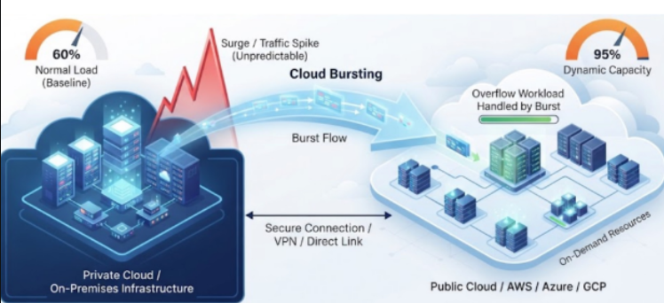
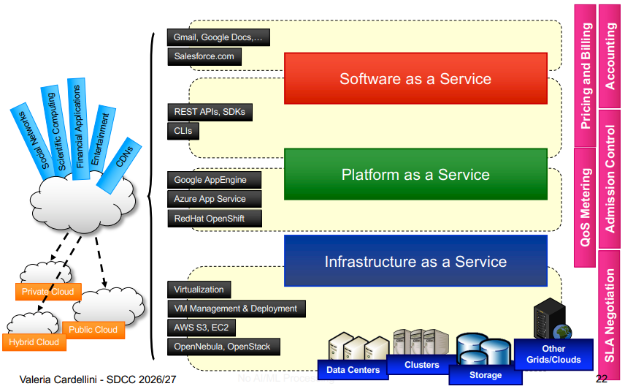
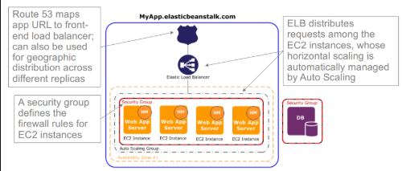
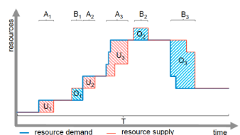
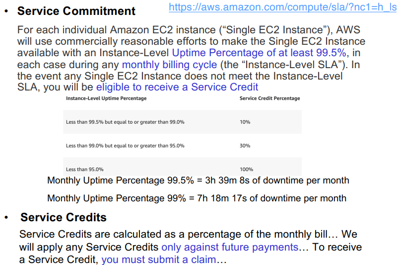
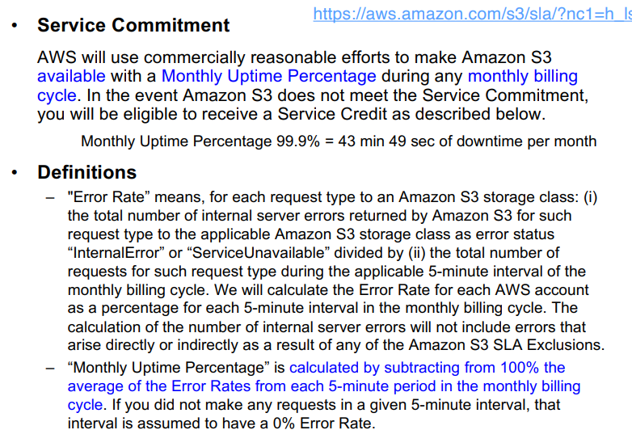
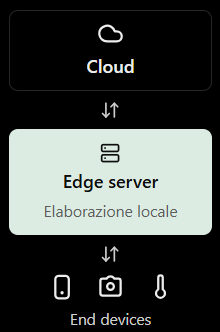
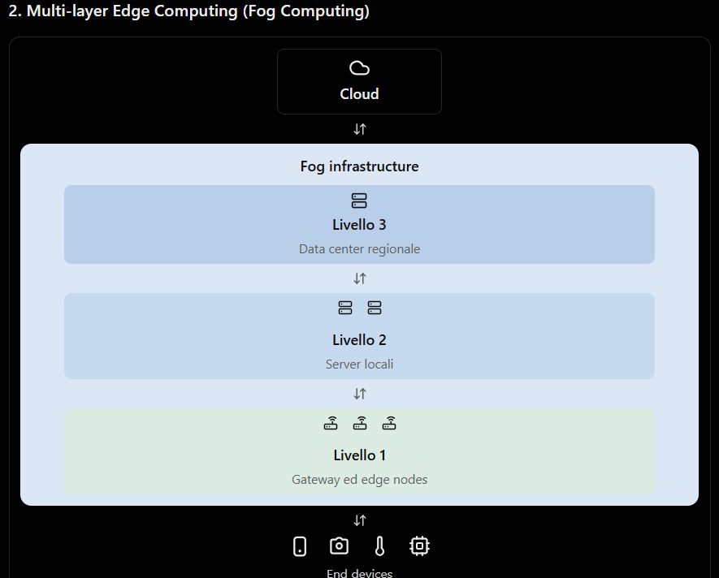
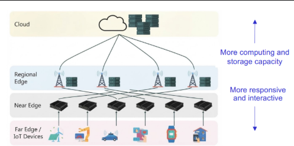

## Intro
**Cloud Computing** == modello che permette di usare risorse informatiche (Computation, Storage e Coordination) attraverso la rete, senza dover possedere e gestire direttamente l'infrastruttura fisica necessaria (ospitata principalmente nei data center). 

Nato per ovviare ad un problema di scalabilità a partire da Amazon, dove in certi periodi dell'anno il traffico era molto elevato e richiedeva quindi infrastruttura aggiuntiva inutilizzata per il resto del tempo --> l'utilizzo del cloud permette invece di pagare solo per le risorse effettivamente utilizzate!

Idee che hanno preceduto il cloud, ma che in qualche modo ne fanno parte:
- **Utility Computing**: considera le risorse informatiche come un servizio da consumare secondo necessità proprio come l'acqua o l'elettricità. L'utente paga solo per ciò che consuma.
- **Grid Computing**: le risorse utilizzate sono distribuite geograficamente e collegate tra loro tramite la rete.  
(in origine il punto era collegare risorse di organizzazioni diverse in posti diversi tra loro)
- **Autonomic Computing**: si vuole un sistema in grado di autogestirsi quanto più possibile (vedremo in questo senso MAPE, autoscaling, self-healing etc..)
- **Software as a Service (SaaS)**: fornire l'applicazione come servizio accessibile tramite rete.

Tornando alla definizione di Cloud Computing: i servizi offerti sono disponibili su richiesta e rapidamente allocabili e rilasciabili, con gestione automatizzata e utilizzo misurabile (vedremo bene perché parlando dei SLA Service Level Agreements).  
Da ciò le caratteristiche del cloud:
- **on-demand self-service**: come detto servizi disponibili su richiesta *ma senza interazione con il fornitore: la richiesta avviene autonomamente tramite un portale web o un'API*
- **broad network access**: risorse accessibili tramite rete da client eterogenei. Vedremo nel cloud privato l'accesso disponibile potenzialmente solo attraverso la rete aziendale
- **Elasticity**: capacità di **aumentare e ridurre risorse rapidamente in funzione della domanda**.  
Bisogna ben distinguere elasticità da scalabilità: la prima infatti è la **capacità** di sostenere un carico maggiore aumentando le risorse... un sistema può essere scalabile ma poco elastico (es. può potenzialmente crescere aggiungendo server, ma impiegherebbe settimane per acquistarli/configurarli).  
L'elasticità inoltre non implica che l'adattamento sia automatico, il meccanismo che permette ciò è l'**autoscaling**.
- **resource pooling e multi-tenancy**: il provider organizza le risorse in un pool (infrastruttura fisica) condiviso dal quale assegna capacità ai clienti.  
La multi-tenancy permette a più client di usare la stessa infrastruttura fisica mantenendo però isolamento logico
- **resource visualization**: la **virtualizzazione** permette al provider di cedere ai client risorse virtuali con configurazioni personalizzate in termini di CPU, RAM, storage etc..
- **pay-per-use**: il costo dipende dall'uso delle risorse secondo metriche e contratto previsti
- **measured service**: il provider monitora l'uso delle risorse e fornisce report dettagliati al cliente.

---

## Deployment models
Un **Deployment Model** descrive a chi è destinata l'infrastruttura cloud e come è organizzata. Tre modelli principali:
1. **Public Cloud**: **il provider gestisce un'infrastruttura che offre servizi a clienti che possono essere molto diversi tra loro** --> piattaforma multi-tenant che garantisce quindi isolamento logico.  
Essendo il servizio offerto a una platea più generale di clienti, l'accesso alle singole risorse è soggetto a diversi controlli e autorizzazioni. Il cliente usa le risorse del provider senza preoccuparsi di dove siano fisicamente collocate né di come gestire l'hardware sottostante.
2. **Private Cloud**: **l'infrastruttura è dedicata esclusivamente a una singola organizzazione**, al cui interno ovviamente possono esserci più utilizzatori (es. gruppi di ricerca o unità aziendali).  
Il cloud può essere gestito dall'oganizzazione stessa, da un provider esterno o da una combinazione dei due, inoltre può fisicamente trovarsi all'interno della sede dell'organizzazione o essere ospitato esternamente (ciò che lo rende privato **è l'uso esclusivo**, non la posizione fisica).  
    - **Vantaggi**: *maggiore controllo e possibilità di personalizzare infrastruttura e politiche di accesso* (da ciò può quindi derivare *maggiore sicurezza*, se isolamento e configurazioni gestite correttamente, ma non è detto che sia sempre così)  
    - **Svantaggi**: capacità fisica tendenzialmente più limitata, *difficoltà nell'espansione (sia in termini di scalabilità che di elasticità)*, *costi più alti* (non si possono sfruttare economie di scala come nel public cloud)
3. **Hybrid Cloud**: **combina infrastrutture cloud distinte, tipicamente uno privato e uno pubblico,** tramite tecnologie che consentono di integrare servizi e trasferire dati o applicazioni (tipicamente connessione diretta o accesso sicuro tramite ad es. VPN).  
es. un'azienda piò conservare un DB nel cloud privato, ma eseguire alcuni servizi applicativi nel pubblico!

Molti vantaggi derivano dall'uso del cloud ibrido:
- **bilanciare l'uso di risorse e costi**: l'azienda può usare l'infrastruttura privata per il carico abituale, ma ricorrere al pubblico quando serve capacità aggiuntiva (es. picchi di traffico stagionali). In questo modo una possibilità è il risparmio di costi, considerando però anche i costi di integrazione e trasferimento dati tra i due cloud.
- **ridurre il vendor lock-in**: il vendor lock-in è una situazione dove abbandonare il fornitore diventa difficile o costoso --> con il cloud ibrido si riduce la dipendenza dal fornitore cloud
- **aumentare la flessibilità**: l'azienda può scegliere l'ambiente più adatto a ciascuna esigenza.  
es. se vuole maggior controllo e sicurezza su certi dati li può mettere nel cloud privato; oppure ancora il backup per il recupero dopo un guasto grave (se si vuole fare quindi **disaster recovery**) può essere posto nel cloud pubblico; o ancora se si vogliono servire utenti in aree geografiche diverse si può usare il cloud pubblico per distribuire contenuti più vicino agli utenti finali; se si vogliono gestire picchi si può attivare capacità aggiuntiva nel cloud pubblico etc...

La modalità per cui se il cloud privato non ha abbastanza capacità e si deve quindi ricorrere al cloud pubblico è detta **cloud bursting**, per cui il servizio per i clienti in eccesso è reindirizzato al cloud pubblico.

Anche diversi svantaggi nell'uso del cloud ibrido:
- **Complessità operativa**: bisogna gestire più ambienti spesso con configurazioni diverse. Inoltre serve coordinamento nella creazione delle risorse, aggiornamenti, monitoraggio, autorizzazioni etc...
- **Sicurezza**: aumenta la superficie di attacco dato che aumentano le componenti e i collegamenti da proteggere
- **Possibili ritardi**: la comunicazione tra cloud implica latenza  
es. se un'app del cloud pubblico consulta continuamente un db nel cloud privato, la latenza di rete può diventare un problema
- **Troubleshooting più difficile**: le variabili che possono causare rallentamenti o malfunzionamenti aumentano (il problema sta nell'applicazione, nelcloud privato, pubblico, nella rete o in una combinazione di esse?)
- **Costi di integrazione**: l'uso di connessioni protette, trasferimento dati, competenze specialistiche etc.. hanno costo significativo --> avere cloud ibrido può far risparmiare sull'hardware necessario per i picchi (cloud bursting), ma può anche aumentare altri costi...

---
## Cloud Stack
Il **cloud provider** è colui che offre i servizi cloud (es. AWS, Microsoft Azure, Google Cloud...) e bisogna distinguerlo da chi invece la utilizza per offrire altrri servizi ad utenti finali. 

Il **Cloud Stack** riguarda il livello "di astrazione" tramite cui il cloud provider offre i propri servizi (più è alto il livello, più dettagli tecnici sono nascosti all'utente). Tre livelli principali, dal più basso al più alto:
1. **Infrastructure as a Service IaaS**: il client riceve direttamente risorse di calcolo, storage e rete --> l'attività principale del cliente è configurare l'ambiente virtuale ed eseguire il proprio software.
2. **Platform as a Service PaaS**: il client riceve una piattaforma pronta per eseguire applicazioni --> l'attività principale del cliente è sviluppare e distribuire le proprie applicazioni senza gestire l'infrastruttura sottostante.
3. **Software as a Service SaaS**: il client riceve un'applicazione già pronta all'uso --> l'attività del cliente si limita ad usare l'applicazione senza preoccuparsi né dell'infrastruttura né della piattaforma sottostante.

Mentre quindi i **modelli di deployment** rispondevano alla domanda "*a chi è destinata l'infrastruttura cloud e come è organizzata*", i **modelli di servizio** rispondono alla domanda "*cosa riceve il cliente dal provider e cosa deve fare lui stesso*".

**IaaS**

Il provider offre le risorse informatiche fondamentali di capacità di calcolo, storage e reti virtuali/componenti di rete. Il cliente può quindi usarle per installare ed eseguire il proprio software (SO e applicazioni comprese nel caso di una VM).

Il cliente in generale può modificare alcuni aspetti della rete virtuale (es. regole di accesso via firewall etc..) ma non gestisce direttamente l'infrastruttura fisica sottostante.

Un es. di IaaS è Amazon EC2 (Elastic Compute Cloud).

**PaaS**

Qui il cliente riceve una piattaforma pronta per sviluppare, distribuire ed eseguire applicazioni --> la differenza rispetto a IaaS è che mentre in IaaS il client parte da risorse infrastrutturali e prepara lui l'ambiente, qui si parte da una piattaforma pronta a gestire buona parte dell'ambiente di esecuzione.

Il **vantaggio è riduzione del lavoro di gestione** (ad es. il SO non è più a carico del cliente), ma il **compromesso è che l'app deve rispettare linguaggi e librerie supportate dalla piattaforma** --> libertà di configurazione ridotta.

Un sottinsime di PaaS è **FaaS (Function as a Service)**, dove il cliente fornisce solo funzioni che vengono eseguite in risposta a eventi, senza preoccuparsi di server o infrastruttura sottostante.

Un esempio di PaaS è Elastic Beanstalk di AWS: 

il cliente carica il pacchetto dell'applicazione fornendo le configurazioni necessarie --> la piattaforma crea e configura le risorse che la eseguiranno.  
Route 53 è il servizio di gestione DNS che associa il nome dell'app al punto di accesso appropriato, questo porta a un load balancer per distribuire il traffico tra le istanze dell'applicazione, che a loro volta possono scalare automaticamente in base al carico dal momento che sono parte di un gruppo Auto Scaling.  
Il security group definisce invece le regole di accesso nella rete per le istanze dell'applicazione e il database è gestito separatamente dalle istanze applicative.

**SaaS**

Il client usa un'applicazione già realizzata ed eseguita dal provider (es. Gmail, Microsoft Teams, Mega...) --> la cosa che al più può gestire il client sono le impostazioni consentite, gli utenti e i contenuti inseriti.

Esistono anche modelli più specifici tipo Database as a Service DBaaS, Monitoring as a Service MaaS (per monitorare l'attività di un'applicazione), Gen AI as a Service GAIaaS (fornire LLM come servizio) e più in generale **X as a Service** (**XaaS**) per indicare qualsiasi servizio fornito come servizio cloud.

---
**Modelli di prezzo**:
- **on-demand e pay-per-use**: il costo dipende dalle risorse usate e dalla durata di utilizzo --> è un modello costoso ma anche più flessibile
- **fixed o reserved**: il cliente assume impegno economico per ottenere uno sconto (es. pagando in anticipo per un anno di utilizzo)
- **dedicated**: il cliente paga per avere risorse dedicate. Maggiore isolamento fisico ma costa di più.
- **spot**: il cliente usa capacità disponibile ma che potrebbe essergli revocata con poco preavviso a prezzi vantaggiosi. Utile per lavori tolleranti a interruzioni (es. calcolo batch, addestramento di modelli ML con checkpointing etc..)

---
### Capacity planning ed Elasticity
Il **capacity planning** consiste nel determinare quante risorse servono e di quali dimensioni, e può riguardare ogni tier dello stack.

Definiamo **previsioning** l'assegnazione e preparazione effettiva di quelle risorse. Al variare della domanda si possono presentare due possibilità: 
- **over-provisioning** se si assegnano più risorse di quelle necessarie --> rimane capacità inutilizzata e quindi si paga per risorse non usate
- **under-provisioning** se avviene il contrario --> le risorse non sono sufficienti a soddisfare la domanda e quindi si hanno prestazioni scadenti o addirittura malfunzionamenti

In generale prevedere il carico è difficile dal momento che la domanda può avere andamenti diversi (crescente, periodica, eccezionale, imprevedibile...) e oltre al numero delle richieste può variare anche la prestazione delle risorse (es. se ci sono problematiche di rete o una CPU è più lenta del previsto).

Una soluzione classica al **previsioning** è lo **scaling**, che distinguiamo in:
- **scale in/out** (orizzontale) se **si aggiungono o rimuovono istanze** (es. VM o container) per gestire il carico.
- **scale up/down** (verticale) se **si aumenta o diminuisce la capacità di una singola istanza** (es. più CPU, RAM, storage etc..)

Lo scaling manuale richiede tempo ed è complesso da gestire se il carico cambia rapidamente --> la soluzione moderna è **l'autoscaling** per cui il sistema monitora il carico e reagisce automaticamente scalando in base a regole predefinite (lo vedremo in dettaglio parlando del ciclo MAPE).  
L'obiettivo chiaramente è che la capacità segua quanto più possibile la domanda...

Come anticipato l'**Elasticity** è **il grado con cui un sistema riesce ad adattarsi a variazioni di carico, scalando autonomamente affinché la capacità disponibile corrisponda il più possibile alla domanda** --> comprende entrambe le direzioni: se devono aumentare le risorse (scaling out/up) o se devono essere rilasciate (scaling in/down).

**Scalabilità** == capacità di sostenere più carico assumendo di aggiungere risorse  
**Elasticità** == capacità di adattarsi alla variazione di carico (anche rilasciando risorse) *velocemente*.

Per realizzare l'elasticità in infrastrutture di dimensione considerevole, servono sistemi software autoadattivi --> MAPE (Monitor, Analyze == valutare se la capacità è adeguata, Plan == decidere un'eventuale modifica, Execute).

Due metriche principali per misurare l'elasticità:
- **Accuracy**: Sia $d(t)$ la domanda al tempo t e $c(t)$ la capacità disponibile al tempo t. Allora l'accuracy è la somma delle aree di over-provisioning $O$ e under-provisioning $U$ in un intervallo di tempo $T$:

    $$O = \int_{0}^{T} max(0, c(t) - d(t)) dt \quad U = \int_{0}^{T} max(0, d(t) - c(t)) dt$$

    $$Accuracy = O + U = \int_{0}^{T} |c(t) - d(t)| dt$$

    dove l'accuracy è tanto migliore quanto più si avvicina a 0.
- **Timing**: rappresenta il tempo in cui si rimane in una situazione di over-provisioning o under-provisioning.  

---
## Load Balancer
Per distribuire il carico tra più repliche di un'applicazione si usa un **load balancer**.  
Gli obiettivi principali sono **corretto uso delle risorse**, di modo che **si riduca il tempo di risposta e si aumenti il throughput**.

Diverse possibilità: un balancer di **lvl 4** decide a chi dare le risorse sulla base di info dal lvl di trasporto (TCP/UDP) come indirizzi IP e porte, mentre un balancer di **lvl 7** può usare info a livello applicativo (HTTP headers, cookies, URL etc..).

Nel caso **one-way** il balancer manda la richiesta a una replica e questa risponde direttamente al client.  
Nel caso **two-way** invece la risposta deve passare di nuovo per il balancer.  
Gli **health check** verificano periodicamente lo stato delle repliche: se una non risponde per troppo tempo o risponde con errore, il balancer la può escludere dal pool di repliche disponibili.

Per scegliere una replica moltissime politiche possibili:
- Random
- **Round Robin** (distribuisce le richieste in modo ciclico tra le repliche)
- **Least Loaded**
- **Weighted Round Robin** dove alcune repliche hanno peso maggiore (es. più risorse disponibili) e quindi ricevono più richieste
- **Power of Two Choices** (scegli due repliche u.a.r. e inoltra alla meno carica)
- Hashing
- Session Stickiness per mantenere la sessione di un utente sempre sulla stessa replica. Fa parte delle politiche dette **client-aware**, che dovendo mantenere orientati i client verso le stesse repliche posssono rendere meno uniforme la distribuzione del carico

Random, RR, WRR e Hashing non richiedono di conoscere lo stato attuale del server, si parla quindi di politiche **stateless**.

---
## SLA, SLI, SLO e Cloud Monitoring
Un **SLA (Service Level Agreement)** è un accordo formale tra fornitore e cliente che **definisce le metriche di qualità che il servizio deve mantenere e le conseguenze in caso di mancato rispetto**.  

Chiaramente servono delle metriche che siano **misurabili** (es. tempo medio di risposta inferiore al secondo, disponibilità del servizio superiore al 99.9% in un anno etc..).  
Ognuna di queste condizioni presenti nello SLA è detto **SLO (Service Level Objective)**.

In generale il ciclo di vita per uno SLA è il seguente: dopo aver individuato un provider si definisce il lvl di servizio richiesto e si stabilisce l'accordo SLA. Dopodiché si monitora il servizio per rilevare eventuali violazioni e, una volta terminato l'accordo, si applicano eventuali penalità previste.  
Il punto centrale in questo processo è sicuramente proprio il monitoraggio durante l'esecuzione (**runtime monitoring**).

Uno **SLI (Service Level Indicator)** indica una metrica specifica usata per misurare un SLO (es. percentuale mensile di disponibilità, tempo medio di risposta, throughput, tasso di errore...)

---

Es. 

qui Amazon dice nei Service Commitment di impegnarsi a rendere disponibile ogni singola istanza EC2 **almeno il 99.5% del periodo di fatturazione mensile** (qui SLO, e SLI è la percentuale mensile di disponibilità, SLA è tutto l'accordo compreso di crediti) --> $30 \cdot 24 \cdot 60 = 43.200$ minuti in un mese, quindi il tempo massimo di inattività consentito è $43.200 \cdot 0.005 = 216$ minuti, i.e. circa 3 ore e 36 minuti...  

I Service Credit descrivono i crediti che scattano se AWS non rispetta la SLA, dove un credit è da vedere come un credito economico generico (dipende dal servizio, non è necessariamente rimborso in denaro..).  
Se la disponibilità è tra il 99.0% e il 99.5% si ottiene un credito del 10% del costo mensile, se è tra il 95.0% e il 99.0% si ottiene un credito del 30%, se è inferiore al 95.0% si ottiene un credito del 100% rispetto a quanto speso (il credito è calcolato come percentuale della fattura mensile pertinente, e in questo caso viene applicato a pagamenti futuri in AWS!)

Inoltre i bastardi ti dicono che *il credito non è assegnato automaticamente alla rilevazione dell'errore, ma devi fare richiesta TE per reclamarlo rispettando le condizioni previste!*

Altro es.

Invece che EC2 dove la disponibilità è riferita alla singola istanza, qui si parla di S3 dove la disponibilità è calcolata tramite la percentuale di richieste che generano errori su intervalli di 5 min (S3 è un servizio di storage, quindi non ha senso parlare di disponibilità di una singola istanza...).

AWS si impegna a mantenere disponibile il servizio Amazon S3 misurandone la disponibilità su base mensile, nello specifico del caso 99.9% (circa 43 minuti con lo stesso calcolo di prima).

Per calcolare questa disponibilità AWS introduce il concetto di **error rate** come rapporto tra numero di richieste con errore interno e richieste totali in un intervallo di **5 minuti**: 

$$\text{Richieste con errore interno} / \text{Richieste totali} \cdot \text{100}$$

Ad es. se in 5 min. 1000 richieste e 20 con errore --> 2% di error rate.  
Attenzione al fatto che nelle specifiche SLA viene detto come non tutti gli errori vengano conteggiati, ma solo quelli previsti secondo contratto...

A questo punto la disponibilità mensile (Monthly Uptime Percentage) è calcolata come 100% meno la media degli error rate su tutti gli intervalli di 5 minuti in un mese.

---

**Problematiche SLA**:
- Terminologia e definizioni: due provider possono usare una stessa parola ma intenderla in modi diversi
- **le medie nascondono la distribuzione dei problemi**
- **disponibilità non implica buone prestazioni**
- **compensazioni limitate**: un credito su pagamenti futuri può essere molto inferiore al danno subito dal cliente..
- **rilevazione e segnalazione**: spesso è il cliente a dover raccogliere prove e segnalare il problema al provider
- **scarsa negoziabilità**

Il **monitoraggio** è quindi fondamentale per rilevare eventuali violazioni SLA. Si distinguono:
- **metriche di sistema** che misurano lo stato delle risorse (CPU, RAM, storage, rete etc..)
- **metriche di applicazione** che misurano lo stato dell'applicazione (tempo di risposta, throughput, tasso di errore etc..)

Esistono molti strumenti e dashboard per raccogliere e visualizzare le metriche, come Amazon CloudWatch o strumenti esterni tipo Prometheus.  

---

### PUE e altri concetti sparsi

Per quella merda di data center, una misura importante è la **PUE (Power Usage Effectiveness)** che indica l'efficienza energetica del data center, calcolata come rapporto tra energia totale consumata e energia consumata dai soli server:

$$PUE = \frac{\text{Energia totale consumata}}{\text{Energia consumata dagli strumenti IT}}$$

Se ad es. i server assorbono 10 MW e l'intero impianto 11 MW --> PUE = 11/10 = 1.1, quindi il 10% dell'energia è usata solo per raffreddamento, illuminazione etc..

Un'applicazione **cloud-native** è progettata per sfruttare appieno le caratteristiche del cloud, come scalabilità, elasticità e resilienza. Per questi motivi queste applicazioni sono spesso sviluppate usando servizi piccoli (*microservices*) indipendenti e *loosely coupled*, che comunicano tra loro tramite API e possono essere scalati indipendentemente.

Un servizio **stateful** conserva uno stato tra interazioni (l'abbiamo anticipato parlando di session stickiness), mentre un servizio **stateless** non lo necessita.  
I servizi stateless sono più facili da scalare e gestire dato che ogni richiesta può essere gestita da qualsiasi istanza del servizio.

Un altro concetto importante è il **cloud serverless**, dove il provider gestisce l'infrastruttura e il cliente si concentra solo ed esclusivamente sul codice dell'applicazione. 

Un modello **multi-cloud** implica l'uso di servizi cloud da più provider --> ciò introduce problemi di coordinamento legato alle interfacce e configurazioni diverse, sicurezza, monitoraggio distribuito etc..  
uno degli approcci è **IaC (Infrastructure as Code)**: l'infrastruttura e le configurazioni sono definite tramite file che gli strumenti del provider possono interpretare per creare e gestire le risorse. In questo modo si può avere un approccio più uniforme tra provider diversi.

La **Cloud Governance** riguarda le politiche e le regole per gestire l'uso del cloud da parte di un'azienda: quindi la sicurezza, la conformità e l'ottimizzazione dei costi (i.e. evitare gli sprechi senza compromettere prestazioni e qualità del servizio).  
**FinOPS** riguarda invece la gestione economica del cloud con l'obiettivo di ottimizzare i costi massimizzando il valore degli investimenti.

---
## Beyond The Cloud
La latenza non è mai zero. Questo è accettabile per alcune applicazioni, ma problematico per altre (robotica, veicoli autonomi, applicazioni industriali...) --> l'idea è **spostare una parte dell'elaborazione e della memorizzazione più vicino ai luoghi dove i dati sono prodotti**.

Da qui nascono i concetti di **Edge Computing** (elaborazione vicino ai dispositivi) e **Computing Continuum** (collaborazione tra cloud ed edge).

### Edge Computing e Fog Computing
Si porta la capacità di calcolo e storage alla periferia della rete, vicino a sensori, utenti e dispositivi.  
Un **edge node** può essere un gateway, un piccolo server, uno smartphone o più in generale un qualsiasi dispositivo con capacità di elaborazione. In genere gli edge node sono posti a singolo hop dal dispositivo dell'utente finale.

es. una telecamera produce un flusso video --> un edge node può analizzare il flusso in tempo reale per rilevare eventi, inviando al cloud solo risultati rilevanti. 

Tra i **vantaggi**:
- **riduzione della latenza** e della **banda necessaria** (il primo perché siamo vicini, il secondo per la questione del filtraggio dei dati da inviare al cloud) --> **possibile risparmio energetico** (meno dati da trasmettere, anche se si deve considerare il consumo dell'edge node)
- **maggior controllo sui dati** (alcuni dati sensibili possono essere elaborati localmente senza essere inviati al cloud --> aiuta la privacy purché i dispositivi edge siano sicuri e affidabili)
- **funzionamento con connettività limitata**, i.e. un sistema può continuare alcune attività locali anche quando il collegamento con il cloud è debole o temporaneamente assente!

es. industria: analizzare sensori per rilevare anomalie;  
veicoli autonomi: elaborare info utili alle decisioni immediate;
IoT: filtrare e aggregare dati dei dispositivi prima di inviarli al cloud  
Orwell: elaborare dati del traffico sfruttando le telecamere

Tra i **limiti**:
- **risorse limitate degli edge node**, che quindi non possono gestire grandi quantità di dati o eseguire calcoli complessi
- **gestione distribuita**: più edge node significa più complessità nella gestione --> **sicurezza**, la superficie di attacco si estende anche agli edge node
- **eterogeneità**: tutti dispositivi che possono avere hardware e protocolli diversi..

La risposta al primo limite è proprio spostare parte del carico di lavoro al cloud o ad edge node più potenti: si parla di **offloading**.

Nella foto qui sotto: edge computing tradizionale (single layer)

### Fog Computing e Computing Continuum
Il trasferimento al cloud dall'edge reintroduce comunque latenza e costi di banda --> l'idea è quindi definire dei livelli intermedi, si parla di **multi layer edge computing** (o **fog computing**).

Il **Computing Continuum** integra tutti i livelli visti con il fog computing e tenta di porli in un ambiente nel quale possano essere più adatti.

I layer vengono suddivisi in:
- **Far edge / IoT devices**: dispositivi che si occupano di produzione dati e prime elaborazioni (es. sensori, telecamere, smartwatch...)
- **Near edge**: elaborazione vicina ai dispositivi (es. gateway, router, access point, piccoli server locali...)
- **Regional edge**: aggregazione e calcolo con più risorse (es. micro data center...)
- **Cloud**: elaborazioni intensive e storage su larga scala (i data center più grandi)

Quindi chiaramente più ci si avvicina al cloud, più le risorse sono potenti ma meno vicine ai dispositivi finali.

es. Monitoraggio Ambientale: sensori ambientali distribuiti geograficamente --> un possibile funzionamento del sistema è che i sensori raccolgono dati e li inviano a un edge node locale, che li filtra rilevando eventi urgenti.  
A quel punto i dati filtrati vengono inviati nei regional edge (che quindi aggregano dati di un'intera area geografica) e infinie il cloud conserva lo storico e fa analisi globali più approfondite.

Le **difficoltà** del computing continuum sono circa le stesse viste parlando di edge computing ma amplificate (sicurezza, interoperabilità ed eterogeneità, gestione distribuita...) e si aggiunge in modo più impattante anche SLA: rispettare gli obiettivi mentre il lavoro attraversa più livelli diventa difficile (es. un'attività può essere troppo pesante per un nodo locale, ma spostarla sul cloud può violare un requisito di latenza...)

---

### Benefici del cloud e limiti

Sul piano **tecnico** il cloud offre *scalabilità ed elasticità*, *accessibilità tramite rete*, *gestione semplificata* (specie se si usa PaaS o SaaS), strumenti e competenze di sicurezza del provider e rapidità nel predisporre ambienti e servizi.

Sul piano **economico** il cloud riduce la necessità di acquistare l'infrastruttura fisica in anticipo, e permette di pagare solo per le risorse effettivamente usate.

**Privacy e sicurezza tendenzialmente più limitate di quanto si pensi**, il cliente deve chiedersi sempre dove sono collocati i dati fisicamente, chi può accedervi, per quali finalità vengono utilizzati, come vengono protetti e recuperati...

La **portabilità** è la possibilità di spostare e adattare dati e applicazioni tra ambienti diversi, e può essere ostacolata dal **vendor lock-in** (dipendenza da API, formati e servizi proprietari del provider...). In questo senso i container aiutano a rendere ripetibile l'ambiente software, mentre IaC aiuta a rendere ripetibile l'ambiente infrastrutturale, tuttavia ciò non è sempre sufficiente (non rende ad es. automaticamente portabile un DB gestito da un provider a un altro...)  
Per gli **SLA**, il *monitoraggio anche da parte del cliente* è fondamentale per rilevare eventuali violazioni e richiedere eventuali crediti.

Anche le grandi infrastrutture possono diventare indisponibili per molte cause diverse (es. esaurimento risorse, errori software o configurazione, aggiornamenti difettosi, problemi fisici del data center...)  
In questo senso il concetto principale è il **cascading failure**: se un servizio condiviso smette di funzionare --> ciò compromette tutti quelli che dipendono da esso e così a cascata.  
La replicazione non è sempre sufficiente (se le repliche sono a loro volta dipendenti da un servizio che fallisce allora siamo fottuti) --> la resilienza richiede di considerare anche le dipendenze comuni oltre ai server stessi!

Difficoltà dei provider: consumo energetico, domanda incerta, gestione SLA, interoperabilità e competenze specialistiche.