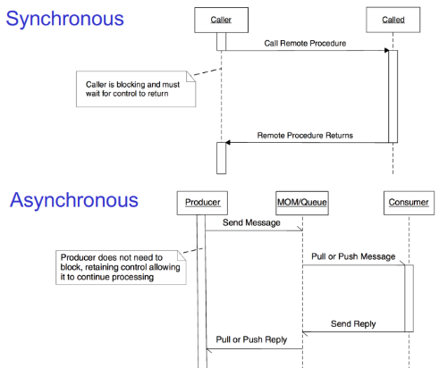

Due modi di descrivere un sistema distribuito:
- **Architettura Software** == descrive l'organizzazione logica dei componenti software e delle loro interazioni
- **Architettura di Sistema** == descrive come l'architettura software è concretamente realizzata, includendo il **deployment** (collocamento e avvio dei componenti sull'infrastruttura)

Prima di proseguire, ricordiamo che tradizionalmente un'applicazione 

# Architettura Software
Uno **stile architetturale** è l'insieme di scelte progettuali che definisce come organizzare le componenti software e le loro interazioni.

Distinguiamo tra **componente software** (unità modulare con un'interfaccia ben definita) e **connettore** (meccanismo di comunicazione tra componenti, es. HTTP, RPC, msg su coda...).  
Una componente può esser sostituita con un'altra implementazione se questa mantiene interfaccia e comportamento compatibili con ciò che le altre componenti si aspettano.

Tre famiglie di stili: **a livelli, orientato ai servizi e pub/sub style**.

## Stile a livelli (layered)
I componenti sono organizzati in livelli, ciascuno con responsabilità specifiche, e nel modello tradizionale **un livello superiore usa i servizi del livello inferiore** (la richiesta scende ai livelli inferiori e la risposta risale).

In particolare: sia $N$ il livello più alto che $1$ il livello più basso --> il componente nel lvl $i$ invoca un componente nel lvl $j$ se e solo se $j < i$.  
Esistono molte varianti, ad es. dove le chiamate possono essere fatte saltando alcuni livelli, oppure dove possono esserci chiamate senza risposta immediata (**one-way call**) e comunicazioni verso l'alto (**up-calls**).


Un'applicazione concreta dello stile a livelli nell'organizzazione del software di un'applicazione è l'**Application Layering**:


es. in un negozio online il presentation layer mostra il carrello, la logica applicativa nel business layer calcola il totale, mentre il persistence layer gestisce le operazioni di salvataggio e recupero dei dati dal database.

Attenzione al fatto che questi sono livello logici --> non devono necessariamente essere eseguiti su macchine diverse.

## Stile service-oriented
L'applicazione è vista come insieme di entità separate, ciascuna delle quali **incapsula un servizio**.  
Ogni entità realizza una funzione ed espone un'interfaccia attraverso cui gli altri componenti possono invocare il servizio, senza conoscere i dettagli di implementazione. 

### Object-based
Prima declinazione del service-oriented: ogni componente è un oggetto che contiene dati e offre metodi per operarvi.

Permette quindi di applicare i principi di **incapsulamento** (dati nascosti e accessibili solo via metodi pubblici), **information hiding**, **riuso** (gli oggetti sono riutilizzabili in contesti diversi).

La comunicazione tra oggetti diversi può avvenire tramite una **RPC Remote Procedure Call**, per cui una componente richiede l'esecuzione di una procedura su un altro processo, eventualmente su un'altra macchina.

### Stile a microservizi 
L'applicazione viene scomposta in servizi relativamente piccoli, autonomi e dedicati a responsabilità specifiche; che comunicano tramite API ben definite.

Con questo stile si vuole che questi servizi siano **loosely coupled** (quanto più indipendenti possibile) di modo da ottenere:
- *Modularità*: l'applicazione è così decomposta in servizi "indipendently deployable", che possono essere quindi istanziati e scalati rapidamente
- *Resilienza ai guasti*: i fallimenti si limitano ai singoli microservizi

### Stile RESTful
**REST (REpresentational State Transfer)** è uno stile architettrale per i sistemi distribuiti dove *i componenti possono operare attraverso un'interfaccia uniforme e stateless* (per gli esempi che vediamo, **HTTP**).

Una risorsa può essere un utente, una recensione, un documento o un oggetto conservato nel cloud.  
Le risorse sono identificate tramite **URI Uniform Resource Identifier**, mentre un **URL Uniform Resource Locator** è un URI che indica anche come localizzare ed accedere alla risorsa in questione.

Con **stateless** non si intende che il server non mantiene alcuna informazione sullo stato della risorsa, ma che *il server non mantiene alcuna informazione sullo stato della sessione del client*.

L'interfaccia uniforme permette di interagire con risorse diverse tramite convenzioni standardizzate, nel caso HTTP **GET**, **PUT** (per creare o sostituire lo stato della risorsa all'URI specificato), **POST** (crea una nuova risorsa o invia dati al server per elaborazione), **DELETE**.

Un esempio di questo stile lo troviamo in Amazon S3, che è un servizio di storage a oggetti, dove ogni oggetto è conservato in bucket e identificato da una chiave:  
```plaintext
https://example-bucket.s3.us-west-2.amazonaws.com/photos/puppy.jpg
```
qui il bucket è `example-bucket` nella regione `us-west-2`, la chiave è `photos/puppy.jpg`.  
Le operazioni sono eseguite tramite le richieste HTTP standard, ad es. GET sul bucket per elencarne gli oggetti, PUT per caricare un oggetto, GET per scaricarlo etc...

---

## Decoupling
Prima di parlare dello stile pub/sub, introduciamo il concetto di **decoupling**. 

Quando un componente chiama direttamente un altro, possono nascere delle *dipendenze* (es. conoscere la sua identità, richiedere che sia disponibile, restare bloccato in attesa della risposta...).  
Queste dipendenze costituiscono forme di **coupling** tra componenti.

Uno dei modi principali per ridurre il coupling è introdurre un **intermediario** tra i componenti, che si occupa di inoltrare le richieste e le risposte.

L'obiettivo tipicamente è ottenere il decoupling delle componenti secondo tre dimensioni:
- **Space Decoupling** se il componente non deve conoscere l'identità del componente chiamato (es. il suo endpoint) --> per ottenerlo *serve conoscere un punto di comunicazione comune*
- **Time Decoupling** se i componenti non devono essere attivi nello stesso momento in cui avviene la comunicazione --> *per ottenerlo l'intermediario deve poter memorizzare i messaggi*
- **Synchronization Decoupling** se i componenti non devono attendere la risposta della chiamata per proseguire l'esecuzione --> *per ottenerlo, chi avvia l'interazione può continuare l'esecuzione senza attendere immediatamente il completamento del lavoro dell'altro componente*

Attenzione al fatto che **queste tre proprietà sono distinte**: es. una chiamata asincrona può evitare il blocco del mittente, ma richiede che il destinatario sia disponibile comunque in quel momento e quindi manca il decoupling temporale..

Ripassando interazioni sincrone e asincrone:
- **Interazione Sincrona** == il chiamante invoca una procedura remota e resta bloccato fino alla risposta del chiamato --> il tempo di attesa comprende trasferimento richiesta, elaborazione e trasferimento risposta
- **Interazione Asincrona** == viene introdotto un'intermediario (una coda o un MOM Message Oriented Middleware) che si occupa di inoltrare la richiesta al chiamato mentre il chiamante prosegue il proprio lavoro.  
Un'eventuale risposta sarà poi comunicata al chiamante secondo due possibili modalità di consegna: **Pull** o **Push**.

**Vantaggi Decoupling**:
- **Spaziale** --> il vantaggio è che *un componente può esser sostituito, aggiornato, replicato o spostato senza che i mittenti debbano conoscerne la nuova collocazione*
- **Temporale** --> il mittente e il destinatario *possono essere disponibili in momenti diversi* --> utile per **componenti volatili** (entrano e escono dal sistema o non sono sempre attivi, come applicazioni serverless o dispositivi IoT)
- **di Sincronizzazione** --> un componente può proseguire senza aspettare il lavoro di un altro

Tuttavia tutta questa flessibilità del decoupling ha un **costo**: serve un intermediario e quindi un'infrastruttura che introduce **elaborazione, trasferimenti, memorizzazione e gestione aggiuntivi --> può aumentare latenza e costo complessivo**.  

Il compromesso sta quindi tra **benefici di disaccoppiamento** e **overhead di intermediazione**, vedremo con Kafka come mitigare quest'ultimo.

---

## Pub/Sub style

Parliamo quindi finalmente degli stili basati su comunicazione indiretta tipo pub/sub, tre declinazioni principali

### Stile Event-driven
I componenti comunicano tramite **eventi**, dove un evento rappresenta un cambiamento di stato significativo per l'applicazione (es. variazione di temperatura, nuovo ordine effettuato, ...).

Per questo stile le componenti comunicano tramite un **event bus**: alcune di esse **pubblicano gli eventi**, mentre altre **si sottoscrivono per ricevere quelle di interesse**.  
Il bus si occupa di inoltrare le notifiche.

es. ridimensionamento img: un componente pubblica l'evento "immagine disponibile" --> il componente che ridimensiona le img riceve l'evento, recupera l'immagine e la elabora (quindi l'evento può contenere il riferimento all'immagine, non per forza il file..)

La comunicazione è **multicast**: un evento può essere ricevuto da più destinatari!

Decoupling ottenuti:
- Poiché la comunicazione è del tutto anonima tra producer e consumers --> **decoupling spaziale**.  
- I componenti possono anche proseguire il lavoro mentre attendono notifiche --> **decoupling di sincronizzazione**

E il **decoupling temporale**? Questo dipende da come è implementato l'event bus: *se il bus può conservare gli eventi finché i destinatari non sono pronti a riceverli, allora c'è anche decoupling temporale*.

Dal momento che nel modello base ciò non è previsto, **Event-driven style non garantisce decoupling temporale**.

### Stile Data-Oriented
Qui i componenti comunicano tramite uno **spazio dati condiviso**. Un componente deposita un dato mentre un altro lo recupera.

Operazioni principali: `write`, `read` e `take` (che legge e rimuove il dato dallo spazio condiviso). Anche varianti come `readIfExists` e `takeIfExists` che non bloccano il chiamante se il dato non è presente.

Dato che `take` rimuove il dato --> se più componenti lo leggono, uno solo lo otterrà --> **è necessario gestire la concorrenza**.

Si distinguono inoltre due tipi di spazio dati: **Spazio Passivo** se risponde solo alle operazioni dei componenti, e **Spazio Attivo** se può inviare anche notifiche o effettuare push quando diventano disponibili dati di interesse.  
Con lo spazio passivo, un componente può dover attendere una lettura bloccante oppure **dover fare polling**...

Decoupling ottenuti:
- **Spaziale**: i componenti non si conoscono tra loro, ma solo lo spazio dati condiviso
- **Temporale**: lo spazio ovviamente conserva i dati --> i componenti non devono essere attivi contemporaneamente... l'unica attenzione qui è la gestione della concorrenza

Qui il **decoupling di sincronizzazione** dipende dalle API e dal meccanismo di notifica... uno spazio passivo senza possibilità di polling per il mittente può comportare che questo debba restare bloccato in attesa della risposta del destinatario.  
Al contrario uno spazio attivo con giusta implementazione delle notifiche può garantire anche questo coupling.

### Stile Publish/Subscribe
Nel modello **pub/sub** esistono due ruoli principali: il **publisher** che produce e pubblica eventi, e il **subscriber** che si sottoscrive per ricevere eventi di interesse.

Uno stesso componente può svolgere entrambi i ruoli. Un **middleware pub/sub** si occupa di inoltrare gli eventi dai publisher ai subscriber --> il publisher non si deve occupare dei destinatari: affida semplicemente l'evento al middleware di consegna.



Questo stile permette di ottenere tutti i **decoupling**: spaziale dato che pub e sub non si devono conoscere, temporale perché il middleware può **memorizzare** gli eventi finché i subscriber non sono pronti a riceverli, e di sincronizzazione perché il publisher può proseguire senza attendere la consegna dell'evento.

Perché diverso dal Data-Oriented con spazio attivo? Logicamente coincidono, la differenza sta nell'implementazione: nel data-oriented enfasi sul depositare, leggere e prelevare dati con relativa gestione della concorrenza, mentre nel pub/sub l'enfasi è sulla **pubblicazione e sottoscrizione di eventi** (ad es. in Kafka, che implementa pub/sub, i dati sono immutabili e non vengono mai rimossi, quindi non c'è concorrenza tra consumer).

#### Modelli di Sottoscrizione
Esistono due modelli principali per far sì che il middleware decida quali eventi consegnare a ciascun subscriber:
- **Modello Topic-based**: il publisher pubblica un evento su un topic, mentre il subscriber si sottoscrive a uno o più topic. Il middleware inoltra gli eventi ai subscriber iscritti al topic corrispondente.  
Questo modello è **semplice e veloce** perché è sufficiente confrontare il topic dell'evento con quelli a cui il subscriber è iscritto per capire se inoltrarglielo.  
Tuttavia offre anche una selezione **relativamente poco espressiva**: un subscriber riceve tutti gli eventi di un topic, anche quelli che non gli interessano...
- **Modello Content-Based**: il subscriber può specificare **filtri più complessi** basati sul contenuto dell'evento (es. `categoria = "elettronica" AND prezzo < 100`) --> il middleware deve verificare per ogni subscriber se l'evento soddisfa il relativo filtro prima di inoltrarlo, quindi **matching molto più costoso, che comporta problemi di scalabilità all'aumentare del numero di subscriber e della complessità dei filtri**.

In pratica quindi il Topic Based è il modello più diffuso in quanto più adatti ai sistemi orientati a throughput elevati, come Kafka --> **compromesso tra espressività e scalabilità**.

---

Inutile dire che *non esiste uno stile architetturale migliore per tutte le applicazioni*: la scelta, oltre a dipendere dai **requisiti specifici** dell'app dipende anche da **requisiti non funzionali** come costi, scalabilità ed elasticità, tolleranza ai guasti, usabilità...

Un sistema reale può anche **combinare più stili architetturali assegnandoli alle parti per le quali sono più adatti**.  

es. per la parte di API esposte al client uno stile possibile è REST, per le elaborazioni avviate periodicamente sulla base della disponibilità di nuovi dati degli stili possibili sono Event-Driven o Pub/Sub, per comunicazione interna si potrebbero vedere le componenti come microservizi e farle interagire tramite RPC, per l'analisi e raccolta log magari uno stile Data-Oriented con spazio dati attivo...

---

# Architettura di Sistema