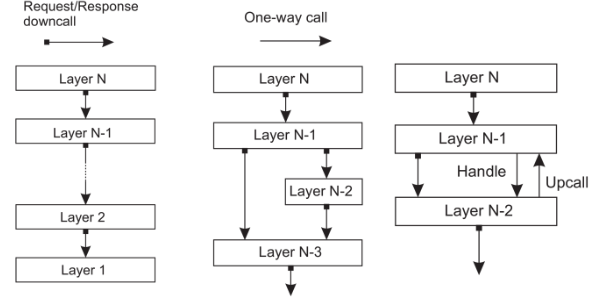
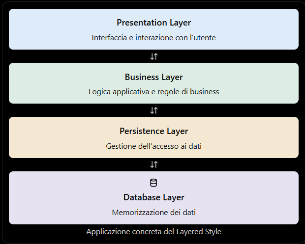
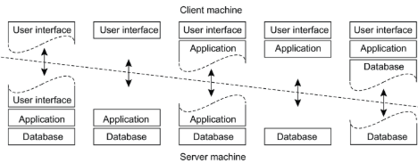
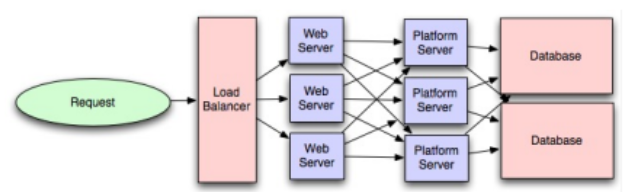
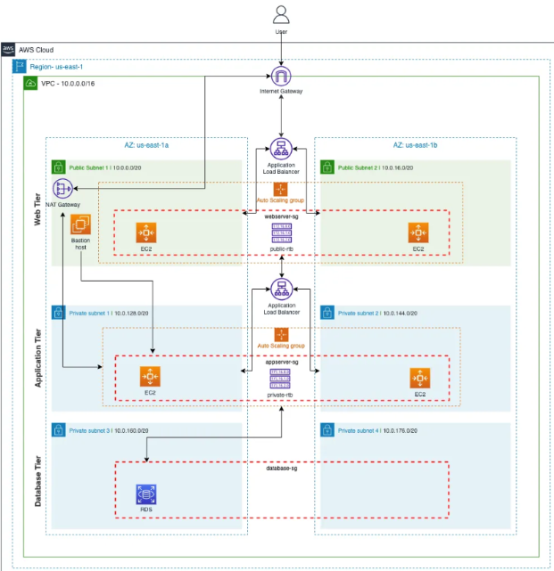
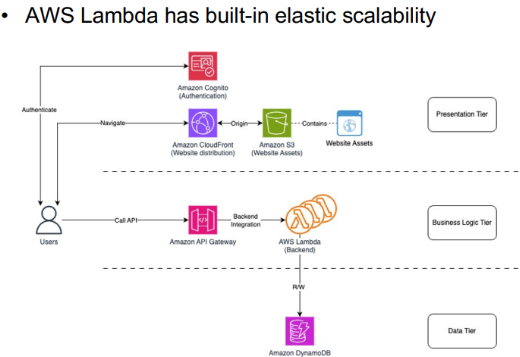
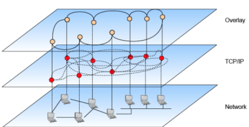
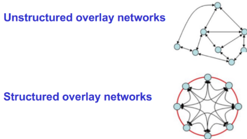

Due modi di descrivere un sistema distribuito:
- **Architettura Software** == descrive l'organizzazione logica dei componenti software e delle loro interazioni
- **Architettura di Sistema** == descrive come l'architettura software è concretamente realizzata, includendo il **deployment** (collocamento e avvio dei componenti sull'infrastruttura)

Prima di proseguire, ricordiamo che tradizionalmente un'applicazione 

# Architettura Software
Uno **stile architetturale** è l'insieme di scelte progettuali che definisce come organizzare le componenti software e le loro interazioni.

Distinguiamo tra **componente software** (unità modulare con un'interfaccia ben definita) e **connettore** (meccanismo di comunicazione tra componenti, es. HTTP, RPC, msg su coda...).  
Una componente può esser sostituita con un'altra implementazione se questa mantiene interfaccia e comportamento compatibili con ciò che le altre componenti si aspettano.

Tre famiglie di stili: **a livelli, orientato ai servizi e pub/sub style**.

## Stile a livelli (layered)
I componenti sono organizzati in livelli, ciascuno con responsabilità specifiche, e nel modello tradizionale **un livello superiore usa i servizi del livello inferiore** (la richiesta scende ai livelli inferiori e la risposta risale).

In particolare: sia $N$ il livello più alto che $1$ il livello più basso --> il componente nel lvl $i$ invoca un componente nel lvl $j$ se e solo se $j < i$.  
Esistono molte varianti, ad es. dove le chiamate possono essere fatte saltando alcuni livelli, oppure dove possono esserci chiamate senza risposta immediata (**one-way call**) e comunicazioni verso l'alto (**up-calls**).



Un'applicazione concreta dello stile a livelli nell'organizzazione del software di un'applicazione è l'**Application Layering**:



es. in un negozio online il presentation layer mostra il carrello, la logica applicativa nel business layer calcola il totale, mentre il persistence layer gestisce le operazioni di salvataggio e recupero dei dati dal database.

Attenzione al fatto che questi sono livello logici --> non devono necessariamente essere eseguiti su macchine diverse.

## Stile service-oriented
L'applicazione è vista come insieme di entità separate, ciascuna delle quali **incapsula un servizio**.  
Ogni entità realizza una funzione ed espone un'interfaccia attraverso cui gli altri componenti possono invocare il servizio, senza conoscere i dettagli di implementazione. 

### Object-based
Prima declinazione del service-oriented: ogni componente è un oggetto che contiene dati e offre metodi per operarvi.

Permette quindi di applicare i principi di **incapsulamento** (dati nascosti e accessibili solo via metodi pubblici), **information hiding**, **riuso** (gli oggetti sono riutilizzabili in contesti diversi).

La comunicazione tra oggetti diversi può avvenire tramite una **RPC Remote Procedure Call**, per cui una componente richiede l'esecuzione di una procedura su un altro processo, eventualmente su un'altra macchina.

### Stile a microservizi 
L'applicazione viene scomposta in servizi relativamente piccoli, autonomi e dedicati a responsabilità specifiche; che comunicano tramite API ben definite.

Con questo stile si vuole che questi servizi siano **loosely coupled** (quanto più indipendenti possibile) di modo da ottenere:
- *Modularità*: l'applicazione è così decomposta in servizi "indipendently deployable", che possono essere quindi istanziati e scalati rapidamente
- *Resilienza ai guasti*: i fallimenti si limitano ai singoli microservizi

### Stile RESTful
**REST (REpresentational State Transfer)** è uno stile architettrale per i sistemi distribuiti dove *i componenti possono operare attraverso un'interfaccia uniforme e stateless* (per gli esempi che vediamo, **HTTP**).

Una risorsa può essere un utente, una recensione, un documento o un oggetto conservato nel cloud.  
Le risorse sono identificate tramite **URI Uniform Resource Identifier**, mentre un **URL Uniform Resource Locator** è un URI che indica anche come localizzare ed accedere alla risorsa in questione.

Con **stateless** non si intende che il server non mantiene alcuna informazione sullo stato della risorsa, ma che *il server non mantiene alcuna informazione sullo stato della sessione del client*.

L'interfaccia uniforme permette di interagire con risorse diverse tramite convenzioni standardizzate, nel caso HTTP **GET**, **PUT** (per creare o sostituire lo stato della risorsa all'URI specificato), **POST** (crea una nuova risorsa o invia dati al server per elaborazione), **DELETE**.

Un esempio di questo stile lo troviamo in Amazon S3, che è un servizio di storage a oggetti, dove ogni oggetto è conservato in bucket e identificato da una chiave:  
```plaintext
https://example-bucket.s3.us-west-2.amazonaws.com/photos/puppy.jpg
```
qui il bucket è `example-bucket` nella regione `us-west-2`, la chiave è `photos/puppy.jpg`.  
Le operazioni sono eseguite tramite le richieste HTTP standard, ad es. GET sul bucket per elencarne gli oggetti, PUT per caricare un oggetto, GET per scaricarlo etc...

---

## Decoupling
Prima di parlare dello stile pub/sub, introduciamo il concetto di **decoupling**. 

Quando un componente chiama direttamente un altro, possono nascere delle *dipendenze* (es. conoscere la sua identità, richiedere che sia disponibile, restare bloccato in attesa della risposta...).  
Queste dipendenze costituiscono forme di **coupling** tra componenti.

Uno dei modi principali per ridurre il coupling è introdurre un **intermediario** tra i componenti, che si occupa di inoltrare le richieste e le risposte.

L'obiettivo tipicamente è ottenere il decoupling delle componenti secondo tre dimensioni:
- **Space Decoupling** se il componente non deve conoscere l'identità del componente chiamato (es. il suo endpoint) --> per ottenerlo *serve conoscere un punto di comunicazione comune*
- **Time Decoupling** se i componenti non devono essere attivi nello stesso momento in cui avviene la comunicazione --> *per ottenerlo l'intermediario deve poter memorizzare i messaggi*
- **Synchronization Decoupling** se i componenti non devono attendere la risposta della chiamata per proseguire l'esecuzione --> *per ottenerlo, chi avvia l'interazione può continuare l'esecuzione senza attendere immediatamente il completamento del lavoro dell'altro componente*

Attenzione al fatto che **queste tre proprietà sono distinte**: es. una chiamata asincrona può evitare il blocco del mittente, ma richiede che il destinatario sia disponibile comunque in quel momento e quindi manca il decoupling temporale..

Ripassando interazioni sincrone e asincrone:
- **Interazione Sincrona** == il chiamante invoca una procedura remota e resta bloccato fino alla risposta del chiamato --> il tempo di attesa comprende trasferimento richiesta, elaborazione e trasferimento risposta
- **Interazione Asincrona** == viene introdotto un'intermediario (una coda o un MOM Message Oriented Middleware) che si occupa di inoltrare la richiesta al chiamato mentre il chiamante prosegue il proprio lavoro.  
Un'eventuale risposta sarà poi comunicata al chiamante secondo due possibili modalità di consegna: **Pull** o **Push**.


**Vantaggi Decoupling**:
- **Spaziale** --> il vantaggio è che *un componente può esser sostituito, aggiornato, replicato o spostato senza che i mittenti debbano conoscerne la nuova collocazione*
- **Temporale** --> il mittente e il destinatario *possono essere disponibili in momenti diversi* --> utile per **componenti volatili** (entrano e escono dal sistema o non sono sempre attivi, come applicazioni serverless o dispositivi IoT)
- **di Sincronizzazione** --> un componente può proseguire senza aspettare il lavoro di un altro

Tuttavia tutta questa flessibilità del decoupling ha un **costo**: serve un intermediario e quindi un'infrastruttura che introduce **elaborazione, trasferimenti, memorizzazione e gestione aggiuntivi --> può aumentare latenza e costo complessivo**.  

Il compromesso sta quindi tra **benefici di disaccoppiamento** e **overhead di intermediazione**, vedremo con Kafka come mitigare quest'ultimo.

---

## Pub/Sub style

Parliamo quindi finalmente degli stili basati su comunicazione indiretta tipo pub/sub, tre declinazioni principali

### Stile Event-driven
I componenti comunicano tramite **eventi**, dove un evento rappresenta un cambiamento di stato significativo per l'applicazione (es. variazione di temperatura, nuovo ordine effettuato, ...).

Per questo stile le componenti comunicano tramite un **event bus**: alcune di esse **pubblicano gli eventi**, mentre altre **si sottoscrivono per ricevere quelle di interesse**.  
Il bus si occupa di inoltrare le notifiche.

es. ridimensionamento img: un componente pubblica l'evento "immagine disponibile" --> il componente che ridimensiona le img riceve l'evento, recupera l'immagine e la elabora (quindi l'evento può contenere il riferimento all'immagine, non per forza il file..)

La comunicazione è **multicast**: un evento può essere ricevuto da più destinatari!

Decoupling ottenuti:
- Poiché la comunicazione è del tutto anonima tra producer e consumers --> **decoupling spaziale**.  
- I componenti possono anche proseguire il lavoro mentre attendono notifiche --> **decoupling di sincronizzazione**

E il **decoupling temporale**? Questo dipende da come è implementato l'event bus: *se il bus può conservare gli eventi finché i destinatari non sono pronti a riceverli, allora c'è anche decoupling temporale*.

Dal momento che nel modello base ciò non è previsto, **Event-driven style non garantisce decoupling temporale**.

### Stile Data-Oriented
Qui i componenti comunicano tramite uno **spazio dati condiviso**. Un componente deposita un dato mentre un altro lo recupera.

Operazioni principali: `write`, `read` e `take` (che legge e rimuove il dato dallo spazio condiviso). Anche varianti come `readIfExists` e `takeIfExists` che non bloccano il chiamante se il dato non è presente.

Dato che `take` rimuove il dato --> se più componenti lo leggono, uno solo lo otterrà --> **è necessario gestire la concorrenza**.

Si distinguono inoltre due tipi di spazio dati: **Spazio Passivo** se risponde solo alle operazioni dei componenti, e **Spazio Attivo** se può inviare anche notifiche o effettuare push quando diventano disponibili dati di interesse.  
Con lo spazio passivo, un componente può dover attendere una lettura bloccante oppure **dover fare polling**...

Decoupling ottenuti:
- **Spaziale**: i componenti non si conoscono tra loro, ma solo lo spazio dati condiviso
- **Temporale**: lo spazio ovviamente conserva i dati --> i componenti non devono essere attivi contemporaneamente... l'unica attenzione qui è la gestione della concorrenza

Qui il **decoupling di sincronizzazione** dipende dalle API e dal meccanismo di notifica... uno spazio passivo senza possibilità di polling per il mittente può comportare che questo debba restare bloccato in attesa della risposta del destinatario.  
Al contrario uno spazio attivo con giusta implementazione delle notifiche può garantire anche questo coupling.

### Stile Publish/Subscribe
Nel modello **pub/sub** esistono due ruoli principali: il **publisher** che produce e pubblica eventi, e il **subscriber** che si sottoscrive per ricevere eventi di interesse.

Uno stesso componente può svolgere entrambi i ruoli. Un **middleware pub/sub** si occupa di inoltrare gli eventi dai publisher ai subscriber --> il publisher non si deve occupare dei destinatari: affida semplicemente l'evento al middleware di consegna.


Questo stile permette di ottenere tutti i **decoupling**: spaziale dato che pub e sub non si devono conoscere, temporale perché il middleware può **memorizzare** gli eventi finché i subscriber non sono pronti a riceverli, e di sincronizzazione perché il publisher può proseguire senza attendere la consegna dell'evento.

Perché diverso dal Data-Oriented con spazio attivo? Logicamente coincidono, la differenza sta nell'implementazione: nel data-oriented enfasi sul depositare, leggere e prelevare dati con relativa gestione della concorrenza, mentre nel pub/sub l'enfasi è sulla **pubblicazione e sottoscrizione di eventi** (ad es. in Kafka, che implementa pub/sub, i dati sono immutabili e non vengono mai rimossi, quindi non c'è concorrenza tra consumer).

#### Modelli di Sottoscrizione
Esistono due modelli principali per far sì che il middleware decida quali eventi consegnare a ciascun subscriber:
- **Modello Topic-based**: il publisher pubblica un evento su un topic, mentre il subscriber si sottoscrive a uno o più topic. Il middleware inoltra gli eventi ai subscriber iscritti al topic corrispondente.  
Questo modello è **semplice e veloce** perché è sufficiente confrontare il topic dell'evento con quelli a cui il subscriber è iscritto per capire se inoltrarglielo.  
Tuttavia offre anche una selezione **relativamente poco espressiva**: un subscriber riceve tutti gli eventi di un topic, anche quelli che non gli interessano...
- **Modello Content-Based**: il subscriber può specificare **filtri più complessi** basati sul contenuto dell'evento (es. `categoria = "elettronica" AND prezzo < 100`) --> il middleware deve verificare per ogni subscriber se l'evento soddisfa il relativo filtro prima di inoltrarlo, quindi **matching molto più costoso, che comporta problemi di scalabilità all'aumentare del numero di subscriber e della complessità dei filtri**.

In pratica quindi il Topic Based è il modello più diffuso in quanto più adatti ai sistemi orientati a throughput elevati, come Kafka --> **compromesso tra espressività e scalabilità**.

---

Inutile dire che *non esiste uno stile architetturale migliore per tutte le applicazioni*: la scelta, oltre a dipendere dai **requisiti specifici** dell'app dipende anche da **requisiti non funzionali** come costi, scalabilità ed elasticità, tolleranza ai guasti, usabilità...

Un sistema reale può anche **combinare più stili architetturali assegnandoli alle parti per le quali sono più adatti**.  

es. per la parte di API esposte al client uno stile possibile è REST, per le elaborazioni avviate periodicamente sulla base della disponibilità di nuovi dati degli stili possibili sono Event-Driven o Pub/Sub, per comunicazione interna si potrebbero vedere le componenti come microservizi e farle interagire tramite RPC, per l'analisi e raccolta log magari uno stile Data-Oriented con spazio dati attivo...

---

# Architettura di Sistema
Finora abbiamo descritto l'organizzazione logica dei componenti software e delle loro interazioni. Ora consideriamo invece **la loro istanziazione a runtime sull'infrastruttura fisica** (**deployment**).

Le famiglie che introduciamo sono **centralizzate, decentralizzate** o **ibride**.

## Architettura Centralizzata, modello Client-Server
In questo modello i server offrono servizi, mentre i client ne richiedono l'utilizzo.  
L'approccio tipico è **request-reply**: il client invia una richiesta al server e resta bloccato in attesa della risposta --> comunicazione sincrona e bloccante, con client dipendente dal server.

Centralizzato ovviamente non significa necessariamente "eseguito su una sola macchina": il servizio può essere istanziato su più server ma restare logicamente centralizzato.

Distinguiamo in questo senso:
- **Layer** == **livello logico** (quindi separazione in layer == separazione logica delle responsabilità)
- **Tier** == **livello fisico** (quindi separazione in tier == suddivisione dell'applicazione in base a dove vengono effettivamente eseguiti i componenti software)

I layer sono gli stessi visti parlando degli strati applicativi: **Presentation Layer**, **Business Layer**, **Persistence Layer** e **Database Layer**. Ognuno di essi può essere distribuito su più **tier**.  
In figura vediamo tutte configurazioni *two-tier*: da un lato il client e dall'altro il server, e cambia la ripartizione dei layer e quindi la responsabilità che si affida al client e quella che si affida al server.



Nella configurazione *three-tier* tradizionale; presentazione, logica e dati sono separati da tre tier distinti. All'architettura si possono aggiungere altri componenti come cache, load balancer, servizi intermedi di sicurezza (Es. WAF Web Application Firewall) etc.. per cui il numero di tier può crescere a $N$ 

Avere più tier permette di **scalare in modo indipendente per ciascuno di essi**, ma comporta anche *più collegamenti di rete*, *più componenti da gestire* e in generale quindi **maggiore complessità**.

Si distinguono due modi di distribuire i layer sui tier:
- **Distribuzione verticale** se layer diversi sono collocati su tier diversi (es. presentation su client, business e persistence su server, dati su database server..)
- **Distribuzione orizzontale** se uno stesso layer è distribuito su più nodi (es. più server che eseguono lo stesso business layer, con le richieste che gli arrivano tramite un load balancer) (NB è sempre e comunque lo stesso tier! Quindi un tier non è necessariamente un singolo nodo).

Le due forme nelle applicazioni reali spesso si combinano, separando layer diversi su tier diversi e replicando layer uguali su più nodi.



---

**Esempio 1: Web Application in AWS**



La figura realizza un'architettura web a *tre tier*, con *distribuzione orizzontale*, *isolamento di rete* e componenti in *due Availability Zone AZ*.

La separazione prevede:
- Web Tier, che gestisce le richieste del client e l'inoltro delle richieste applicative. Le istanze mostrate sono EC2, quindi un servizio IaaS per cui l'utente ha a disposizione intere VM su cui installare il software che vuole.
- App Tier, esegue la logica applicativa. Anche qui le istanze sono EC2.
- Database Tier, che conserva e interroga i dati persistenti, qui si usa un DB Amazon RDS

Il percorso è il seguente: la richiesta del client raggiunge il load balancer pubblico che sceglie un'istanza del web tier. Raggiunta l'istanza, questa a sua volta comunica con un altro load balancer stavolta *interno all'application tier*, che sceglie un'istanza applicativa. L'istanza allora esegue la logica e accede a RDS se le serve leggere o scrivere dati persistenti. I risultati tornano infine al client.

Le tre proprietà fondamentali che vengono realizzate in questa figura:
- **Elasticità** tramite **autoscaling**: il web tier e l'app tier ne hanno due gruppi distinti --> il numero rispettivo di istanze può aumentare/diminuire in base al carico
- **Disponibilità** tramite **replica in più AZ**: se un'intera AZ diventa indisponibile, il traffico viene reindirizzato alle istanze dell'altra AZ
- **Sicurezza** tramite **isolamento di rete**: nell'architettura mostrata troviamo una **VPC** (*Virtual Private Cloud*) per cui, mentre il tier web è ancora accessibile da internet (Internet Gateway), i livelli applicativi e il database sono in subnet private.

---

**Esempio 2: 3-tier serverless architecture**



Anche qui three-tier, per cui si separano presentazione, logica e dati in tier diversi, ma qui i componenti sono serverless.  
Con **serverless** si intende che non solo il client non deve predisporre e amministrare i server fisici che eseguono il codice, ma **neanche gli ambienti di esecuzione!** Se ne occupa del tutto il provider cloud.

Quindi il modello serverless si avvicina a un modello **PaaS Platform as a Service**, nel caso specifico di Lambda si parla di modello **FaaS Function as a Service**: l'utente fornisce solo il codice della funzione, l'astrazione è quindi portata alla singola funzione invocata!

In questa architettura, come nel primo esempio, coesistono sia distribuzione orizzontale che verticale.  
Il presentation layer è realizzato con i servizi S3 (per lo storage degli asset su disco), CloudFront (per la distribuzione del contenuto geograficamente per ridurre latenza, è una CDN) e Cognito (per l'autenticazione degli utenti).  
Per la logica applicativa il frontend del client chiama anzitutto l'API Gateway, che inoltra quindi la richiesta alla funzione Lambda corrispondente.  
La funzione esegue quindi il codice backend, e può scrivere/leggere dati su DynamoDB (database NoSQL).

**Perché non compaiono i gruppi di autoscaling?** Non è che non esistono, ma *non sono espliciti in quanto* **gestiti direttamente da Lambda**, che si occupa da sola quindi di gestire l'allocazione degli ambienti di esecuzione in risposta alle invocazioni.  
In questo senso importante il concetto di **cold start**: se una funzione non è stata invocata per un po', l'ambiente di esecuzione viene rimosso. Alla successiva invocazione il servizio deve allocare un nuovo ambiente e caricare il codice della funzione --> la prima invocazione può richiedere più tempo...

---

## Architetture Decentralizzate
Nei sistemi P2P le funzionalità del sistema vengono realizzate usando **risorse distribuite e condivise tra i nodi partecipanti** (**peer**).  
Le risorse in questione possono essere di vario tipo: capacità di calcolo, memoria, banda di rete, file... il punto è che un peer può usare risorse degli altri e anche metterne a disposizione.

Tra le caratteristiche fondamentali dei sistemi P2P: **simmetria dei ruoli** (ogni peer può agire sia come client che come server), **decentralizzazione del controllo** (non c'è più un solo nodo che governa le operazioni, in P2P il controllo si realizza tramite collaborazione tra peer), **ampia distribuzione geografica** (tipicamente ai margini della rete poiché sulle macchine dei partecipanti), **dinamismo** (i peer possono entrare e uscire dal sistema in qualsiasi momento) **ridondanza delle informazioni**.

Si introducono i termini:
- **Membership** == insieme dei nodi che fanno parte del sistema in un certo momento
- **Churn** == continuo ingresso e uscita dei nodi, che modifica la membership.

Architetture P2P in moltissimi ambiti in base alla risorsa condivisa: file e video (BitTorrent, WebTorrent), dati e spazio di storage (IPFS, Freenet), capacità di elaborazione (BOINC, Folding@Home), scambio di messaggi (Jami..), transazioni finanziarie (Bitcoin, Ethereum..), training o inferenza (Exo, Bittensor..).

Moltissime sfide per i sistemi P2P:
- **Eterogeneità delle risorse**: il sistema non può fare assunzioni sulle capacità dei peer, deve adattarsi a ciò che offre ciascuno..
- **Scalabilità**: le operazioni devono restare efficienti anche quando aumentano i peer, in questo senso ci concentreremo sul **resource lookup** (come localizzare una risorsa senza interrogare tutti i nodi)
- **Località**: due nodi possono essere vicini nella overlay network ma lontani in quella fisica
- **Tolleranza ai guasti e churn**: i peer possono entrare o uscire di continuo. Se un peer che ospita una risorsa crasha --> sta al sistema garantire che la risorsa sia comunque disponibile
- **Auto-organizzazione**: in assenza di controllore centrale i peer devono organizzarsi da soli per garantire il funzionamento del sistema (gestire connessioni, distribuire il carico, instradare richieste..)
- **Free-riding**: un free-rider è un peer che usa risorse senza contribuire in misura adeguata --> occorrono meccanismi di incentivo e fairness
- **Anonimato**: la decentralizzazione non produce automaticamente anonimato, servono meccanismi specifici tipo Tor con *onion routing* (il msg è protetto da più strati di cifratura, e ogni intermediario rimuove il proprio strato ottenendo solo le info necessarie per inoltrare il msg al prossimo nodo, senza conoscere né mittente né destinatario finale).
- **Fiducia e Reputazione**: i nodi non sempre si conoscono --> un nodo potrebbe fornire info false o risultati errati --> servono meccanismi per valutare l'affidabilità dei peer a seconda dell'applicazione (es. Bitcoin POW)
- **Sybil Attacks**: nel mondo P2P un nodo può creare più identità false (es. esegue tante VM sulla stessa macchina) e ciò potrebbe permettegli di avere influenza sproporzionata sul sistema

Considereremo come caso di studio un sistema P2P per la condivisione file. Molti dei meccanismi ideati per risolvere le sfide di questo tipo di sistema sono stati poi riutilizzati in altri contesti P2P.

Tre operazioni fondamentali:
1. **Bootstrapping**: un nuovo nodo deve scoprire almeno un sottinsieme di peer già attivi per iniziare a partecipare.  
Diverse possibilità: ad es. indirizzi conosciuti a priori, lista di peer conservata in sessioni precedenti etc..
2. **Resource Lookup**: un nodo deve poter localizzare il file desiderato in modo efficiente
3. **Resource Retrieval**: una volta localizzato il file, il peer deve essere in grado di recuperarlo (il trasferimento può avvenire direttamente tra due peer, oppure tramite più peer intermediari che cooperano per trasferire il file a pezzi).

### Le reti P2P come Overlay Network
Con **overlay network** si intende la **rete logica costruita sopra una rete sottostante**.



I collegamenti nell'overlay indicano quali peer comunicano direttamente secondo l'organizzazione del sistema P2P. **Un collegamento logico non equivale necessariamente quindi a un collegamento diretto tra le due macchine**: un msg può dover attraversare più router e collegamenti fisici nella rete sottostante... per questo due peer adiacenti nell'overlay possono potenzialmente trovarsi anche in continenti diversi!

L'**overlay routing** serve a trovare un percorso che consenta di *localizzare la risorsa desiderata* --> diverso dal routing IP: il primo instrada i pacchetti verso l'indirizzo di destinazione, il secondo *parte dalla risorsa desiderata e cerca il peer che può fornirla*.  
**L'overlay network deve supportare il dinamismo insito nei sistemi P2P sia dei peer che delle risorse in essi contenute, nonché poter identificare entrambi.**

Per l'identificazione si ricorre a degli identificatori univoci a livello globale per tutto il sistema, dei **GUID (Globally Unique IDentifier)**.  
La tecnica principale adottata in questo senso è applicare una **funzione hash crittografica** a informazioni associate all'elemento (es. per la risorsa il contenuto, nome o altri metadati; per il peer informazioni identificative come IP e porta). Sappiamo bene infatti che il risultato dell'hash è un **identificatore di lunghezza fissa** che sarà univoco w.h.p.

Per capire poi come organizzare nodi e risorse e instradare le richieste per una risorsa specifica, si distinguono due tipi di overlay network:
- **Overlay non strutturato**: non impone alcuna topologia globale prestabilita: i collegamenti derivano da decisioni locali e dal comportamento dei peer, la ricerca deve adattarsi quindi a questa topologia dinamica e imprevedibile.
- **Overlay strutturato**: impone regole precise per organizzare nodi e risorse: i collegamenti seguono la struttura scelta e la ricerca può quindi sfruttare la topologia per essere più efficiente.



#### Unstructured Overlay Networks
La rete si forma attraverso le decisioni locali dei peer: quando un nuovo nodo entra, scopre alcuni peer già presenti e stabilisce il collegamento con un sottinsieme di essi, diventando vicini nell'overlay. Si parla di **comportamento emergente**: la topologia globale della rete emerge dalle singole decisioni dei nodi.

*Le risorse non vengono assegnate ai nodi secondo una regola globale di collocazione: semplicemente ciascun peer mette a disposizione le risorse che possiede.*  

I vantaggi in questo tipo di rete sono che **è relativamente semplice aggiungere/rimuovere peer e risorse** e quindi **adattarsi al churn**.  
Inoltre la **manutenzione è contenuta**: non bisogna continuamente ricostruire una topologia rigida.

Lo svantaggio è chiaramente il **lookup delle risorse**: senza regole globali il peer che cerca una risorsa non sa a priori chi può averla --> msg complexity potenzialmente elevata.

Per l'organizzazione del routing esistono tre alternative principali.  
Per capire si vuole rispondere alla domanda: **chi conserva l'informazione che associa le risorse ai peer che le possiedono?** Questa informazione costituisce un **indice** (o *directory*):
1. **Overlay non strutturato centralizzato**: qui **l'indice si trova in uno o pochi directory server**.  
In questo caso il funzionamento è il seguente: ogni peer comunica al directory le risorse che mette a disposizione, e quando un peer cerca una risorsa invia al richiesta allo stesso directory server che risponde con l'elenco dei peer che la possiedono --> il peer ne sceglie uno e recupera direttamente il file.  
Si sfrutta cioè un **lookup centralizzato** per trasferire dati tra peer.  
Un esempio di questo approccio era Napster, per la consivisione pirata di musica --> la centralizzazione del server directory fu la sua condanna, in quanto quando furono chiusi l'intero sistema smise di funzionare.  
Da qui gli **svantaggi**:
    - SPOF
    - Limiti di scalabilità, dato che il server può diventare un collo di bottiglia
    - Costo di gestione: qualcuno dovrà pagare ed amministrare il server 

    Il **vantaggio** è invece ovviamente la semplicità: ogni peer sa a chi chiedere --> lookup veloce se il server è libero.
2. **Overlay non strutturato ibrido con super-peer**: in questa soluzione intermedia i compiti aggiuntivi sono affidati ad un insieme di più super peer, che nel caso del lookup si occupano di localizzare le risorse per conto dei peer richiedenti
3. **Overlay non strutturato decentralizzato**: *non esiste alcun directory server / nodo globale a cui rivolgersi*.  
In questo caso ogni nodo può mantenere una copia parziale dell'indice, quindi il lookup deve basarsi su interrogazioni progressive tra peer.

##### Routing in unstructured overlay networks decentralizzato
Esistono tre principali meccanismi di overlay routing per questo tipo di rete: **query flooding**, **random walk** e **gossiping**.  
Ci focalizziamo ora sui primi due, il terzo è argomento di una lezione successiva.

---

Nel **query flooding** la query viene diffusa nellarete in broadcast: ogni peer che la riceve verifica se possiede la risorsa, se True risponde al richiedente (due possibilità in questo caso, come vedremo..) altrimenti inoltra la query a tutti i peer vicini nell'overlay (eccetto il sender).

Chiaramente è necessario limitare la diffusione del msg di query per evitare che questo si propaghi anche quando la risorsa non esiste / è già stata trovata --> si utilizza un **TTL Time To Live** (contatore decrementato ad ogni hop, quando arriva a 0 il msg non viene più inoltrato).

Riguardo il TTL bisogna chiaramente bilanciarlo: se troppo basso la query non raggiunge abbastanza peer, se troppo alto si propagano troppi messaggi.  
In generale la soluzione pratica è scegliere un valore fisso per tutti i peer, ma esistono anche soluzioni adattive che però sono anche più complesse da implementare.

Per evitare cicli, la query contiene un identificativo univoco e ogni peer mantiene una **cache delle query già ricevute**.

Il costo di lookup di questa strategia è $O(N)$, dove $N$ è il numero di peer dell'overlay.

**Come torna la risposta al richiedente?** Due possibilità:
1. **Direct Routing**: il peer che possiede la risorsa la manda direttamente al nodo che ha originato la query --> è necessario che abbia le info necessarie per raggiungerlo (es. il suo endpoint)
2. **Backward Routing**: il peer che possiede la risorsa la invia al peer da cui ha ricevuto la query, che a sua volta la inoltra al peer da cui l'ha ricevuta etc.. fino a tornare al richiedente --> ogni nodo deve ricordare almeno ID della query e vicino da cui l'ha ricevuta.  
Qui i vantaggi sono:
    - Privacy: i peer intermediari non conoscono l'identità del richiedente originario
    - **caching delle risposte**: ogni nodo attraversato può memorizzare l'informazione per cui "il nodo $  $ possiede la risorsa Y" ed usarla in futuro per ridurre eventualmente il lavoro necessario.  
    Questa cache è però **non autoritativa** in quanto non fonte di verità assoluta, potrebbe essere che nel frattempo $X$ si è disconnesso o ha rimosso la risorsa $Y$.

    Se un nodo del percorso esce, è necessario che il protocollo preveda alternative su come scegliere un altro percorso disponibile.

Limiti del flooding:
- **Overhead di comunicazione**: molti msg raggiungono nodi che non possiedono la risorsa
- **Scelta del TTL**
- **Rischi di sicurezza e congestione**: una singola richiesta viene amplificata dall'algoritmo --> query malevole possono sovraccaricare la rete
- **Nodi black hole**: nodi che ricevono messaggi ma non li inoltrano (perché malfunzionanti o malevoli) possono interrompere alcuni rami di ricerca
- **Topology mismatch**: un singolo hop nell'overlay può nella realtà corrispondere a un trasferimento fisico lungo e costoso...