Due modi di descrivere un sistema distribuito:
- **Architettura Software** == descrive l'organizzazione logica dei componenti software e delle loro interazioni
- **Architettura di Sistema** == descrive come l'architettura software è concretamente realizzata, includendo il **deployment** (collocamento e avvio dei componenti sull'infrastruttura)

# Architettura Software
Uno **stile architetturale** è l'insieme di scelte progettuali che definisce come organizzare le componenti software e le loro interazioni.

Distinguiamo tra **componente software** (unità modulare con un'interfaccia ben definita) e **connettore** (meccanismo di comunicazione tra componenti, es. HTTP, RPC, msg su coda...).  
Una componente può esser sostituita con un'altra implementazione se questa mantiene interfaccia e comportamento compatibili con ciò che le altre componenti si aspettano.

Tre famiglie di stili: **a livelli, orientato ai servizi e pub/sub style**.

## Stile a livelli (layered)
I componenti sono organizzati in livelli, ciascuno con responsabilità specifiche, e nel modello tradizionale **un livello superiore usa i servizi del livello inferiore** (la richiesta scende ai livelli inferiori e la risposta risale).

In particolare: sia $N$ il livello più alto che $1$ il livello più basso --> il componente nel lvl $i$ invoca un componente nel lvl $j$ se e solo se $j < i$.  
Esistono molte varianti, ad es. dove le chiamate possono essere fatte saltando alcuni livelli, oppure dove possono esserci chiamate senza risposta immediata (**one-way call**) e comunicazioni verso l'alto (**up-calls**).

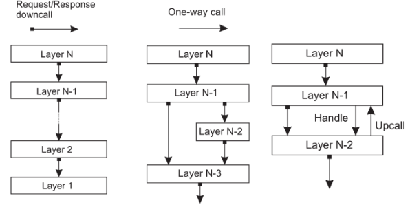

Un'applicazione concreta dello stile a livelli nell'organizzazione del software di un'applicazione è l'**Application Layering**:

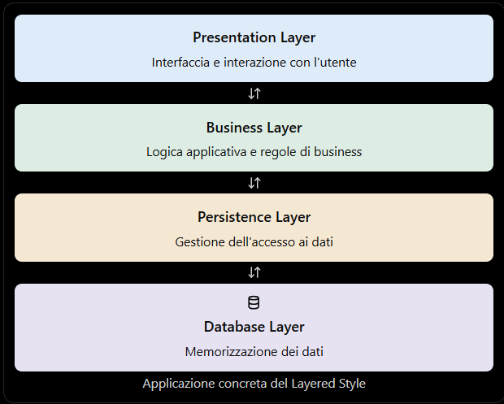

es. in un negozio online il presentation layer mostra il carrello, la logica applicativa nel business layer calcola il totale, mentre il persistence layer gestisce le operazioni di salvataggio e recupero dei dati dal database.

Attenzione al fatto che questi sono livello logici --> non devono necessariamente essere eseguiti su macchine diverse.

## Stile service-oriented
L'applicazione è vista come insieme di entità separate, ciascuna delle quali **incapsula un servizio**.  
Ogni entità realizza una funzione ed espone un'interfaccia attraverso cui gli altri componenti possono invocare il servizio, senza conoscere i dettagli di implementazione. 

### Object-based
Prima declinazione del service-oriented: ogni componente è un oggetto che contiene dati e offre metodi per operarvi.

Permette quindi di applicare i principi di **incapsulamento** (dati nascosti e accessibili solo via metodi pubblici), **information hiding**, **riuso** (gli oggetti sono riutilizzabili in contesti diversi).

La comunicazione tra oggetti diversi può avvenire tramite una **RPC Remote Procedure Call**, per cui una componente richiede l'esecuzione di una procedura su un altro processo, eventualmente su un'altra macchina.

### Stile a microservizi 
L'applicazione viene scomposta in servizi relativamente piccoli, autonomi e dedicati a responsabilità specifiche; che comunicano tramite API ben definite.

Con questo stile si vuole che questi servizi siano **loosely coupled** (quanto più indipendenti possibile) di modo da ottenere:
- *Modularità*: l'applicazione è così decomposta in servizi "indipendently deployable", che possono essere quindi istanziati e scalati rapidamente
- *Resilienza ai guasti*: i fallimenti si limitano ai singoli microservizi

### Stile RESTful
**REST (REpresentational State Transfer)** è uno stile architettrale per i sistemi distribuiti dove *i componenti possono operare attraverso un'interfaccia uniforme e stateless* (per gli esempi che vediamo, **HTTP**).

Una risorsa può essere un utente, una recensione, un documento o un oggetto conservato nel cloud.  
Le risorse sono identificate tramite **URI Uniform Resource Identifier**, mentre un **URL Uniform Resource Locator** è un URI che indica anche come localizzare ed accedere alla risorsa in questione.

Con **stateless** non si intende che il server non mantiene alcuna informazione sullo stato della risorsa, ma che *il server non mantiene alcuna informazione sullo stato della sessione del client*.

L'interfaccia uniforme permette di interagire con risorse diverse tramite convenzioni standardizzate, nel caso HTTP **GET**, **PUT** (per creare o sostituire lo stato della risorsa all'URI specificato), **POST** (crea una nuova risorsa o invia dati al server per elaborazione), **DELETE**.

Un esempio di questo stile lo troviamo in Amazon S3, che è un servizio di storage a oggetti, dove ogni oggetto è conservato in bucket e identificato da una chiave:  
```plaintext
https://example-bucket.s3.us-west-2.amazonaws.com/photos/puppy.jpg
```
qui il bucket è `example-bucket` nella regione `us-west-2`, la chiave è `photos/puppy.jpg`.  
Le operazioni sono eseguite tramite le richieste HTTP standard, ad es. GET sul bucket per elencarne gli oggetti, PUT per caricare un oggetto, GET per scaricarlo etc...

---

## Decoupling
Prima di parlare dello stile pub/sub, introduciamo il concetto di **decoupling**. 

Quando un componente chiama direttamente un altro, possono nascere delle *dipendenze* (es. conoscere la sua identità, richiedere che sia disponibile, restare bloccato in attesa della risposta...).  
Queste dipendenze costituiscono forme di **coupling** tra componenti.

Uno dei modi principali per ridurre il coupling è introdurre un **intermediario** tra i componenti, che si occupa di inoltrare le richieste e le risposte.

L'obiettivo tipicamente è ottenere il decoupling delle componenti secondo tre dimensioni:
- **Space Decoupling** se il componente non deve conoscere l'identità del componente chiamato (es. il suo endpoint) --> per ottenerlo *serve conoscere un punto di comunicazione comune*
- **Time Decoupling** se i componenti non devono essere attivi nello stesso momento in cui avviene la comunicazione --> *per ottenerlo l'intermediario deve poter memorizzare i messaggi*
- **Synchronization Decoupling** se i componenti non devono attendere la risposta della chiamata per proseguire l'esecuzione --> *per ottenerlo, chi avvia l'interazione può continuare l'esecuzione senza attendere immediatamente il completamento del lavoro dell'altro componente*

Attenzione al fatto che **queste tre proprietà sono distinte**: es. una chiamata asincrona può evitare il blocco del mittente, ma richiede che il destinatario sia disponibile comunque in quel momento e quindi manca il decoupling temporale..

Ripassando interazioni sincrone e asincrone:
- **Interazione Sincrona** == il chiamante invoca una procedura remota e resta bloccato fino alla risposta del chiamato --> il tempo di attesa comprende trasferimento richiesta, elaborazione e trasferimento risposta
- **Interazione Asincrona** == viene introdotto un'intermediario (una coda o un MOM Message Oriented Middleware) che si occupa di inoltrare la richiesta al chiamato mentre il chiamante prosegue il proprio lavoro.  
Un'eventuale risposta sarà poi comunicata al chiamante secondo due possibili modalità di consegna: **Pull** o **Push**.

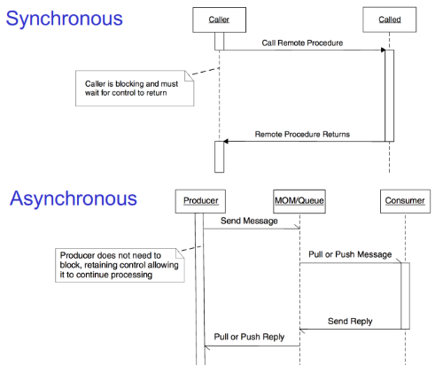

**Vantaggi Decoupling**:
- **Spaziale** --> il vantaggio è che *un componente può esser sostituito, aggiornato, replicato o spostato senza che i mittenti debbano conoscerne la nuova collocazione*
- **Temporale** --> il mittente e il destinatario *possono essere disponibili in momenti diversi* --> utile per **componenti volatili** (entrano e escono dal sistema o non sono sempre attivi, come applicazioni serverless o dispositivi IoT)
- **di Sincronizzazione** --> un componente può proseguire senza aspettare il lavoro di un altro

Tuttavia tutta questa flessibilità del decoupling ha un **costo**: serve un intermediario e quindi un'infrastruttura che introduce **elaborazione, trasferimenti, memorizzazione e gestione aggiuntivi --> può aumentare latenza e costo complessivo**.  

Il compromesso sta quindi tra **benefici di disaccoppiamento** e **overhead di intermediazione**, vedremo con Kafka come mitigare quest'ultimo.

---

## Pub/Sub style

Parliamo quindi finalmente degli stili basati su comunicazione indiretta tipo pub/sub, tre declinazioni principali

### Stile Event-driven
I componenti comunicano tramite **eventi**, dove un evento rappresenta un cambiamento di stato significativo per l'applicazione (es. variazione di temperatura, nuovo ordine effettuato, ...).

Per questo stile le componenti comunicano tramite un **event bus**: alcune di esse **pubblicano gli eventi**, mentre altre **si sottoscrivono per ricevere quelle di interesse**.  
Il bus si occupa di inoltrare le notifiche.

es. ridimensionamento img: un componente pubblica l'evento "immagine disponibile" --> il componente che ridimensiona le img riceve l'evento, recupera l'immagine e la elabora (quindi l'evento può contenere il riferimento all'immagine, non per forza il file..)

La comunicazione è **multicast**: un evento può essere ricevuto da più destinatari!

Decoupling ottenuti:
- Poiché la comunicazione è del tutto anonima tra producer e consumers --> **decoupling spaziale**.  
- I componenti possono anche proseguire il lavoro mentre attendono notifiche --> **decoupling di sincronizzazione**

E il **decoupling temporale**? Questo dipende da come è implementato l'event bus: *se il bus può conservare gli eventi finché i destinatari non sono pronti a riceverli, allora c'è anche decoupling temporale*.

Dal momento che nel modello base ciò non è previsto, **Event-driven style non garantisce decoupling temporale**.

### Stile Data-Oriented
Qui i componenti comunicano tramite uno **spazio dati condiviso**. Un componente deposita un dato mentre un altro lo recupera.

Operazioni principali: `write`, `read` e `take` (che legge e rimuove il dato dallo spazio condiviso). Anche varianti come `readIfExists` e `takeIfExists` che non bloccano il chiamante se il dato non è presente.

Dato che `take` rimuove il dato --> se più componenti lo leggono, uno solo lo otterrà --> **è necessario gestire la concorrenza**.

Si distinguono inoltre due tipi di spazio dati: **Spazio Passivo** se risponde solo alle operazioni dei componenti, e **Spazio Attivo** se può inviare anche notifiche o effettuare push quando diventano disponibili dati di interesse.  
Con lo spazio passivo, un componente può dover attendere una lettura bloccante oppure **dover fare polling**...

Decoupling ottenuti:
- **Spaziale**: i componenti non si conoscono tra loro, ma solo lo spazio dati condiviso
- **Temporale**: lo spazio ovviamente conserva i dati --> i componenti non devono essere attivi contemporaneamente... l'unica attenzione qui è la gestione della concorrenza

Qui il **decoupling di sincronizzazione** dipende dalle API e dal meccanismo di notifica... uno spazio passivo senza possibilità di polling per il mittente può comportare che questo debba restare bloccato in attesa della risposta del destinatario.  
Al contrario uno spazio attivo con giusta implementazione delle notifiche può garantire anche questo coupling.

### Stile Publish/Subscribe
Nel modello **pub/sub** esistono due ruoli principali: il **publisher** che produce e pubblica eventi, e il **subscriber** che si sottoscrive per ricevere eventi di interesse.

Uno stesso componente può svolgere entrambi i ruoli. Un **middleware pub/sub** si occupa di inoltrare gli eventi dai publisher ai subscriber --> il publisher non si deve occupare dei destinatari: affida semplicemente l'evento al middleware di consegna.

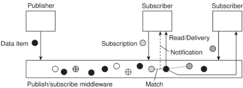

Questo stile permette di ottenere tutti i **decoupling**: spaziale dato che pub e sub non si devono conoscere, temporale perché il middleware può **memorizzare** gli eventi finché i subscriber non sono pronti a riceverli, e di sincronizzazione perché il publisher può proseguire senza attendere la consegna dell'evento.

Perché diverso dal Data-Oriented con spazio attivo? Logicamente coincidono, la differenza sta nell'implementazione: nel data-oriented enfasi sul depositare, leggere e prelevare dati con relativa gestione della concorrenza, mentre nel pub/sub l'enfasi è sulla **pubblicazione e sottoscrizione di eventi** (ad es. in Kafka, che implementa pub/sub, i dati sono immutabili e non vengono mai rimossi, quindi non c'è concorrenza tra consumer).

#### Modelli di Sottoscrizione
Esistono due modelli principali per far sì che il middleware decida quali eventi consegnare a ciascun subscriber:
- **Modello Topic-based**: il publisher pubblica un evento su un topic, mentre il subscriber si sottoscrive a uno o più topic. Il middleware inoltra gli eventi ai subscriber iscritti al topic corrispondente.  
Questo modello è **semplice e veloce** perché è sufficiente confrontare il topic dell'evento con quelli a cui il subscriber è iscritto per capire se inoltrarglielo.  
Tuttavia offre anche una selezione **relativamente poco espressiva**: un subscriber riceve tutti gli eventi di un topic, anche quelli che non gli interessano...
- **Modello Content-Based**: il subscriber può specificare **filtri più complessi** basati sul contenuto dell'evento (es. `categoria = "elettronica" AND prezzo < 100`) --> il middleware deve verificare per ogni subscriber se l'evento soddisfa il relativo filtro prima di inoltrarlo, quindi **matching molto più costoso, che comporta problemi di scalabilità all'aumentare del numero di subscriber e della complessità dei filtri**.

In pratica quindi il Topic Based è il modello più diffuso in quanto più adatti ai sistemi orientati a throughput elevati, come Kafka --> **compromesso tra espressività e scalabilità**.

---

Inutile dire che *non esiste uno stile architetturale migliore per tutte le applicazioni*: la scelta, oltre a dipendere dai **requisiti specifici** dell'app dipende anche da **requisiti non funzionali** come costi, scalabilità ed elasticità, tolleranza ai guasti, usabilità...

Un sistema reale può anche **combinare più stili architetturali assegnandoli alle parti per le quali sono più adatti**.  

es. per la parte di API esposte al client uno stile possibile è REST, per le elaborazioni avviate periodicamente sulla base della disponibilità di nuovi dati degli stili possibili sono Event-Driven o Pub/Sub, per comunicazione interna si potrebbero vedere le componenti come microservizi e farle interagire tramite RPC, per l'analisi e raccolta log magari uno stile Data-Oriented con spazio dati attivo...

---

# Architettura di Sistema
Finora abbiamo descritto l'organizzazione logica dei componenti software e delle loro interazioni. Ora consideriamo invece **la loro istanziazione a runtime sull'infrastruttura fisica** (**deployment**).

Le famiglie che introduciamo sono **centralizzate, decentralizzate** o **ibride**.

## Architettura Centralizzata, modello Client-Server
In questo modello i server offrono servizi, mentre i client ne richiedono l'utilizzo.  
L'approccio tipico è **request-reply**: il client invia una richiesta al server e resta bloccato in attesa della risposta --> comunicazione sincrona e bloccante, con client dipendente dal server.

Centralizzato ovviamente non significa necessariamente "eseguito su una sola macchina": il servizio può essere istanziato su più server ma restare logicamente centralizzato.

Distinguiamo in questo senso:
- **Layer** == **livello logico** (quindi separazione in layer == separazione logica delle responsabilità)
- **Tier** == **livello fisico** (quindi separazione in tier == suddivisione dell'applicazione in base a dove vengono effettivamente eseguiti i componenti software)

I layer sono gli stessi visti parlando degli strati applicativi: **Presentation Layer**, **Business Layer**, **Persistence Layer** e **Database Layer**. Ognuno di essi può essere distribuito su più **tier**.  
In figura vediamo tutte configurazioni *two-tier*: da un lato il client e dall'altro il server, e cambia la ripartizione dei layer e quindi la responsabilità che si affida al client e quella che si affida al server.

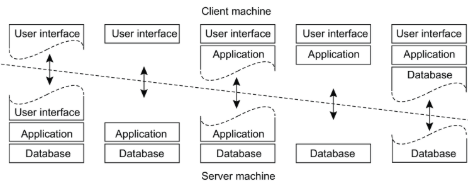

Nella configurazione *three-tier* tradizionale; presentazione, logica e dati sono separati da tre tier distinti. All'architettura si possono aggiungere altri componenti come cache, load balancer, servizi intermedi di sicurezza (Es. WAF Web Application Firewall) etc.. per cui il numero di tier può crescere a $N$ 

Avere più tier permette di **scalare in modo indipendente per ciascuno di essi**, ma comporta anche *più collegamenti di rete*, *più componenti da gestire* e in generale quindi **maggiore complessità**.

Si distinguono due modi di distribuire i layer sui tier:
- **Distribuzione verticale** se layer diversi sono collocati su tier diversi (es. presentation su client, business e persistence su server, dati su database server..)
- **Distribuzione orizzontale** se uno stesso layer è distribuito su più nodi (es. più server che eseguono lo stesso business layer, con le richieste che gli arrivano tramite un load balancer) (NB è sempre e comunque lo stesso tier! Quindi un tier non è necessariamente un singolo nodo).

Le due forme nelle applicazioni reali spesso si combinano, separando layer diversi su tier diversi e replicando layer uguali su più nodi.

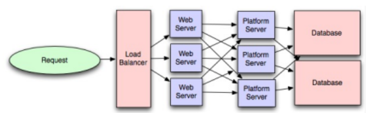

---

**Esempio 1: Web Application in AWS**

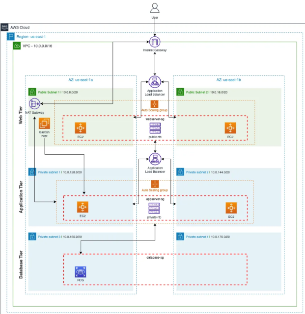

La figura realizza un'architettura web a *tre tier*, con *distribuzione orizzontale*, *isolamento di rete* e componenti in *due Availability Zone AZ*.

La separazione prevede:
- Web Tier, che gestisce le richieste del client e l'inoltro delle richieste applicative. Le istanze mostrate sono EC2, quindi un servizio IaaS per cui l'utente ha a disposizione intere VM su cui installare il software che vuole.
- App Tier, esegue la logica applicativa. Anche qui le istanze sono EC2.
- Database Tier, che conserva e interroga i dati persistenti, qui si usa un DB Amazon RDS

Il percorso è il seguente: la richiesta del client raggiunge il load balancer pubblico che sceglie un'istanza del web tier. Raggiunta l'istanza, questa a sua volta comunica con un altro load balancer stavolta *interno all'application tier*, che sceglie un'istanza applicativa. L'istanza allora esegue la logica e accede a RDS se le serve leggere o scrivere dati persistenti. I risultati tornano infine al client.

Le tre proprietà fondamentali che vengono realizzate in questa figura:
- **Elasticità** tramite **autoscaling**: il web tier e l'app tier ne hanno due gruppi distinti --> il numero rispettivo di istanze può aumentare/diminuire in base al carico
- **Disponibilità** tramite **replica in più AZ**: se un'intera AZ diventa indisponibile, il traffico viene reindirizzato alle istanze dell'altra AZ
- **Sicurezza** tramite **isolamento di rete**: nell'architettura mostrata troviamo una **VPC** (*Virtual Private Cloud*) per cui, mentre il tier web è ancora accessibile da internet (Internet Gateway), i livelli applicativi e il database sono in subnet private.

---

**Esempio 2: 3-tier serverless architecture**

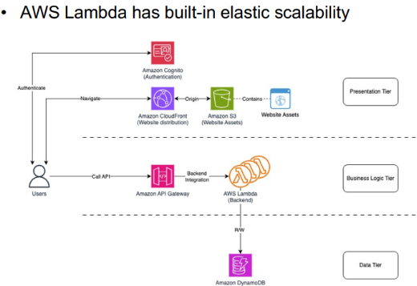

Anche qui three-tier, per cui si separano presentazione, logica e dati in tier diversi, ma qui i componenti sono serverless.  
Con **serverless** si intende che non solo il client non deve predisporre e amministrare i server fisici che eseguono il codice, ma **neanche gli ambienti di esecuzione!** Se ne occupa del tutto il provider cloud.

Quindi il modello serverless si avvicina a un modello **PaaS Platform as a Service**, nel caso specifico di Lambda si parla di modello **FaaS Function as a Service**: l'utente fornisce solo il codice della funzione, l'astrazione è quindi portata alla singola funzione invocata!

In questa architettura, come nel primo esempio, coesistono sia distribuzione orizzontale che verticale.  
Il presentation layer è realizzato con i servizi S3 (per lo storage degli asset su disco), CloudFront (per la distribuzione del contenuto geograficamente per ridurre latenza, è una CDN) e Cognito (per l'autenticazione degli utenti).  
Per la logica applicativa il frontend del client chiama anzitutto l'API Gateway, che inoltra quindi la richiesta alla funzione Lambda corrispondente.  
La funzione esegue quindi il codice backend, e può scrivere/leggere dati su DynamoDB (database NoSQL).

**Perché non compaiono i gruppi di autoscaling?** Non è che non esistono, ma *non sono espliciti in quanto* **gestiti direttamente da Lambda**, che si occupa da sola quindi di gestire l'allocazione degli ambienti di esecuzione in risposta alle invocazioni.  
In questo senso importante il concetto di **cold start**: se una funzione non è stata invocata per un po', l'ambiente di esecuzione viene rimosso. Alla successiva invocazione il servizio deve allocare un nuovo ambiente e caricare il codice della funzione --> la prima invocazione può richiedere più tempo...

---

## Architetture Decentralizzate
Nei sistemi P2P le funzionalità del sistema vengono realizzate usando **risorse distribuite e condivise tra i nodi partecipanti** (**peer**).  
Le risorse in questione possono essere di vario tipo: capacità di calcolo, memoria, banda di rete, file... il punto è che un peer può usare risorse degli altri e anche metterne a disposizione.

Tra le caratteristiche fondamentali dei sistemi P2P: **simmetria dei ruoli** (ogni peer può agire sia come client che come server), **decentralizzazione del controllo** (non c'è più un solo nodo che governa le operazioni, in P2P il controllo si realizza tramite collaborazione tra peer), **ampia distribuzione geografica** (tipicamente ai margini della rete poiché sulle macchine dei partecipanti), **dinamismo** (i peer possono entrare e uscire dal sistema in qualsiasi momento) **ridondanza delle informazioni**.

Si introducono i termini:
- **Membership** == insieme dei nodi che fanno parte del sistema in un certo momento
- **Churn** == continuo ingresso e uscita dei nodi, che modifica la membership.

Architetture P2P in moltissimi ambiti in base alla risorsa condivisa: file e video (BitTorrent, WebTorrent), dati e spazio di storage (IPFS, Freenet), capacità di elaborazione (BOINC, Folding@Home), scambio di messaggi (Jami..), transazioni finanziarie (Bitcoin, Ethereum..), training o inferenza (Exo, Bittensor..).

Moltissime sfide per i sistemi P2P:
- **Eterogeneità delle risorse**: il sistema non può fare assunzioni sulle capacità dei peer, deve adattarsi a ciò che offre ciascuno..
- **Scalabilità**: le operazioni devono restare efficienti anche quando aumentano i peer, in questo senso ci concentreremo sul **resource lookup** (come localizzare una risorsa senza interrogare tutti i nodi)
- **Località**: due nodi possono essere vicini nella overlay network ma lontani in quella fisica
- **Tolleranza ai guasti e churn**: i peer possono entrare o uscire di continuo. Se un peer che ospita una risorsa crasha --> sta al sistema garantire che la risorsa sia comunque disponibile
- **Auto-organizzazione**: in assenza di controllore centrale i peer devono organizzarsi da soli per garantire il funzionamento del sistema (gestire connessioni, distribuire il carico, instradare richieste..)
- **Free-riding**: un free-rider è un peer che usa risorse senza contribuire in misura adeguata --> occorrono meccanismi di incentivo e fairness
- **Anonimato**: la decentralizzazione non produce automaticamente anonimato, servono meccanismi specifici tipo Tor con *onion routing* (il msg è protetto da più strati di cifratura, e ogni intermediario rimuove il proprio strato ottenendo solo le info necessarie per inoltrare il msg al prossimo nodo, senza conoscere né mittente né destinatario finale).
- **Fiducia e Reputazione**: i nodi non sempre si conoscono --> un nodo potrebbe fornire info false o risultati errati --> servono meccanismi per valutare l'affidabilità dei peer a seconda dell'applicazione (es. Bitcoin POW)
- **Sybil Attacks**: nel mondo P2P un nodo può creare più identità false (es. esegue tante VM sulla stessa macchina) e ciò potrebbe permettegli di avere influenza sproporzionata sul sistema

Considereremo come caso di studio un sistema P2P per la condivisione file. Molti dei meccanismi ideati per risolvere le sfide di questo tipo di sistema sono stati poi riutilizzati in altri contesti P2P.

Tre operazioni fondamentali:
1. **Bootstrapping**: un nuovo nodo deve scoprire almeno un sottinsieme di peer già attivi per iniziare a partecipare.  
Diverse possibilità: ad es. indirizzi conosciuti a priori, lista di peer conservata in sessioni precedenti etc..
2. **Resource Lookup**: un nodo deve poter localizzare il file desiderato in modo efficiente
3. **Resource Retrieval**: una volta localizzato il file, il peer deve essere in grado di recuperarlo (il trasferimento può avvenire direttamente tra due peer, oppure tramite più peer intermediari che cooperano per trasferire il file a pezzi).

### Le reti P2P come Overlay Network
Con **overlay network** si intende la **rete logica costruita sopra una rete sottostante**.

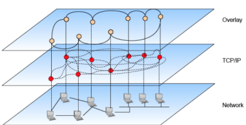

I collegamenti nell'overlay indicano quali peer comunicano direttamente secondo l'organizzazione del sistema P2P. **Un collegamento logico non equivale necessariamente quindi a un collegamento diretto tra le due macchine**: un msg può dover attraversare più router e collegamenti fisici nella rete sottostante... per questo due peer adiacenti nell'overlay possono potenzialmente trovarsi anche in continenti diversi!

L'**overlay routing** serve a trovare un percorso che consenta di *localizzare la risorsa desiderata* --> diverso dal routing IP: il primo instrada i pacchetti verso l'indirizzo di destinazione, il secondo *parte dalla risorsa desiderata e cerca il peer che può fornirla*.  
**L'overlay network deve supportare il dinamismo insito nei sistemi P2P sia dei peer che delle risorse in essi contenute, nonché poter identificare entrambi.**

Per l'identificazione si ricorre a degli identificatori univoci a livello globale per tutto il sistema, dei **GUID (Globally Unique IDentifier)**.  
La tecnica principale adottata in questo senso è applicare una **funzione hash crittografica** a informazioni associate all'elemento (es. per la risorsa il contenuto, nome o altri metadati; per il peer informazioni identificative come IP e porta). Sappiamo bene infatti che il risultato dell'hash è un **identificatore di lunghezza fissa** che sarà univoco w.h.p.

Per capire poi come organizzare nodi e risorse e instradare le richieste per una risorsa specifica, si distinguono due tipi di overlay network:
- **Overlay non strutturato**: non impone alcuna topologia globale prestabilita: i collegamenti derivano da decisioni locali e dal comportamento dei peer, la ricerca deve adattarsi quindi a questa topologia dinamica e imprevedibile.
- **Overlay strutturato**: impone regole precise per organizzare nodi e risorse: i collegamenti seguono la struttura scelta e la ricerca può quindi sfruttare la topologia per essere più efficiente.

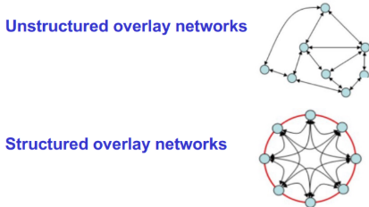

### Unstructured Overlay Networks
La rete si forma attraverso le decisioni locali dei peer: quando un nuovo nodo entra, scopre alcuni peer già presenti e stabilisce il collegamento con un sottinsieme di essi, diventando vicini nell'overlay. Si parla di **comportamento emergente**: la topologia globale della rete emerge dalle singole decisioni dei nodi.

*Le risorse non vengono assegnate ai nodi secondo una regola globale di collocazione: semplicemente ciascun peer mette a disposizione le risorse che possiede.*  

I vantaggi in questo tipo di rete sono che **è relativamente semplice aggiungere/rimuovere peer e risorse** e quindi **adattarsi al churn**.  
Inoltre la **manutenzione è contenuta**: non bisogna continuamente ricostruire una topologia rigida.

Lo svantaggio è chiaramente il **lookup delle risorse**: senza regole globali il peer che cerca una risorsa non sa a priori chi può averla --> msg complexity potenzialmente elevata.

Per l'organizzazione del routing esistono tre alternative principali.  
Per capire si vuole rispondere alla domanda: **chi conserva l'informazione che associa le risorse ai peer che le possiedono?** Questa informazione costituisce un **indice** (o *directory*):
1. **Overlay non strutturato centralizzato**: qui **l'indice si trova in uno o pochi directory server**.  
In questo caso il funzionamento è il seguente: ogni peer comunica al directory le risorse che mette a disposizione, e quando un peer cerca una risorsa invia al richiesta allo stesso directory server che risponde con l'elenco dei peer che la possiedono --> il peer ne sceglie uno e recupera direttamente il file.  
Si sfrutta cioè un **lookup centralizzato** per trasferire dati tra peer.  
Un esempio di questo approccio era Napster, per la consivisione pirata di musica --> la centralizzazione del server directory fu la sua condanna, in quanto quando furono chiusi l'intero sistema smise di funzionare.  
Da qui gli **svantaggi**:
    - SPOF
    - Limiti di scalabilità, dato che il server può diventare un collo di bottiglia
    - Costo di gestione: qualcuno dovrà pagare ed amministrare il server 

    Il **vantaggio** è invece ovviamente la semplicità: ogni peer sa a chi chiedere --> lookup veloce se il server è libero.
2. **Overlay non strutturato ibrido con super-peer**: in questa soluzione intermedia i compiti aggiuntivi sono affidati ad un insieme di più super peer, che nel caso del lookup si occupano di localizzare le risorse per conto dei peer richiedenti
3. **Overlay non strutturato decentralizzato**: *non esiste alcun directory server / nodo globale a cui rivolgersi*.  
In questo caso ogni nodo può mantenere una copia parziale dell'indice, quindi il lookup deve basarsi su interrogazioni progressive tra peer.

#### Routing in unstructured overlay networks decentralizzato
Esistono tre principali meccanismi di overlay routing per questo tipo di rete: **query flooding**, **random walk** e **gossiping**.  
Ci focalizziamo ora sui primi due, il terzo è argomento di una lezione successiva.

---

Nel **query flooding** la query viene diffusa nellarete in broadcast: ogni peer che la riceve verifica se possiede la risorsa, se True risponde al richiedente (due possibilità in questo caso, come vedremo..) altrimenti inoltra la query a tutti i peer vicini nell'overlay (eccetto il sender).

Chiaramente è necessario limitare la diffusione del msg di query per evitare che questo si propaghi anche quando la risorsa non esiste / è già stata trovata --> si utilizza un **TTL Time To Live** (contatore decrementato ad ogni hop, quando arriva a 0 il msg non viene più inoltrato).

Riguardo il TTL bisogna chiaramente bilanciarlo: se troppo basso la query non raggiunge abbastanza peer, se troppo alto si propagano troppi messaggi.  
In generale la soluzione pratica è scegliere un valore fisso per tutti i peer, ma esistono anche soluzioni adattive che però sono anche più complesse da implementare.

Per evitare cicli, la query contiene un identificativo univoco e ogni peer mantiene una **cache delle query già ricevute**.

Il costo di lookup di questa strategia è $O(N)$, dove $N$ è il numero di peer dell'overlay.

**Come torna la risposta al richiedente?** Due possibilità:
1. **Direct Routing**: il peer che possiede la risorsa la manda direttamente al nodo che ha originato la query --> è necessario che abbia le info necessarie per raggiungerlo (es. il suo endpoint)
2. **Backward Routing**: il peer che possiede la risorsa la invia al peer da cui ha ricevuto la query, che a sua volta la inoltra al peer da cui l'ha ricevuta etc.. fino a tornare al richiedente --> ogni nodo deve ricordare almeno ID della query e vicino da cui l'ha ricevuta.  
Qui i vantaggi sono:
    - Privacy: i peer intermediari non conoscono l'identità del richiedente originario
    - **caching delle risposte**: ogni nodo attraversato può memorizzare l'informazione per cui "il nodo $  $ possiede la risorsa Y" ed usarla in futuro per ridurre eventualmente il lavoro necessario.  
    Questa cache è però **non autoritativa** in quanto non fonte di verità assoluta, potrebbe essere che nel frattempo $X$ si è disconnesso o ha rimosso la risorsa $Y$.

    Se un nodo del percorso esce, è necessario che il protocollo preveda alternative su come scegliere un altro percorso disponibile.

Limiti del flooding:
- **Overhead di comunicazione**: molti msg raggiungono nodi che non possiedono la risorsa
- **Scelta del TTL**
- **Rischi di sicurezza e congestione**: una singola richiesta viene amplificata dall'algoritmo --> query malevole possono sovraccaricare la rete
- **Nodi black hole**: nodi che ricevono messaggi ma non li inoltrano (perché malfunzionanti o malevoli) possono interrompere alcuni rami di ricerca
- **Topology mismatch**: un singolo hop nell'overlay può nella realtà corrispondere a un trasferimento fisico lungo e costoso...

---

Con la **Random Walk** si riduce la ramificazione di ricerca: il nodo iniziale sceglie un solo vicino $u.a.r$ e gli invia la query, e così iterativamente finché non si trova un peer con la risorsa.

Il vantaggio principale è il **minore overhead di comunicazione**, a costo però del fatto che il percorso può essere "poco favorevole" e impiegare più tempo per trovare la risorsa cercata, o esaurire il TTL senza trovarla.  
Per ottimizzare ciò una variante è la **k-Random Walk** per cui l'origine avvia $k$ percorsi casuali in parallelo ed ogni coppia a sua volta sceglie $k$ (o solo uno a seconda della variante) etc...  
Più $k$ è grande, più ci si avvicina al query flooding in quanto a msg complexity.

---

### Structured Overlay Networks
Si impone una topologia fissa per risolvere il problema del lookup in modo più efficiente.  
Moltissime topologie possibili: tra le più diffuse anello, ipercubo, albero, mesh... ricordiamo comunque che si tratta sempre di una struttura logica sull'overlay, non fisica.

L'idea è che **ogni peer mantiene informazioni su un sottinsieme specifico degli altri peer, scelto secondo le regole della topologia** --> la ricerca potrà sfruttare questa organizzazione.

Se il vantaggio è un lookup più efficiente (vedremo anche $O(log N)$), il prezzo da pagare è una **manutenzione della struttura ben più complessa**: ogni volta che un nodo entra, esce o si guasta bisogna aggiornare opportunamente i collegamenti e le responsabilità delle risorse dei peer coinvolti.

Come anticipato, nel modello affrontato ogni risorsa e peer sono identificati da un **GUID** calcolato tramite hash crittografica; in particolare si utilizza per entrambi la stessa funzione hash, **mappando così sia risorse che nodi nello stesso spazio di identificatori** (vedremo che questo è fondamentale per il Consistent Hashing).

**Ogni peer è responsabile di una porzione dello spazio delle chiavi**: data la chiave di una risorsa (chiave == id della risorsa), si determina il peer responsabile secondo il protocollo di routing.  
Ogni protocollo si basa su una **metrica di vicinanza**, che varia in base alla topologia e al protocollo in sé.

Come trovare efficientemente il peer responsabile di una risorsa, senza usare un directory server centrale o inondare i peer con query flooding? La risposta è l'uso di **DHT**.

---

La **DHT (Distributed Hash Table)** è una struttura dati distribuita che dà organizzazione alla ricerca **tramite la distribuzione tra i peer delle associazioni key-value**, permettendo così al protocollo specifico di routing di localizzare il peer responsabile di una risorsa.

Intuitivamente possiamo cioè vedere la DHT come un'astrazione distribuita di una tabella hash, "partizionata" tra i peer della rete.  
Mentre in una tabella hash tradizionale il tempo di lookup è $O(1)$, nella DHT potremmo dover interrogare più peer prima di raggiungere quello con la risorsa di nostro interesse.

L'interfaccia DHT comprende le tre classiche operazioni:
- `put(key, value)` --> memorizza la coppia chiave-valore nella tabella del peer responsabile della chiave
- `get(key)` --> recupera il valore associato alla chiave 
- `remove(key)` --> rimuove la coppia chiave-valore dalla tabella

Nel modello che stiamo affrontando la chiave è il GUI, e il valore la risorsa stessa (o un riferimento che indica dove recuperarla).

**Progettare una DHT è difficile** in quanto ci sono molti problemi da affrontare:
1. **Evitare concentrazioni di chiavi**: se in peer gestisce troppe chiavi può diventare un **hotspot** (quindi SPOF e collo di bottiglia) --> serve una funzione hash che distribuisca le chiavi in modo sufficientemente uniforme
2. **Gestire il churn**: ogni volta che un nodo entra o esce **si deve evitare una rimappatura completa delle chiavi** (che sarebbe costosa), in questo senso si ricorre al **Consistent Hashing**.  
3. **Replicazione**: occorre avere repliche e meccanismi di recupero, afficnhé le associazioni di cui è a conoscenza un peer non vadano perse se il peer si disconnette o crasha.
4. **Supporta solo ricerche exact-match**: la DHT permette ricerce solo per chiavi esatte --> non supportano richieste più flessibili (es. "voglio trovare tutte le risorse che iniziano per s")

Tra i principali protocolli basati su DHT si hanno **Chord**, **Kademlia**, Pastry, Tapestry, CAN.

#### Chord
Chord è una soluzione relativamente semplice ed elegante per localizzare il peer responsabile di una chiave.  
Proprietà principali:
- **lookup in $O(log N)$ messaggi**
- *informazioni di routing limitate* (ogni peer mantiene info su un numero limitato di altri peer)
- *scalabilità*, *robustezza* (quest'ultima tramite opportuni meccanismi di manutenzione e tolleranza ai guasti)

Per quel che riguarda la topologia, Chord mappa sia peer che chiavi in un **anello logico**, ordinati in senso crescente.  
Con identificatori ad $m$ bit (nell'esempio sotto $m = 4$), dopo $2^{m-1}$ si torna a 0.

La **regola di assegnazione delle chiavi** è la seguente: una risorsa con chiave $K$ viene assegnata **al primo peer incontrato procedendo in senso orario a partire da $K$** (includendo il peer con ID uguale a $K$, se esiste). Questo peer detto **successore** di $K$, `succ(K)`.

Sarebbe a dire che, finché non si supera lo 0, il successore di $K$ è il peer **con più piccolo ID maggiore o uguale a $K$**. Se non esiste, si riparte dall'inizio dell'anello.

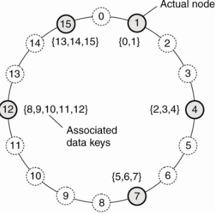

Un peer $p$ è responsabile quindi di tutte le chiavi **successive al predecessore e fino al proprio ID incluso**:

$$(pred(p), p]$$

La **metrica di vicinanza** definita per Chord è la distanza sull'anello: date due chiavi $x$ e $y$ allora la loro distanza, procedendo in senso crescente, è:

$$d(x, y) = (y - x) \mod 2^m \quad \iff \quad d(x, y) = \begin{cases} y - x & \text{se } y \geq x \\ 2^m + y - x & \text{se } y < x \end{cases}$$

dove $2^m$ è l'insieme di punti dell'anello, i.e. lo spazio delle chiavi.  

Quanto appena visto (mappatura delle chiavi nel cerchio logico tramite hash crittografica) rappresenta diretta applicazione del **Consistent Hashing**.  
Il vantaggio che ne deriva è che **l'ingresso o l'uscita di un peer richiede di riassegnare solo le chiavi del suo intervallo di responsabilità** (quindi quelle comprese tra il predecessore e il peer stesso) --> se un nodo entra, allora il suo successore gli cede le chiavi di cui è responsabile, se un nodo esce, il suo predecessore diventa responsabile delle chiavi che erano del nodo uscito.

Usare come soluzione alternativa al Consistent Hashing una soluzione classica come $hash(key) \mod N$ sarebbe stato molto più costoso, dato che al variare di $N$ (peer che entrano o escono) tutte le chiavi sarebbero state riassegnate.

L'altro motivo per cui **Consistent Hashing** è così vantaggioso sta nel **bilanciamento del carico**: è possibile dimostrare che, se si usa una buona funzione hash, allora in media il carico sarà approssimativamente bilanciato tra peer --> si evita il problema degli hotspot!

##### Chord Routing
Abbiamo visto quindi che in Chord peer e risorse hanno ID appartenenti allo stesso spazio ($[0, 2^m - 1]$), che questo spazio è organizzato come un anello logico e che una chiave $K$ è assegnata a `succ(K)` (ricorda che si include come elemento assegnato anche il peer con ID uguale a $K$, se presente).


Dobbiamo risolvere ora il problema del **lookup**: dato un peer $p$ e una chiave $K$, come fa $p$ a trovare il peer responsabile di $K$?  
Due soluzioni estreme:
1. **Ogni peer conosce il proprio successore**: la richiesta allora avanza lungo l'anello, un peer alla volta.  
es. cerchiamo la chiave 10 partendo dal peer 4 --> 4 contatta il suo succ (7), che a sua volta contatta il suo succ (12) che è il responsabile di 10 e quindi possiede la chiave.  
Questo approccio è semplice (basta che ogni nodo mantenga il succ), ma problematico per la msg complexity dato che **worst case bisogna attraversare tutti i peer dell'anello** --> $O(N)$ messaggi.
2. **Ogni peer conosce tutti**: inutile dire che lookup costante, ma *il costo in memoria è non scalabile* ($O(N)$ per peer).

Chord adotta un compromesso tra queste due idee, usando una **conoscenza parziale ma organizzata**: ogni peer mantiene una **Finger Table**. 

La **Finger Table** è la tabella di ruoting dei peer e contiene riferimenti solo ad altri peer, scelti in modo da permettere salti "crescenti" lungo l'anello (*intuitivamente, ogni peer conosce in modo dettagliato ciò che gli è vicino, e più rarefatto ciò che è lontano*).

---

**Costruzione della finger table**

Se gli identificatori hanno $m$ bit --> la FT ha $m$ righe.  
Per il peer $p$:
$$FT_p[i] = succ((p + 2^{i-1}) \mod 2^m), \quad 1 \leq i \leq m$$
cioè per costruire ogni riga partiamo dall'ID $p$, aggiungiamo una potenza di 2, riportiamo il risultato nell'anello tramite modulo e troviamo il peer responsabile della chiave così ottenuta (il successore).

Le posizioni di partenza sono quindi $p+1, p+2, p+4, p+8, ...$ fino a $p + 2^{m-1}$ (sempre $\mod 2^m$).

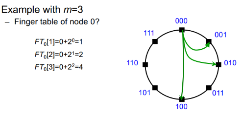

Dall'esempio è chiaro come poi, trovando il successore, più righe della FT possano contenere lo stesso peer!

---

**Algoritmo di Routing**

Supponiamo che il peer $p$ riceva una richiesta per trovare il responsabile della chiave $K$.  
Allora l'algoritmo procede come segue:
1. **Caso 1: $p$ è già il responsabile**, i.e. $K \in (pred(p), p]$ --> il lookup termina immediatamente e $p$ risponde con se stesso
2. **Caso 2: il responsabile è il successore immediato di $p$**, i.e. $K \in (p, succ(p)]$ --> di nuovo il lookup termina e $p$ risponde con $succ(p)$
3. **Caso 3: bisogna avvicinarsi alla chiave**. Se i primi due casi non sono soddisfatti --> $p$ sceglie tra i peer nella propria FT *il peer più distante da lui in senso orario, ma che non superi $K$*. Allora la richiesta sarà inoltrata a quel peer, che ripeterà ricorsivamente l'algoritmo. 

*Perché non bisogna scavalcare la chiave?* Perché **la FT è incompleta**: se andassimo al peer salvato nella FT dopo $K$ non è detto che lui sia il responsabile!  
(ricordiamo che tutti i confronti dell'alg. seguono l'ordine circolare, se ad es. se ci sono 32 peer e partiamo da 28, allora 4 è più avanti nel percorso in senso orario pur avendo ID minore)

Si può dimostrare facilmente che il costo di questo protocollo è $O(log N)$ --> fortemente scalabile.

**Esempio applicativo**

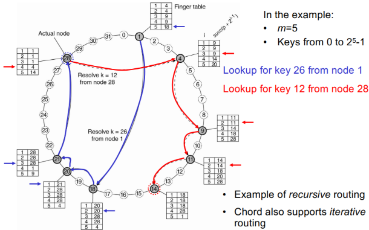

Cerchiamo la chiave $26$ partendo dal peer $1$: $1$ non è responsabile né lo è il suo succ ($4$) --> caso 3, il peer più avanzato nella $FT_1$ senza superare $26$ è $18$. Si ripete così ricorsivamente fino a $21$ che ha $28$ come succ e $26 \in (21, 28]$ --> $28$ è il responsabile.

Abbiamo visto qui un approccio **ricorsivo** dell'algoritmo, tuttavia è possibile facilmente riscriverlo in senso **iterativo**: mentre nel caso ricorsivo la richiesta è inoltrata ai peer di volta in volta a partire dallo user, in quello iterativo ogni peer restituisce il riferimento al prossimo peer da contattare secondo la logica del protocollo.  
**Ha senso usare la versione iterativa se si vuole ridurre il carico di lavoro dei peer intermedi, lasciando allo user il compito di inoltrare la richiesta al peer successivo**.

---

##### Chord Maintenance
Come detto le reti P2P sono soggette a elevato churn --> Chord deve mantenere corretti *i collegamenti dell'anello*, le *Finger Table* e le *assegnazioni delle chiavi ai peer*. 

Per semplificare la manutenzione, ogni peer mantiene anche un riferimento al **predecessore**, oltre che al successore. 

All'**ingresso di un peer $p$**, questo:
1. **Determina il proprio ID** applicando la funzione hash a dati prestabiliti (es. indirizzo IP e porta)
2. **Contatta un peer già esistente** per avviare i lookup necessari e inserirsi nell'anello
3. **Chiede al peer contattato di trovare il suo successore succ(p + 1)** (per questo importante che nell'assegnazione risorse se $K$ è nodo allora è responsabile di se stesso: se infatti $p+1$ fosse un nodo allora $succ(p + 1) = p + 1$)
4. **Ottiene l'info del proprio predecessore dal successore** (il vecchio pred del succ è il suo nuovo pred) **e invia i propri riferimenti a successore e predecessore** (si aggiornano quindi il pred del succ e il succ del pred)
5. **Costruisce la propria FT**: trova i successori delle posizioni $p + 2^i \mod 2^m$ per $i = 0, 1, ..., m-1$ tramite lookup
6. **Load balancing**: riceve dal successore le chiavi del proprio intervallo, che prima erano gestite dal successore (sarebbero quelle tra il vecchio predecessore del successore e $p$)

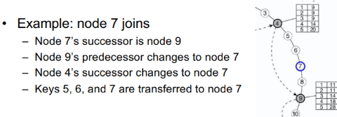

**E la FT degli altri peer?** L'inserimento di un nuovo nodo deve modificare anche gli indici delle FT degli altri peer. Aggiornarli tutti insieme ad ogni ingresso è inutilmente costoso vista la dinamicità dei sistemi P2P --> l'idea è **stabilizzazione periodica**.  
Ciò significa che durante l'assestamento della rete alcune FT potrebbero contenere riferimenti a peer che non esistono più o non sono più responsabili di alcune chiavi...

All'**uscita volontaria di un peer**, questo deve:
1. **Trasferire al proprio succ le chiavi di cui è responsabile**
2. **Far aggiornare il riferimento al predecessore del proprio succ**
3. **Far aggiornare il riferimento al successore del proprio pred**

Il **costo della manutenzione**, in termini di operazioni ingresso o uscita, è **polylog** $O(log^2 N)$, quindi comunque buono.

---

Un caso importante da considerare è quello in cui **un peer si guasta e non avvisa gli altri della propria uscita** --> si devono risolvere due problemi:
- riparare le informazioni sull'anello e sul routing
- rendere ancora disponibili i dati del peer guasto (fault tolerance)

Per risolvere il primo problema c'è la **stabilizzazione periodica** anticipata poco fa (oltre all'aggiornamento delle FT questa comprende anche il controllo dei collegamenti ancora attivi, tramite meccanismi di **failure detection** tipo *timeout* o *heartbeat*).

Per la fault tolerance invece si procede come al solito tramite **replicazione dei dati**, affinché se un peer si guasta le chiavi di cui era responsabile non vadano perse.  
in particolare si replicano le coppie $(K,V)$: con $R$ copie totali, una è posta sul peer responsabile e le altre $R-1$ sui successori di quel peer nell'anello.

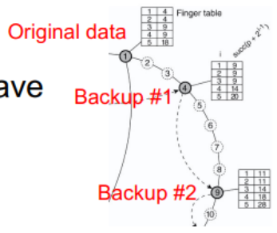

Questa gestione dei guasti implica che un peer debba conoscere più di un successore, in modo *da sapere a chi rivolgersi se il successore immediato non risponde* --> viene mantenuta una **successor list**.

Durante l'assenza di un peer guasto i dati possono cambiare --> se un nodo torna servono due modifiche:
1. il peer deve controllare con i successori eventuali aggiornamenti ai dati di cui torna ad essere responsabile
2. deve anche controllare con i predecessori eventuali aggiornamenti dei dati che conserva come backup per loro

La replicazione quindi aumenta sì la robustezza del sistema, ma introduce anche spazio occupato, più comunicazioni e lavoro di sincronizzazione tra le copie.

**Inserimento, Aggiornamento e Rimozione risorse**

Per inserire una risorsa:
1. si determina la sua chiave $K$ tramite hash crittografica
2. si esegue il lookup per trovare il peer responsabile `succ(K)`
3. si esegue `put(K, V)` sul peer responsabile, dove $V$ è la risorsa stessa o un riferimento ad essa

Per aggiornare o rimuovere l'associazione relativa a una risorsa, si contatta il peer responsabile della sua chiave.  
In tutto ciò, se ci sono copie replicate, queste devono essere gestite coerentemente con l'operazione effettuata sul peer responsabile.

---

##### Vantaggi e Limiti Chord
**Vantaggi**:
- lookup logaritmico, quindi efficiente e scalabile nel numero di peer
- conoscenza parziale organizzata, per cui ogni peer può instradare senza conoscere tutta la rete
- load balancing grazie al Consistent Hashing
- robustezza: tolleranza ai guasti e churn, grazie a meccanismi di stabilizzazione e replicazione dei dati

**Limiti**:
- la vicinanza nell'anello logico non corrisponde necessariamente a vicinanza fisica della rete sottostante, sempre per il discorso dell'overlay
- per richieste non esatte, Chord (così come tutti i protocolli basati su DHT) non è adatto... risponde solo per **exact match**
- la manutenzione della rete è delicata

---

#### Kademlia
Kademlia è un altro protocollo basato su DHT su una rete P2P strutturata.

Restano valide le idee generali delle DHT: peer e risorse hanno ID nello stesso spazio, le associazioni $(K, V)$ sono distribuite tra i peer, ogni peer mantiene conoscenza parziale della rete.  
Anche Kademlia permette un lookup di $O(log N)$ messaggi.

Stavolta i GUID sono a 160 bit, ottenuti tramite SHA-1. Tra i sistemi che usano Kademlia ricordiamo BitTorrent, IPFS, Ethereum.

La differenza sostanziale rispetto a Chord è la **metrica di vicinanza**: qui la distanza tra due chiavi $x$ e $y$ è definita come:
$$d(x, y) = x \oplus y$$
cioè si applica lo XOR bit a bit tra due identificatori e si interpreta il risultato come un numero intero non negativo (attento al fatto che non stiamo contando il numero di bit diversi come distanza, ma l'intero che ne deriva: es. $d(0110, 1010) = 1100 = 12$).

I motivi dell'utilizzo dello XOR sono principalmente che **è veloce da calcolare** (operazione supportata dall'hardware) ed è **simmetrica** a differenza della distanza circolare di Chord: $d(x, y) = d(y, x)$.

Per Kademlia, l'overlay logico è organizzato come un **albero binario** costruito come segue: consideriamo gli identificatori a soli tre bit
$$000, 001, 010, 011, 100, 101, 110, 111$$
Possiamo organizzarli leggendo i bit dal più significativo al meno significativo. Nel primo lvl dell'albero si considera solo il primo bit, dividendo così lo spazio degli identificatori in due gruppi:
- 0xx: 000, 001, 010, 011
- 1xx: 100, 101, 110, 111

Per il secondo livello si considera anche il secondo bit:
- 00x: 000, 001
- 01x: 010, 011
- 10x: 100, 101
- 11x: 110, 111

e infine al terzo livello si avrà l'identificatore completo: abbiamo raggiunto le foglie.  
Il perché dello XOR diventa evidente: due chiavi che differiscono solo nel primo bit (es. 000 e 100) sono più distanti di due chiavi che differiscono solo nell'ultimo bit (es. 000 e 001).

---

**Assegnazione delle risorse**

Immaginiamo di avere tre bit con presenti solo i peer $000, 110$ e $111$, con tutte le altre posizioni identificatori possibili per risorse.  
Per effettuare l'assegnazione di una risorsa, si individua per ogni chiave il peer con minima distanza XOR da essa --> tutte le chiavi che iniziano con $0xx$ sono più vicine al peer $000$, per la chiave $100$ il peer più vicino è $110$, mentre per $101$ è $111$

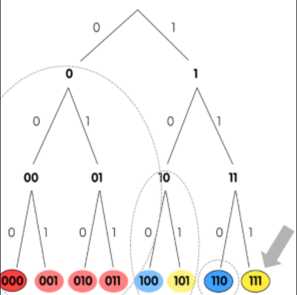

---

##### Kademlia Routing
Ogni peer mantiene una tabella di routing con $m$ **bucket**, dove $m$ è il numero di bit degli identificatori.  
A sua volta, ogni bucket contiene fino a $k$ **contatti**: si parla di tabelle di routing a $k$-buckets per cui ogni riga può contenere fino a $k$ peer.

Per ogni peer viene conservata la tupla $(IP, port, ID)$, dove $ID$ è proprio il GUID del peer, necessario per calcolare la distanza logica XOR.

Fissiamo un nodo $i$ e la riga $j$ della sua tabella di routing. Allora i peer nel bucket $j$ sono quelli che **condividono con $i$ un numero di bit iniziali pari proprio a $j$**, ma differiscono nel bit successivo (chiaramente non compaiono necessariamente tutti, ma al massimo $k$ di essi...)

Ad es. per il bucket 0 nessun bit iniziale comune --> lì ci saranno tutti i peer più lontani da $i$ in senso XOR;  
per il bucket 1 condividono il primo bit, per il bucket 2 i primi due etc... fino ai peer più vicini (nell'ultimo bucket $m-1$ bit iniziali in comune, per cui differiscono solo nell'ultimo bit). 

Vedendo un es. concreto con GUID a 6 bit e $i = 111110$:

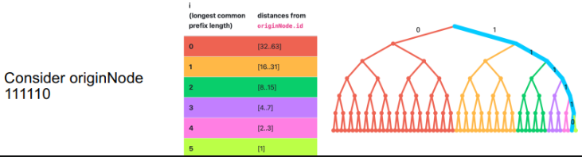

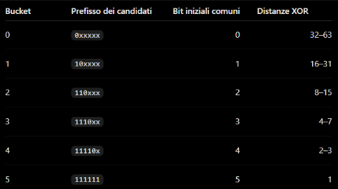

In formule, i peer candidati a far parte del bucket $j$ di un peer $i$ sono quelli con distanza che soddisfa:
$$2^{m-j-1} \leq d(i, peer) < 2^{m-j}$$
(intuitivamente sono cioè quelli con distanza XOR che inizia con $j$ zeri, in quanto hanno i primi $j$ bit di prefisso comune).

---

**Come avviene il lookup**

L'obiettivo è restringere progressivamente la ricerca, trovando contatti sempre più vicini alla chiave cercata:
1. il richiedente seleziona, tra i contatti conosciuti, quelli più vicini alla chiave, per poi interrogarli
2. riceve quindi il valore cercato (se disponibile) oppure riferimenti ad altri peer più vicini alla chiave
3. usa i nuovi contatti per proseguire la ricerca

Si nota anzitutto che, in contrapposizione con il routing classico di Chord, qui **iterativo**: è proprio il richiedente iniziale a effettuare i contatti successivi, mentre il peer interrogato si limita a restituire informazioni.

Es. supponiamo $m = 3$ e cercare 011 partendo da 111 (richiedente).  

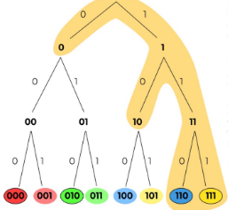

La tabella del peer 111 contiene:

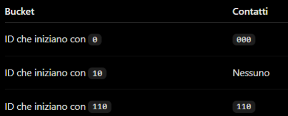

Ma 111 non possiede la risorsa 011 --> interroga 000 in quanto peer più vicino alla chiave tra quelli che conosce (ha distanza $011 \oplus 000 = 011 = 3$ invece che $011 \oplus 110 = 101 = 5$) --> 000 non possiede anch'esso 011, ma supponiamo che la sua tabella sia tale che conosce 010 --> 000 risponde a 111 con il contatto 010, che effettivamente possiede 011. Restituisce quindi la tupla associata e il lookup termina.

Si può dimostrare che il restringimento progressivo della ricerca segue salti exp. nella distanza XOR dall'elemento cercato --> $O(log N)$ messaggi.

Nell'esempio giocattolo lo abbiamo visto con un solo nodo alla volta, ma il vantaggio di avere $k$ contatti per bucket è che **Kademlia può interrogare più peer in parallelo**, ciò:
- **riduce latenza** (un peer può rispondere prima degli altri o fornire contatti migliori)
- **dà maggiore affidabilità** (se un contatto è guasto o non risponde, ci sono comunque gli altri --> permette quindi anche tolleranza a churn)

Non vedremo stavolta nel dettaglio come Kademlia gestisce ingresso e uscita dei peer, ma il concetto è simile a Chord: ogni peer deve aggiornare la propria tabella di routing, i peer vicini devono aggiornare le chiavi di cui sono responsabili...

---

#### IPFS
**IPFS (InterPlanetary File System)** rappresenta un sistema P2P distribuito per **memorizzare, individuare e recuperare file su larga scala**, basato su Kademlia e DHT.

La "rivoluzione" in IPFS sta nel meccanismo per identificare le risorse: **invece di basarsi su un indirizzo di posizione in un certo server, si segue un ID basato sul contenuto stesso della risorsa**.

Nel web tradizionale per identificare una risorsa si usa un URL come `https://www.example.com/index.html`, che indica un server e un percorso presso cui recuperarla, e il contenuto disponibile in quell'indirizzo può cambiare nel tempo.  
IPFS invece usa un **identificatore derivato dal contenuto**, noto come **CID Content Identifier**, per cui la richiesta diventa qualcosa del tipo "dato il contenuto identificato da questo CID, quali peer possono fornirmelo?" --> non è necessario che il contenuto stia sempre nello stesso indirizzo.

Per capire intuitivamente IPFS una buona analogia è Web (per la pubblicazione e accesso ai contenuti) + BitTorrent (per la segmentazione dei file in blocchi e il download da più peer) + Git (per la gestione delle versioni dei contenuti e le strutture basate su hash).

---

**Blocchi, CID e Merkle DAG**

In IPFS ogni file può essere suddiviso in piccoli blocchi, detti **chunk**.  
Ogni blocco è identificato da un **CID** che rappresenta un hash crittografico del suo contenuto --> *se il contenuto cambia, cambia anche il CID* 

I blocchi non sono indipendenti, ma vengono collegati tramite riferimenti ai loro CID, formando così un **Merkle DAG** (Directed Acyclic Graph).

es. nel Merkle Tree sottostante abbiamo alla radice una directory e due file associati. Uno dei due file è diviso in tre blocchi di dimensioni diverse, ognuno con il proprio CID.  
La struttura prevede che la directory mantenga i CID dei due file, e come proprio CID abbia l'hash dei due CID dei file. A loro volta, il file diviso in tre blocchi mantiene i CID dei tre blocchi e come proprio CID l'hash dei tre CID dei blocchi --> in questo modo la directory ha i CID dei file necessari per ricostruirla, e allo stesso modo i file hanno i CID dei blocchi necessari per ricostruirli etc...

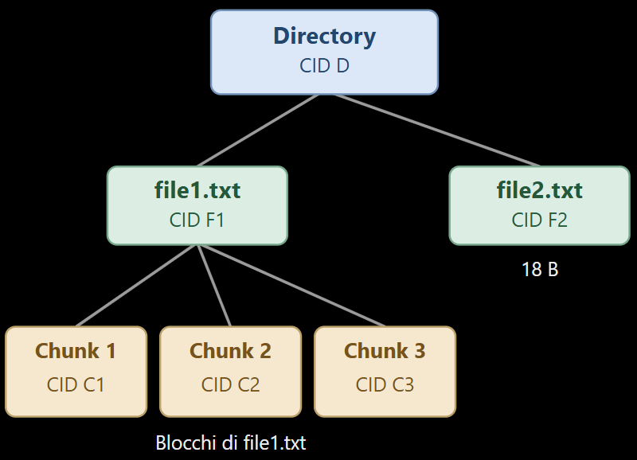

Inoltre, anche se cambia solo il secondo blocco del file --> cambia il suo CID --> cambia il CID del file --> cambia il CID della directory, quindi i cambiamenti dei singoli "nodi" si propagano fino alla radice!  
I blocchi rimasti uguali invece mantengono lo stesso CID --> possono essere riutilizzati senza doverli riscaricare.

Quindi la struttura DAG in IPFS offre 4 vantaggi principali:
1. **Verifica dell'integrità**: quando si riceve un blocco, si può ricalcolarne l'hash e confrontarlo con quello atteso nel suo CID, di modo da capire se il blocco è stato corrotto
2. **Confronto efficiente tra versioni**: per confrontare due strutture non dobbiamo trasferire tutti i dati, ma possiamo invece partire dal CID della radice. Se coincidono --> stessa struttura, altrimenti si scende ai livelli inferiori per individuare i blocchi diversi.  
Il risparmio, oltre che nella strategia, sta anche nel fatto che **confrontare id di lunghezza fissa è molto più efficiente che confrontare interi file di dimensione arbitraria**
3. **Deduplicazione dei dati**: se due file condividono blocchi identici, questi hanno lo stesso CID e quindi possono essere memorizzati una sola volta
4. **Download indipendente e parallelo dei blocchi**: si possono scaricare i blocchi separatamente e in parallelo, dato che il file ha nella propria struttura i riferimenti ai CID dei blocchi e quindi le informazioni necessarie per organizzarli correttamente.

---

**Il ruolo della DHT**

IPFS usa una variante di Kademlia con $k$-buckets e lookup paralleli e asincroni.  
Sappiamo bene che la DHT serve a trovare il contenuto, e non a trasferirlo (**resorce lookup $\neq$ resource retrieval**) --> a questo scopo vengono usati **provider records**, ossia informazioni che associano un CID ai peer che effettivamente li possiedono.  
Pertanto *una DHT non contiene i dati che stiamo cercando, ma le informazioni su chi li possiede (appunto, i provider records)*.

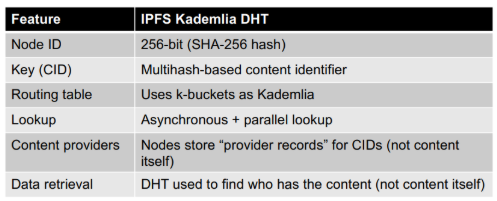

Il funzionamento può essere distinto in tre momenti:
1. **Pubblicazione**: un peer che dispone di un contenuto annuncia nella DHT di poterlo fornire --> l'annuncio rende possibile trovare il provider (non direttamente il contenuto, come detto)
2. **Ricerca del provider**: un peer interessato a un certo CID esegue il lookup nella DHT per sapere quali peer possono fornirlo
3. **Trasferimento**: il richiedente contatta il provider ottenuto via lookup e recupera i blocchi tramite un protocollo di retrieval P2P come BitSwap, eventualmente in parallelo.  
Dopo averli ricevuti, ne verifica l'integrità calcolando l'hash del contenuto e confrontandolo con il CID atteso e infine li ricompone secondo la struttura del Merkle DAG per riottenere il file originale.

In tutto ciò, due scenari possibili: **rete pubblica** se i peer partecipano ad una rete condivisa, usata per annunciare e cercare contenuti oppure **rete privata** se IPFS viene usato in un ambiente ristretto (es. aziendale) --> in tal caso la rete di discovery è separata.

**Vantaggi**:
- **Decentralizzazione**: il contenuto può essere fornito da più peer, non c'è più dipendenza da un server centrale --> **maggiore resistenza alla censura**
- **Integrità e identificazione delle versioni** tramite i CID e il DAG
- **Efficienza** grazie alla deduplicazione dei dati e al download parallelo dei blocchi
- **Accesso locale**: se i contenuti sono disponibili su peer raggiungibili in LAN --> non è necessario passare per Internet

**Limiti**:
- **Non garantisce automaticamente conservazione permanente**: sapere che un peer offre un contenuto non significa che lo manterrà per sempre, se nessun peer raggiungibile conserva certi blocchi allora li abbiamo persi...
- **I dati che cambiano spesso richiedono più gestione** (ogni modifica produce nuovi CID per le strutture coinvolte, quindi più versioni da gestire)
- **La ricerca è basata su exact match** (per natura stessa dell'uso di DHT..)

---

## Architetture Ibride
Le **architetture ibride** combinano elementi di sistemi centralizzati e decentralizzati: si vuole sfruttare la semplicità e l'efficienza di alcune funzioni centralizzate, mantenendo però distribuite altre attività come memorizzazione e condivisione dati.

Vediamo tre esempi: **reti con super-peer**, **BitTorrent con tracker** e **blockchain permissioned**.

### Reti con super-peer
Qui alcuni nodi, detti **super-peer**, hanno più responsabilità e capacità rispetto agli altri --> **assumono il ruolo di organizzazione e ricerca delle risorse per i peer ordinari**.  
La rete presenta due livelli:
- ogni super-peer mantiene info sulle risorse disponibili presso i peer ordinari a cui sono collegati
- i super-peer sono a loro volta collegati tra loro tramite overlay, e collaborano per cercare risorse fuori dal loro dominio

In questo senso i super-peer svolgono il ruolo di **directory locale**, dal momento che conosce quali risorse sono disponibili nel gruppo senza però che debba conservarle tutte:

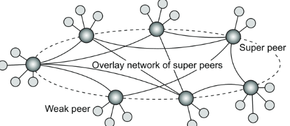

Supponiamo che un nodo stia cercando il file, allora la ricerca avviene semplicemente come segue: contatta anzitutto il proprio super-peer, che controlla se il file è disponibile presso uno dei peer del gruppo. Se restituisce il riferimento del peer che lo possiede, altrimenti ne estende la ricerca contattando altri super-peer. 

In questo senso i protocolli adattabili sono anche **flooding** o **random-walk**, in quanto *stavolta l'overlay dei super-peer ha dimensione ridotta*!

Due problemi caratteristici di queste reti:
1. **Come associare i peer ai super-peer**: o **associazione statica** (i peer scelgono un super-peer e lo mantengono) o **associazione dinamica** (un peer può nel tempo passare a un super-peer più vicino o meno carico)
2. **Come selezionare i super-peer**: qui si possono usare algoritmi di **leader election** che però considerino le caratteristiche dei candidati (un super-peer è tale se ha determinate capacità di calcolo, memoria e banda rispetto a un peer ordinario).

### BitTorrent con tracker
BitTorrent è un sistema P2P per la condivisione file. Consideriamo ora la versione con **tracker** (esiste anche quella *trackless* basata su DHT e derivata da Kademlia).

Il principio fondamentale è che **un file viene suddiviso in blocchi, scaricabili da peer differenti anche in parallelo**.  
Un peer può anche condividere blocchi già ricevuti mentre sta ancora scaricando quelli mancanti --> non deve aspettare il file completo per contribuire alla distribuzione.

Il **tracker** è un servizio che *tiene traccia dei peer partecipanti alla condivisione di un certo file*, ciò permette a un nuovo partecipante di ottenere i dati iniziali in fase di **bootstrap**. Il procedimento è:
1. **Il client ottiene il file `.torrent` da altri peer**: il file torrent contiene metadati relativi alla condivisione, tra cui il riferimento al tracker.  
Non è il file che si vuole scaricare, ma un file di piccole dimensioni che contiene info su come ottenere il contenuto desiderato (il torrent tipicamente è distribuito tramite siti web o canali di comunicazione esterni)
2. **Il client contatta il tracker**, che restituisce una lista di peer che partecipano alla condivisione e possono avere il file o alcuni suoi blocchi
3. **Il client contatta i peer in questione per scaricare**           

Uno **swarm** rappresenta l'insieme dei peer che partecipano alla condivisione di uno stesso file (es. scarica un blocco da un partecipante, scaricane un altro contemporaneamente da un altro peer e intanto invia a un terzo peer i blocchi già ricevuti...)  
Ciò spiega perché questa versione di BitTorrent è considerata architettura ibrida: il tracker ha ruolo centralizzato di indicizzazione, mentre il trasferimento dei blocchi avviene in modo distribuito tra i peer.

Non tutti i blocchi sono disponibili sullo stesso numero di peer --> BitTorrent adotta una strategia **Rarest Piece First**, per cui si dà priorità di download ai blocchi meno diffusi affinché la disponibilità dei blocchi sia quanto più bilanciata possibile tra i peer.

In un sistema del genere una componente fondamentale è il **meccanismo di incentivi**: per evitare **free-rider**, BitTorrent implementa un meccanismo **tit-for-tat** per cui, semplificando, un peer privilegia l'invio dei dati verso peer da cui ne riceve altri.

### Blockchain
Introdotte per l'esigenza di **gestire transazioni in modo decentralizzato, verificandone la validità e conservandone una registrazione affidabile**.  
(NB. una tx non si limita a quella finanziaria, ma possono rappresentare più in generale **registrazioni o operazioni relative a documenti, risorse, votazioni e altri dati..**)

es. tx 10 euro ad Alice da Bob --> *validazione == verificare che la tx rispetti le regole del sistema (es. no double spending)* e *memorizzazione == conservare le tx in modo persistente al fine di poterle consultare in futuro*.

Ma chi dedice se una tx è valida e dove conservarla? Come fanno i peer a concordare sulla storia delle transazioni?  
In generale una **blockchain** è un **registro di tx organizzate in blocchi connessi tra loro e replicato tra più partecipanti**.  
Il registro in cui sono registrate le tx è detto **ledger**, in questo senso la blockchain appartiene alla famiglia delle **DLT (Distributed Ledger Technology)**.

L'obiettivo è mantenere una storia condivisa e resistente alle alterazioni anche quando i nodi sono **untrusted**: in questo senso distinguiamo il concetto di **crash failure** di un nodo (che smette di funzionare) da quello di **Byzantine failure** (un nodo che funziona ma si comporta in modo malevolo al fine di far fallire il sistema).

La presenza di nodi bizantini (prima introduzione con Byzantine Generals Problem, Lamport) introduce il tema di **consenso distribuito**, che approfondiremo successivamente.

#### Funzionamento generale (semplificato) e struttura della catena
Si assume che ogni peer mantenga una replica locale del ledger, i.e. copia della storia delle transazioni. 

L'algoritmo di consenso prevede in generale che, quando viene proposta una nuova tx:
1. la richiesta sia diffusa a tutti i peer della rete
2. la tx venga validata per verificarne la correttezza secondo le regole del sistema
3. le varie tx validate vengano raccolte in un blocco, cha a sua volta sarà effettivamente aggiunto alla catena solo dopo che il blocco è stato validato secondo le regole di consenso

Le tx sono quindi raggruppate in blocchi, e ogni blocco è diviso in:
- **header**: contiene le info di controllo e collegamento, tra cui principalmente **l'hash dell'header del blocco precedente**, il **timestamp**, l'**hash del body del blocco corrente** e il **nonce** legato al meccanismo di consenso (es. POW)
- **body**: contiene le tx validate che il blocco registra, tipicamente organizzate in un Merkle Tree per consentire verifica dell'integrità dei dati

Quindi la blockchain si sviluppa in quanto ogni blocco contiene un riferimento basato sull'hash dell'header del blocco precedente --> se un byzantine tenta di modificare una tx di un blocco già registrato, cambia l'hash dell'header di quel blocco e quindi anche il riferimento nel blocco successivo e così a catena fino all'ultimo blocco --> il nuovo blocco sarà rifiutato, il bizantino dovrebbe modificare tutti i blocchi successivi alla tx per far accettare la sua versione della storia...

Chiaramente questo meccanismo si basa fortemente sul fatto che la funzione hash crittografica sia **one-way** e **collision-resistant**: deve essere computazionalmente difficile trovare collisioni che possano risultare utili a sostituire blocchi e falsificare dati della catena.

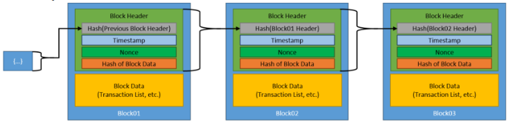

**Ma chi decide chi può aggiungere un blocco alla catena?** Si necessita di un **meccanismo di consenso** che permetta di capire chi, tra i leader eletti (i.e. partecipanti al processo di consenso), può contribuire all'allungamento della catena.

La soluzione banale sarebbe affidarsi ad una singola entità fidata. Questo chiaramente andrebbe contro la volontà iniziale di gestire transazioni in modo decentralizzato --> due alternative: affidare la decisione ad un gruppo autorizzato o totalmente decentralizzato, con protocollo di consenso basato su tutti i peer

#### Blockchain permissioned
In questo caso la partecipazione al processo decisionale è riservata a **un gruppo di nodi autorizzati**.  
Nello scenario descritto il gruppo è relativamente piccolo, con membri preselezionati e ammessi secondo specifiche regole che possono cambiare nel tempo: sono i membri a raggiungere un accordo su come far avanzare il registro.

Gruppo di nodi autorizzati non significa necessariamente fidati al 100% --> si resta sempre nel mondo untrusted e quindi per cui i nodi possono essere bizantini.  
Si è dimostrato che, nel mondo permissioned e asincrono, affinché vi sia consenso (problema Byzantine Agreement) il numero di nodi corrotti deve essere meno di un terzo rispetto alla totalità dei nodi:
$$f \le \frac{n-1}{3} == n \ge 3f + 1$$
Esempi di blockchain permissioned sono **Hyperledger** e **Corda**.

#### Blockchain permissionless
Quando il consenso si basa su un protocollo aperto a tutti i peer della rete --> per garantire sicurezza e resistenza a comportamenti bizantini, si ricorre a meccanismi di consenso come **Proof of Work (PoW)** o **Proof of Stake (PoS)**.

**PoW** == competizione basata su potenza computazionale: i peer competono per risolvere un puzzle crittografico, il primo che lo risolve può proporre il blocco successivo.

**PoS** == competizione basata su stake: i peer competono per proporre il blocco successivo in base alla quantità di risorse (es. criptovalute) che hanno messo in gioco

Il mondo permissionless non è soggetto al risultato per cui al max un terzo dei nodi può essere bizantino: la sicurezza del sistema dipende dal potere computazionale / stake in mano ai nodi onesti.

La blockchain permissionless, a differenza della permissioned (che è ibrida), è totalmente decentralizzata. Es. **Bitcoin** e **Ethereum**.
