Un **sistema software autoadattivo** è in grado di modificare il proprio funzionamento runtime, in risposta a cambiamenti **nel proprio stato interno** oppure **nell'ambiente esterno** in cui opera.

L'obiettivo di questi sistemi è continuare a fornire il servizio e rispettare certi requisiti, richiedendo così intervento umano limitato.  
Si collegano questi sistemi al concetto più ampio di **autonomic computing**, paradigma basato sul sistema nervoso umano per cui la gestione di certe funzioni corporee (digestione, respirazione) sono regolate automaticamente senza intervento cosciente.  
I principi di autoadattamento si applicano a tanti contesti, a noi interessano applicati al cloud, edge e continuum computing.

Alcuni esempi di sistemi software autoadattivi sono Kubernetes (sistema di orchestrazione di container: tra le attività di autoadattamento placement e scheduling dei container nei nodi, scaling orizzontale, vertiale e self-healing (ricreare su nodi disponibili componenti che erano eseguite in un nodo ora guasto)); Amazon EC2 Auto Scaling che permette di aumentare/diminuire automaticamente il numero di istanze EC2 in base a regole predefinite dall'utente; self healing networks (tipo Chord) e database autoadattivi, in grado di gestire automaticamente i dati.

## self-* capabilities
Esistono diverse capacità di autogestione, raggruppate nella notazione **self-$*$**:
- **Self-Optimization**: ottimizzare prestazioni e uso risorse, rispettando gli obiettivi di qualità del servizio (es. cambiare il posizionamento dei componenti per ridurre tempi di risposta)
- **Self-Healing**: rilevare e recuperare automaticamente guasti (es. escludere un nodo guasto dal bilanciamento del carico)
- **Self-Configuration**: integrare nuovi elementi o modificare automaticamente parametri di configurazione (es. aggiungere un nuovo nodo al cluster)
- **Self-Protection**: rilevare minacce e reagire per limitarne gli effetti (es. identificare e bloccare un attacco DDoS)

Per raggiungere questi obiettivi, il sistema deve **conoscere il proprio stato interno** (**self-awareness**, quindi risorse disponibili, componenti attivi, prestazioni...), **conoscere il contesto operativo** (**self-situation**, quindi condizioni della rete, utenti, carico esterno e ambiente in generale), **rilevare eventuali cambiamenti** (**self-monitoring** osservando come evolve il sistema) e eventualmente **intervenire** (**self-adjustement**) modificando il proprio comportamento per adattarsi ai cambiamenti rilevati.

Il modello di un sistema self-adaptive è concettualmente fatto di due parti:
- **Managed System**: è il software che fornisce il servizio e che deve essere adattato (es. applicazione Web con più istanze)
- **Managing System**: è il sistema di gestione vero e proprio, che osservando il managed system decide come adattarlo per perseguire gli obiettivi di qualità del servizio prestabiliti. Oltre che il managed system, deve osservare anche l'ambiente in cui esso si trova, su cui il managed system non ha controllo (utenti, rete, software esterno...)

Tra i due sistemi, è necessaria quindi una strumentazione che permetta di **misurare** (tramite ad es. sensori o sonde) e **intervenire** in caso necessario tramite meccanismi di intervento detti **effettori**.  

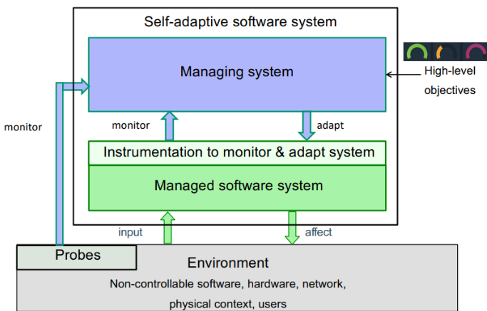

es. in un'applicazione cloud, il managed serve le richieste, le sonde misurano il carico, la CPU e i tempi di risposta, mentre il managing valuta se le risorse sono sufficienti e gli effettori possono creare nuove repliche.  
Si tratta di un *ciclo di controllo a retroazione* (**feedback loop**).

## MAPE-K loop
Questo ciclo è organizzato nel modello MAPE:
$$\text{Monitor} \rightarrow \text{Analyze} \rightarrow \text{Plan} \rightarrow \text{Execute}$$
con l'aggiunta di una **Knowledge** (K) che contiene una base di conoscenza.

In generale:
- **Monitor** raccoglie i dati dal sistema e dall'ambiente: può filtrarli, aggregarli e correrarli per ottenre info più utili da usare
- **Analyze** valuta le info raccolte determinando se è necessario un adattamento. Per farlo può adottare un approccio *reattivo* (es. regole di soglia o target tracking) oppure *proattivo* (es. modelli predittivi basati su tecniche di ML)
- **Plan** è la parte decisionale del ciclo: sceglie quale azione effettuare per ottenere il cambiamento desiderato
- **Execute** applica le azioni pianificate al managed system tramite gli *effettori*
- **Knowledge** conserva la conoscenza condivisa necessaria per le varie fasi (es. dati di monitoraggio, info sull'ambiente, stato del sistema..). Non deve essere necessariamente un unico database centrale, è da vedere come una componente logica.

es. tempi di risposta troppo alti --> il Monitor raccoglie i tempi di risposta e l'uso delle risorse, l'Analyze si accorge che il servizio potrebbe non rispettare i requisiti di qualità, il Plan decide quindi quante repliche aggiungere e l'Execute le avvia, per poi ripetersi il ciclo.

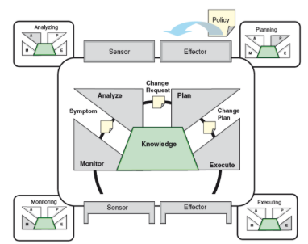

### Monitor
Per progettare correttamente il monitoraggio bisogna porsi alcune domande:
- **When to monitor?** Il monitoraggio può infatti essere **continuativo** oppure **on-demand** (attivato se richiesto, ad es. di fronte a uno specifico evento)
- **What to monitor?** Moltissime misure in questo senso: risorse (CPU, memoria, banda..), carico di lavoro (numero di richieste, dimensione dei dati), prestazioni (tempi di risposta, throughput), stato del sistema (componenti attivi, errori, guasti), disponibilità e stato dei componenti...
- **How to monitor?** In un'architettura **centralizzata**, i dati confliuscono in un'entità centrale.  
In una **decentralizzata** invece la raccolta e l'elaborazione sono distribuite tra più componenti.  
La scelta effettiva del **come monitorare** è distinta dalla metodologia scelta per l'elaborazione:
    - **Passiva** se si osservano dati o attività già disponibili, senza iniettare richieste e quindi traffico nel sistema (es. log)
    - **Attiva** se si inviano richieste di misurazione (es. ping, heartbeat) per ottenere info più dettagliato. Chiaramente carico aggiuntivo rispetto all'approccio passivo...
- **Where to monitor?** Sarebbe a dire, dove conservare i dati e come prepararli? Es. i database a serie temporali sono adatti a misure associate al tempo come uso della CPU, che viene rilevato ogni pochi secondi... sul come prepararli invece i dati possono essere *aggregati, filtrati, correlati o normalizzati*

### Analyze
L'analisi usa i dati monitorati per stabilire se serve un adattamento.  

La prima scelta riguarda quando attivare l'analisi: **a tempo** (periodicamente, es. ogni 2 min) oppure **a evento** (es. un certo numero di richieste in coda).

La seconda scelta è tra approccio reattivo o proattivo:
- **reattivo** se *si reagisce a un cambiamento già avvenuto, basandosi su metriche osservate*. Il *vantaggio è la semplicità* (vedremo in questo senso l'approccio a soglie o il target tracking), lo *svantaggio* è che istanziare/rimuovere eventuali risorse richiede tempo --> *possibile ritardo nell'adattamento.*
- **proattivo** se *si reagisce prima del cambiamento previsto: per farlo ci si deve basare su dati storici e previsioni, usando modelli predittivi tipicamente di ML*. Il *vantaggio* è che a differenza del reattivo *compensa il tempo di avvio delle risorse*, gli *svantaggi* sono che è *più complesso* e *ci possono sempre essere errori di previsione*...

### Plan
Plan è come detto il cuore decisionale del ciclo: le sue decisioni devono perseguire degli **obiettivi di alto livello** al fine di mantenere la qualità del servizio.  
Si tratta della fase più complessa e studiata, in quanto *le decisioni prese in questa fase devono arrivare in tempo utile: il sistema deve continuare a funzionare mentre il controllore pianifica. --> una soluzione ottima, ma ottennuta troppo tardi, può essere inutile, per cui il tempo è vincolo fondamentale.*

Per Plan esistono diverse famiglie di metodi:
- **Ottimizzazione matematica**: con questo approccio si **definisce il modello rigorosamente** tramite **variabili decisionali**, una **funzione obiettivo** e **vincoli che le decisioni devono rispettare**:
  - **Vantaggio**: la soluzione così costruita è **ottima**
  - **Svantaggio**: l'ottimo matematico non sempre coincide con la decisione migliore in pratica, dato che alcune soluzioni ottime richiedono troppo tempo per essere calcolate (molti problemi di ottimizzazione delle risorse sono NP-hard...) --> in tal caso si usano euristiche
- **Euristiche**: un'euristica cerca una soluzione utile con costo computazionale contenuto, non garantendo però l'ottimalità
- **ML e Reinforcement Learning**: l'uso di modelli addestrati sui dati storici può permettere di predire buone soluzioni da intraprendere.  
Nel caso specifico di Reinforcement Learning, si tratta di un approccio per cui il controllore impara a prendere decisioni tramite un'interazione continua con l'ambiente e ricevendo feedback (reward) che gli indica quanto la decisione sia stata buona rispetto agli obiettivi di qualità del servizio.  
Anche gli LLM sono ad oggi un possibile strumento di supporto per la fase di Plan, tuttavia *attenzione al fatto che tecniche sofisticate non sono necessariamente preferibili: ricorda che il tempo è vincolo fondamentale!*
- *Control Theory*: teoria dei sistemi di controllo e tecniche relative
- *Teoria delle Code*: si modella il sistema come una rete di code, per cui le richieste attendono prima di essere servite dalle risorse, e si applicano le tecniche relative

#### Esempio concreto di Plan: il problema del Placement
Il problema di **Placement** consiste nel decidere **su quali nodi collocare VM o container che compongono un'applicazione distribuita**, in modo da rispettare i requisiti di qualità e ottimizzare l'uso delle risorse.  

Questo problema è riducibile al **bin packing** (correlato al problema del Knapsack), dove i **bin sono i server fisici**, gli **item sono le VM/container**, le **dimensioni dell'item sono le risorse richieste** e la **capacità del bin le risorse disponibili nel server**.  
Per risolvere il problema, si vuole **collocare tutti gli oggetti usando il minor numero di server possibile, senza che si superi mai la capacità di nessuno di essi**.

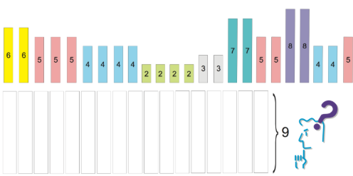

Formuliamo il problema come *modello di ottimizzazione matematica*, siano:
- $I$ l'insieme di item da collocare (VM/container)
- $n$ il numero di server fisici disponibili
- $s_i$ le risorse richieste dall'item $i$
- $B$ la capacità di ciascun server fisico, che qui assumiamo uguale per tutti per semplicità

Allora si introducono le *variabili decisionali*:

$$y_j = \begin{cases} 1 & \text{se il server } j \text{ è usato} \\ 0 & \text{altrimenti} \end{cases} \quad \text{e} \quad x_{ij} = \begin{cases} 1 & \text{se l'item } i \text{ è collocato sul server } j \\ 0 & \text{altrimenti} \end{cases}$$

La *funzione obiettivo* da minimizzare è il numero di server usati:

$$K = \min \sum_{j=1}^{n} y_j$$

I *vincoli* da rispettare su $K \ge 1$ sono:
1. **ogni oggetto deve esser collocato su un solo server**: 
   $$\sum_{j=1}^{n} x_{ij} = 1 \quad \forall i \in I$$
2. **rispettare la capacità del server usando solo quelli attivi**:
   $$\sum_{i \in I} s_i x_{ij} \le B y_j \quad \forall j = 1, \dots, n$$
   (i.e. a sx ci sono le risorse richieste da tutti gli oggetti assegnati al server $j$, a dx invece se $y_j =1$ allora la capacità è $B$, altrimenti se $y_j = 0$ il server non è attivo quindi non può ospitare oggetti)
3. (chiaramente) $x_{ij}, y_j \in \{0,1\}$

Questo modello di ottimizzazione è un esempio di **Integer Linear Programming (ILP)**, che è NP-hard.

Quindi, per trovare una soluzione in tempi ragionevoli, si ricorre a **euristiche**:
- **Random** sceglie un server $u.a.r.$, verifica che lo spazio sia sufficiente. Se sì metti l'oggetto, altrimenti fottiti e ripeti
- **Round-Robin** scorre i server in ordine, mantenendo la posizione e inserisce nel primo con capacità sufficiente
- **First-Fit** uguale a RR ma per ogni oggetto si riparte dal primo server
- **First-Fit Decreasing** ordina prima gli oggetti per dimensione decrescente, poi applica First-Fit --> collocare prima oggetti grandi permette di evitare la frammentazione dello spazio che può portare a non riuscire a collocare oggetti più piccoli in seguito, anche se una soluzione esisteva
- **Best-Fit** per ogni oggetto sceglie il server che lascerebbe meno spazio libero, ma sufficiente, dopo l'inserimento dell'oggetto
- **Worst-Fit** per ogni oggetto sceglie il server che lascerebbe più spazio libero dopo l'inserimento dell'oggetto

Le prime euristiche sono sicuramente meno sofisticate, ma anche più veloci --> come al solito quindi la scelta dipende dal contesto e dai vincoli di tempo...

### Execute:
Qui approfondiamo di meno: la fase di Execute infatti consiste semplicemente nell'attuare le decisioni prese in Plan tramite degli **effettori** (nel caso di Placement ad es. significa solo avviare/ricollocare le VM/container sui server scelti).

Se il componente è già in esecuzione --> si può prevedere una **migrazione live** per assicurarsi di **mantenere la continuità del servizio, riducendo al minimo l'interruzione**.  
Vedremo diverse tecniche di migrazione live nella parte dedicata alla Virtualizzazione.

---

### Alcune applicazioni MAPE in scenari concreti (esercizi esoneri vecchi)

**Scenario 1 -- Elasticità orizzontale delle VM**:
- **Monitor** == raccogli CPU, tempi di risposta, numero di richieste
- **Analyze** == determina se la capacità attuale è sufficiente
- **Plan** == decidi quante istanze aggiungere o rimuovere
- **Execute** == avvia o termina le istanze

**Scenario 2 -- Consolidamento energetico dei server**:
- **Monitor** == raccogli info sulle risorse usate, sui consumi e sulla collocazione delle VM
- **Analyze** == individua se ci sono server sottoutilizzati e possibilità di consolidamento
- **Plan** == decidi effettivamente quali VM migrare e verso quali server, secondo tecniche di migrazione live
- **Execute** == migra le VM secondo quanto deciso dal planner e spegni se possibile i server liberati

**Scenario 3 -- Placement delle componenti sofrtware**:
- **Monitor** == raccogli le capacità dei nodi, le risorse richieste, il carico e il placement attuale
- **Analyze** == determina se è necessario un nuovo placement o solo una ricollocazione di alcune componenti
- **Plan** == calcola una nuova assegnazione delle componenti ai nodi
- **Execute** == avvia o ricolloca le componenti sui nodi selezionati

---

### Pattern MAPE
Ci si chiede **in quali nodi eseguire le varie fasi del ciclo MAPE** e **come farle comunicare tra loro**: stiamo cioè affrontando l'architettura del *Managing System*, non quella dell'applicazione relativa al Managed System.

I due modelli architetturali anche in questo caso sono:
- **MAPE Centralizzato**: ogni componente è collocata su **un singolo nodo dedicato**. Questa architettura è semplice, ma ogni nodo può diventare collo di bottiglia oltre che SPOF...  
In particolare questo approccio è difficile per *sistemi distribuiti su larga scala*: fare un Monitoring con questa architettura in questo scenario significherebbe che i sensori devono inviare i dati a un singolo nodo centrale --> latenza eccessiva...
- **MAPE Decentralizzato**: è quello su cui ci concentriamo noi, **le componenti sono distribuite su più nodi**. Due pattern di questa architettura sono:
  - **Pattern Gerarchico**: le componenti di controllo higher-level gestiscono le componenti di controllo subordinate --> **Master-Worker/Slave**, **Hierarchical Control**.
  - **Pattern Flat**: tutte le componenti di controllo cooperano tra loro come peer, sullo stesso livello --> **Coordinated Control**, **Information Sharing**.

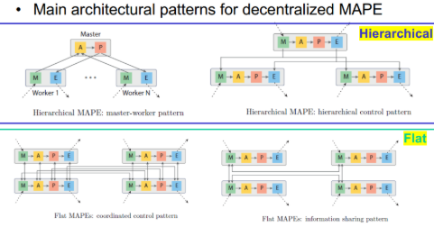

(NB: i pattern per decentralizzare MAPE sono domanda frequente agli esoneri)

#### Pattern Gerarchico
**Master-Slave**

In questo pattern la distribuzione delle responsabilità è **Master == Analyze + Plan** e **Slaves == Monitor + Execute**.

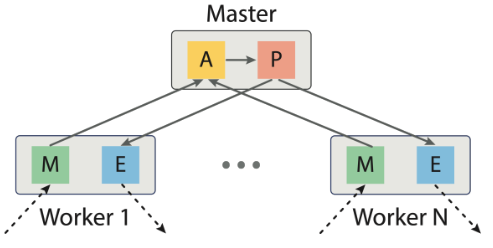

I **vari** Worker (dislocati tipicamente in diverse aree geografiche, per sistemi su larga scala) raccolgono e possono pre-elaborare i dati locali, inviando al **singolo** Master le informazioni già aggregate.  
Allora il Master con Analyze decide se è necessario un adattamento, decide con Plan e invia ai worker Execute le eventuali azioni da compiere.

Con questo approccio il **vantaggio** è che **il decisore ha vista globale del sistema e può quindi perseguirne gli obiettivi a livello globale**, i **limiti** invece sono **le comunicazioni verso il master** dal momento che rappresentano un possibile bottleneck, oltre che dipendenza dal suo funzionamento e quindi SPOF.

Per mitigare questi limiti migliorando quindi la disponibilità, ciò che si fa tipcamente è **replicare il Master, con però un singolo leader attivo alla volta**. In caso di guasto si ricorre quindi a protocolli di leader election.

---

**Hierarchical Control**

In questo altro pattern gerarchico, si hanno **più cicli MAPE completi, organizzati in una gerarchia**.  
*Ogni livello ha responsabilità diverse e può lavorare a frequenze differenti* (es. il livello più basso può avere un ciclo MAPE molto veloce, mentre quello più alto può avere un ciclo meno reattivo ma con una visione più globale).

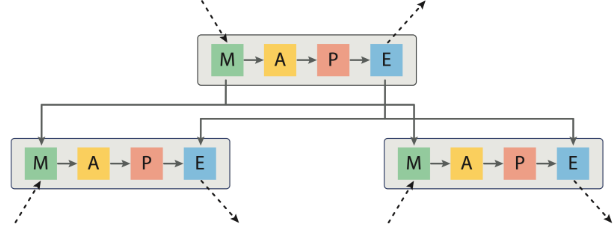

es. *autoscaling di un'applicazione a microservizi* (la vediamo meglio tra un po'): qui si ipotizza che i controllori locali gestiscano lo scaling dei singoli microservizi, mentre un controllore superiore considera l'intera applicazione per coordinare le decisioni da prendere.

**Perché serve un controllore dall'alto?** Perché un microservizio potrebbe considerare valido aumentare le proprie capacità, inviando molto più traffico ai servizi a valle e portando a un loro sovraccarico (senza però che lui lo sappia, visto che il MAPE locale si concentra solo su di lui) --> una decisione locale può creare problemi altrove.  
Mentre i controllori locali possono intervenire frequentemente, quello globale può dare direttive in tempi più lunghi.

**Vantaggio**: **separazione delle responsabilità in livelli diversi**, nonché **maggiore flessibilità** (ogni livello può infatti avere un ciclo MAPE con frequenza diversa!).  
Il **limite** è **riuscire ad individuare una buona suddivisione dei livelli**... non tutti i sistemi si prestano facilmente alla distinzione tra controllo locale e globale!

#### Pattern Flat

**Coordinated Control**

In questo pattern ogni **controllore esegue un proprio ciclo MAPE su una parte di sistema**. **Non c'è un controllore superiore al livello gerarchico**: *i cicli si coordinano tra loro tramite interazioni tra le loro componenti* --> ciò permette di distribuire il controllo senza concentrare le decisioni su un singolo nodo!

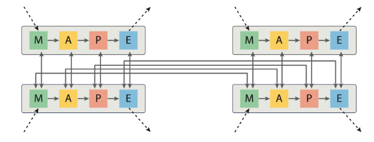

Il **vantaggio** è **maggior potenziale scalabilità** (non c'è più un singolo master che può diventare collo di bottiglia all'aumentare del numero di controllori).  
Il **limite** è che **coordinare le decisioni tra controllori sullo stesso livello è complesso e ha costo significativo**

---

**Information Sharing**

Rappresenta un *caso particolare di Coordinated Control* dove **solo le componenti Monitor interagiscono tra loro**: ha senso in quanto sono i Monitor che raccolgono i dati grezzi ed eventualmente li pre-elaborano.

I controllori condividono quindi le info raccolte via Monitoring a livello globale, ma ognuno di essi poi esegue separatamente Analyze, Plan ed Execute sul proprio dominio di competenza.

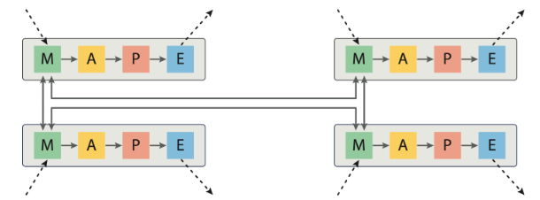

Il **vantaggio** è **minori interazioni rispetto a un classico Coordinated Control e quindi meno costi e complessità**, il **limite** è che **i planner** (non avendo visione globale dei dati nella loro interezza) **possono prendere decisioni subottimali o addirittura in conflitto tra loro**.

---

Vediamo ora tre esempi di sistemi auto-adattivi per la gestione delle risorse, al fine di aver chiari questi pattern di controllo e introdurre alcune delle policy reattive e proattive più importanti.  
In tutti i tre casi le applicazioni operano *under uncertainty* (ossia possono esserci cambiamenti imprevisti nel carico di lavoro o nell'ambiente) e l'obiettivo di adattamento è mantenere i target di qualità SLO (es. tempo di risposta, availability, throughput...)

### Caso d'uso 1: EC2 Auto Scaling
Si vogliono adattare il numero di istanze EC2: a questo scopo si usa un servizio AWS chiamato **Amazon EC2 Auto Scaling**.  
Un **Auto Scaling Group** è un insieme di istanze gestite dal servizio: si stabiliscono un min e un max e il servizio provvede a modificare le capacità entro questi limiti secondo le policy configurate.  
Il max in particolare serve a limitare la crescita dei costi.

In questo caso il focus è lo **scaling orizzontale**: **scale-out** se si aggiungono istanze, **scale-in** se se ne rimuovono.

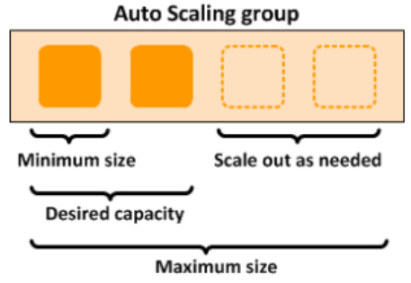

Per il **Monitoring** la componente si appoggia a **CloudWatch**: le metriche di risorse in questo caso sono CPU, memoria, banda, disco e conteggio di richieste tramite un **Load Balancer**.  
In generale è da ricordare che **la decisione di scaling deve usare una metrica che sia rappresentativa del carico o delle prestazioni**, a seconda dell'applicazione specifica.

In generale è importante distinguere due tipi di metriche: **metriche di risorse** (CPU, memoria, banda...) e **metriche dell'applicazione** (tempi di risposta, throughput, sessioni attive, lunghezza delle code...).  
Per le metriche applicative serve *strumentazione specifica* che permettano al Monitoring di misurare e raccogliere le informazioni.

Il servizio di Auto Scaling permette anche **Self-Healing**: si sostituiscono istanze "non sane" tramite i controlli configurati (es. se ho 5 istanze e una si guasta --> il sistema può trovarne una sostitutiva per mantenere la capacità prevista, o anche fare load balancing sulle 4 rimanenti se il numero minimo di istanze è 4...)

Per il **Planning** studiamo due delle più semplici policy implementate da EC2 Auto Scaling per lo scale-in e scale-out: **Policy reattiva a soglie** e **Policy reattiva a Target Tracking**, oltre che in generale il concetto di **Policy Predittive**.

#### Policy reattiva a soglie
Si tratta di una semplice euristica basata su due soglie:

$$\begin{cases} \text{scale-out} & \text{se la metrica supera la soglia superiore} \\ \text{scale-in} & \text{se la metrica scende sotto la soglia inferiore} \\ \text{nessuna modifica} & \text{altrimenti}\end{cases}$$

Sta all'utente quindi definire precisamente le *soglie*, le *metriche considerate*, le *finestre di valutazione* e *il numero di istanze da aggiungere/rimuovere nei due casi*.

es. uso medio della CPU $\gt 70\%$ per un minuto --> scale-out di un'istanza  
uso medio della CPU $\lt 30\%$ per 5 minuti --> scale-in di un'istanza

La politica è chiaramente **reattiva** dato che decide sulla base di **condizioni e misurazioni già osservate**.

Nel modello MAPE quindi sarebbe: Monitor raccoglie e aggrega la metrica in questione, Analyze rileva il superamento o il mancato rispetto delle soglie, Plan decide i valori di scale-in o scale-out e Execute effettua l'operazione di scaling effettiva.

Ad ogni azione di scaling effettuata corrisponde un tempo di **cooldown**, introdotto per lasciare al sistema il tempo di assestarsi e per osservare l'effetto dell'intervento, prima di avviarne eventualmente altri.  
Importante distinguere il cooldown dalla **finestra di valutazione**, che invece è il periodo di tempo in cui si osserva la metrica per stabilire se la condizione di scaling si sia o meno verificata.

Si distingue in questa policy il **simple scaling** se al verificarsi della condizione si applica una variazione fissa configurata, e **step scaling** se invece la variazione dipende da quanto la metrica supera la soglia.

Il **vantaggio di questa policy è senz'altro la semplicità**, ma al costo di diversi **svantaggi**:
1. **è difficile scegliere una metrica significativa**: serve conoscere l'applicazione specifica e spesso l'applicazione è limitata da più metriche.  
Limitandosi ad osservarne solo alcune, si rischia di non reagire correttamente
2. **è difficile scegliere le soglie e i tempi corretti**:
   - *Soglia superiore troppo alta* --> rischio di aggiungere le risorse troppo tardi e quindi peggioramento delle prestazioni, **under-provisioning**
   - *Soglia superiore troppo bassa* --> rischio di aggiungere risorse troppo presto e quindi spreco di risorse, **over-provisioning**
   - *Soglia inferiore troppo alta* --> rischio di rimuovere risorse in modo troppo aggressivo e quindi possibile capacità insufficiente, **under-provisioning**
   - *Soglia inferiore troppo bassa* --> rischio di rimuovere risorse troppo tardi e quindi spreco di risorse, **over-provisioning**
   - *Finestre di valutazione e cooldown troppo lunghi/brevi* --> reazione lenta ai cambiamenti/reazioni troppo frequenti e quindi instabilità del sistema
3. **è tendenzialmente inadatto per carichi di lavoro fortemente variabili**

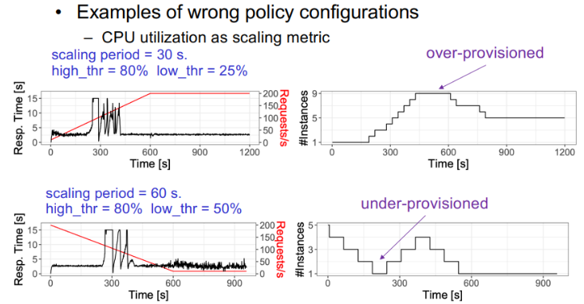

Nel grafico in alto a sx i picchi dimostrano come il sistema stia aggiungendo risorse troppo lentamente per gestire le richieste (high_thr troppo alto)... fino a riabbassarlo con 9 istanze. Tuttavia il low_thr è troppo basso e quindi per un lungo periodo il sistema resta over-provisioned...  

In basso a sx invece rimozione troppo aggressiva: il numero di richieste diminuisce costantemente, ma a un tratto il response time riaumenta all'improvviso proprio per via che la capacità è stata ridotta più velocemente di quanto fosse opportuno --> under-provisioning.

Un approccio per risolvere questo problema è sfruttare il reinforcement learning per imparare le soglie (es. soluzione multiagente con uno che si occupa della soglia relativa alla CPU, l'altro per la memoria etc... con l'obiettivo di adattare il comportamento a carichi che possono colpire risorse diverse)

Il punto è che **se si decide di usare una policy reattiva a soglie --> si deve conoscere bene l'applicazione per capire come configurare opportunamente le soglie e i tempi di valutazione**.

#### Policy reattiva a Target Tracking
Invece che indicare due soglie, questa policy **prevede di indicare un valore obiettivo**(es. "mantieni l'uso medio della CPU attorno al 60%").

Resta una policy **reattiva** dato che si basa su misurazioni di metriche già osservate.  
Il vantaggio è quindi una **maggiore semplicità di configurazione**.

Kubernetes HPA (Horizontal Pod Autoscaler) implementa questa policy seguendo la seguente regola:

$$N_{desired} = \lceil\left(N_{current} \times \frac{M_{current}}{M_{target}}\right)\rceil$$

Dove $N$ è il numero di istanze ed $M$ è il valore della metrica osservata.

Ad es. con 5 repliche, CPU media all'$80\%$ e target al $60\%$:

$$N_{desired} = \lceil\left(5 \times \frac{80}{60}\right)\rceil = \lceil 6.66 \rceil = 7$$

per cui il controllore deciderà di passare da 5 a 7 repliche.

Il **limite** è che la formula funziona bene fintanto che si parla di **metriche lineari alla variazione del numero di istanze** --> **non va applicata indistintamente a qualunque metrica.**

#### Policy Predittive
Nello scaling predittivo si usa un modello ML per prevedere il carico e istanziare la capacità **prima che si presenti il bisogno** --> è un approccio **proattivo**.

La motivazione (e quindi suo vantaggio principale) è che per avviare le risorse ci vuole tempo --> se riusciamo a prevedere quando il carico aumenterà, possiamo compensare a questo ritardo.

Tuttavia diversi limiti:
- servono **dati storici rappresentativi** per l'addestramento dei modelli
- una **variazione improvvisa e mai osservata** può esser difficile da prevedere
- nel caso specifico di Amazon EC2 Auto Scaling, offre solo politica **scale-out**
- si assume che tutte le istanze VM siano equivalenti

---

### Caso d'uso 2: Selezionare dinamicamente i servizi
Qui non si sceglie più quante istanze avviare, **ma quali servizi usare per realizzare un certo compito**.

Ci focalizziamo su un'applicazione **Service Oriented** (SOA): qui si distingue tra *servizio astratto* (che rappresenta una certa funzionalità richiesta) e *servizio concreto* (che rappresenta una sua specifica implementazione).

Più servizi concreti possono offrire la stessa funzionalità, ma con proprietà non funzionali diverse (costo, disponibilità, tempo di risposta..)

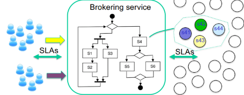

In figura si osserva come il servizio astratto $S_4$ abbia più alternative concrete, che possono però essere diverse per proprietà non funzionali.  
Il diagramma con i fork-join, le condizioni e sequenze lega logicamente i vari servizi dell'applicazione.

L'obiettivo dell'adattamento è quindi scegliere dinamicamente quali servizi concreti usare per rispettare gli SLO dell'applicazione:
- **Monitor** raccoglie le info sulle prestazioni e disponibilità dei servizi
- **Analyze** valuta se gli obiettivi di qualità sono rispettati
- **Plan** determina una nuova politica di selezione di servizi concreti (ad es. tramite MOSES, un planner centralizzato basato sulla programmazione lineare)
- **Execute** applica la nuova politica

Per migliorare le prestazioni diverse possibilità: assegnare ai servizi astratti diversi servizi concreti in base alla situazione del sistema (come visto ora nel MAPE), ma anche **invocare diversi servizi in parallelo e usare il primo che risponde**

Quindi l'aspetto centrale qui è mantenere la funzione generale dell'applicazione, adattando però dinamicamente le implementazioni concrete dei servizi.

---

### Caso d'uso 3: Autoscaling gerarchico dei miscroservizi 
Questo caso si applica all'**Hierarchical control**.  
L'obiettivo è **mantenere il tempo di risposta sotto un certo limite**, adattando il numero di repliche dei microservizi che compongono l'applicazione.

Il sistema ha due livelli: **Controllori Locali (Microservice Manager)** e **Controllore Globale (Application Manager)**.

Per quel che riguarda i controllori locali, ogni microservizio (coerentemente a quanto visto con il pattern) ha un proprio controllore che esegue un ciclo MAPE completo: osserva il funzionamento del microservizio, valuta le necessità di adattamento ed in caso produce una **proposta** di scale-in/scale-out per il microservizio che gestisce.

Un modo per fare Planning nel Microservice Manager è ad es. combinare la **teoria delle code** per modellare il servizio delle richieste e fare **previsione del carico** con un modello come la regressione lineare.  
La **proposta** di adattamento viene quindi **inviata al controllore globale**

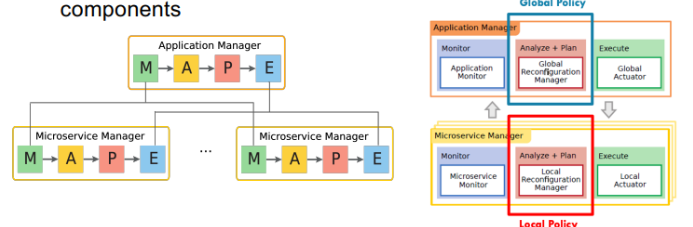

Il controllore globale ha una vista dell'intera applicazione e può quindi approvare o rifiutare le proposte locali. Le decisioni prese vengono quindi trasmesse alle componenti Execute locali.

Come anticipato, il controllore globale serve eprché i microservizi sono tutti interconnessi -- una richiesta di $A$ può generare lavoro per $B$ (es. $A$ invia richieste a $B$ e il controllore di $A$ chiede di aumentare le repliche per inviare più richieste, mentre quello di $B$ propone di diminuirle --> conflitto: $B$ rischia di non avere capacità sufficiente per gestire le richieste in arrivo da $A$ --> il controllore globale decide quale delle due proposte accettare).

Nota come ci sia Hierarchical Control e non Master-Slave perché i livelli locali hanno tutti cicli MAPE completi, non solo Monitor + Execute.

---

Ricapitolando i tre casi d'uso:
1. **EC2 Auto Scaling**: viene adattato il numero di istanze, le politiche di decisione sono reattive (a soglie o target tracking) o proattive (predittive)
2. **Selezione dinamica dei servizi**: vengono adattate le implementazioni concrete dei servizi astratti nel tempo, per farlo si usa ottimizzazione lineare centralizzata (MOSES)
3. **Microservizi**: si adatta il numero di repliche dei singoli componenti, per farlo planning locale con code e previsioni, coordinato però gerarchicamente grazie al pattern Hierarchical Control