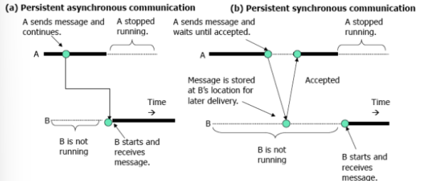
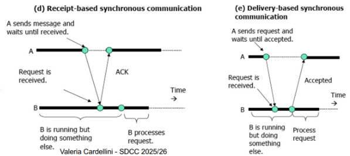
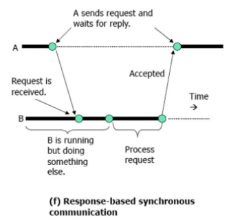
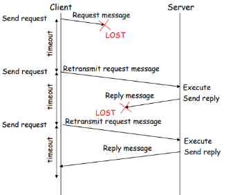
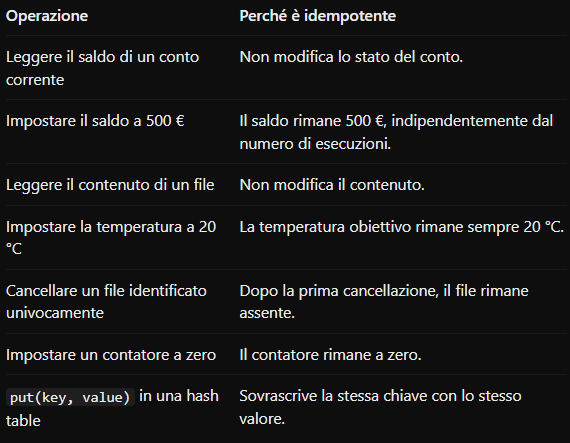
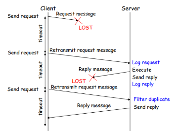

Nei sistemi distribuiti le componenti comunicano tramite *ricezione e invio di messaggi*. 

A questo proposito ci concentriamo sul **middleware di comunicazione**, che offre alle applicazioni distribuite funzionalità come *RPC (Remote Procedure Call)* e *code di messaggi o pub/sub broker*.  

Oltre al middleware di comunicazione ne esistono di altri tipi come naming (per identificare e permettere la condivisione delle risorse), security (per garantire la sicurezza delle comunicazioni), locking (per la gestione della concorrenza) etc..  
Nella pila protocollare, **il middleware di comunicazione si trova tra il livello di trasporto e il livello applicativo** (quindi un gradino sopra rispetto al sistema operativo).

Le funzionalità fornite dal middleware sono **riutilizzabili** ed **indipendenti dalla logica specifica dell'applicazione**. In questa sezione ci si focalizzerà sul middleware di comunicazione di tipo RPC.  

# Tipi di comunicazione

Le comunicazioni possono essere classificate secondo tre criteri:
1. **Persistente vs Transiente** == *se il msg è conservato o meno per una consegna successiva al destinatario* --> se sì, il destinatario non deve essere necessariamente attivo quando il mittente invia.    
Nel caso transiente possono comunque esistere buffer temporanei che conservino il msg, ma non c'è garanzia di consegna se il destinatario non è attivo.
1. **Sincrona vs Asincrona** == *se il mittente attende o meno la risposta del destinatario.*
Esistono diversi tipi di sincronizzazione:
     - **at request submission** se il mittente deve attendere che sia il middleware a prendere in carico la richiesta
     - **at request delivery** se deve attendere che la richiesta raggiunga il destinatario
     - **after request processing** se deve pure attendere che il destinatario elabori la richiesta e produca una risposta

    --> un invio sincrono può anche terminare prima che l'applicazione   destinataria abbia effettivamente eseguito l'operazione richiesta!  
    Nel caso asincrono si parla di **invio non bloccante** dato che il mittente può continuare il proprio lavoro dopo aver inviato il msg.  
    Anche la **ricezione** a sua volta può essere **bloccante** se il ricevente deve attendere che arrivi un msg, oppure **non bloccante** se può continuare a fare altre cose e controllare periodicamente se è arrivato un msg (es. polling).  
    Il fatto che il mittente invii in modo asincrono non implica che il destinatario riceva in modo asincrono, dipende dalla logica dell'applicazione.
1. **Comunicazione Discreta vs Streaming** (*Dipendenza Temporale*) == *se il msg è inviato in blocchi discreti o come flusso continuo di dati.*  
Con la discreta quindi ogni msg rappresenta un'unità informativa distinta (es. interrogazione di un DB) mentre con lo streaming l'informazione per essere compresa deve essere contestualizzata a una sequenza di msg (es. video in streaming), in questo secondo caso i messaggi hanno relazioni di dipendenza temporale tra loro e bisogna saperli ricomporre di conseguenza.

Avere una comunicazione di un certo tipo non implica automaticamente averne un'altra.  
Vediamo però ora alcune delle combinazioni più interessanti: 

**Persistente + Asincrona** --> il mittente invia il msg e continua a lavorare, mentre il middleware conserva il msg finché il destinatario non può riceverlo. 

**Persistente + Sincrona** --> il middleware conserva il msg, ma l'utente deve attendere conferma prima di proseguire il lavoro.  
Nell'esempio sotto, il msg arriva a $B$ quando $B$ è ancora inattivo -> il middleware manda ack ad $A$ quando è sicuro che il msg è stato salvato correttamente e $B$ potrà leggerlo --> in questo caso *sincronia at request delivery*

**Transiente + Asincrona** --> il mittente invia senza attendere nulla, ma manca la conservazione del msg per futura disponibilità del destinatario --> se il destinatario è inattivo niente da fare, il msg va perso (es. UDP), il mittente non sa se il msg è stato ricevuto o meno (*fire and forget*, è un'applicazione best effort).

**Transiente + Sincrona** --> il mittente atttende conferma, ma il sistema non conserva il msg per una consegna in differita.  
Tre varianti simili a prima in base a *quando il mittente può riprendere il lavoro*:
- **receipt-based** se riprende a lavorare appena il msg raggiunge il buffer destinatario
- **delivery-based** se appena il destinatario inizia a processare il msg
- **response-based** se appena il destinatario ha elaborato il msg e inviato la risposta 

Mentre **MOM Message Oriented Middleware** rappresenta un paradigma di comunicazione **Persistenza + Asincrona**, il **paradigma RPC** standard rappresenta una comunicazione **Transiente + Sincrona, response-based** (anche se esistono implementazioni di RPC asincrone, ma sempre e comunque transienti in quanto non c'è un broker che conserva i msg per il destinatario!)

---

# Communication Failures
In generale quando un client esegue una chiamata RPC avviene quanto segue: il client invia la richiesta, il server esegue la procedura specifica e risponde con il risultato.

Approfondiremo bene ogni singolo passaggio in questione, per ora però è importante capire che *il middleware nasconde parte dei dettagli della comunicazione*, ma **non elimina affatto i problemi dovuti alla natura distribuita del sistema**.

Esistono in questo senso diversi fallimenti possibili in termini di comunicazione:
- **perdita o ritardo dei messaggi**
- **crash del server**, che può avvenire **prima** o **dopo** l'elaborazione della richiesta.  
Questa differenza è importante perché il fatto che la risposta non arrivi al client, in generale, non può permettere al client se l'operazione è stata eseguita o meno.
- **crash del client** dopo aver inviato la richiesta

Questi problemi vedremo che riguardano non solo RPC, ma anche altri paradigmi di comunicazione come MOM.

Per gestire questi problemi, i sistemi possono offrire diverse **semantiche**: queste rappresentano **le garanzie che il sistema distribuito offre in caso di fallimento della comunicazione**.

Nel caso di RPC ci concentriamo su garanzie che riguardano il processamento della richiesta da parte del server, mentre vedremo con MOM invece semantiche legate alla consegna dei messaggi all'intermediario.

Quattro semantiche principali:
1. **May-Be**: rappresenta la variante *best-effort*, per cui non si garantisce in alcun modo che la richiesta venga processata o meno.
2. **At-Least-Once**: si garantisce che, *se ricevo risposta*, la richiesta è stata processata **almeno una volta** (se non ricevo risposta non posso essere sicuro di nulla, il server potrebbe essere crashato come potrebbe aver processato la richiesta...)
3. **At-Most-Once**: si garantisce che, se il client riceve risposta, la richiesta sia stata elaborata **al più una volta**
4. **Exactly-Once**: anche in questo caso, se il client non riceve risposta, non può sapere con certezza se la richiesta sia stata elaborata o meno (magari il server è esploso...).  
Ciò che però distingue questa semantica da at-most-once è che, *oltre a impedire esecuzioni duplicate*, **exactly-once introduce meccanismi avanzati di persistenza e recovery che consentono di garantire il completamento dell'operazione anche in presenza di guasti come il crash del server** (sempre e comunque nelle condizioni previste dal protocollo)

Esistono **tre strumenti principali** per implementare *at-least-once* e *at-most-once*:
1. **RR1 - Request Retry**: il client avvia un timer quando invia la richiesta, e ritrasmette al timeout.  
Chiaro che il timeout non implica che il server sia guasto (magari richiesta lunga da elaborare o server in overload) --> si possono limitare le ritrasmissioni aumentando progressivamente il timeout (**backoff esponenziale**).
2. **DF - Duplicate Filtering**: il server riconosce che una richiesta è ritrasmissione di una precedente --> **non la esegue nuovamente**
3. **RR2 - Result Retransmit**: il server conserva il risultato della richiesta. Se arriva un duplicato della richiesta --> **ritrasmette il risultato salvato senza rielaborarla**

*RR2 risolve quindi un problema per cui solo DF non basta: ignorare tutti i duplicati evita sì multipla esecuzione, ma se al client non è arrivata la prima risposta e non gliela rimandiamo resta senza niente (porello)*

## May-Be
Con la semantica **May-Be** non serve alcuno degli strumenti descritti sopra: il client invia e non ha alcuna garanzia di ricevere mai la risposta... né tantomeno di sapere se la richiesta è stata processata o meno.  
Il **vantaggio** è **semplicità e performance**, lo **svantaggio ovviamente è l'assenza di garanzie**.

*Possibili applicazioni di May-Be*: dati di sensori per le quali perdite sporadiche sono tollerabili, oppure logging non critico...

## At-Least-Once
Si può implementare questa semantica tramite l'uso esclusivo di **RR1** --> *se la risposta non arriva il client riprova, e il server tratta ciascuna richiesta come una nuova operazione da eseguire.*  
Risulta chiaro quindi che un'operazione possa essere eseguita più volte

Questa modalità è adatta a servizi **idempotenti**, ossia tali per cui se un'operazione viene eseguita più volte con lo stesso input il risultato non cambia ($f(x) = f(f(x))$).

Esempi cardine di operazioni idempotenti sono il *get* o *put* di risorse in un database, il *set* di una variabile (fare più set con stesso input non cambia il risultato finale), cancellare una risorsa definita univocamente (se la risorsa non esiste più, cancellarla di nuovo non cambia nulla):

Al contrario, esempi di operazioni non idempotenti sono *incrementare* o *decrementare* un contatore o un valore più in generale:

Per le operazioni non idempotenti è preferibile usare *at-most-once* o *exactly-once*.

## At-Most-Once
Qui il server esegue la richiesta zero oppure una volta: per ottenere questa semantica si combinano **RR1** lato client e **DF**, **RR2** lato server.

Facile capire perché funziona: il client sa che prima o poi il server riceverà la richiesta grazie a RR1. Si evitano le richieste duplicate grazie a DF e ci si assicura che il client riceverà la risposta, prima o poi, grazie a RR2.

Se il client non riceve risposta, non può sapere se la richiesta è stata eseguita o meno, ma sa che non è stata eseguita più di una volta.

Più precisamente, per implementare **DF** e **RR2** il **server deve saper riconoscere richieste duplicate ed associarle ad un singolo risultato**.  

Per fare ciò il client include un ID univoco (**xid**) per ogni nuova richiesta, usando sempre lo stesso per le ritrasmissioni, in una forma del tipo $xid = (client\_id, nonce)$.    

Quando il server riceve uno **xid per la prima volta** --> processa la richiesta, associa lo xid al risultato in una forma del tipo $result \rightarrow (status, result)$, e invia il risultato al client.

Lo $status$ può essere **pending** se la richiesta è in corso di elaborazione, oppure **completed** se il processamento è terminato e il $result$ è pronto in memoria.  
Allora se un duplicato arriva con *pending* --> il server lo ignora e aspetta che il risultato sia pronto (tanto poi lo invia comunque), mentre se arriva con *completed* --> il server risale subito a $result$ grazie all'associazione con lo xid e lo ritrasmette.

Il server chiaramente non può conservare all'infinito ogni $result$ --> per gestire la cosa si possono inserire timeout oppure finestre scorrevoli sugli xid.

Il pattern appena visto è noto come **Idempotent Receiver** (i.e. il ricevente può gestire anche servizi non idempotenti!)

## Exactly-Once
In at-most-once c'è una problematica nascosta legata alla possibilità **che il server crashi mid processing: in tal caso anche se il risultato è stato calcolato, questo sarà perso se non è stato salvato stabilmente con associato lo xid, e il server non può sapere se aveva iniziato a processarlo**.  

Exactly-once affronta il problema seguendo la logica transazionale dell'atomicità: 
- se tutto va bene, eventuali duplicati sono filtrati e l'operazione viene eseguita solo una volta
- se ci sono problemi (e.g. crash del server) il sistema ha comunque meccanismi avanzati che permettono al server di sapere se l'operazione è stata completata o meno

Per ottenere questa fortissima garanzia RR1, DF e RR2 non bastano più, ulteriori meccanismi:
- **Replicazione del server**: più server mantengono copie del servizio e del suo stato --> un guasto può esser gestito facendo proseguire un'altra replica (schemi leader-followers o primary-backup).  
Le difficoltà qui è la **consistenza** delle copie e la **trasparenza** delle repliche verso il client.
- **Write-Ahead Logging**: agisce preventivamente salvando le richieste in memoria *persistente* prima di eseguirle
- **Meccanismi di Recovery**: se avviene un crash, il server deve essere in grado di recuperare lo stato corretto e coerente del servizio. Tra questi meccanismi:
  - **Checkpoint dello stato**: si salva in memoria *persistente* lo stato del server ogni tot tempo, così da poterlo recuperare in caso di crash.
  - **Checkpointing con snapshot**: non ci si limita a un singolo server, ma si vuole salvare una visione globale e consistente anche dei replicati. Più complesso, richiede coordinamento tra i server
  
  Prima di approfondire il WAL, è importante puntualizzare che la semantica exactly-once, oltre a dare maggiori garanzie, è anche la più difficile in assoluto da implementare, soprattutto in sistemi distribuiti su larga scala (l'exactly-once pura è in realtà impraticabile in scenari reali).

### WAL Write-Ahead Logging
Il **WAL Write-Ahead Logging** (aka Commit Log) è un **registro persistente delle operazioni necessarie a ricostruire lo stato di un servizio**.

Il principio generale è il seguente: *prima si registra l'informazione necessaria al recupero (es. la richiesta), e solo poi si applica l'operazione in sé*.

*Ogni cambio di stato è salvato come nuova entry del log*, dove il log è inteso come **struttura dati append-only scritta in memoria persistente** --> in questo modo, se il server crashasse, al riavvio può leggere il log e ricostruire lo stato del servizio.

Importante distinguere tra **checkpoint** e **WAL**: il primo conserva lo stato del sistema in un dato istante (stato == condizione del sistema dopo un certo numero di operazioni), mentre il secondo conserva proprio le operazioni necessarie a ricostruire lo stato.

Per recuperare da un crash quindi il server:
1. anzitutto **carica un checkpoint valido**
2. e solo dopo **riapplica le entry successive allo stato presenti nel WAL**

Scrivere in memoria persistente è però molto costoso, specialmente se viene fatto una singola entry alla volta --> un'alternativa migliore sarebbe accumulare più entry in batch e scriverle in gruppo, però questo potrebbe comportare l'impossibilità di ricostruire lo stato corretto in caso di crash (se alcune operazioni erano nel batch in RAM quando il server è crashato...)

Abbiamo visto il WAL implementato lato server, ma questo può essere anche implementato lato client.  
I relativi vantaggi della doppia implementazione sono:
- **lato client** permette di recuperare le richieste pendenti e i relativi identificativi (xid) dopo un crash, per poterli ritrasmettere senza crearne di nuovi
- **lato server** permette di recuperare correttamente lo stato del servizio e conoscere le richieste già processate

---

In conclusione le semantiche più diffuse sono **at-least-once** e **at-most-once**, la prima preferita per la scalabilità e semplicità e usata per servizi idempotenti.  

**Exactly-once** è tipicamente relegata ad applicazioni critiche.

---

**Esonero 2023 - Domanda 1c**

*Cosa può fare lo sviluppatore se il middleware di comunicazione che deve utilizzare supporta soltanto la semantica at-least-once ma la procedura remota che sta sviluppando è non idempotente?*

Per prima cosa, lo sviluppatore può trasformare (laddove possibile) l'operazione non idempotente in un'operazione idempotente, ad esempio trasformando un'operazione di incremento in un'operazione di set (es. *incrementa di 47 di 1* --> *imposta 48*).

Se ciò non dovesse bastare, lo sviluppatore può rendere idempotente la gestione dell'operazione implementando a livello applicativo un meccanismo di Duplicate Filtering, secondo il pattern Idempotent Receiver, sopperendo così alla mancanza di tale meccanismo nel middleware.

In particolare:
1. Il client associa a ogni richiesta un identificativo univoco (xid), mantenendolo invariato in caso di ritrasmissione.
2. Il server mantiene una struttura dati contenente gli identificativi delle richieste già elaborate e i relativi risultati.
3. Quando riceve una richiesta, il server verifica se il relativo identificativo è già presente.
   - Se non è presente, elabora la richiesta e registra il risultato.
   - Se è già presente, restituisce il risultato precedentemente calcolato senza rieseguire l'operazione.
  