Per far comunicare due componenti distribuite possiamo lavorare a livelli di astrazione differenti:
- con la **programmazione di rete esplicita** lo sviluppatore usa direttamente le primitive di comunicazione di rete (socket, HTTP, etc..) per gestire lo scambio di messaggi.  
Questo approccio richiede di occuparsi di molti dettagli della comunicazione (costruzione ed invio richieste, ricezione, interpretazione risposte...)
- l'alternativa **implicita** è utilizzare un **middleware di comunicazione** (collocato logicamente, come anticipato in 4, tra applicazione e SO) che offre un'interfaccia a livello applicativo e permette di gestire operazioni comuni nascondendo i dettagli della comunicazione, che altrimenti lo sviluppatore dovrebbe implementare da sé --> in questo modo lo sviluppatore può concentrarsi sulla logica applicativa.

# RPC
**RPC** sta per **Remote Procedure Call**: *un client chiede l'esecuzione di una procedura che però si trova presso un altro processo (in genere su una macchina remota)*.

Con RPC il client chiama la procedura, il server riceve la richiesta e la esegue, e infine il risultato viene restituito al client.  
L'obiettivo principale di RPC è la **trasparenza della comunicazione**: nonostante bisogni affrontare tutti i problemi legati alla comunicazione di rete e si deve eseguire la richiesta su un'altra macchina, si vuole far sì che (per quanto possibile) il client veda l'accesso alla procedura remota come se fosse locale.

Moltissime realizzazioni di RPC: **Sun RPC** (C), **Java RMI**, **RPyC** (Python), **Go** (che le supporta nativamente), **gRPC** (da Google, che permette di far interagire componenti scritte anche in linguaggi diversi).

## Client e Server Stub
In una chiamata locale, chiamante e procedura condividono lo stesso spazio di indirizzamento e possono usare meccanismi come la pila di esecuzione per passare parametri e risultati.  
In una RPC questo chiaramente non è possibile, dato che client e server sono processi distinti con spazi di memoria separati.

In RPC, per simulare una chiamata locale, vengono introdotti due componenti intermediari, detti **stub** o **proxy**.

Il **Client Stub** è un componente che si trova nel processo del client e ha la stessa interfaccia della procedura remota. Quando viene invocato:
1. Riceve i parametri della chiamata
2. Effettua il **marshalling**, preparando il messaggio di richiesta
3. Invia la richiesta al server tramite il sistema di comunicazione
4. Riceve il messaggio di risposta
5. Effettua l'**unmarshalling** del risultato
6. Restituisce il risultato al client

Il **Server Stub** è invece il componente che gestisce la comunicazione lato server. Quando riceve una richiesta:
1. Effettua l'**unmarshalling** dei parametri
2. Individua e invoca la procedura applicativa richiesta
3. Riceve il risultato della procedura
4. Effettua il **marshalling** del risultato
5. Invia la risposta al client

Il flusso completo della RPC può essere quindi schematizzato così:

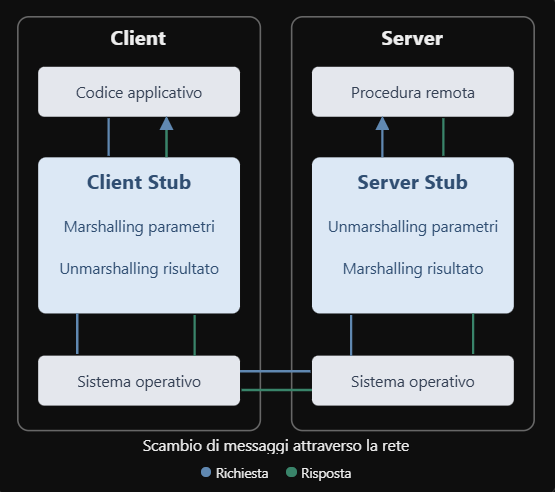

Gli stub implementano il così detto **Proxy Pattern**: rappresentano localmente la procedura remota e nascondono diversi dettagli implementativi di comunicazione.

## Requisiti e problematiche implementative delle RPC
Tra le problematiche principali che deve affrontare il middleware per effettuare la chiamata remota:
1. **Scambio dei messaggi**: identificare la procedura richiesta, trasportare i parametri e risultati e associare ogni risultato alla relativa richiesta.
2. **Eterogeneità dei dati**: garantire che client e server possano interpretare i dati anche usando rappresentazioni differenti
3. **Passaggio dei parametri**: se un parametro è un riferimento (indirizzo) in memoria locale, come fare a passarlo al server remoto?
4. **Semantica dei fallimenti**: stabilire le garanzie offerte in caso di perdite di messaggi, ritardi, crash...
5. **Binding**: individuare l'endpoint del server che implementa la procedura richiesta.

Per quanto riguarda il punto 1, abbiamo già introdotto i concetti di *client stub* e *server stub*, che si occupano anche di associare ogni richiesta al relativo risultato. Iniziamo quindi ad analizzare più nel dettaglio gli altri punti.

### Eterogeneità dei dati
Client e server possono usare piattaforme e architetture diverse, che rappresentano i dati in modo differente.  
Tra le differenze principali l'*endianess* (ordine dei byte), *dimensione dei tipi* (es. un intero può essere rappresentato con 2, 4 o 8 byte), *codifica dei caratteri* (es. ASCII, UTF-8..), padding e allineamento dei dati in memoria...

Per questi motivi è necessario concordare una rappresentazione dei dati adatta alla trasmissione, detta *wire encoding*. Per fare ciò, RPC utilizza i concetti di:
- **Marshalling**: preparazione complessiva dei dati da inviare. 
- **Unmarshalling**: interpretazione dei dati ricevuti e ricostruzione della rappresentazione locale.

Un concetto da non confondere con il marshalling è quello di **serializzazione**, ossia la rappresentazione di dati e oggetti come una sequenza di byte --> la serializzazione è parte del marshalling.

Per la conversione dei dati, esistono quattro strategie principali:
1. **Codifica indicata nel messaggio** == il mittente specifica il formato utilizzato e il destinatario effettua la conversione --> il limite di questo approccio è l'**overhead** nella dimensione del messaggio. 
2. **Conversione nel formato destinatario** == il mittente converte direttamente i dati nel formato del ricevente --> il limite è che il ricevente **deve conoscere tutti i formati degli altri sistemi**
3. **Broker** == un componente intermediario si occupa delle conversioni --> il limite è che il broker diventa quindi SPOF e collo di bottiglia
4. **Formato comune** == sia mittente che destinatario convertono i dati da e verso una codifica condivisa 

Di questi quattro approcci, il secondo non è ben scalabile: supponendo di avere $N$ formati diversi nella rete (uno per ogni nodo) --> ogni nodo deve essere in grado di convertire i propri dati in $N-1$ formati diversi --> $O(N^2)$ conversioni totali.

Il formato comune, al contrario, rappresenta una soluzione **scalabile**: ogni sistema deve saper convertire solo dal proprio formato a quello comune e viceversa --> $O(N)$ conversioni totali in una rete di $N$ sistemi di formati differenti.  
Inoltre, la soluzione a formato comune **riduce anche il coupling** dato che i vari nodi sono dipendenti solo dal formato comune e non dai formati degli altri nodi --> per queste ragioni **la soluzione a formato comune è quella prevalente nelle implementazioni RPC**.

### Passaggio dei parametri per riferimento
In una chiamata locale sappiamo distinguersi tre modalità principali di passaggio dei parametri:
- **per valore** se la procedura riceve direttamente una copia del dato --> le modifiche al parametro non modificano l'originale
- **per riferimento** se la procedura accede direttamente al dato originale tramite un riferimento (es. un puntatore) 
- **copy-restore**: qui la procedura chiamata riceve una copia del valore (*copy-in*), ma al termine della chiamata il valore modificato viene copiato nuovamente nel parametro originale (*copy-out*) --> la procedura lavora su una copia, ma il risultato finale modifica effettivamente la memoria del chiamante.

Nelle RPC chiaramente **un riferimento a un indirizzo di memoria del client non può essere usato direttamente dal server remoto**, dato che i due processi hanno spazi di indirizzamento diversi.  
Una possibile soluzione adottata nelle RPC consiste quindi nel *simulare il passaggio per riferimento tramite un* **copy-restore**:
1. Il client stub copia e traspette il dato al server (*copy-in*)
2. il server esegue la procedura lavorando sulla copia ricevuta
3. il server restituisce il dato eventualmente modificato
4. il client stub aggiorna il dato originale (*copy-out*)

Se la struttura contiene altri puntatori --> si procede ricorsivamente, copiando anche i dati puntati dai puntatori etc...

### Semantica dei fallimenti
Ci si ricollega al riassunto 4.  
Qui ci limitiamo a ricordare come **at-least-once** sia la semantica più adatta nel caso si debbano eseguire operazioni **idempotenti** (è sufficiente meccanismo RR1), mentre **at-most-once** è più complessa (RR1, RR2, DF) ma garantisce che se il server ha ricevuto la richiesta, allora la eseguirà al più una volta.

Ricordiamo che un'operazione non idempotente può essere protetta da duplicazioni introducendo identificativi univoci delle richieste e un meccanismo applicativo di deduplicazione, trasformando il receiver in un Idempotent Receiver; oppure trasformando dove possibile l'operazione in un'operazione idempotente (es. *incrementa di 47 di 1* --> *imposta 48*).

Per RPC non analizzeremo la semantica **exactly-once**, che sappiamo richiedere meccanismi avanzati di persistenza e recovery (la vedremo nelle MOM con Kafka), ricordiamo comunque che exactly-once serve per operazioni critiche dove si vuole garantire che la richiesta venga completata anche in caso di crash del server mid-processing.

### Binding
Prima di effettuare una RPC il client deve conoscere l'**endpoint** del server (i.e. le informazioni necessarie per contattarlo), tipicamente un indirizzo IP e una porta.  
Il processo attraverso il cui il client identifica l'indirizzo remoto è detto **binding**.

Si distingue tra:
- **Binding Statico** se l'endpoint viene stabilito prima dell'esecuzione, ad es. nel codice o nella configurazione del client.  
Questo approccio è **semplice dato che non richiede meccanismo dinamico di discovery**, ma anche **poco flessibile** (se l'indirizzo cambia, il client deve aggiornare le informazioni utilizzate) e quindi **poco trasparente**
- **Binding Dinamico** se invece il client individua l'endpoint durante l'esecuzione. Questo approccio permette quindi di **modificare la posizione** e **scegliere tra più repliche senza dover modificare il codice applicativo**, introducendo però ***overhead aggiuntivo per l'individuazione del server**.

Il Binding Dinamico distingue due concetti:
1. **Naming** == stabilisce quale servizio vuole sfruttare il client
2. **Addressing** == individuazione dell'endpoint concreto attraverso cui raggiungere quel servizio

ossia si deve distinguere tra il nome del servizio e l'indirizzo concreto del server che lo implementa.  
Nell'**Addressing Esplicito**, il client cerca direttamente il server, ad esempio tramite broadcast o multicast, attendendo una risposta.  
Nell'**Addressing Implicito** il client utilizza invece un componente dedicato detto **Service Registry** (o *Binder*/*Service Directory*/*Name Server*) per individuare il server.

Il **Service Registry** mantiene una tabella che mappa i nomi logici dei servizi agli endpoint disponibili.  
Il funzionamento tipico è il seguente:
1. Il server registra il proprio servizio e relativo endpoint nel registry
2. Il client interroga il registry, specificando il nome logico del servizio richiesto
3. Il registry restituisce l'endpoint, necessario per raggiungerlo
4. Il client invia la richiesta al server individuato

Il registry può inoltre supportare la rimozione e l'aggiornamento delle registrazioni, ad es. sulla base di timeout o heartbeat.  
Il registry tipicamente non è su una terza macchina, ma lato server.

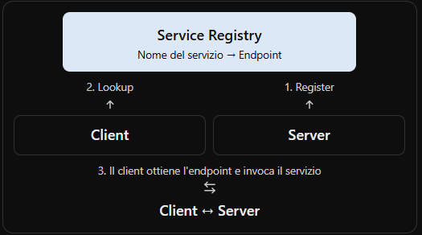

Per ridurre l'overhead del binding dinamico tipicamente si utilizza una **cache** per evitare di ripetere il lookup ad ogni invocazione.  
Il binding dinamico favorisce quindi la **location transparency**, ma questa non è necessariamente completa: alcune implementazioni richiedono comunque la conoscenza di un hostname oppure dell'indirizzo del registry...

### Ulteriori problematiche
Ci sono anche altre problematiche oltre alle 5 appena viste.

**RPC sincrone e asincrone**: alcune RPC implementano comunicazione asincrona, che permette al client di inviare la richiesta senza attendere la risposta, continuando l'esecuzione --> si può ottenere **decoupling di sincronizzazione** tra client e server.  
Per quanto riguarda il **decoupling temporale**, le principali implementazioni RPC non lo supportano --> **comunicazione transiente**, per cui il middleware RPC non conserva normalmente le richieste inviate se il server non è disponibile.

**Limiti della trasparenza**: per quanto l'interfaccia RPC possa somigliare a una chiamata locale, il comportamento è diverso sotto molti aspetti:
- **prestazioni**: costi aggiuntivi in termini di serializzazione, copy-restore, attraversamento del SO e soprattutto latenza di rete (0.1-1 ms in LAN vs nanosecondi di una chiamata locale, milioni di volte peggio!)
- **fallimenti**: come visto con le semantiche client e server possono fallire indipendentemente, e i messaggi possono andare persi. Anche l'uso di TCP non garantisce che la procedura venga eseguita o che il client ne conosca il risultato... l'affidabilità del lvl di trasporto non risolve i guasti applicativi
- **concorrenza e replicazione**: non tutti i middleware RPC gestiscono automaticamente richieste concorrenti o repliche del server
- **sicurezza**: i middleware possono dover offrire meccanismi di autenticazione, autorizzazione, confidenzialità, integrità e protezione dagli attacchi di replay.

---

## IDL Interface Definition Language
Un problema importante delle RPC è definire un'interfaccia comune che client e server possano utilizzare, anche quando sono sviluppati in linguaggi diversi.

Una soluzione è rappresentata dall'**IDL Interface Definition Language**, un linguaggio che permette di descrivere formalmente l'interfaccia del servizio remoto.  
In particolare, un IDL definisce:
- nome del servizio
- operazioni disponibili
- parametri e relativi tipi
- tipi dei valori restituiti

L'IDL rappresenta quindi a tutti gli effetti il **contratto del servizio**, ma non contiene direttamente l'implementazione delle procedure.

Es.
```idl
service KeyValueStore {
    i32 put(1: string key, 2: string value);
    string get(1: string key);
}
```
Qui l'interfaccia descrive un servizio `KeyValueStore` che espone due operazioni:
- `put` riceve una chiave e un valore, entrambi stringhe, e restituisce un intero a 32 bit
- `get` riceve una chiave e restituisce una stringa

I numeri associati ai parametri rappresentano identificatori univoci dei campi, che vengono utilizzati per il marshalling e l'unmarshalling dei dati.

A partire dall'IDL, un apposito **compilatore IDL** può generare automaticamente i componenti necessari per utilizzare il servizio.  
In particolare, **il compilatore genera tutto il codice di supporto come gli stub client e server** (che ricordiamo implementano il Proxy Pattern occupandosi di marshalling, unmarshalling e gestione della comunicazione) --> **lo sviluppatore si limita a scrivere**:
- **la definizione IDL** del servizio
- **il codice applicativo del client**
- **l'implementazione delle procedure sul server**

*Chiaramente da distinguere tra compilatore IDL e eventuale compilatore del linguaggio di programmazione*, quest'ultimo compila solo il codice applicativo insieme ai componenti generati dal compilatore IDL e alle librerie necessarie.

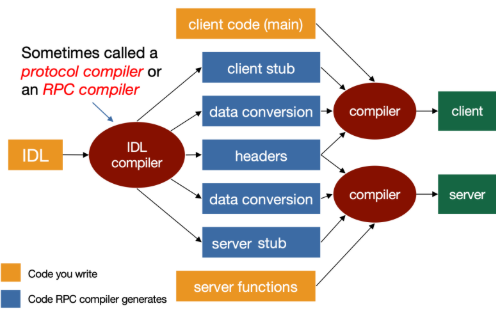

Non tutte le implementazioni RPC usano un IDL separato: alcune sfruttano direttamente i meccanismi del linguaggio di programmazione.

---

# RPC case studies
Vediamo "brevemente" Sun RPC, Java RMI, Python RPyC. Approfondiremo invece Go e gRPC.

## Sun RPC
**Sun RPC** è una delle primissime implementazioni del modello RPC, sviluppata da Sun Microsystems (ora Oracle) negli anni '90 e utilizzata in molti sistemi Unix, tra cui il famoso protocollo NFS (Network File System).  

Permette ad un'applicazione, tipicamente scritta in C, di invocare procedure eseguite su un server remoto senza gestire esplicitamente lo scambio dei messaggi. 

Sun RPC utilizza:
- Un **IDL** per definire l'interfaccia del servizio
- Un **compilatore IDL** `rpcgen` per generare gli stub client e server
- Il formato binario **XDR (External Data Representation)** per il marshalling e l'unmarshalling dei dati
- Un **port mapper** per individuare la porta del servizio remoto

---

Per comprenderne il funzionamento consideriamo l'esempio semplice dove un client invia un numero a un server, che ne deve calcolare e restituire il quadrato. 

Anzitutto, lo sviluppatore descrive il servizio tramite un file IDL con estensione `.x`, nell'esempio `square.x`:
```idl
struct square_in{
    long arg1;
};
struct square_out{
    long res1;
};
program SQUARE_PROG {
    version SQUARE_VERS {
        square_out SQUAREPROC(square_in) = 1;
    } = 1;
} = 0x20000001;
```
Quindi `square.x` definisce:
- **tipi di input e output** (`square_in` e `square_out`)
- **programma RPC** `SQUARE_PROG`, che rappresenta il servizio remoto che tipicamente raggruppa più procedure (in questo caso una sola)
- **versione dell'interfaccia** `SQUARE_VERS`
- **procedura remota** `SQUAREPROC`

L'operazione fondamentale qui è `square_out SQUAREPROC(square_in) = 1;`, che definisce una procedura remota che prende un argomento di tipo `square_in` e restituisce un risultato di tipo `square_out`, con identificativo numerico `1`.  
Oltre che la singola procedura, anche la versione e il programma sono identificati univocamente, affinché **il middleware possa individuare esattamente l'operazione richiesta**. Inoltre, per convenzione, tutti gli identifier sono scritti in maiuscolo nel file IDL `.x`.

In Sun RPC **ogni procedura riceve un solo argomento e restituisce un solo risultato --> per trasmettere più valori, li si deve raggruppare in una `struct`**.

Una volta definito il file `.x`, lo sviluppatore usa il compilatore IDL `rpcgen` per produrre automaticamente il codice di supporto necessario alla comunicazione remota. I file generati sono:
- `square.h` --> contiene le definizioni dei tipi di dato e gli identificatori numerici delle procedure, versioni e programmi
- `square_clnt.c` --> client stub
- `square_svc.c` --> server stub
- `square_xdr.c` --> funzioni per conversione XDR

A questo punto allo sviluppatore non resta che implementare il comportamento applicativo, scrivendo il codice del client e del server --> scrive solo il `.x`, `client.c` e `server.c`.

Per quanto riguarda `server.c` e `client.c` si distinguono due funzioni importanti:
- `squareproc_1_svc` --> è la funzione applicativa lato **server** scritta dal programmatore, per convenzione ha il nome della procedura definita nell'IDL ma minuscolo, seguito dalla versione e `_svc`
- `squareproc_1` --> è la funzione del **client stub** generata automaticamente da `rpcgen`

Se il client nel codice applicativo deve invocare la procedura remota, chiama proprio `squareproc_1` --> il client stub serializza i parametri, invia la richiesta al server e attende la risposta. Il server stub riceve la richiesta, ricostruisce i parametri, individua la procedura corretta e invoca `squareproc_1_svc`. Il risultato viene poi riconvertito e restituito al client.

La chiamata RPC è quindi, per quel che riguarda Sun RPC, **sincrona e bloccante**.

---

**Marshalling e Unmarshalling**

Sun RPC affronta il problema dell'**eterogeneità** dei dati usando **XDR External Data Representation**, un formato **binario** comune e indipendente dalle rappresentazioni interne delle singole macchine.  

XDR usa un sistema di **typing implicito**: il messaggio non deve necessariamente contenere informazioni esplicite sui tipi dei dati, in quanto sia server che client già conoscono la struttura dei dati grazie al file IDL (ad ogni tipo era assegnato un identificatore numerico, serviva proprio a questo) --> XDR è un formato **non self-describing**.

**Binding e Port Mapper**

Per quanto riguarda invece il **binding**, Sun RPC fa si che il client debba conoscere il servizio da invocare, ma non necessariamente la porta su cui esso è in ascolto.  
Sun RPC infatti usa un componente chiamato **Port Mapper** (o `rpcbind`) in esecuzione sul server, generalmente sulla porta 111. 

Il Port Mapper contiene una tabella del tipo:
$$(programma, versione, protocollo) \rightarrow porta$$
Funziona come segue:
1. All'avvio, il server registra il proprio servizio sul Port Mapper locale
2. Il client conosce l'hostname della macchina server (l'hostname serve per il mapping all'IP via DNS) e il programma RPC che vuole invocare
3. Il middleware contatta quindi il Port Mapper per conoscere la porta del servizio, e la ottiene comunicando così direttamente con il server remoto

es. la chiamata `clnt_create(hostname, SQUARE_PROG, SQUARE_VERS, "tcp")` crea un handle RPC usando il nome del server, l'id del programma, la versione e il protocollo di trasporto --> si crea il collegamento, ma ancora non si sta chiamando la procedura remota!

Il Port Mapper interviene per l'individuazione del servizio, **ma non si occupa di inoltrare le singole invocazioni RPC** (non è broker).

**Semantica e Trasparenze**

In generale, SunRPC offre semantica **at-least-once** per cui le richieste possono essere ritrasmesse dopo un timeout, ma non viene garantita la deduplicazione --> operazioni idempotenti!  
Per operazioni non idempotenti, possono essere necessari meccanismi aggiuntivi

Trasparenze:
- **Access Transparency** == **parziale**: la chiamata usa uno stub, ma restano visibili aspetti remoti come l'handle necessario al mapping (`clnt_create`) e gli errori
- **Location Transparency** == **parziale**: il Port Mapper nasconde la porta, ma il client deve comunque conoscere l'hostname del server...
- **Replication Transparency** == non supportata nativamente
- **Sincronia** == sincrona e bloccante
- **Trasporto** == TCP o UDP
- **Concorrenza** == nell'implementazione base, il server permette solo una gestione sequenziale delle richieste

Ricordare per Sun RPC: IDL `.x`, compilatore `rpcgen`, XDR e Port Mapper.

---

## Java RMI
**Java RMI (Remote Method Invocation)** consente a un oggetto Java di invocare metodi appartenenti a un oggetto presente su un'altra JVM, eventualmente su un host remoto.

La differenza fondamentale rispetto a Sun RPC sta nel modello di programmazione: mentre Sun RPC espone procedure remote, qui si parla di metodi di oggetti remoti.

Java RMI sfrutta la separazione che esiste nativamente tra **interfaccia** (che definisce quali metodi possono essere invocati) e **implementazione** --> l'oggetto che implementa quei metodi si trova e resta sul server, **il client ottiene la possibilità di invocarne i metodi tramite un riferimento remoto, senza quindi ricevere una copia dell'oggetto**.

---

Anche Java RMI usa il **Proxy Pattern**.

Sul client è presente uno **stub** che rappresenta localmente l'oggetto remoto (riferimento remoto all'oggetto) e gestisce le operazioni necessarie ad invocarne i metodi (nell'esempio è `serverRMI`).

Sul server, nelle implementazioni storiche, era presente uno **skeleton** incaricato di ricevere le richieste ed inoltrarle all'oggetto remoto.  
Nelle implementazioni più recenti lo skeleton è stato rimosso, e questa funzione viene svolta direttamente dal **runtime RMI**.

La sintassi della chiamata somiglia a quella di una normale invocazione Java, ad es. `serverRMI.getEcho(msg)`, tuttavia *il programmatore deve comunque gestire le eccezioni associate al fatto che la comunicazione è remota*.

**Interfaccia Remota**

**In Java RMI non è necessario definire un IDL separato come avviene in Sun RPC**: l'interfaccia viene dichiarata direttamente in Java, a patto che estenda l'interfaccia `java.rmi.Remote` e che i metodi dichiarino di lanciare l'eccezione `RemoteException` (che rappresenta possibili problemi associati all'invocazione remota).
```java
public interface EchoInterface extends Remote {
    String getEcho(String msg) throws RemoteException;
}
```
La classe server implementa effettivamente l'interfaccia e contiene la logica del metodo.

**Marshalling e passaggio dei parametri**

Java RMI usa la **serializzazione nativa di Java** per convertire oggetti e dati in sequenze di byte --> a differenza di Sun RPC non serve generare funzioni XDR mediante file IDL.  
Con `writeObject` serializzazione, i.e. l'oggetto è trasformato in una sequenza di byte, e con `readObject` avviene la deserializzazione (chiaramente si tratta di operazioni gestite dal middleware).

Il passaggio dei parametri dipende dal tipo di dato:
- **tipo primitivo** (`int`, `boolean`, ...) --> passaggio per valore (i.e. il valore è serializzato e inviato al server)
- **oggetto ordinario serializzabile** --> passaggio per valore sempre via serializzazione
- **oggetto remoto** --> passaggio per riferimento remoto tramite stub 

Questa distinzione è importante in quanto se il client passa un oggetto ordinario serializzabile --> il server ricostruisce una copia nella propria memoria, mentre se viene passato un oggetto remoto il destinatario ottiene un riferimento che gli permette di invocare metodi sull'oggetto originale.

**Binding**

Java RMI usa **RMI Registry**, che permette di associare un nome logico a un riferimento remoto.

Il server:
1. istanzia l'oggetto remoto 
2. avvia il RMI Registry, ad es. sulla porta 1099
3. registra l'oggetto mediante un nome, ad es. `EchoService`

Dopo aver creato l'istanza (`serverRMI`), le operazioni fondamentali quindi sono:
```java
LocateRegistry.createRegistry(1099); // avvia il registry
registry.bind("EchoService", serverRMI); // registra l'oggetto remoto
```
A questo punto il client deve effettuare un lookup per ottenere il riferimento remoto e invocare i metodi:
```java
EchoInterface serverRMI = (EchoInterface) Naming.lookup("rmi://hostname:1099/EchoService");
```
successivamente a ciò, potrà tranquillamente invocare i metodi remoti del servizio: `serverRMI.getEcho("ciao")`.

Il **registry** interviene quindi per individuare l'oggetto remoto, ma non viene consultato ad ogni invocazione: da lì in poi il client può invocare i metodi dell'oggetto remoto tramite lo stub ottenuto.

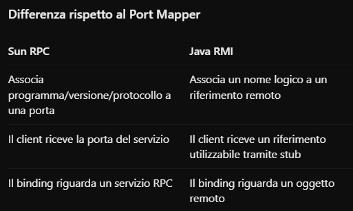

Quindi anche qui non c'è trasparenza totale alla locazione, in quanto il client deve sapere dove trovare il registry.

**Semantica e Trasparenze**

Per quel che riguarda la semantica, Java RMI offre anche **at-most-once** --> una singola invocazione remota può quindi essere eseguita zero oppure una volta.

Trasparenze:
- **Access Transparency** == **elevata** ma non totale: metodi simili a quelli locali, ma restano le eccezioni remote (`RemoteException`)
- **Location Transparency** == **parziale**: il client deve conoscere l'hostname del server e la porta del registry
- **Replication Transparency** == non supportata nativamente
- **Sincronia** == sincrona e bloccante nel modello base
- **Trasporto** == nativamente usa un protocollo applicativo che si appoggia solo su TCP
- **Concorrenza** == il runtime può gestire invocazioni concorrenti dello stesso oggetto remoto, ma il programmatore deve provvedere a proteggere lo stato condiviso

Per la **sicurezza**, Java RMI dà la possibilità di proteggere la comunicazione con TLS, tuttavia **non è abilitata di default**.

Un altro concetto importante in Java RMI è quello di **Garbage Collection distribuita**: come capire quando un oggetto non è più referenziato da nessun client remoto e può essere quindi eliminato?

Un'idea banale sarebbe far gestire la cosa direttamente dal server, che ogni tot. controlla se ci sono oggetti senza riferimenti remoti per eliminarli... tuttavia il controllo dei riferimenti non costa poco e quindi l'approccio **non è scalabile**, appesantisce eccessivamente il server.

Piuttosto si eroga il compito ai client, che devono comunicare se stanno ancora usando l'oggetto remoto tramite l'uso dei **lease**: un **lease** è un contratto che scade dopo un certo tempo e che il client deve rinnovare per continuare ad usare il riferimento remoto. 

Un client che non usa più lo stub può segnalarlo al server, ma per evitare che un client malintenzionato o malfunzionante tenga occupato un oggetto senza mai usarlo --> il server impone la scadenza.   
Se il lease scade senza rinnovo allora il server considererà terminato l'interesse del client per l'oggetto --> **limite**: se il client era sovraccarico/crashato e non ha potuto rinnovare il lease allora deve ricominciare la procedura di lookup...

---

## RPyC
**RPyC (Remote Python Call)** è una libreria Python per la comunicazione RPC, che permette di invocare metodi e utilizzare oggetti presenti in processi remoti.

Come Java RMI si basa sul paradigma a oggetti, ma sfrutta alcune caratteristiche di Python:
- **Tipizzazione Dinamica** (non è necessario dichiarare staticamente i tipi dei parametri e dei risultati)
- **Introspezione a Runtime** (classi, metodi e attributi possono essere esaminati durante l'esecuzione)

Per questo motivo anche RPyC non richiede IDL separato né generazione preventiva di stub statici.  
La comunicazione è invece basata su **proxy dinamici**, chiamati **netref** (*network reference*).

Un **netref** è un proxy locale che rappresenta un oggetto presente in un processo remoto.  
Quando un client invoca un metodo tramite netref --> RPyC inoltra l'operazione al processo che ospita l'oggetto effettivo. 

Ad es. `conn.root.add(4, 7)` invoca il metodo `add` sull'oggetto remoto `root`, grazie al netref `conn.root` che rappresenta l'oggetto remoto.

RPyC offre quindi elevata trasparenza all'accesso, pur mantenendo visibili la gestione della connessione e i possibili errori remoti (proprio come in Java RMI).

---

Si considera la modalità RPyC basata su servizi.  
Un servizio è definito attraverso una classe che estende `rpyc.Service`, e per rendere accessibile un metodo remoto si usa il prefisso `exposed_` nel nome del metodo.

es. lato server:
```python
class CalculatorService(rpyc.Service):
    def exposed_add(self, x, y):
        return x + y
```
Allora il client stabilisce una connessione e invoca il metodo tramite proxy locale *netref*:
```python
conn = rpyc.connect("hostname", port)
result = conn.root.add(4, 7)
```
(dove `conn` rappresenta la connesione, mentre `conn.root` è il netref del serivizio remoto)

Il prefisso `exposed_` è quindi importante per controllare quali operazioni sono pubblicamente accessibili, dando la possibilità di ridurre la **superficie di attacco del servizio**.

**Passaggio dati e marshalling**

RPyC distingue due modalità di trasferimento:
- **Per valore** --> il destinatario riceve una copia del dato (per tipi semplici come numeri o stringhe)
- **Per riferimento remoto** --> il destinatario riceve un netref e interagisce con l'oggetto originale

La particolarità rispetto a Java RMI è che RPyC permette di lavorare dinamicamente con riferimenti a oggetti Python **senza dover preventivamente dichiarare una specifica interfaccia remota** (per questo si parla di **proxy dinamici**).

**Binding e Concorrenza**

RPyC non usa un service registry obbligatorio (come il Port Mapper di Sun RPC o il RMI Registry di Java RMI), ma il client deve conoscere direttamente l'**hostname e la porta** del server remoto:
```python
conn = rpyc.connect("hostname", port)
```
La trasparenza della locazione è quindi limitata... si tratta di un **binding statico**.

Per la concorrenza RPyC supporta `ThreadedServer`, che **crea un server che gestisce le connessioni usando un thread separato per ogni client** --> anche qui comunque il programmatore deve occuparsi della protezione dello stato condiviso dall'accesso concorrente.

Oltre a `ThreadedServer` esistono altre modalità come `OneShotServer` (che gestisce una sola connessione e poi termina) e `ForkingServer` (che crea un nuovo processo per ogni connessione).

**Chiamate Asincrone: Future/Promise**

La novità in RPyC è che **supporta sia chiamate sincrone che asincrone**. 

Mentre nel modello sincrono il client attende il risultato della procedura remota prima di proseguire, per le chiamate asincrone **il client ottiene immediatamente un oggetto che rappresenta il risultato futuro**, secondo il pattern **Future/Promise** --> in RPyC questo oggetto è chiamato `AsyncResult` e si chiama con `rpyc.async_()`.

es.
```python
slow_add = rpyc.async_(conn.root.slowAdd)

res = slow_add(4, 7) # restituisce un oggetto AsyncResult immediatamente

# il client può eseguire altre operazioni

res.wait() # attende il completamento
print(res.value)
```

Altri valori utili per la comunicazione asincrona in RPyC sono:
- `res.ready()` --> restituisce True se il risultato è pronto
- `res.set_expiry(...)` --> imposta un timeout per il risultato (attento però che alla scadenza non è detto che la procedura non sia stata eseguita sul server)
- `res.add_callback(...)` --> permette di registrare una funzione di callback da eseguire quando il risultato è pronto

**Callback e Pattern Observer**

Altra caratteristica di RPyC è che è in grado di realizzare comunicazione bidirezionale --> **il server può invocare metodi o funzioni del client tramite riferimenti remoti**.

Questo permette di implementare, tra le altre cose, il **Pattern Observer**, vediamolo a grandi linee con un esempio di monitoraggio file:
1. Il client chiede al server di monitorare un file, fornendo il riferimento ad una propria funzione di callback
2. Il server controlla periodicamente il file
3. Quando rileva una modifica, invova la funzione di callback remota sul client, che quindi riceve la notifica e può reagire di conseguenza

Si tratta di applicazione del pattern Observer perché il client si registra per ricevere notifiche al verificarsi di un certo evento. 


**Semantica e Trasparenze**

Nel modello RPyC standard, la semantica è **May-be**, quindi *best-effort* --> se si vogliono garanzie più forti, il programmatore deve implementare meccanismi di deduplicazione o retry a livello applicativo.

Per le trasparenze:
- **Access Transparency** == **elevata**, grazie ai netref
- **Location Transparency** == **limitata** in quanto la connessione è esplicita a host e porta, nonché statica
- **Replication Transparency** == non supportata nativamente
- **Concorrenza** == supportata tramite `ThreadedServer`, ma il programmatore deve proteggere lo stato condiviso
- **Sincronia** == supporta sia sincrona che asincrona (per l'asincrona si usa `rpyc.async_()`)

Le altre caratteristiche di RPyC sono il supporto alle **callback** (comunicazione bidirezionale), maggiore sicurezza grazie al prefisso `exposed_`, che non ci sono direttamente degli stubs ma dei **netref** dinamici. 

---

## Go (Intro)
Go è un linguaggio compilato, tipizzato staticamente e progettato per facilitare lo sviluppo di software concorrente ed efficiente.  
Risulta particolarmente adatto ai sistemi distribuiti grazie al supporto nativo per la concorrenza tramite **goroutine** e **canali**.

Go organizza il codice in **package**, che raggruppano funzioni, tipi e altre dichiarazioni. Una regola importante è che **gli identificatori che iniziano con una lettera maiuscola sono esportati**, ossia **accessibili anche da altri package** --> fondamentale in Go RPC, dato che i servizi, i metodi remoti e i tipi usati devono rispettare specifici requisiti di esportazione.

### Struct e Metodi
In Go non esistono classi come in Java, si possono però definire dei tipi `struct` e associare loro dei metodi.  

Una `struct` raggruppa campi di tipi eventualmente diversi:
```go
type Args struct {
    A int
    B int
}
```
Possiamo inoltre definire un tipo che rappresenti un servizio: `type Arith struct{}` (la struct è vuota perché il servizio non ha bisogno di mantenere uno stato interno).

Per associare un metodo ad `Arith`:
```go
func (a *Arith) Multiply(x int, y int) int {
    return x * y
}
```
dove la parte `a *Arith` è detta **receiver** e indica che il metodo `Multiply` è associato al tipo (struct) `Arith` --> **è importante distinguerlo dai parametri del metodo `x` e `y`**: il receiver identifica l'oggetto sul quale viene invocato il metodo, mentre i parametri sono i valori passati al metodo stesso.à

### Puntatori
I **puntatori** permettono di riferirsi ad una variabile tramite il suo indirizzo di memoria. In Go:
- `&x` restituisce l'indirizzo di memoria della variabile `x`
- `*p` dereferenzia il puntatore `p` (i.e. permette di accedere al valore puntato da `p`)

es. 
```go
x := 10
p := &x 
*p = 20
```
alla fine del codice, `x` vale 20.

Questo è fondamentale dato che in Go RPC **il risultato della procedura viene scritto attraverso un parametro puntatore**, anziché essere restituito direttamente come normale valore di ritorno.

### Goroutine e canali
Le **goroutine** sono unità di esecuzione concorrente gestite dal runtime di Go.  
Per avviarne una, si usa la parola chiave `go`:
```go
go function()
```
La funzione viene avvia concorrentemente e il chiamante può proseguire senza attendere che termini.

Le goroutine possono comunicare attraverso **canali**:
```go
ch := make(chan int) // crea un canale di interi
```
Un valore viene inviato sul canale con `ch <- 10` e ricevuto con `x := <-ch`.

Nel caso di Go RPC, i canali sono importanti soprattutto per le **chiamate asincrone**, nelle quali il risultato viene reso disponibile successivamente.

## Go RPC
**Go RPC** è un'implementazione di RPC fornita dalla libreria standard di Go, tramite il package `net/rpc`.

Permette a un client di invocare metodi definiti su un servizio remoto, senza gestire manualmente sincronizzazione o scambio di messaggi.  
A differenza di Sun RPC, **Go RPC non richiede un IDL separato**, né tantomeno un compilatore IDL dedicato alla generazione degli stub. L'interfaccia del servizio è definita direttamente tramite i tipi e i metodi Go.

Per individuare il metodo remoto, il client usa una stringa della forma *"NomeServizio.NomeMetodo"*, ad esempio `"Arithmetic.Multiply"` --> il middleware si occupa di codificare gli argomenti, trasmettee la richiesta, individuare il metodo corrispondente sul server e ricostruire il risultato.

---

Per rendere un metodo utilizzabile tramite `net/rpc`, la sua firma deve rispettare alcune convenzioni. La struttura generale **lato server** è la seguente:
```go
func (s *Servizio) Metodo(
    input TipoInput,
    reply *TipoRisposta
) error
```
Si distingue quindi `s *Servizio` è il **receiver** e in questo caso serve per individuare l'istanza del servizio (ricorda che il receiver identifica l'oggetto sul quale è invocato il metodo); il metodo in sé; l'argomento della procedura con relativo tipo (`input TipoInput`); `reply *TipoRisposta` che è **il puntatore alla variabile su cui scrivere il risultato** ed `error` che è il valore restituito per indicare eventuali errori durante l'esecuzione della procedura remota, ed è `nil` in caso di successo.

Per essere registrabile tramite `net/rpc` il metodo inoltre deve essere **esportato** (i.e. il nome deve iniziare con una lettera maiuscola) e deve avere **due parametri** (uno per l'input e uno per l'output --> se più parametri in input, si sfrutta una `struct` per raggrupparli), e come singolo valore di ritorno proprio `error`.  
Devono essere esportati anche i tipi dei parametri utilizzati.

Vediamo un esempio di servizio `Arith` che espone un metodo `Multiply`:
```go
type Arith struct{}

type Args struct {
    A, B int
}

type Result int

func (a *Arith) Multiply(
    args *Args,
    res *Result,
) error {
    *res = Result(args.A * args.B)
    return nil
}
```
per cui il metodo `Multiply` riceve i due operandi attraverso `args`, calcola il prodotto e scrive il risultato nella variabile puntata da `res` --> si vede come la firma del metodo rispetti le convenzioni richieste da `net/rpc`, per cui non viene restituito il risultato direttamente, ma solo un eventuale errore, e il risultato è scritto su un puntatore.

**Lato Server**

Dopo aver definito il servizio, il server deve crearne un'istanza e registrarla presso il runtime RPC, per poi mettersi in ascolto delle connessioni in arrivo.

```go
arithService := new(arith.Arith) // crea un'istanza del servizio (arith piccolo è il package)

server := rpc.NewServer() 

server.RegisterName( 
    "Arithmetic", 
    arithService,
)
```
Un'alternativa a usare `server.RegisterName` è usare direttamente `rpc.Register(arithService)` che registra il servizio usando il nome del tipo come nome del servizio (in questo caso `Arith`).

Dopodiché il server deve aprire la connessione, e lo fa tramite la creazione di un oggetto **listener**, per poi avviare la gestione delle connessioni e richieste RPC tramite `Accept`:
```go
lis, err := net.Listen("tcp", ":1234") // ascolta sulla porta 1234
server.Accept(lis)
```
In questo modo, `net/rpc` gestisce le richieste in modo concorrente tramite goroutine, senza che lo sviluppatore debba crearne manualmente una per ogni chiamata --> resta però anche qui **responsabilità dello sviluppatore sincronizzare l'accesso a eventuali dati condivisi delle richieste!**

Quando arriva una richiesta per `Arithmetic.Multiply`, il runtime RPC cerca il servizio registrato come `Arithmetic`, individua il metodo `Multiply`, fa unmarshalling dei parametri, esegue la procedura e restituisce al client il risultato (o l'errore) --> **il nome logico del servizio e del metodo usati dal client devono corrispondere a quelli registrati sul server**.

**Lato Client**

Anzitutto il client deve fare il **binding** con il server:
```go
client, err := rpc.Dial(
    "tcp", 
    "hostname:1234",
    )
```
per cui il client deve conoscere esplicitamente **hostname e porta del server** (binding statico...).  
Una variante è usare `rpc.DialHTTP` se il server RPC è esposto tramite HTTP.

Così facendo il client avrà accesso a tutti i servizi registrati su quel server, a patto che siano esposti correttamente.  
A questo punto, una volta ottenuto l'oggetto `client`, è possibile invocare i metodi remoti in due motalità: **sincrona** e **asincrona**.

**Chiamata Sincrona --> `client.Call`**
```go
args := arith.Args{A: 7, B: 3}

var result arith.Result

err := client.Call(
    "Arithmetic.Multiply", 
    &args, 
    &result,
)
```
dove `arith` è il package che contiene la definizione del servizio, importato sia dal client che dal server.  
(Tipicamente un progetto Go RPC è organizzato così:
```
progetto/
├── arith/
│   └── arith.go
├── client/
│   └── main.go
└── server/
    └── main.go
```
)

Se la chiamata va a buon fine, `err` sarà `nil` e il risultato sarà scritto nella variabile `result`, altrimenti si è verificato un errore.

**Chiamata Asincrona --> `client.Go`**
```go
args := arith.Args{A: 7, B: 3}

var result arith.Result

call := client.Go(
    "Arithmetic.Multiply", 
    &args, 
    &result, 
    nil,
)
```
Qui `client.Go` avvia una chiamata **asincrona** e **restituisce immediatamente un oggetto di tipo `*rpc.Call`**.  
Questo oggetto contiene, tra le altre cose:
- `Done` == canale utlizzato per segnalare il completamento della chiamata
- `Error` == eventuale errore della chiamata

Il client può quindi eseguire altre istruzioni e attendere il risultato solo quando necessario:
```go
<-call.Done // attende il completamento della chiamata sul canale Done
if call.Error == nil {
    fmt.Println("Result:", result)
}
```

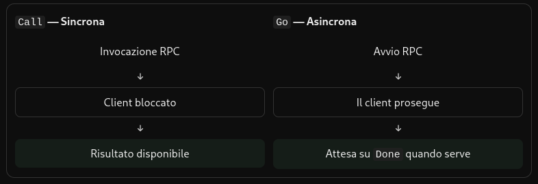

---

**Marshalling e Unmarshalling**

Go RPC effettua automaticamente marshalling e unmarshalling utilizzando il package `encoding/gob`. 

`gob` è un formato di **serializzazione binaria** che consente di rappresentare valori Go come sequenze di byte.  
La caratteristica importante è che **gob è self-describing**: il flusso trasporta informazioni sui tipi dei dati, necessarie alla codifica.

Chiaramente **i puntatori non sono trasmessi come indirizzi di memoria**, ma vengono codificati i dati a cui fanno riferimento secondo le regole del formato `gob`.

L'altra differenza rispetto a Sun RPC è che Go RPC non richiede un IDL che generi funzioni necessarie al marshalling (come avveniva in XDR, che tra l'altro non era self-describing), e a differenza di Java non usa una serializzazione nativa del linguaggio.

**Binding**

Come visto Go RPC ha binding statico, per cui non c'è un **service registry** come il Port Mapper di Sun RPC o il RMI Registry di Java RMI --> `server.RegisterName("Arithmetic", arithService)` serve a far conoscere **al runtime RPC locale del server i metodi disponibili**, e `rpc.Dial("tcp", "hostname:1234")` richiede che il client conosca esplicitamente l'endpoint del server...

Quindi importante distinguere la **registrazione del metodo** effettuata localmente via `Register` o `RegisterName`, e l'**individuazione della macchina server** affidata invece alla configurazione del client tramite `Dial` oppure a sistemi esterni di discovery (non forniti nativamente da Go RPC).

**Semantica e Trasparenze**

La libreria `net/rpc` non implementa automaticamente una politica generale di retry, df o conservazione dei risultati delle richieste --> la semantica è il **may-be** (*best-effort*) --> per avere garanzie migliori, lo sviluppatore deve integrarle a livello applicativo.

Tra le trasparenze:
- **Access Transparency** == **parziale**: il middleware nasconde la comunicazione e la serializzazione, ma il client usa chiamate specifiche ed esplicite `Call` o `Go`
- **Location Transparency** == **limitata**: il client deve conoscere l'hostname e la porta del server
- **Replication Transparency** == non supportata nativamente
- **Failure Transparency** == limitata (la semantica è best-effort)
- **Concorrenza** == gestione automatica delle richieste concorrenti, ma sincronizzazione dello stato condiviso a carico dello sviluppatore

Quindi Go RPC si distingue per `net/rpc`, metodi remoti con firma specifica e tipizzati come `struct`, `RegisterName`, `Call`, `Go`, serializzazione `gob`, binding statico, semantica may-be.

---

## gRPC
**gRPC** è un framework RPC open-source progettato per fornire comunicazioni efficienti tra applicazioni distribuite, **anche sviluppate in linguaggi diversi** --> pensato per essere usato tra componenti **poliglotte**.

Questa caratteristica è particolarmente importante nelle architetture a microservizi, dove componenti diverse possono essere sviluppate da team e linguaggi diversi.

gRPC si basa principalmente su:
- **HTTP/2** come protocollo usato per la trasmissione delle richieste e delle risposte
- **Protocol Buffers (Protobuf)** usato come linguaggio per definire le interfacce e serializzare i messaggi --> **file IDL `.proto`** per definire le interfacce dei servizi
- **Stub generati automaticamente**, per gestire le chiamate remote secondo il Proxy Pattern

### HTTP/2
Per trasportare richieste e risposte RPC, gRPC usa **HTTP/2**.  
Una delle caratteristiche fondamentali di questo protocollo è il **multiplexing**, che permette di trasportare più richieste e risposte contemporaneamente sulla stessa connessione TCP.

Il problema storico di HTTP/1.1 era l'**Head-of-Line Blocking**: date due richieste $A$ e $B$ dove $A$ richiede elaborazione lunga e $B$ una molto veloce, il *pipelining* di HTTP/1.1 costringeva le risposte a rispettare l'ordine delle richieste --> se $B$ è già pronta, deve comunque attendere la risposta di $A$.

Per risolvere il problema HTTP/2 introduce gli **stream**, ossia flussi logici distinti all'interno della stessa connessione TCP.  
Ogni stream è identificato univocametne nella connessione e i dati sono trasmessi mediante **frame binari** --> il server può inviare frame appartenenti a stream diversi in qualsiasi ordine

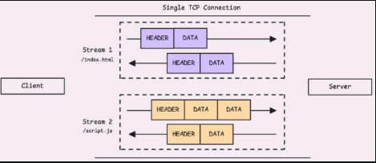

Attenzione al fatto che HTTP/2 risolve l'HOL Blocking solo a livello applicativo, ma non a livello di trasporto TCP --> se si perde un segmento TCP, il recupero può ritardare stream diversi che condividono comunque la stessa connessione.

Caratteristiche principali di HTTP/2:
- **Multiplexing** --> permette più RPC contemporanee sulla stessa connessione TCP
- **Binary framing** --> i dati sono suddivisi in frame binari
- *Header compression* --> invece di inviare ripetutamente lo stesso header, si usano tecniche di invio del solo delta --> riduzione dell'overhead
- *Flow Control* --> regolazione del flusso di dati per evitare congestione e sovraccarico del destinatario
- **Full-duplex** --> client e server possono inviare dati contemporaneamente

### Protocol Buffers e file `.proto`
**Protocol Buffers (Protobuf)** svolge due funzioni fondamentali in gRPC:
1. **Definizione delle interfacce (IDL)**: permette di specificare servizi, metodi remoti e tipi dei messaggi scambiati
2. **Serializzazione**: permette di convertire i messaggi in un formato **binario** compatto e indipendente dalla piattaforma

Per la **definizione dei messaggi**:
```protobuf
message Person {
    string name = 1;
    int32 id = 2;
    string email = 3;
}
```
`message` definisce il tipo di messaggio, mentre ogni campo comprende:
- un *tipo* (es. `string`, `int32`, ...)
- un *nome* (es. `name`, `id`, `email`)
- un *identificativo numerico locale al messaggio*

I numeri identificano i campi nella codifica Protobuf, non rappresentano l'ordine in cui devono essere trasmessi --> il destinatario interpreterà i dati sempre in base a Protobuf --> a differenza di `gob` (dove le info sulle definizioni dei tipi erano trasportate nel flusso) e similmente a XDR, Protobuf è **self-describing**.

Per la definizione di un servizio:
```protobuf
service ProductInfo {
    rpc AddProduct(Product) returns (ProductID);
    rpc GetProduct(ProductID) returns (Product);
}

message Product {
    string id = 1;
    string name = 2;
    float price = 3;
}

message ProductID {
    string id = 1;
}
```
qui l'interfaccia definisce un servizio che espone i due metodi `AddProduct` e `GetProduct`, con i rispettivi tipi di input e output.

Il file `.proto` quindi **descrive quali operazioni sono disponibili e quali dati devono scambiarsi client e server**, ma non definisce come devono essere implementate!

Dopo aver scritto l'interfaccia `.proto`, lo sviluppatore usa **il compilatore `protoc`** insieme ai **plugin appropriati per lo specifico linguaggio di programmazione** per generare automaticamente gli stub client e server per la gestione delle chiamate remote e della serializzazione dei messaggi.

Quindi simile a Sun RPC dove si usava `rpcgen` a partire da un IDL `.x`, ma qui linguaggio Protobuf poliglotta e comunicazione basata su HTTP/2.

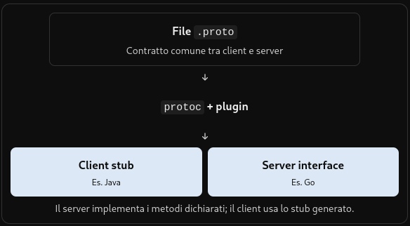

---

**Es. di implementazione di un servizio HelloWorld**  
(non serve saperlo per l'esonero, giusto per avere un'idea dell'uso poi in Go per il progetto)

Un servizio `Greeter` riceve il nome di una persona e deve restituire un messaggio di saluto.

Definizione `.proto`:
```protobuf
service Greeter {
    rpc SayHello(HelloRequest) returns (HelloReply);
}

message HelloRequest {
    string name = 1;
}

message HelloReply {
    string message = 1;
}
```

**Lato Server (Go)** si definisce il servizio e si implementa il metodo:
```go
// 1. Definizione del servizio
type server struct {
    pb.UnimplementedGreeterServer
}
// dove pb è il package generato da protoc a partire dal file .proto
// 2. Implementazione del metodo remoto
func (s *server) SayHello(
    ctx context.Context,
    in *pb.HelloRequest,
) (*pb.HelloReply, error) {
    return &pb.HelloReply{
        Message: "Hello " + in.GetName(),
    }, nil
}
```
dove nella firma del metodo:
- `ctx context.Context` è un oggetto che permette di gestire il contesto della chiamata (timeout, cancellazione, metadati, ecc.)
- `in *pb.HelloRequest` è il puntatore al parametro di input
- `*pb.HelloReply` è puntatore al risultato della procedura, con eventuale errore

Qui si nota come **il risultato della procedura viene restituito direttamente come valore di ritorno**, a differenza di Go RPC dove il risultato era scritto su un puntatore passato come parametro.

Dopodiché il server crea un'istanza di gRPC e registra il servizio:
```go
func main() {
    // 3. Apertura della porta TCP
    lis, err := net.Listen("tcp", ":50051")
    if err != nil {
        log.Fatal(err)
    }

    // 4. Creazione del server gRPC
    s := grpc.NewServer()

    // 5. Registrazione del servizio Greeter
    // (dove pb è il package generato da protoc a partire dal file .proto, 
    // e RegisterGreeterServer è la funzione generata per associare al server gRPC
    // l'implementazione del servizio Greeter)
    pb.RegisterGreeterServer(s, &server{})

    // 6. Avvio del server
    log.Fatal(s.Serve(lis))
}
```

**Lato Client (Go)**:

Una volta creata la connessione, il client genera lo stub locale:
```go
c := pb.NewGreeterClient(conn)
```
e successivamente invoca il metodo remoto:
```go
r, err := c.SayHello(
    ctx,
    &pb.HelloRequest{Name: "Anna"},
)
```
Il client stub serializza la richiesta tramite Protobuf, la trasmette tramite HTTP/2 e ricostruisce la risposta ricevuta.

Qui per il codice client completo:
```go
package main

import (
    "context"
    "log"
    "time"

    pb "example.com/progetto/helloworld"

    "google.golang.org/grpc"
    "google.golang.org/grpc/credentials/insecure"
)

func main() {

    // 1. Creazione del canale verso il server
    conn, err := grpc.NewClient(
        "localhost:50051",
        grpc.WithTransportCredentials(
            insecure.NewCredentials(),
        ),
    )

    if err != nil {
        log.Fatalf("Errore creazione client: %v", err)
    }

    defer conn.Close()

    // 2. Creazione dello stub locale
    c := pb.NewGreeterClient(conn)

    // 3. Creazione del contesto con timeout
    ctx, cancel := context.WithTimeout(
        context.Background(),
        5*time.Second,
    )

    defer cancel()

    // 4. Invocazione del metodo remoto
    r, err := c.SayHello(
        ctx,
        &pb.HelloRequest{Name: "Anna"},
    )

    if err != nil {
        log.Fatalf("Errore RPC: %v", err)
    }

    // 5. Lettura della risposta
    log.Println(r.GetMessage())
}
```
**Differenza rispetto a Go RPC**

Come accennato prima, lato server, il metodo remoto in Go RPC scriveva il risultato su un parametro puntatore e restituisce direttamente solo `error`:
```go
func (a *Arith) Multiply(
    args *Args,
    res *Result,
) error
```
Al contrario in gRPC-Go il metodo remoto restituisce sia risposta che eventuale errore:
```go
func (s *server) SayHello(
    ctx context.Context,
    in *pb.HelloRequest,
) (*pb.HelloReply, error)
```

**Context, deadline e cancellazione**

Un elemento importante nell'implementazione di gRPC-Go è `context.Context`.  
Il contesto permette di gestire info associate alla chiamata, tra cui deadline, cancellazione e metadati applicativi:
- **Deadline**: il client può stabilire un tempo massimo entro il quale desidera ottenere il risultato. Se la deadline viene superata --> la chiamata termina dal punto di vista del client con un errore
- **Cancellazione**: il client può cancellare una chiamata non più necessaria --> il server riceve la notifica tramite il contesto e può interrompere l'elaborazione se il codice applicativo lo prevede  
(attenzione al fatto che *cancellare una RPC non garantisce che gli effetti già prodotti dell'operazione sul server vengano annullati*)

---

### Modalità di comunicazione gRPC
gRPC supporta **quattro tipi di chiamate remote**: **Unary**, **Server Streaming**, **Client Streaming** e **Bidirectional Streaming**.

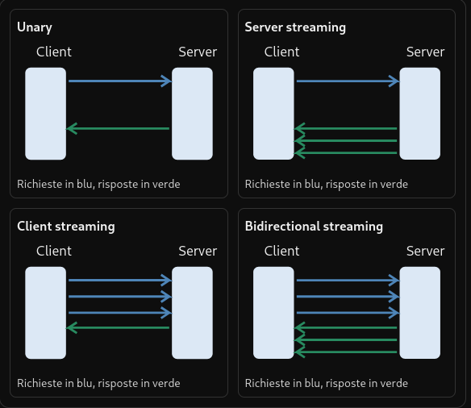

Per capirle immaginiamo un servizio di mappe, dove a volte ho bisogno di chiedere info su un singolo punto e altre di inviare più punti di un percorso su cui cammino, o di ricevere molti punti in una sola ricerca (in questi ultimi casi è evidente l'utilità dello streaming).

#### Unary (Simple) RPC
Il client invia una singola richiesta e riceve una singola risposta:
```protobuf
rpc ListFeatures(Rectangle)
    returns (stream Feature);
```
Si tratta del modello più simile ad una normale chiamata a procedura remota
#### Server Streaming RPC
Il client invia una singola richiesta, mentre il server restituisce uno stream di messaggi
```protobuf
rpc ListFeatures(Rectangle)
    returns (stream Feature);
```
Es: il client richiede i punti di interesse presenti in una zona e il server restituisce progressivamente i risultati.
#### Client Streaming RPC
Il client invia uno stream di messaggi, mentre il server restituisce una singola risposta
```protobuf
rpc RecordRoute(stream Point)
    returns (RouteSummary);
```
Es. il client invia progressivamente i punti di un percorso e il server restituisce un riepilogo finale.
#### Bidirectional Streaming RPC
Sia il client che il server si inviano uno stream di messaggi, potenzialmente contemporaneamente.  
```protobuf
rpc RouteChat(stream RouteNote)
    returns (stream RouteNote);
```
Si tratta di una comunicazione **full-duplex**, per cui il server può inviare risposte senza dover necessariamente attendere che il client abbia terminato l'invio di tutti i messaggi e viceversa.

**gRPC preserva l'ordine dei messaggi all'interno di ciascuna direzione dello stream**.

Attenzione a non confondere lo **Streaming** con il **Multiplexing**: il primo riguarda più messaggi scambiati all'interno della stessa chiamata RPC, il secondo più chiamate RPC distinte che condividono la stessa connessione HTTP/2 (e quindi TCP).  
Quindi una connessione HTTP/2 può trasportare contemporaneamente più RPC, ciascuna delle quali può essere unary oppure streaming.

**Semantica, Sicurezza e Trasparenze**

Per quel che riguarda la semantica, gRPC offre una politica base **may-be** (*best-effort*), ma il framework supporta dei meccanismi di retry che possono essere configurati al fine di aumentare la probabilità di completamento. 

In particolare:
- **Retry con exponential backoff**: se una chiamata fallisce, il client può ritentarla dopo un intervallo di tempo progressivamente crescente --> il vantaggio è ridurre il rischio che molti client sovraccarichino contemporaneamente un server già in difficoltà
- **Request Hedging**: se un primo tentativo è ancora in corso ma è abbastanza lento da giustificare un secondo tentativo, il client invia una seconda richiesta magari verso un'altra replica. Quando arriva la risposta, il client può cancellare i tentativi ancora in corso.  
Il vantaggio è ridurre la latenza percepita dal client, ma il rischio è che il server riceva più richieste dello stesso tipo e quindi si sovraccarichi.

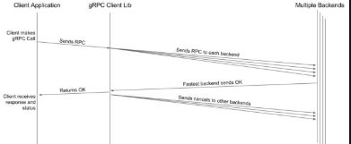

Per quel che riguarda la sicurezza, gRPC supporta **TLS**, che permette di proteggere la comunicazione tramite cifratura e autenticazione lato server.  
Con **mTLS** (mutual TLS) è possibile anche autenticare il client tramite certificato.

Per le trasparenze:
- **Access Transparency** == **alta**, grazie agli stub generati automaticamente, tuttavia restano visibili errori, deadline e altri aspetti remoti --> comunque trasparenza molto forte se si pensa alla natura poliglotta di gRPC
- **Location Transparency** == **limitata**: di base il client deve conoscere l'endpoint del server da contattare. Tuttavia possibilità di integrare resolver personalizzati con sistemi esterni tipo Consul...
- **Concorrenza** == il framework permette a più chiamate RPC di essere in corso contemporaneamente grazie al **multiplexing** di HTTP/2, ma il programmatore deve comunque proteggere eventuali dati condivisi
- **Replication Transparency** == gRPC non lo fornisce nativamente, ma si presta ad integrazione esterna con sistemi di Load Balancing, che siano client-side o esterni.  
- **Failure Transparency** == limitata nel modello base, ma il framework supporta meccanismi di retry e request hedging per aumentare la probabilità di completamento delle chiamate
- **Security** == TLS e mTLS supportati nativamente

Per quel che riguarda la replicazione, se esistono più istanze dello stesso servizio bisogna considerare anche come viene distribuito il suo stato --> si distinguono due possibilità:
- **Replicazione dello stato** == più server mantengono copie dei dati... qui il problema è che garantire la consistenza tra le repliche è complesso e richiede forte coordinazione
- **Partizionamento dello stato** == ogni server mantiene soltanto una parte dei dati --> le richieste devono essere indirizzate al server responsabile della partizione corretta

---

**Esonero 2025**

*Se il servizio fosse distribuito su più server per supportare un numero elevato di richieste concorrenti, quali caratteristiche di gRPC lo renderebbero adatto a questo tipo di scenario?*

**Multiplexing HTTP/2**. Permette a più RPC di essere in corso contemporaneamente sulla stessa connessione TCP, evitando di dover creare una connessione indipendente per ogni chiamata.

**Protocol Buffers**. Utilizza una serializzazione binaria generalmente compatta ed efficiente, riducendo l'overhead di trasmissione ed elaborazione.

**Concorrenza**. Il framework supporta la gestione di più chiamate contemporanee. Lo sviluppatore deve comunque sincronizzare l'accesso alle eventuali risorse condivise.

**Load balancing**. gRPC può essere integrato con meccanismi di distribuzione del carico, che permettono di indirizzare le chiamate verso differenti istanze del servizio.

**Service discovery**. Attraverso resolver e sistemi esterni, il client può individuare gli endpoint delle istanze disponibili.

**Deadline e cancellazione**. Permettono di controllare le chiamate troppo lente o non più necessarie, evitando che consumino risorse indefinitamente.

**Request hedging** per migliorare la latenza percepita dal client, inviando richieste duplicate verso più istanze del servizio.

gRPC è adatto a gestire un numero elevato di richieste concorrenti grazie all'utilizzo di HTTP/2, che supporta il multiplexing di più RPC sulla stessa connessione TCP, e di Protocol Buffers, che offre una serializzazione binaria compatta ed efficiente.

Inoltre, gRPC supporta l'esecuzione concorrente delle chiamate e può essere integrato con meccanismi di service discovery e load balancing, permettendo di distribuire le richieste tra più istanze del servizio.

Le funzionalità di deadline e cancellazione consentono infine di controllare la durata delle chiamate e l'utilizzo delle risorse.

--- 

**Esonero 2023**

*Interpreta il seguente file `.proto` e spiega quali caratteristiche del middleware gRPC emergono dall'interfaccia*

```protobuf
syntax = "proto3";

service OrderManagement {
    rpc addOrder(Order)
        returns (google.protobuf.StringValue);

    rpc getOrder(google.protobuf.StringValue)
        returns (Order);

    rpc searchOrders(google.protobuf.StringValue)
        returns (stream Order);

    rpc updateOrders(stream Order)
        returns (google.protobuf.StringValue);

    rpc processOrders(
        stream google.protobuf.StringValue
    ) returns (stream CombinedShipment);
}
```

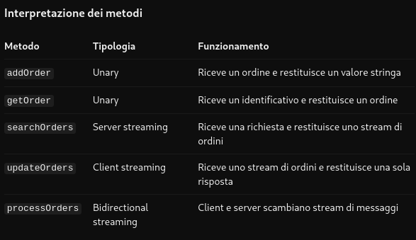

Strategia per rispondere, devi identificare:
1. il servizio definito e le operazioni disponibili
2. i messaggi di richiesta e risposta, con relativi campi e tipi
3. la tipologia di ciascuna RPC in base alla presenza o meno di `stream` in input e output
4. le caratteristiche generali di gRPC evidenziate dall'interfaccia come IDL, Protobuf, interoperabilità, streaming, serializzazione binaria self-describing...

---

## RECAPPONE

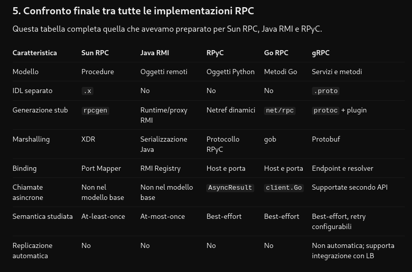