Il **Message Oriented Middleware (MOM)** è una tipologia di middleware che permette alle componenti di un sistema distribuito di comunicare tramite scambio di messaggi.

Per capirne l'utilità partiamo da un limite di RPC: si tratta di una **comunicazione transiente**.  
Quando il client invoca una procedura remota infatti, anche nel caso asincrono, il server deve essere raggiungibile per ricevere la richiesta DURANTE l'invocazione.

Con MOM invece si introduce un componente intermedio, il **message broker**, che può memorizzare i msg e consegnarli successivamente --> **comunicazione persistente!**

In questo senso il principale vantaggio di MOM è che, a differenza di RPC, garantisce **decoupling temporale**, oltre che anche quello **spaziale** rispetto al destinatario finale (il client deve conoscere solo l'endpoint del broker) e generalmente anche quello **di sincronizzazione**.

RPC e MOM non sono necessariamente alternative: in una stessa applicazione si possono usare RPC per operazioni che richiedono una risposta immediata e MOM per lavori differibili.

I principali pattern di MOM sono il **Message Queue** e il **Publish/Subscribe**.

## Message Queue Pattern
In questo pattern uno o più **producer** inviano *messaggi* a una coda, dalla quale uno o più **consumer** li prelevano e li elaborano.

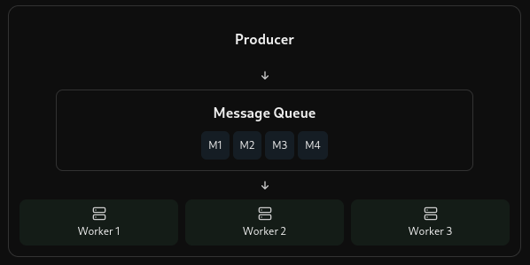

Questo modello è **one-to-one** a livello logico: *ogni messaggio rappresenta un compito che dovrebbe essere svolto da uno e un solo consumer, anche se più consumer possono essere disponibili per prelevarlo*.

Tuttavia un messaggio può finire per essere elaborato più di una volta a causa di una riconsegna dopo un guasto, a seconda della semantica di consegna.

**Es.** Tre worker che ridimensionano fotografie, il producer inserisce in coda un msg per ogni foto --> quando un worker è libero, può prelevare un msg.  
In questo senso le code di messaggi sono tipicamente usate per fare **Load Balancing** tra più istanze di un servizio, ma anche altri use case come *task scheduling*, *elaborazioni in background* etc..

Le operazioni tipiche su una message queue sono:
- `put`: il producer inserisce un messaggio
- `get`: il consumer attende e preleva un messaggio dalla coda
- `poll`: il consumer controlla la presenza di messaggi in coda, senza attendere indefinitamente
- `notify`: il middleware segnala la disponibilità di un messaggio tramite handler o callback

In generale, in sistemi su larga scala, le code (così come i topic per pub/sub) possono essere distribuite --> si ha un modello dove il mittente deposita il msg nella propria **coda locale** e il destinatario lo preleva dalla propria --> nel mezzo, dei **queue manager** lo instradano attraverso dei nodi intermedi, formando una vera e propria **rete overlay** per cui ci si ricollega al message routing già studiato (algoritmi di flooding, RW, DHT, Gossip...)

## Publish/Subscribe Pattern
Nel **Pub/Sub** un publisher pubblica un *evento* su un **topic**, mentre i subscriber si iscrivono ai topic di loro interesse.

A differenza delle code, qui il modello è **one-to-many**: uno stesso evento può interessare più destinatari indipendenti.


Il componente logico che associa gli eventi alle sottoscrizioni è chiamato **event dispatcher**.    
L'event dispatcher può applicare anche dei *filtri*, consegnando a ciascun subscriber solo gli eventi corrispondenti ai criteri richiesti.

Le operazioni principali sono:
- `publish(event)`
- `subscribe(filter, notify_cb, expiry) -> sub_handle`: il subscriber si registra per ricevere eventi di un topic, indicando eventuale filtro, una callback e una scadenza per la sottoscrizione. Riceve in output un handle tramite cui può eventualmente disiscriversi via `unsubscribe(sub_handle)`.  
Quando un evento corrisponde al filtro, il middleware può invocare la callback `notify_cb(sub_handle, event)` per notificare il subscriber.

Un *event dispatcher centralizzato* è più facile da gestire, ma può diventare SPOF e collo di bottiglia --> in un sistema distribuito su larga scala può essere preferibile distribuire le responsabilità di instradamento degli eventi. 

**N.B.** *Se si vuole che qualcuno svolga un lavoro --> Message Queue*, se si vuole che *tutti i componenti interessati siano informati --> Pub/Sub.*

## Semantiche di consegna dei messaggi
Qui si parla di semantica di delivery, ossia le garanzie offerte dal middlware rispetto alla consegna dei messaggi / eventi

Immaginiamo un messaggio che chieda di incrementare di 1 il contatore associato alla parola "casa" --> non è un'operazione idempotente:

**At-most-once**

Il messaggio può essere consegnato **zero oppure una volta** --> il sistema evita le consegne duplicate, ma può perdere un messaggio in caso di guasto.

Es. il consumer riceve un lavoro e conferma la ricezione prima di elaborarlo --> se il consumer va in crash prima di completare il lavoro, il messaggio è perso.

**At-least-once**

Qui il middleware cerca di garantire che il msg venga consegnato **almeno una volta**, ammettendo possibili duplicati.

Un meccanismo tipico per questa semantica prevede un meccanismo di ACK e timeout. 

Es. se il consumer si guasta prima di inviare l'ACK, ma quando ha già incrementato il contatore --> il middleware ritenta la consegna del messaggio e un altro consumer potrebbe riceverlo e incrementare nuovamente il contatore 

Adatta a lavori idempotenti. Per rendere un'operazione non idempotente idempotente, si può trasformare l'operazione dove possibile, ad esempio nel caso del contatore usare un'operazione di *set*.  
Un'alternativa può essere associare ad ogni messaggio un identificativo univoco ed implementare a livello applicativo un meccanismo di *deduplication* e RR1 (RR2 più caratteristico delle RPC, dato che il client attende il risultato della chiamata).

**Exactly-once**

Con **exactly-once** l'obiettivo è che ogni messaggio **produca un solo effetto logico**, anche in presenza di ritrasmissioni.  

--- 

Due meccanismi utilizzati specificatamente in ambito MOM per ottenere alcune di queste semantiche sono **Timeout Based Delivery** e **Transaction Based Delivery**.

### Timeout Based Delivery
Particolarmente importante in quanto usata da Amazon SQS, il funzionamento è il seguente:
1. Il consumer $A$ riceve un msg
2. Il middleware conserva il msg, ma lo rende temporaneamente invisibile agli altri consumer per un certo periodo di tempo (**visibility timeout**)
3. Se $A$ completa il lavoro, conferma il consumo e il messaggio viene eliminato dalla coda
4. Se $A$ non completa il lavoro entro il timeout --> il messaggio torna disponibile per un nuovo tentativo

Questo meccanismo offre un modello di consegna **at-least-once**, dato che potrebbe accadere che il consumer $A$ completi il lavoro ma non riesca a confermare il consumo prima del timeout --> il messaggio torna disponibile e un altro consumer potrebbe riceverlo e completare nuovamente il lavoro.

### Transaction Based Delivery
Con questo meccanismo si cerca di far sì che un messaggio venga cancellato dalla coda **solo se il lavoro associato è stato completato con successo**:
- **Commit** rende definitive le operazioni comprese nella transazione, il sistema considera il messaggio consumato
- **Rollback** annulla le modifiche comprese nella transazione, e il messaggio torna disponibile per un nuovo tentativo di consegna.

Questa garanzia vale solo per le operazioni coinvolte in una stessa transazione --> recupereremo questo meccanismo parlando della semantica **exactly-once** di Kafka.

## Modelli di consegna
Due tipi:
- **Push** se è il middleware ad inviare/segnalare la disponibilità di un messaggio al consumer (es. RabbitMQ con push delivery)
- **Pull** se è il consumer a interrogare il middleware quando desidera leggere (es. Amazon SQS e Kafka)

Il **vantaggio del pull** è che **il consumer può controllare il proprio ritmo di elaborazione**, e lo **svantaggio** è il possibile overhead del polling che ne deriva (specie se il consumer effettua tante richieste quando non ci sono messaggi disponibili) --> tecnica del *long polling* per ridurre l'overhead.

---

# Amazon SQS
**Amazon SQS (Simple Queue Service)** è un servizio cloud gestito da AWS che permette alle applicazioni distribuite di scambiare messaggi attraverso delle code.

Essendo un servizio gestito, AWS si occupa dell'infrastruttura necessaria a memorizzare, distribuire e rendere disponibili i messaggi.

I messaggi sono distribuiti *in più SQS server all'interno della regione AWS scelta*, dove ogni server è replicato in più AZ al fine di aumentare la **disponibilità** e la **tolleranza ai guasti**.


SQS utilizza:
- **Message Queue** --> i messaggi rappresentano lavori che (idealmente) un solo consumer dovrebbe svolgere
- **Modello Pull** --> sono i consumer a interrogare la coda per prelevare i messaggi
- **Disaccoppiamento temporale, spaziale e di sincronizzazione**
- **Timeout Based Delivery** --> semantica di consegna **at-least-once** 

## Semantica di consegna in SQS
Come anticipato SQS offre una semantica di consegna **at-least-once** implementando un meccanismo di **timeout based delivery**.

Immaginiamo che il consumer $A$ esegua `ReceiveMessage()` e riceva un messaggio $M1$ dalla coda.  
Da quel momento SQS rende il messaggio invisibile agli altri consumer per un intervallo di tempo configurabile, il **visibility timeout**.

A questo punto ci sono due possibili scenari:
- **Caso A -- Elaborazione completata**: il consumer termina il lavoro ed esegue `DeleteMessage()` per confermare il consumo del messaggio --> il msg viene rimosso definitivamente dalla coda
- **Caso B -- Guasto o timeout**: il consumer non elimina il msg prima della scadenza del visibility timeout --> il msg torna disponibile per un nuovo tentativo di consegna ad un altro consumer.  
Se però il primo worker aveva già completato l'operazione prima di bloccarsi, il secondo potrebbe eseguirla di nuovo --> **SQS richiede attenzione per l'idempotenza delle operazioni**.

Importante non confondere il *visibility timeout* dal **retention period**: quest'ultimo indica **per quanto tempo il msg viene conservato nella coda prima di essere rimosso automaticamente** (default 4 giorni, max 14 giorni).

Nel caso un'elaborazione richieda più tempo del previto --> il consumer può usare `ChangeMessageVisibility()` per modificare il timeout di visibilità del messaggio.

## Modello Pull: short polling e long polling
Poiché SQS usa un modello **pull** --> i consumer devono richiedere i messaggi disponibili.  

In particolare in SQS il consumer chiede direttamente a Amazon SQS se ci sono messaggi disponibili in coda, e ricordando che **la coda è distribuita su più server** bisogna distinguere tra i due tipi di polling.

Con lo **short polling** SQS consulta un sottoinsieme dei server che gestiscono la coda e restituisce rapidamente la risposta. 

Il problema è che potrebbero essercci msg disponibili su server che la richiesta non ha consultato.  

Con il **long polling** SQS consulta tutti i server.  
Se non c'è messaggio disponibile, può mantenere aperta la richiesta per un intervallo configurabile fino a 20 secondi.

Il vantaggio è la riduzione dell'overhead dovuto a richieste ripetute quando non ci sono messaggi disponibili, migliorando l'efficienza del sistema.

## Ordine di consegna ed API
SQS offre due tipologie principali di code: **Standard** e **FIFO**.

Con la **Standard Queue** si privilegia *scalabilità* e *throughput*: l'ordine di consegna dei messaggi ai consumer non è garantito, è *best-effort*.  
La semantica seguita in questo caso resta comunque l'**at-least-once**.

Con la coda **FIFO** invece si offrono garanzie più forti sia sull'*ordinamento* che sulla *deduplicazione* degli invii.  
Si garantisce **l'ordine di consegna all'interno dello stesso message group**, nonché una **deduplicazione degli invii** entro una finestra temporale di 5 minuti --> queste garanzie comportano un *throughput più basso* rispetto alle Standard Queue.

(attenzione al fatto che la deduplicazione riguarda invii duplicati verso lo stesso consumer, non garantisce che un messaggio non venga mai rielaborato dopo un visibility timeout, è comunque semantica **at-least-once**!)

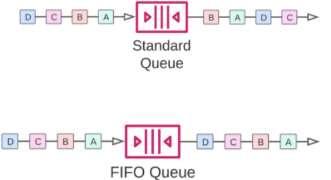

Le principali API di SQS sono:
- `CreateQueue, ListQueues e DeleteQueue`: per creare, elencare e cancellare code
- `SendMessage` per inserire un messaggio in coda. Per un contenuto grande, si può **salvare il file su S3 e inviare solo il suo riferimento in coda**
- `ReceiveMessage` per prelevare i msg disponibili. Si può chiedere da 1 a un max di 10 msg per chiamata
- `DeleteMessage` per rimuovere un msg dalla coda dopo che il consumer ha completato il lavoro
- `ChangeMessageVisibility` per modificare il timeout di visibilità di un msg già prelevato. Utile se il consumer si accorge che il lavoro richiederà più tempo del previsto
- `GetQueueAttributes` e `SetQueueAttributes` per ottenere e impostare informazioni sulla coda, es. il numero di msg disponibili, il timeout di visibilità, il retention period etc.

Una particolarità importante di SQS è che questo **non permette di filtrare i messaggi direttamente tramite `ReceiveMessage`** --> il consumer deve ricevere i messaggi e poi filtrare quelli di interesse a livello applicativo, e quando non gli interessano lascia che il visibility timeout scada, così che il msg torni disponibile per un altro consumer.

---

**Esempio applicativo: elaborazione di immagini con S3, SQS e EC2**

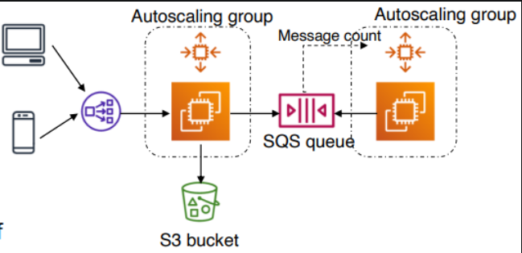

Il funzionamento è il seguente:
1. Il front-end riceve la fotografia dell'utente
2. La foto viene salvata in un bucket S3
3. Il front-end inserisce in SQS un msg contenente il riferimento alla foto appena salvata
4. Un worker EC2 in backend recupera il riferimento dalla coda e scarica la foto da S3
5. Il worker elabora il file e, se l'operazione riesce, elimina il msg dalla coda.  
Se si guasta prima della conferma, il msg torna disponibile per un altro worker.

Questa architettura **migliora la scalabilità** in quanto il front-end non deve attendere che il backend abbia completato l'elaborazione della foto.  
Inoltre il numero di messaggi in attesa può essere salvato in un contatore dalla coda SQS e usato quindi come **metrica per effettuare l'autoscaling backend dei worker EC2**: 
- se i msg si accumulano --> il sistema può fare scale-out aggiungendo nuovi worker EC2
- se il carico diminuisce allora si può effettuare scale-in, rimuovendo i worker in eccesso.

L'architettura migliora anche la **tolleranza ai guasti** grazie al meccanismo di timeout based delivery implementato nativamente da SQS: se un worker si guasta, il msg torna disponibile per un altro worker, che potrà completare l'elaborazione della foto (ciò comunque ricordiamo non eliminare la necessità di gestire duplicati).

Quindi in generale l'uso della coda permette di *disaccoppiare il front-end dal back-end*, assorbire picchi di traffico, distribuire il lavoro tra più worker, supportare l'autoscaling e aumentare la tolleranza ai guasti.

---

# Apache Kafka
**Apache Kafka** è una piattaforma distribuita open-source per lo streaming di eventi.  
Permette alle applicazioni di:
- Pubblicare eventi
- Memorizzarli in modo persistente
- Leggerli ed elaborarli, distribuendo l'elaborazione tra più componenti (grazie a strumenti come Kafka Streams, su cui noi non ci soffermeremo --> ci concentriamo solo su come gli eventi sono consegnati, scritti e conservati)

Useremo in modo intercambiabile i termini *evento*, *messaggio* e *record*.

L'architettura di Kafka comprende quattro elementi fondamentali:
1. **Producer**: pubblica record in uno o più topic
2. **Topic**: categoria logica dove vengono pubblicati e organizzati i record
3. **Broker**: in questo caso non è da vedere come intermediario; rappresenta piuttosto un nodo del cluster Kafka che memorizza partizioni dei Topic e gestisce le richieste
4. **Consumer**: legge i record dai topic di interesse

L'insieme dei broker costituisce un **Kafka Cluster**.

Kafka offre tutti i tipi di decoupling (*temporale*, *spaziale* e *di sincronizzazione*): il producer pubblica su un topic senza conoscere i consumer, gli eventi possono restare memorizzati e i consumer possono leggerli successivamente.  
Essendo un sistema pub/sub, ricordiamo anche la logica **one-to-many**, per cui uno stesso evento può interessare più consumer indipendenti.

## Topic, log e partizioni
La caratteristica fondamentale di Kafka è che **ogni topic è suddiviso in partizioni**, e ciascuna partizione contiene un proprio **log di eventi**.  

Un log è una struttura dati **append-only**, per cui i nuovi record vengono aggiunti in fondo senza che quelli già inseriti vengano mai modificati direttamente.  
(es. se un ordine cambia stato, allora anziché modificare il record precedente si aggiunge il nuovo evento `order shipped` in fondo al log)

Quando viene pubblicato un evento in una partizione, il broker Kafka gli assegna un **offset**, che ne identifica la posizione nel log, e lo aggiunge in fondo al log. 

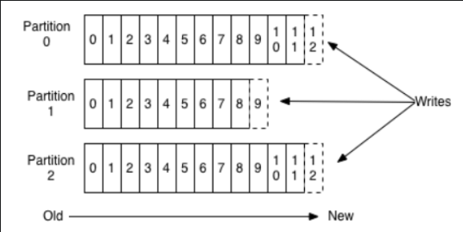

L'offset è **univoco solo a livello di partizione**, non globalmente in tutto il topic --> due partizioni diverse dello stesso topic possono contenere entrambe un record con offset 10.

### Le partizioni come unità di parallelismo

Le partizioni rappresentano la principale **unità di parallelismo** di Kafka: se un topic fosse costituito di un singolo log --> sarebbe necessario coordinare tutte le scritture tramite un unico leader di partizione --> SPOF e collo di bottiglia.

Al contrario, avendo diverse partizioni per ogni topic, Kafka le può distribuire fisicamente su broker diversi permettendo di:
- consentire scrittura e lettura parallela degli eventi --> aumenta il throughput
- distribuire il carico di lavoro tra più server
- scalare potenzialmente il sistema, aggiungendo nuovi broker e partizioni

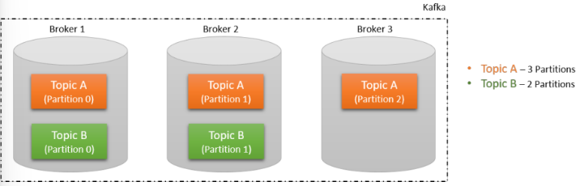

Il partizionamento introduce anche alcuni problemi, tra cui il fatto che **Kafka non garantisce ordine globale dei record tra partizioni diverse di uno stesso topic** e che *la distribuzione dei record tra partizioni può essere non uniforme* --> li vediamo meglio dopo.

### Come il producer sceglie la partizione
Esistono diverse strategie che il producer può utilizzare

**Key-based partitioning**: ad ogni record viene associata una chiave, ad esempio l'ID di un ordine --> il producer calcola un hash della chiave per determinare la partizione a cui inviare il record.

In questo modo, a parità di configurazione, si garantisce che record aventi stessa chiave saranno assegnati alla stessa partizione, preservando l'ordine di pubblicazione per quella chiave.

**Senza chiave**: i record possono essere distribuiti tra le partizioni che mirano a bilanciare il carico, ad es. **Round-Robin con politica sticky** per cui RR però con invio in batch per ridurre overhead di rete e aumentare throughput.

**Custom Partitioning** se invece l'applicazione applica una propria logica specifica per determinare la partizione di destinazione.

Una volta individuata la partizione, il producer usa **i metadati del cluster** per individuarne il **leader**.

---

Tornando al problema dell'univocità locale dell'offset, immaginiamo che un producer debba registrare tre eventi legati allo stesso ordine (es. `order created`, `order confirmed`, `order shipped`) --> sarà importante che i consumer li leggano esattamente in quest'ordine per comprendere correttamente lo stato dell'ordine.

Quindi, dato che in Kafka **non c'è ordinamento globale degli offset** è importante che **questi eventi vengano pubblicati tutti nella stessa partizione!**

Il modo più comune per ovviare al problema è proprio l'uso del **key-based partitioning**: se si vuole mantenere l'ordine degli eventi relativi a una stessa entità, è utile usare una chiave di partizionamento comune.

## Kafka Consumer Group
Un **consumer group** è un insieme di consumer che condividono lo stesso `group.id` e si dividono il lavoro di lettura delle partizioni.  
Dal punto di vista del sistema, il gruppo **rappresenta un unico consumer logico**.

La regola fondamentale dei consumer group è la seguente: **all'interno di uno stesso consumer group, una partizione è assegnata a un solo consumer alla volta**, mentre un consumer può essere assegnato a più partizioni.

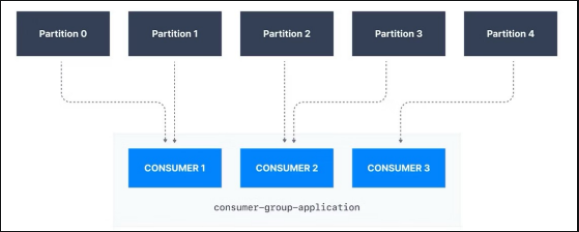

Nell'esempio in figura si hanno **meno consumer che partizioni** --> *dato che ogni partizione è assegnata a un solo consumer, alcuni consumer leggeranno da più partizioni*.

Se avessimo invece avuto **più consumer che partizioni** (es. $3$ partizioni, $\gt 3$ consumer) --> *al massimo tre 3 consumer potranno ricevere una partizione in quel gruppo, gli altri rimarranno inattivi rispetto a quel topic.*

Quindi **il numero di partizioni all'interno di un consumer group determina il parallelismo massimo di consumo**.

---

Importante però capire che una partizione può essere letta da **più consumer, a patto che appartengano a consumer group diversi**.

Ciò è fondamentale soprattutto quando si vogliono implementare dei **microservizi** che comunichino tramite Kafka... vediamo un esempio:

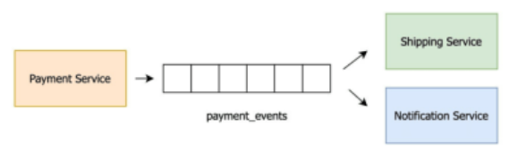

Il servizio di pagamento pubblica sul topic `payment_events` quando un pagamento va a buon fine.  
I servizi interessati al pagamento sono quelli di `Shipping` e `Notification` all'utente.  
Qui è fondamentale che i due microservizi **appartengano a consumer group diversi**, dato che devono leggere entrambi gli stessi eventi.

Se infatti usassero lo stesso `group.id`, Kafka li considererebbe parte dello stesso gruppo e distribuirebbe le partizioni tra loro --> entrambi leggerebbero solo una parte degli eventi...

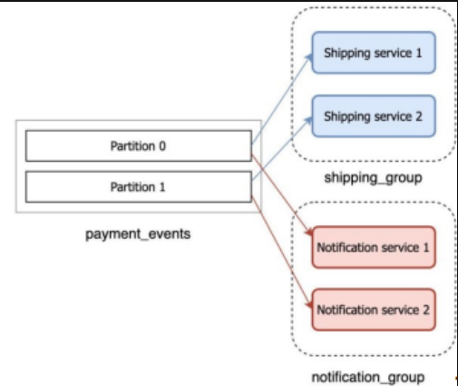

---

I consumer di un gruppo sono **dinamici**: possono entrare, uscire o subire guasti.

Quando ciò accade Kafka cambia la composizione del gruppo e l'assegnazione delle partizioni in un processo detto **rebalance** --> ciò permette di ribilanciare il lavoro ma può introdurre overhead e interruzioni dell'elaborazione.

## Lettura dei record e commit degli offset
Kafka usa un modello **pull**, per cui è il consumer a richiedere al broker i record di una determinata partizione, *a partire da uno specifico offset*.

Ad esempio:
```text
Partizione P0

Offset:      10    11    12    13
Record:      M1    M2    M3    M4
```
un consumer che si trova all'offset 11 può richiedere i record a partire da quella posizione. 

Il vantaggio del modello pull è che **il consumer può leggere i dati secondo il proprio ritmo di processamento**, ciò è un elemento importante che incrementa la **scalabilità** del sistema (con il modello push il broker dovrebbe decidere quando inviare i record a ciascun consumer, ognuno con ritrmo diverso, e sapere per ciascun consumer a che offset si trova...)

Il costo che deriva dall'uso del modello pull è la possibilità di **busy waiting** da parte del consumer --> per mitigarlo Kafka permette alle richieste di lettura di specificare un *timeout* prima di "arrendersi".

---

Il consumer deve conservare un riferimento alla posizione da cui riprendere la lettura in caso di guasto... se la memorizzasse solo in RAM infatti la perderebbe in caso di crash.

Per questo motivo Kafka permette di **effetturare il commit degli offset**, memorizzandoli in modo **persistente** all'interno del topic speciale `__consumer_offsets` (che è a sua volta partizionato e replicato).

Vedremo che il tipo di semantica di consegna in Kafka **dipende anche da quando viene effettuato il commit dell'offset rispetto all'elaborazione del record**:

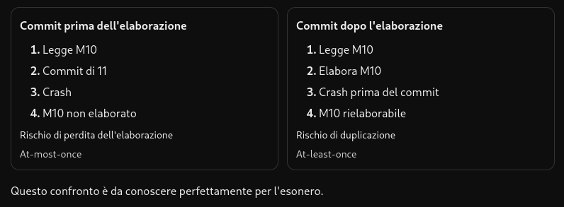

Convenzionalmente si registra **l'offset del prossimo record da leggere** (es. se ho elaborato correttamente il record con offset 12 --> posso effettuare il commit di 13).

## Replicazione e tolleranza ai guasti
Abbiamo visto che Kafka suddivide i topic in partizioni per migliorare la scalabilità.

Con la **replicazione** invece si vuole aumentare principalmente la **tolleranza ai guasti** e la **disponibilità** dei dati.

In Kafka la replicazione consiste nel mantenere più copie di una stessa partizione su broker differenti, secondo un **replication factor**.

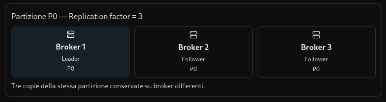

Ogni partizione ha:
- **Un Leader**, che gestisce tutte le scritture dei producer e le letture dei consumer
- **Zero o più Follower**, che mantengono copie dei dati presenti nel leader

I follower recuperano i nuovi record tramite **pull** dal leader, chiedendo gli aggiornamenti che non hanno ancora copiato --> replicazione asincrona: il leader può aver ricevuto record che i follower non hanno ancora copiato.

Il motivo di **un solo leader per partizione** è una questione di semplicità al fine di garantire la **consistenza dei dati**... se ci fossero più leader sarebbe ad es. necessario un meccanismo di coordinamento per garantire che i record vengano scritti nello stesso ordine su tutti i leader.

Quando un leader si guasta --> viene scelta una partizione follower sufficientemente aggiornata come nuova leader secondo un protocollo di **leader election** basato su KRaft.  

### In-Sync Replicas (ISR) e `acks`, high watermark
L'**ISR In-Sync Replicas** è l'insieme delle repliche che si considerano sufficientemente aggiornate rispetto al leader, secondo i criteri di Kafka (leader compreso).

Questo è un insieme dinamico: **un follower può uscire dall'ISR se rimasto troppo out-of-sync rispetto al leader**, ma può anche **rientrare quando recupera il ritardo**.

Il producer può configurare il paramentro `acks`, che stabilisce quando una scrittura deve essere considerata confermata (se scade il timeout senza ricevere conferma, il producer fa retry):
- `acks=0` == il producer non aspetta alcuna conferma dal broker (*fire and forget*) --> *minore overhead, ma rischio maggiore di perdita di messaggi*
- `acks=1` == il leader conferma dopo aver registrato il record localmente --> *il record può essere perso se il leader crasha prima che i follower abbiano fatto pull dei nuovi dati*
- `acks=all` == il leader attende la replicazione del messaggio su tutte le repliche, e solo allora conferma al producer --> *maggiore durabilità, ma anche maggiore latenza*

Ricordando che l'ISR è dinamico --> il funzionamento di `acks = all` dipende dalla composizione dell'ISR.

In questo senso esiste un parametro importante, `min.insync.replicas`, che stabilisce **il numero minimo di repliche che devono essere in sync** affinché il leader accetti le scritture con `acks=all`.

Supponiamo una situazione del tipo:
```text
replication.factor = 3
min.insync.replicas = 2
acks = all
```
--> se l'ISR contiene $\ge 2$ repliche, il leader può confermare la scrittura dopo che tutte le repliche dell'ISR l'hanno registrata.

Tuttavia, se due repliche escono dall'ISR e rimane solo il leader --> la soglia minima non è soddisfatta, **la scrittura viene rifiutata!**

In questo senso si introduce il primo tradeoff importante di Kafka: **durabilità vs disponibilità**: `min.insync.replicas` alta aumenta le garanzie di durabilità, ma può anche ridurre la disponibilità delle scritture se alcuni broker sono guasti o in ritardo...

---

Per quanto riguarda quello che può leggere il consumer, Kafka implementa un meccanismo per far sì che i consumer leggano solo record che abbiano raggiunto un certo livello di replicazione.

Questo meccanismo si basa sul concetto di **High Watermark**: si tratta del più piccolo offset che sia stato replicato su tutte le repliche dell'ISR --> *ogni consumer legge dal leader della partizione, ma solo fino all'offset dell'high watermark.*

Per le transazioni Kafka si introduce un limite ancora più stringente, detto **Last Stable Offset LSO**.

## KRaft e coordinamento del cluster
Quando un broker si guasta, Kafka deve aggiornare le informazioni relative alle partizioni e ai loro leader.  
Tutte queste informazioni costituiscono i **metadati del cluster**

Per gestire questi metadati Kafka usa **KRaft**, un'architettura basata sul protocollo di consenso Raft... soluzione a due livelli:
1. **Controller quorum**: si parte da un piccolo gruppo di broker controller (tipicamente 3 o 5) che mantiene un **log interno replicato dei metadati**.  
Raft elegge un singolo **controller attivo** del gruppo, che si occupa di gestire la scelta dei leader delle partizioni in caso di guasti e aggiornare i metadati del cluster.
2. **Fetch dei metadati**: i broker fuori dal controller quorum fanno periodicamente fetch del log dei metadati e li lasciano in cache (dato che gli serve per sapere dove si trovano le partizioni e chi le gestisce)

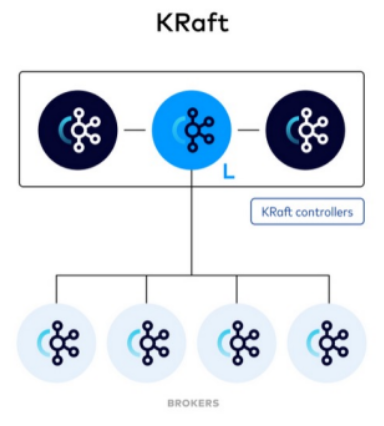

Prima di KRaft, Kafka si appoggiava su *ZooKeeper*, un sistema distribuito esterno... ciò comportava costi soprattutto nella latenza dovuta all'interazione dei due sistemi per ottenere info aggiornate sul cluster.

## Semantiche di consegna in Kafka
Per le semantiche di consegna si collegano le conferme dei broker ai producer e il commit degli offset dei consumer --> è necessario considerare **sia il producer che il consumer** per capire quale semantica di consegna si ottiene.

### At-most-once
Si accetta la possibilità di perdere messaggi, evitando tentativi ripetuti che produrrebbero duplicati.
- **Producer**: con `acks=0` invia i record senza attendere alcuna conferma dal broker (*fire and forget*) --> se il leader crasha prima di registrare il record, questo viene perso
- **Consumer**: se il consumer fa commit dell'offset in `__consumer_offsets` prima di aver processato il record --> se va in crash e riparte, rileggerà dal prossimo offset e perderà il record non ancora processato.

Semantica utile quando perdere occasionalmente un evento è più accettabile che elaborarlo più volte.

### At-least-once
Si cerca di evitare le perdite, ammettendo la possibilità di duplicati.
- **Producer**: con `acks=all` e `min.insync.replicas > 1` il producer può aumentare la durabilità delle scritture confermate.  
Tuttavia, se il broker registra il record ma l'ACK viene perso --> il producer può inviarlo nuovamente, generando un duplicato se non ci sono meccanismi di deduplicazione. 
- **Consumer**: il consumer fa il commit solo dopo l'elaborazione --> se si guasta, il record potrà esser letto ed elaborato nuovamente. Si evita quindi di non elaborarlo mai, ma potrebbero esserci più elaborazioni.

Opportuno da usare per operazioni idempotenti.

### Exactly-once
La semantica **exactly-once** di Kafka ha come obiettivo quello di garantire che ogni record coperto dalle garanzie transazionali del sistema produca **un solo effetto logico**.

Per implementare questa semantica sono necessari diversi meccanismi, tra questi c'è il **producer idempotente**.

Un **producer idempotente** permette al broker di riconoscere tentativi ripetuti di scrittura dello stesso record.

Questo meccanismo usa un **ID del producer** e un **numero di sequenza** per ogni partizione: se il leader riconosce un invio che è già stato registrato, può confermare l'ack senza riscrivere il record nel log.

es. supponiamo che il producer invii `M1, M2, M3`, e che il broker registri `M1` e `M2` ma che la risposta di conferma si perda.  
Allora il producer ritenta l'invio --> senza idempotenza del consumer, il broker potrebbe registrare di nuovo `M1` e `M2`, invece in questo modo aggiunge solo il messaggio mancante `M3` e conferma l'ack al producer.

---

Una volta capito questo, **per ottenere exactly-once servono tre meccanismi**:
1. **Producer Idempotente** e **`acks=all`** 
2. **`min.insync.replicas > 1`** e **replication factor $\ge 3$**
3. **Transazioni Kafka**: bisogna vedere producer, consumer e broker come un unico sistema transazionale.

Sull'ultimo punto non si entra troppo in dettaglio, però intuitivamente il suo scopo è ottenere:
- *Scritture **atomiche** delle diverse partizioni* (es. se un producer scrive su due partizioni, o entrambe le scritture vanno a buon fine o nessuna delle due)
- *Commit atomico dell'offset*: se Kafka conferma i risultati, allora il consumer deve fare il commit dell'offset, altrimenti il commit non deve avvenire.
- `read_committed` per chi legge il risultato: semplificando, il consumer può leggere solo ciò che è sicuro sia stato replicato... in questo senso torna il **Last Stable Offset (LSO)** di cui si parlava prima.

Nonostante tutti questi accorgimenti, ricordiamo che comunque non si ottiene l'**exactly-once puro** dato che potrebbero sempre sorgere problematiche esterne al sistema Kafka (es. se dopo aver letto un evento un consumer aggiorna un DB esterno --> bisogna coordinare anche quell'aggiornamento..)

---

In conclusione sulla semantica Kafka: 
- **at-most-once** utile se ci aspettiamo di perdere potenzialmente qualche record, ma in cambio molta disponibilità e throughput elevato (**es. applicativo: streaming in tempo reale**)
- **at-least-once** se non vogliamo perdere record, ma potremmo avere duplicati --> servono operazioni idempotenti (**es. applicativo: elaborazione di ordini**)
- **exactly-once** è la soluzione che evita perdite o duplicati, ma a prezzo di throughput e latenza maggiore (**es. applicativo: transazioni finanziarie, contatori d'inventario etc..**)

I trade-off di Kafka:
- **Durabilità vs Disponibilità** vista prima
- **Latenza vs Durabilità**: `acks=all` e valori di `min.insync.replicas` più alti aumentano la durabilità, ma anche la latenza di scrittura

## Retention period e segmenti
Kafka è pub/sub --> one-to-many --> i dati possono essere conservati nel middleware e non vengono eliminati non appena un consumer li legge.

La **retention** determina quanto tempo o entro quale limite di spazio i dati restano conservati nel log.

Kafka memorizza i log su disco, suddividendoli in **segmenti**:
- con politica di cancellazione basata sul **tempo** --> Kafka rimuove i segmenti più vecchi quando scadono
- con una politica basata sulla **dimensione** --> rimuove i segmenti più vecchi quando il log della partizione supera il limite configurato

Consumer lenti quindi possono perdere la possibilità di recuperare record, se Kafka li ha già cancellati.

Per cercare di ridurre lo spazio, una possibilità è la **log compaction**: immaginiamo un sensore che invia temperature successive usando come chiave l'ID del sensore.  
Se ci interessa solo ricostruire le temperature più recenti per ogni sensore --> **tramite log compaction verranno rimossi solo i record più vecchi associati alla stessa chiave.**

Quindi log compaction utile quando **ci interessa lo stato più recente per chiave**.

Un altro elemento importante è il **flush**: quando il broker aggiunge dati al log, il SO può tenerli inizialmente in cache sulla RAM.  
Il flush si occupa di portare quei dati su disco --> si deve trovare equilibrio tra *performance* (trasferire continuamente su disco è costoso, sarebbe preferibile farlo in batch) e *durabilità* (se il broker va in crash prima del flush, i dati ancora in page cache saranno persi..)

---

**Esonero 2025**

*Perché Kafka è scalabile? Perché invece è tollerante ai guasti?*

Kafka è scalabile grazie alla suddivisione dei topic in più partizioni, ciascuna delle quali contiene un log append-only indipendente. Le partizioni possono essere distribuite tra broker diversi, consentendo scritture e letture parallele. Inoltre, i consumer appartenenti allo stesso consumer group si dividono le partizioni, permettendo di aumentare il parallelismo dell'elaborazione. L'uso del modello pull, del batching e della page cache contribuisce ulteriormente a ottenere un throughput elevato.

La tolleranza ai guasti è ottenuta mediante la replicazione delle partizioni su broker differenti. Ogni partizione possiede un leader e può avere repliche follower. In caso di guasto del leader, una replica idonea può subentrare. L'insieme ISR e i meccanismi di acknowledgement consentono di controllare le garanzie di durabilità, mentre il commit degli offset permette ai consumer di recuperare la posizione di lettura dopo un guasto.

---

**API di Kafka e il loro ruolo in una pipeline**

Per capire le API di Kafka prendiamo come esempio una pipeline di analisi di dati: si parte da un database sorgente, Kafka può raccogliere e rendere disponibili gli eventi mentre un sistema come Spark o Flink può leggerli per elaborarli... da qui si capisce il perché Kafka esponga API con compiti diversi:
- **Producer API** per pubblicare record nei topic
- **Consumer API** per leggere record dai topic
- **Connect API** per integrare Kafka con sistemi esterni (es. database, file system, ecc..) tramite connettori già pronti (*source connector* se porta dati *verso* Kafka, *sink connector* se porta dati *da* Kafka verso un sistema esterno)
- **Streams API** per elaborare flussi di eventi in tempo reale in un'applicazione che legge e scrive su Kafka
- **Admin API** per la gestione di risorse e configurazioni del cluster, ad es. amministrare i topic

ad es. un connettore può portare dati da MySQL a Kafka, mentre un'applicazione Flink può leggerli come consumer per fare analisi...

Kafka fornisce l'SDK (software development kit, con tutte le librerie e relative API..) ufficialmente solo su Java, ma esistono anche soluzioni di terze parti famose per altri linguaggi tipo Go, Python...

# AMQP e MQTT
Si tratta di due protocolli standard **aperti** per lo scambio di messaggi tra applicazione e broker MOM --> obiettivo comune permettere a client e broker di comunicare via protocollo standard, indipendente dal produttorre del software.

**MQTT (Message Queuing Telemetry Transport)** è un protocollo applicativo **binario** leggero, pensato per dispositivi con risorse o bande limitate (tipicamente **IoT**)

## AMQP
**AMQP (Advanced Message Queuing Protocol)** definisce invece un protocollo applicativo **binario** più complesso, che può operare su TCP ed eventualmente usare TLS per la cifratura.

Nella versione **1.0** AMQP si limita a definire il protocollo di comunicazione e il formato dei messaggi, lasciando al broker libertà totale sull'implementazione del MOM (pub/sub, queue e i vari dettagli).

Un **container AMQP** è un'entità logica che rappresenta un partecipante alla comunicazione AMQP (es. un client o un broker, dove il broker è l'entità che gestisce i messaggi).

AMQP usa concetti come `connection` (collegamento tra due container), `session` (scambio di msg in una stessa connessione), `link` (percorso unidirezionale per lo scambio di msg), **`transfer`** (invio di un msg su un link), **`disposition`** (comunicazione dell'esito della consegna) e **`settlement`** (conclusione della consegna dal punto di vista del protocollo).

Il ruolo del broker dipende dal tratto che stiamo osservando:
- **Producer -> Broker**: il producer invia il msg (`transfer`) e il broker svolge il ruolo da receiver --> manda `disposition`.
- **Broker -> Consumer**: stavolta è il broker ad inviare il msg e il consumer a confermare.

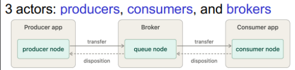

Altro concetto importante in AMQP è quello di **link credit**: il ricevente può "forzare" il mittente ad inviare solo un certo numero di messaggi alla volta.  
Nel tratto broker -> consumer con RabbitMQ, è quindi il consumer a concedere credito al middleware. 

Ogni nuova consegna consuma un credito --> **se il consumer concede un singolo credito alla volta e lo rinnova solo dopo aver finito il lavoro, allora RabbitMQ gli manda un solo lavoro per volta**.

## RabbitMQ
**RabbitMQ** è un broker open source che supporta più protocolli di messaggistica, tra cui AMQP e MQTT.  

Ci focalizziamo su RabbitMQ con **push delivery model**, per cui è il broker a inviare i messaggi al consumer, differentemente da quanto visto con Kafka e SQS (RabbitMQ supporta però anche modello pull).

Il message flow in RabbitMQ è **producer -> exchange -> queue -> consumer**, dove exchange e queue sono parte integrante del broker:
- l'**exchange** riceve i messaggi e decide a quali code inoltrarli. Il **binding** collega un exchange a una coda e può includere criteri di smistamento;
- la **coda** conserva i messaggi in attesa di consegna e li rimuove non appena il consumer li ha confermati (del resto è un modello a coda one-to-one)

es. *log di un'applicazione*: il producer può pubblicare un msg con una chiave che ne indica il tipo, ad es. `error`, e l'exchange può usare quindi questa informazione (secondo le regole di binding) per mandarlo alla coda degli errori.

L'ordine di estrazione dei messaggi dalla coda garantito da RabbitMQ è **FIFO**.  
I broker possono essere molteplici e distribuiti, formando un **cluster RabbitMQ**.

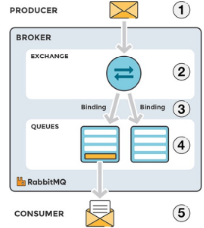

### Quorum Queue
RabbitMQ supporta anche la **quorum queue**: si tratta di una coda persistente che può essere replicata su più nodi del cluster.

Similmente a Kafka, una sola replica è **leader** e gestisce le operazioni sulla coda, mentre le altre sono **follower**: il broker conferma la pubblicazione solo quando *la maggioranza delle repliche della coda hanno registrato il messaggio*.  

Se non vi è maggioranza, allora non c'è quorum e quindi la coda all'esterno apparirà come non disponibile --> **durability over availability**.

Se un leader si guasta, si usa Raft per eleggerne uno nuovo.  
Nel caso di un singolo broker RabbitMQ (no replication) --> la coda e i messaggi vengono salvati su disco, di modo che sopravvivano nel caso il broker si guasti e venga riavviato.

### Semantiche RabbitMQ
Anche qui le semantiche dipendono dal comportamento del producer e del consumer

**At-most-once**:
- **Producer**: il producer non aspetta la `disposition` del broker --> se il messaggio si perde o il broker crasha allora il messaggio andrà perso
- **Consumer**: se manda `accepted` al broker quando riceve il msg ma **prima di processarlo** --> se crasha subito dopo aver inviato l'ack, il messaggio è perso perché il broker lo considera consegnato e lo rimuove dalla coda.

**At-least-once**:
- **Producer**: il producer attende la conferma e fa retry se non la riceve entro un timeout --> il retry può creare un duplicato se il primo invio era riuscito ma la conferma si è persa
- **Consumer**: il consumer manda `accepted` al broker **solo dopo aver processato il msg**, in modo che se si guasta prima allora RabbitMQ lascia il messaggio in coda per poi riconsegnarlo.

---

RabbitMQ ha molti casi d'uso:
- **message queue**: il messaggio è mantenuto in coda e mandato al consumer
- **work queue**: più consumer si dividono il lavoro di elaborazione dei messaggi, per cui i msg sono inoltrati ai consumer secondo politiche diverse (es. RR)
- **pub/sub**, simulato mandando uno stesso msg a più code e quindi più consumer tramite un exchange
- **routing messages**: il producer manda i msg a un exchange, che tramite le binding rules li inoltra alle code corrette secondo criteri di ruouting (es. chiave del msg, come si vede in figura)
- **RPC**: il producer invia un msg a un exchange, che lo inoltra a una coda dove un consumer lo elabora e risponde al producer tramite un'altra coda, simulando così una chiamata remota sincrona e bloccante.

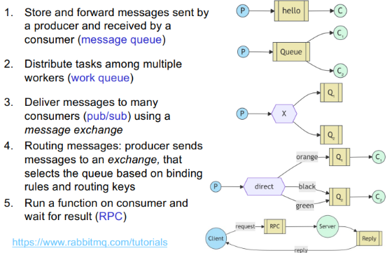

---

**Es. applicativo 1: coda di messaggi**

Qui un producer manda un msg a una coda e RabbitMQ lo consegna a un consumer. Nell'esempio pratico col codice la prof fa vedere che, con due consumer disponibili sulla stessa coda, RabbitMQ li distribuisce in round robin. Quando il broker riceve `accepted`, il msg viene rimosso.

**Es. applicativo 2: working queue**

Qui i messaggi rappresentano task di durata diversa (nel codice lo si simula con ....., dove ogni . rappresenta un secondo di sleep del consumer). Tre versioni:
1. Il worker manda `accepted` non appena riceve il task, prima di elaborare --> se viene interrotto mentre lavora, il broker ha già tolto il msg dalla coda e qunindi il task è perso
2. Il worker manda `accepted` solo dopo aver finito di elaborare il task, e credito infinito per il broker --> se viene interrotto prima della conferma, il task può essere riconsegnato. Con molto credito, RabbitMQ può inviare dei task anche ad un worker molto occupato.
3. Il worker manda `accepted` solo dopo aver finito di elaborare il task ma credito 1 per il broker --> il worker riconcede il credito al broker solo dopo aver finito di elaborare il task, quindi RabbitMQ non invia nuovi task finché il worker non ha finito di processare il precedente.

---

**Appendix: Routing nei sistemi distribuiti**

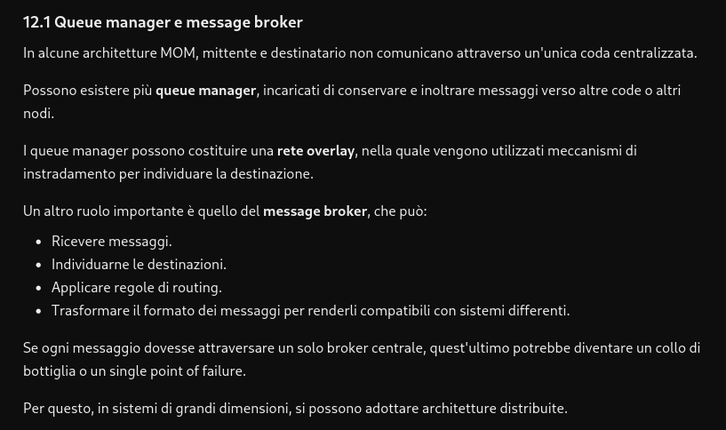

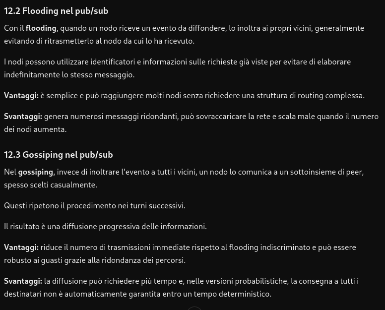

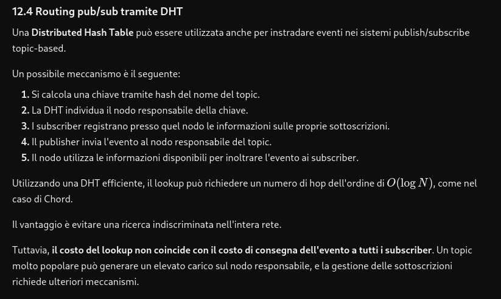

---

**Distinzione essenziale**
- **SQS** orientato alla distribuzione di lavori tra consumer e alla loro riconsegna in caso di mancata conferma
- **Kafka** conserva eventi in log indipendentemente dal loro consumo, permettendo a più gruppi di leggerli e rielaborarli
- **RabbitMQ** è un broker flessibile per la distribuzione e instradamento dei messaggi tramite exchange, queue e binding.

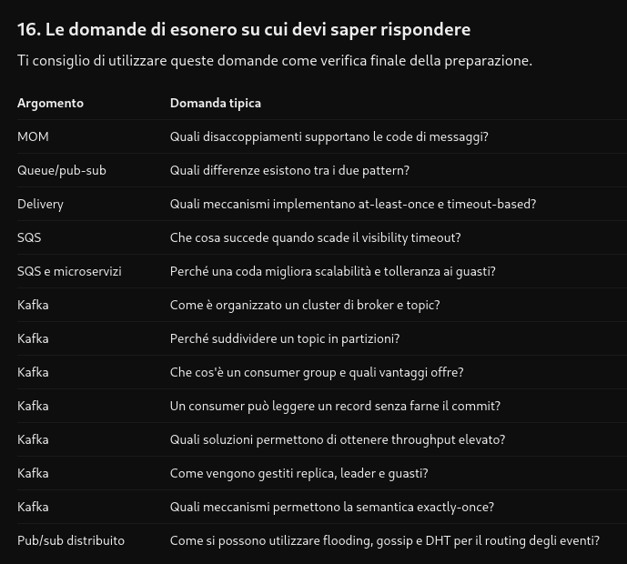