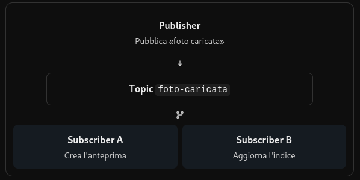
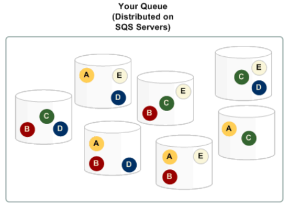

Il **Message Oriented Middleware (MOM)** è una tipologia di middleware che permette alle componenti di un sistema distribuito di comunicare tramite scambio di messaggi.

Per capirne l'utilità partiamo da un limite di RPC: si tratta di una **comunicazione transiente**.  
Quando il client invoca una procedura remota infatti, anche nel caso asincrono, il server deve essere raggiungibile per ricevere la richiesta DURANTE l'invocazione.

Con MOM invece si introduce un componente intermedio, il **message broker**, che può memorizzare i msg e consegnarli successivamente --> **comunicazione persistente!**

In questo senso il principale vantaggio di MOM è che, a differenza di RPC, garantisce **decoupling temporale**, oltre che anche quello **spaziale** rispetto al destinatario finale (il client deve conoscere solo l'endpoint del broker) e generalmente anche quello **di sincronizzazione**.

RPC e MOM non sono necessariamente alternative: in una stessa applicazione si possono usare RPC per operazioni che richiedono una risposta immediata e MOM per lavori differibili.

I principali pattern di MOM sono il **Message Queue** e il **Publish/Subscribe**.

## Message Queue Pattern
In questo pattern uno o più **producer** inviano *messaggi* a una coda, dalla quale uno o più **consumer** li prelevano e li elaborano.

Questo modello è **one-to-one** a livello logico: *ogni messaggio rappresenta un compito che dovrebbe essere svolto da uno e un solo consumer, anche se più consumer possono essere disponibili per prelevarlo*.

Tuttavia un messaggio può finire per essere elaborato più di una volta a causa di una riconsegna dopo un guasto, a seconda della semantica di consegna.

**Es.** Tre worker che ridimensionano fotografie, il producer inserisce in coda un msg per ogni foto --> quando un worker è libero, può prelevare un msg.  
In questo senso le code di messaggi sono tipicamente usate per fare **Load Balancing** tra più istanze di un servizio, ma anche altri use case come *task scheduling*, *elaborazioni in background* etc..

Le operazioni tipiche su una message queue sono:
- `put`: il producer inserisce un messaggio
- `get`: il consumer attende e preleva un messaggio dalla coda
- `poll`: il consumer controlla la presenza di messaggi in coda, senza attendere indefinitamente
- `notify`: il middleware segnala la disponibilità di un messaggio tramite handler o callback

In generale, in sistemi su larga scala, le code (così come i topic per pub/sub) possono essere distribuite --> si ha un modello dove il mittente deposita il msg nella propria **coda locale** e il destinatario lo preleva dalla propria --> nel mezzo, dei **queue manager** lo instradano attraverso dei nodi intermedi, formando una vera e propria **rete overlay** per cui ci si ricollega al message routing già studiato (algoritmi di flooding, RW, DHT, Gossip...)

## Publish/Subscribe Pattern
Nel **Pub/Sub** un publisher pubblica un *evento* su un **topic**, mentre i subscriber si iscrivono ai topic di loro interesse.

A differenza delle code, qui il modello è **one-to-many**: uno stesso evento può interessare più destinatari indipendenti.

Il componente logico che associa gli eventi alle sottoscrizioni è chiamato **event dispatcher**.    
L'event dispatcher può applicare anche dei *filtri*, consegnando a ciascun subscriber solo gli eventi corrispondenti ai criteri richiesti.

Le operazioni principali sono:
- `publish(event)`
- `subscribe(filter, notify_cb, expiry) -> sub_handle`: il subscriber si registra per ricevere eventi di un topic, indicando eventuale filtro, una callback e una scadenza per la sottoscrizione. Riceve in output un handle tramite cui può eventualmente disiscriversi via `unsubscribe(sub_handle)`.  
Quando un evento corrisponde al filtro, il middleware può invocare la callback `notify_cb(sub_handle, event)` per notificare il subscriber.

Un *event dispatcher centralizzato* è più facile da gestire, ma può diventare SPOF e collo di bottiglia --> in un sistema distribuito su larga scala può essere preferibile distribuire le responsabilità di instradamento degli eventi. 

**N.B.** *Se si vuole che qualcuno svolga un lavoro --> Message Queue*, se si vuole che *tutti i componenti interessati siano informati --> Pub/Sub.*

## Semantiche di consegna dei messaggi
Qui si parla di semantica di delivery, ossia le garanzie offerte dal middlware rispetto alla consegna dei messaggi / eventi

Immaginiamo un messaggio che chieda di incrementare di 1 il contatore associato alla parola "casa" --> non è un'operazione idempotente:

**At-most-once**

Il messaggio può essere consegnato **zero oppure una volta** --> il sistema evita le consegne duplicate, ma può perdere un messaggio in caso di guasto.

Es. il consumer riceve un lavoro e conferma la ricezione prima di elaborarlo --> se il consumer va in crash prima di completare il lavoro, il messaggio è perso.

**At-least-once**

Qui il middleware cerca di garantire che il msg venga consegnato **almeno una volta**, ammettendo possibili duplicati.

Un meccanismo tipico per questa semantica prevede un meccanismo di ACK e timeout. 

Es. se il consumer si guasta prima di inviare l'ACK, ma quando ha già incrementato il contatore --> il middleware ritenta la consegna del messaggio e un altro consumer potrebbe riceverlo e incrementare nuovamente il contatore 

Adatta a lavori idempotenti. Per rendere un'operazione non idempotente idempotente, si può trasformare l'operazione dove possibile, ad esempio nel caso del contatore usare un'operazione di *set*.  
Un'alternativa può essere associare ad ogni messaggio un identificativo univoco ed implementare a livello applicativo un meccanismo di *deduplication* e RR1 (RR2 più caratteristico delle RPC, dato che il client attende il risultato della chiamata).

**Exactly-once**

Con **exactly-once** l'obiettivo è che ogni messaggio **produca un solo effetto logico**, anche in presenza di ritrasmissioni.  

--- 

Due meccanismi utilizzati specificatamente in ambito MOM per ottenere alcune di queste semantiche sono **Timeout Based Delivery** e **Transaction Based Delivery**.

### Timeout Based Delivery
Particolarmente importante in quanto usata da Amazon SQS, il funzionamento è il seguente:
1. Il consumer $A$ riceve un msg
2. Il middleware conserva il msg, ma lo rende temporaneamente invisibile agli altri consumer per un certo periodo di tempo (**visibility timeout**)
3. Se $A$ completa il lavoro, conferma il consumo e il messaggio viene eliminato dalla coda
4. Se $A$ non completa il lavoro entro il timeout --> il messaggio torna disponibile per un nuovo tentativo

Questo meccanismo offre un modello di consegna **at-least-once**, dato che potrebbe accadere che il consumer $A$ completi il lavoro ma non riesca a confermare il consumo prima del timeout --> il messaggio torna disponibile e un altro consumer potrebbe riceverlo e completare nuovamente il lavoro.

### Transaction Based Delivery
Con questo meccanismo si cerca di far sì che un messaggio venga cancellato dalla coda **solo se il lavoro associato è stato completato con successo**:
- **Commit** rende definitive le operazioni comprese nella transazione, il sistema considera il messaggio consumato
- **Rollback** annulla le modifiche comprese nella transazione, e il messaggio torna disponibile per un nuovo tentativo di consegna.

Questa garanzia vale solo per le operazioni coinvolte in una stessa transazione --> recupereremo questo meccanismo parlando della semantica **exactly-once** di Kafka.

## Modelli di consegna
Due tipi:
- **Push** se è il middleware ad inviare/segnalare la disponibilità di un messaggio al consumer (es. RabbitMQ con push delivery)
- **Pull** se è il consumer a interrogare il middleware quando desidera leggere (es. Amazon SQS e Kafka)

Il **vantaggio del pull** è che **il consumer può controllare il proprio ritmo di elaborazione**, e lo **svantaggio** è il possibile overhead del polling che ne deriva (specie se il consumer effettua tante richieste quando non ci sono messaggi disponibili) --> tecnica del *long polling* per ridurre l'overhead.

---

# Amazon SQS
**Amazon SQS (Simple Queue Service)** è un servizio cloud gestito da AWS che permette alle applicazioni distribuite di scambiare messaggi attraverso delle code.

Essendo un servizio gestito, AWS si occupa dell'infrastruttura necessaria a memorizzare, distribuire e rendere disponibili i messaggi.

I messaggi sono distribuiti *in più SQS server all'interno della regione AWS scelta*, dove ogni server è replicato in più AZ al fine di aumentare la **disponibilità** e la **tolleranza ai guasti**.

SQS utilizza:
- **Message Queue** --> i messaggi rappresentano lavori che (idealmente) un solo consumer dovrebbe svolgere
- **Modello Pull** --> sono i consumer a interrogare la coda per prelevare i messaggi
- **Disaccoppiamento temporale, spaziale e di sincronizzazione**
- **Timeout Based Delivery** --> semantica di consegna **at-least-once** 

## Semantica di consegna in SQS
Come anticipato SQS offre una semantica di consegna **at-least-once** implementando un meccanismo di **timeout based delivery**.

Immaginiamo che il consumer $A$ esegua `ReceiveMessage()` e riceva un messaggio $M1$ dalla coda.  
Da quel momento SQS rende il messaggio invisibile agli altri consumer per un intervallo di tempo configurabile, il **visibility timeout**.

A questo punto ci sono due possibili scenari:
- **Caso A -- Elaborazione completata**: il consumer termina il lavoro ed esegue `DeleteMessage()` per confermare il consumo del messaggio --> il msg viene rimosso definitivamente dalla coda
- **Caso B -- Guasto o timeout**: il consumer non elimina il msg prima della scadenza del visibility timeout --> il msg torna disponibile per un nuovo tentativo di consegna ad un altro consumer.  
Se però il primo worker aveva già completato l'operazione prima di bloccarsi, il secondo potrebbe eseguirla di nuovo --> **SQS richiede attenzione per l'idempotenza delle operazioni**.

Importante non confondere il *visibility timeout* dal **retention period**: quest'ultimo indica **per quanto tempo il msg viene conservato nella coda prima di essere rimosso automaticamente** (default 4 giorni, max 14 giorni).

Nel caso un'elaborazione richieda più tempo del previto --> il consumer può usare `ChangeMessageVisibility()` per modificare il timeout di visibilità del messaggio.

## Modello Pull: short polling e long polling
Poiché SQS usa un modello **pull** --> i consumer devono richiedere i messaggi disponibili.  

In particolare in SQS il consumer chiede direttamente a Amazon SQS se ci sono messaggi disponibili in coda, e ricordando che **la coda è distribuita su più server** bisogna distinguere tra i due tipi di polling.

Con lo **short polling** SQS consulta un sottoinsieme dei server che gestiscono la coda e restituisce rapidamente la risposta. 

Il problema è che potrebbero essercci msg disponibili su server che la richiesta non ha consultato.  

Con il **long polling** SQS consulta tutti i server.  
Se non c'è messaggio disponibile, può mantenere aperta la richiesta per un intervallo configurabile fino a 20 secondi.

Il vantaggio è la riduzione dell'overhead dovuto a richieste ripetute quando non ci sono messaggi disponibili, migliorando l'efficienza del sistema.

## Ordine di consegna ed API
SQS offre due tipologie principali di code: **Standard** e **FIFO**.

Con la **Standard Queue** si privilegia *scalabilità* e *throughput*: l'ordine di consegna dei messaggi ai consumer non è garantito, è *best-effort*.  
La semantica seguita in questo caso resta comunque l'**at-least-once**.

Con la coda **FIFO** invece si offrono garanzie più forti sia sull'*ordinamento* che sulla *deduplicazione* degli invii.  
Si garantisce **l'ordine di consegna all'interno dello stesso message group**, nonché una **deduplicazione degli invii** entro una finestra temporale di 5 minuti --> queste garanzie comportano un *throughput più basso* rispetto alle Standard Queue.

(attenzione al fatto che la deduplicazione riguarda invii duplicati verso lo stesso consumer, non garantisce che un messaggio non venga mai rielaborato dopo un visibility timeout, è comunque semantica **at-least-once**!)

Le principali API di SQS sono:
- `CreateQueue, ListQueues e DeleteQueue`: per creare, elencare e cancellare code
- `SendMessage` per inserire un messaggio in coda. Per un contenuto grande, si può **salvare il file su S3 e inviare solo il suo riferimento in coda**
- `ReceiveMessage` per prelevare i msg disponibili. Si può chiedere da 1 a un max di 10 msg per chiamata
- `DeleteMessage` per rimuovere un msg dalla coda dopo che il consumer ha completato il lavoro
- `ChangeMessageVisibility` per modificare il timeout di visibilità di un msg già prelevato. Utile se il consumer si accorge che il lavoro richiederà più tempo del previsto
- `GetQueueAttributes` e `SetQueueAttributes` per ottenere e impostare informazioni sulla coda, es. il numero di msg disponibili, il timeout di visibilità, il retention period etc.

Una particolarità importante di SQS è che questo **non permette di filtrare i messaggi direttamente tramite `ReceiveMessage`** --> il consumer deve ricevere i messaggi e poi filtrare quelli di interesse a livello applicativo, e quando non gli interessano lascia che il visibility timeout scada, così che il msg torni disponibile per un altro consumer.

---

**Esempio applicativo: elaborazione di immagini con S3, SQS e EC2**