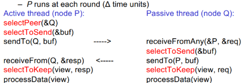
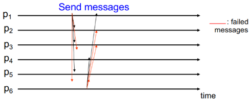
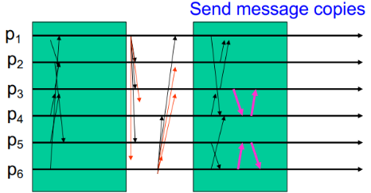
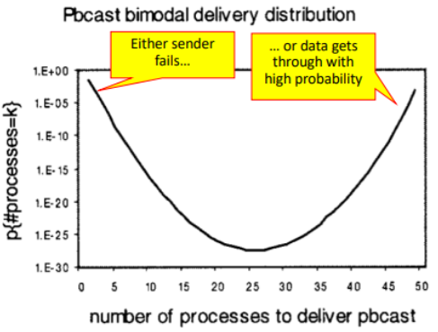
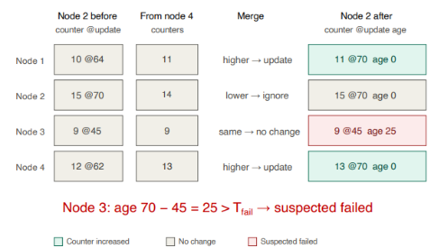

Torniamo al concetto per cui, in un sistema distribuito, può essere necessario **diffondere una stessa informazione a molti nodi** (es. se un nodo si guasta, gli altri nodi ne devono essere informati per non mandargli più richieste!)

Il problema è che trovare un meccanismo di diffusione **scalabile**, **efficiente** e **tollerante ai guasti**, specialmente in overlay non strutturate, non è semplice... in questo senso si considerano tre approcci principali:
- **Flooding** == ogni nodo inoltra il msg a tutti i vicini
- **Random Walk** == si parte da ($k$) nodi scelti $u.a.r.$ e si prosegue casualmente per ognuno di essi
- **Gossiping** == ogni nodo informato contatta periodicamente alcuni degli altri peer, che a loro volta potranno diffondere l'informazione

L'idea alla base del Gossiping è **distribuire il lavoro di propagazione tra i nodi della rete**, anziché affidarlo principalmente al nodo iniziatore.  
Il funzionamento richiama anche matematicamente il modello di diffusione di una malattia o un pettegolezzo: per questo motivo il gossiping appartiene alla famiglia dei **protocolli epidemici**.

---

Il Gossiping viene utilizzato anche per realizzare il **multicast**, cioè la comunicazione nella quale un messaggio è destinato a un gruppo di ricevitori.  
Il multicast può infatti essere realizzato in due modi:
- **A lvl di rete** tramite IP multicast: alcuni router supportano la duplicazione dei pacchetti nei punti in cui i percorsi verso i destinatari si dividono
- **A lvl applicativo** tramite una rete overlay formata dai nodi dell'applicazione

Il punto della **scalabilità** nel multicast è che se un nodo manda un msg unicast verso più destinatari, ed il percorso verso questi condivide alcuni link, allora il messaggio sarà duplicato più volte lungo questi ultimi quando ne bastava uno solo --> il principio per ridurre la msg complexity è proprio far viaggiare una sola copia sul link comune e duplicarla solo quando i percorsi si dividono.

Nelle overlay **strutturate** è possibile organizzare percorsi di diffusione espliciti: le topologie più adatte in questo senso sono gli *alberi* o le *mesh*.

Nelle **overlay non strutturate** invece, come sappiamo, è necessario che la diffusione avvenga tramite contatti (casuali) tra i nodi, senza stabilire in anticipo il percorso di diffusione, ed è in questo contesto che il gossiping si rivela particolarmente utile.

---

Tra le principali proprietà del Gossiping:
- **Semplicità**: ogni nodo esegue regole locali relativamente semplici
- **Decentralizzazione**: non esiste un coordinatore centrale che organizzi la diffusione
- **Scalabilità**: ogni nodo può contattare un numero limitato di peer per ogni round, anche quando il numero complessivo di nodi aumenta
- **Robustezza**: un'informazione può raggiungere un nodo attraverso percorsi diversi --> se un collegamento/nodo si guasta, possono esistere percorsi alternativi
- **Natura probabilistica**: la scelta casuale dei peer rende la diffusione non deterministica

Definiamo un nodo **contaminato** quando ha appreso l'aggiornamento e può contribuire a diffonderlo. Un **round** invece rappresenta un intervallo nel quale i nodi eseguono un ciclo di scambio di informazioni; i round non devono iniziare necessariamente nello stesso istante per tutti i nodi.

Quindi riassumendo il concetto di Gossiping: **si tratta di un protocollo che permette di propagare informazioni attraverso interazioni locali casuali, ottenendo diffusione globale senza nessun coordinamento centrale**.

Due concetti fondamentali per il Gossiping sono l'**Anti-Entropy** e il **Rumor Spreading/Mongering**.

## Anti-Entropy
L'**Anti-Entropy** è una strategia di Gossiping che cerca di **ridurre le differenze tra gli stati dei nodi**, propagando gli aggiornamenti mancanti.

Ad es. supponiamo che $A$ conosca un'informazione nuova, mentre $B$ ha solo la versione precedente --> periodicamente $A$ e $B$ possono comunicare e confrontare i propri stati, al fine di sincronizzarli.

Nel modello più semplice **ogni nodo $P$ sceglie periodicamente e $u.a.r.$ un nodo $Q$**, e a quel punto esistono tre modalità di scambio:
- **Push** $P \rightarrow Q$: $P$ invia a $Q$ gli aggiornamenti che possiede
- **Pull** $P \leftarrow Q$: $P$ richiede a $Q$ gli aggiornamenti che gli mancano
- **Push-Pull** $P \leftrightarrow Q$: entrambi confrontano e scambiano le informazioni mancanti

Di queste tre modalità chiaramente **push-pull** è la più efficace: ciò è dovuto intuitivamente al fatto che all'inizio, quando pochi nodi conoscono le novità, è il **push** a permettere a quei pochi nodi di diffonderla efficacemente, mentre quando quasi tutti le conoscono è il **pull** ad aiutare i pochi nodi rimasti a recuperarla.

## Rumor Spreading/Mongering
Nel **Rumor Spreading** un nodo contaminato cerca di diffondere rapidamente un aggiornamento sugli altri nodi. 

Periodicamente seleziona un numero di peer $F$ (**fanout**, $F \ge 1$) ed invia loro l'aggiornamento. I nodi che lo ricevono diventano contaminati e possono continuare la propagazione, oppure perdere interesse e smettere di diffonderlo secondo specifiche politiche.

Ad esempio nell'approccio **feedback-based** quando un nodo contaminato $P$ contatta un nodo $Q$ già contaminato --> con probabilità $p_{stop}$ il nodo $P$ interrompe la diffusione --> **Rumor Spreading non garantisce necessariamente che tutti i nodi vengano raggiunti**.

Aumentare il fanout $F$ e la $p_{stop}$ permette di accelerare la diffusione e ridurre la probabilità che alcuni nodi restino esclusi, tuttavia comporta anche un maggior numero di messaggi ridondanti.

La differenza rispetto all'Anti-Entropy è che nel primo i nodi cercano periodicamente di ridurre le differenze dei propri stati, mentre nel Rumor Spreading interessa piuttosto diffondere rapidamente l'aggiornamento.  
Per aumentare la copertura, spesso i due approcci sono combinati: il primo diffonde rapidamente gli aggiornamenti, mentre il secondo aiuta a recuperare le info mancanti.

---

Il **Framework generale del Gossip** è il seguente:

All'inizio di ogni round il nodo $P$ sceglie di contattare randomicamente il nodo $Q$ --> sceglie cosa inviargli (può infatti decidere di mandargli ad es. solo gli aggiornamenti recenti) e invia.  
$Q$ riceve la richiesta e, nel paradigma **push-pull**, sceglie a sua volta cosa inviare a $P$. Entrambi decidono quali informazioni mantenere filtrando così eventuali duplicati, ed elaborano la vista aggiornata.

Per quel che riguarda la scelta dei nodi da contattare esistono diverse alternative: o direttamente $u.a.r.$ tra tutti i vicini, o filtrando quelli che si è certi abbiano già l'informazione (perché so che me l'hanno inviata o gliel'ho inviata in un round precedente), oppure ancora scegliendo quelli che sono stati contattati meno e che quindi hanno più probabilità di non essere aggiornati (es. CockroachDB).

## Confronto tra Gossiping e Flooding
Il **Flooding** manda il msg a tutti i vicini, mentre il **Gossiping** seleziona solo un sottinsieme di essi in modo non deterministico.

Il Flooding può **diffondere l'informazione molto velocemente, ma genera anche moltissimi messaggi ridondanti** nella sua versione standard senza alcun meccanismo di controllo.  
Il Gossiping invece tenta proprio di **ridurre la ridondanza dei messaggi**, sfruttando la propagazione progressiva in round e la scelta casuale dei destinatari.

Lo svantaggio principale del Gossiping rispetto al Flooding è che per la sua natura non deterministica **la diffusione verso tutti i nodi della rete non è garantita**, tuttavia la riduzione dell'overhead e quindi della message complexity è estremamente significativa, specialmente in reti su larga scala dove l'uso di Flooding comprometterebbe la scalabilità del sistema.  
Altro svantaggio è che **la diffusione richiede più tempo a seconda della configurazione dei parametri del protocollo** (fanout, probabilità di stop, ecc.).

---

In un sistema pub/sub decentralizzato, il Gossiping può essere usato per propagare eventi tra i nodi che gestiscono i topic, tuttavia la diffusione è probabilistica e può quindi richiedere più tempo e non potrebbe coprire tutti i nodi --> occorrono meccanismi aggiuntivi quando è indispensabile una consegna affidabile a uttti i subscriber.

---

Le applicazioni del gossiping sono molteplici:
- **Group membership**: i nodi si comunicano chi conoscono, per far sì che gli altri abbiano una visione più ampia della rete
- **Peer sampling**: ogni nodo costruis
- ce o aggiorna una visione parziale dei peer da cui ricevere/inviare informazioni (es. bootstrapping)
- **Monitoraggio**: si diffondono info sullo stato delle risorse, ad esempio il carico
- **Failure detection**: si raccolgono e propagano "indizi" sul funzionamento dei nodi
- **Calcolo distribuito**: si combinano valori locali per ottenere valori aggregati come media, somma, min, max... (es. per il min ogni nodo conserva il minimo locale e lo aggiorna ad ogni aggiornamento, scegliendo sempre il valore più piccolo tra il proprio e quello ricevuto)

# Case studies
Ci concentriamo su tre casi di studio di protocolli di Gossiping: **Blind Counter Rumor Mongering**, **Bimodal Multicast** e **Gossip-based Failure Protocol**.
## Blind Counter Rumor Mongering
Si tratta di un algoritmo di diffusione basato su Gossiping che introduce una regola di arresto basata su un **contatore**.

In particolare il nome contiene i tre concetti fondamentali:
- **Rumor Mongering**: l'informazione viene propagata, ma prima o poi i nodi smettono di diffonderla
- **Blind**: l'arresto non dipende direttamente dal *feedback* che indica se un peer conosce già il messaggio
- **Counter**: ogni nodo usa un contatore per decidere quando interrompere la diffusione

Più precisamente, il protocollo usa i due parametri $F$ (**fanout**) e $k$ (contatore usato per arrestare la diffusione) e funziona come segue: il nodo iniziale invia il msg $m$ a $F$ peer scelti $u.a.r.$, che decrementano $k$ e lo inoltrano a loro volta a $F$ peer scelti $u.a.r.$, e così via.  
Un peer smette di diffondere il $m$ se e solo se il suo contatore $k = 0$.

Il senso è che se un messaggio è già molto diffuso, la propagazione tende progressivamente ad esaurirsi.

Risultati sperimentali mostrano come, con $F = k = 2$, rispetto al flooding:
- **Msg complexity migliore del 50%** 
- **Copertura del 90% dei nodi**
- Tuttavia **tempo di diffusione circa il doppio** rispetto al flooding 
  
Si osserva quindi esplicitamente il compromesso di cui si parlava prima: **meno messaggi, ma copertura non completa e più lenta**.

## Bimodal Multicast
Il **Bimodal Multicast** (noto anche come **pbcast**) è un protocollo che cerca di realizzare **multicast affidabile in presenza di possibili perdite di messaggi**.

L'idea prende spunto dall'anti-entropy: combinare una diffusione iniziale rapida via push con una fase successiva di recupero delle info mancanti tramite pull.  
Il protocollo infatti è organizzato in due fasi:
1. **Message Distribution**
2. **Gossip Repair**

Nella fase di **Message Distribution**, il messaggio è diffuso inizialmente tramite multicast senza però garanzie che tutti i destinatari ricevano il messaggio.  

Nell'esempio, $p_1$ e $p_2$ tentano il multicast verso tutti gli altri nodi, e le frecce rosse indicano i messaggi persi.

La fase di **Gossip Repair** serve a recuperare i messaggi persi durante la diffusione iniziale: periodicamente ogni nodo seleziona casualmente alcuni peer e trasmette loro un **digest**, ossia un "riepilogo" dei messaggi che possiede (senza contenerne il contenuto).

Il destinatario confronta il digest con la propria storia, e se vede che l'altro possiede un messaggio che gli manca --> **ne richiede una copia**, e allora il mittente originale gli manda l'effettivo messaggio richiesto.

Una variante migliore di Gossip repair è quella che prevede un **push-pull**, per cui anche il destinatario, a partire dal digest, deduce quali messaggi mancano al mittente e glieli invia a sua volta.

(es. $A$ possiede $M1, M3$, $B$ possiede $M1, M2, M4$ --> $A$ invia il digest a $B$, che capisce che gli manca $M3$ e che il mittente non ha $M2, M4$ --> $B$ invia a $A$ $M2, M4$ e la richiesta di $M3$ --> $A$ invia a $B$ $M3$).

**Perché si chiama Bimodal Multicast?** Il termine bimodale non si riferisce semplicemente alla presenza di due fasi nel protocollo, ma alla **distribuzione probabilistica dei risultati della consegna**: studi sperimentali dimostrano come gli esiti di questo protocollo tendano a concentrarsi in due situazioni: o **il messaggio raggiunge quasi tutti i nodi** o **pochissimi nodi**; gli esiti intermedi hanno invece probabilità molto bassa.

Intuitivamente il msg raggiunge pochissimi nodi perché gli iniziatori originali falliscono nell'invio di molti messaggi, ma se ciò non avviene con alta probabilità l'informazione si diffonde su quasi tutti i nodi.

## Gossip-based Failure Detection
Un **Failure Detector** è un meccanismo che permette ai nodi di un sistema distribuito di individuare altri nodi che **si sospetta abbiano subito un guasto**.  
In questo senso la parola *sospetto* è importante: se un nodo non risponde questo potrebbe sì essere crashato, ma anche essere semplicemente lento o sovraccarico, oppure la rete è congestionata, oppure ancora alcuni messaggi sono andati persi... pertanto nei sistemi distribuiti un Failure Detector può produrre **falsi positivi**.

Un buon Failure Detector deve tener conto di alcune proprietà:
- **Completeness**: i nodi effettivamente guasti devono essere sospetti, prima o poi
- **Accuracy**: bisogna ridurre quanto più possibile il numero di falsi positivi
- **Speed of Detection**: un guasto deve essere rilevato rapidamente
- **Scalability**: il monitoraggio deve essere sostenibile al crescere dei nodi

Queste proprietà introducono dei compromessi: ad es. sospettare rapidamente di un nodo può portare ad un accuracy più bassa...

Un modo tipico per fare failure detection è tramite **heartbeat**, in questo senso esistono diversi approcci:
- *Centralizzato* se tutti mandano l'heartbeat a un singolo monitor centrale --> SPOF...
- *all-to-all* se ogni nodo manda heartbeat a tutti gli altri --> non scalabile, $N(N-1)$ messaggi scambiati per round...
- **Gossip-based** per cui invece **ogni nodo contatta solo alcuni peer, comunicando informazioni sullo stato degli altri nodi dal suo punto di vista**.

---

Il protocollo funziona come segue: ogni nodo $i$ conserva una tabella contenente le informazioni sugli altri nodi $j$. Per ciascun nodo $j$, registra:
- $H_j$ == ultimo heartbeat ricevuto dal nodo $j$ (espresso come contatore incrementale)
- $T_j$ == timestamp locale dell'ultimo heartbeat ricevuto da $j$

La cosa importante da capire è che **il contatore $H_j$ viene incrementato dal nodo $j$ stesso**, gli altri nodi si limitano a diffonderne il valore.

Ad ogni periodo $T_{gossip}$, il nodo $i$ incrementa il proprio contatore $H_i$ ed invia la propria tabella a un nodo scelto $u.a.r.$. Chi riceve la tabella confronta ogni voce con la propria:
- **se il contatore ricevuto è maggiore** --> conserva il nuovo valore e imposta $T_j$ al timestamp locale corrente
- **se il contatore ricevuto è $\le$** --> mantiene la voce precedente, tempo incluso

Per la failure detection si definisce un $T_{fail}$: rappresenta **il tempo massimo che un nodo aspetta senza osservare un aumento del contatore di heartbeat di un altro nodo** prima di sospettarlo come guasto.

es. $P$ tiene in osservazione $j$ e ha memorizzato $H_j = 9$ e $T_j = 45$, sarebbe a dire che all'ora locale 45 ha ricevuto un heartbeat di $j$ pari a 9.  
Allora, con $T_{fail} = 10$, se all'ora locale 56 non ha ricevuto un heartbeat di $j$ con contatore maggiore di 9, inizierà a sospettare che $j$ sia guasto.

Nell'esempio qui sotto, il nodo 2 riceve la tabella del nodo 4 al proprio tempo locale 70, con $T_{fail} = 20$. Aggiorna solo i contatori più alti rispetto ai suoi, e in particolare non aggiorna il nodo 3. Questo era stato aggiornato all'ora locale 45, ma l'ora locale attuale del nodo 2 è 70 --> $70 - 45 = 25 > T_{fail} = 20$ --> sospetta che sia fallito...

I parametri del protocollo mostrano esplicitamente il tradeoff tra **speed of detection**, **scalability** e **accuracy**:
- $T_{gossip}$: più è piccolo, più velocemente si diffondono le informazioni, ma più messaggi vengono scambiati
- $T_{fail}$: più è piccolo, più velocemente un nodo viene sospettato come guasto, ma più falsi positivi si possono avere

Per limitare l'effetto sui falsi positivi il protocollo aggiunge un altro valore, $T_{cleanup}$ (tipicamente dello stesso ordine di $T_{fail}$) che fa si che i nodi non siano eliminati prima della sua scadenza, anche se sospetti.

In questo protocollo semplificato un problema è la **dimensione dei messaggi scambiati** ($O(N)$ essendo la tabella ad $N$ voci), ma per ridurre il traffico molte ottimizzazioni, ad es. inviare solo la parte della tabella con aggiornamenti sufficientemente recenti.

**Vantaggi**: decentralizzazione rispetto a un monitor centrale che sarebbe SPOF, scalabilità rispetto all'all-to-all, robustezza dato che le info possono circolare attraverso percorsi diversi.  
**Svantaggi**: tradeoff tra accuracy, speed of detection e scalability legato ai $T_{gossip}$ e $T_{fail}$, dimensione dei messaggi.

---

Esempi di protocolli e applicazioni basati su Gossip:
- **SWIM** usa il Gossiping per la failure detection e la gestione della membership, si utilizza un meccanismo tramite `ping`... se un nodo non riceve risposta, può chiedere ad altri nodi di contattarlo indirettamente e in caso di insuccesso sospettarlo come guasto.
- **Cassandra** combina il Gossiping con un $\phi$-accrual failure detector: a differenza della soglia fissa, questo approccio più sofisticato usa la storia degli intervalli tra heartbeat per stimare il liello di sospetto associato a un nodo.
- **Redis Cluster** usa Gossip per propagare info sullo stato dei nodi e dei cluster, e per rilevare nodi falliti o non raggiungibili.

---

Il Gossiping è usato anche in applicazioni piuttosto recenti
- Nel **ML distribuito** i nodi possono calcolare localmente i gradienti e poi diffonderli tramite gossip, riducendo il carico di comunicazione rispetto a un approccio centralizzato.
- Nella **swarm robotics** vedi il signor Marco Rodigo: i robots usano il gossip per condividere informazioni in modo del tutto decentralizzato e svolgere task anche complessi
- **Decentralized RAG (Retrieval-Augmented Generation)**: il RAG è un metodo usato per ridurre l'allucinazione dei modelli di linguaggio --> l'applicazione del gossip può contribuire allo scambio di informazioni tra nodi che hanno accesso a diverse fonti di conoscenza, migliorando la qualità delle risposte generate