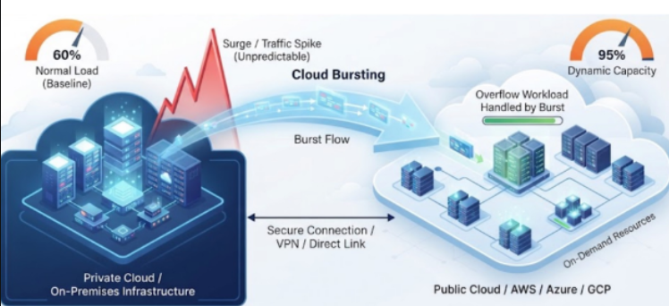
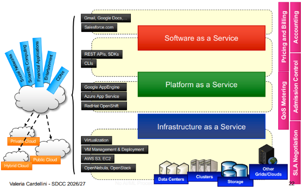
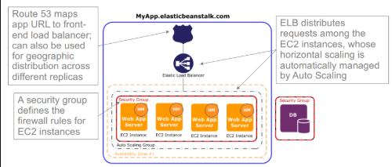

## Intro
**Cloud Computing** == modello che permette di usare risorse informatiche (Computation, Storage e Coordination) attraverso la rete, senza dover possedere e gestire direttamente l'infrastruttura fisica necessaria (ospitata principalmente nei data center). 

Nato per ovviare ad un problema di scalabilità a partire da Amazon, dove in certi periodi dell'anno il traffico era molto elevato e richiedeva quindi infrastruttura aggiuntiva inutilizzata per il resto del tempo --> l'utilizzo del cloud permette invece di pagare solo per le risorse effettivamente utilizzate!

Idee che hanno preceduto il cloud, ma che in qualche modo ne fanno parte:
- **Utility Computing**: considera le risorse informatiche come un servizio da consumare secondo necessità proprio come l'acqua o l'elettricità. L'utente paga solo per ciò che consuma.
- **Grid Computing**: le risorse utilizzate sono distribuite geograficamente e collegate tra loro tramite la rete.  
(in origine il punto era collegare risorse di organizzazioni diverse in posti diversi tra loro)
- **Autonomic Computing**: si vuole un sistema in grado di autogestirsi quanto più possibile (vedremo in questo senso MAPE, autoscaling, self-healing etc..)
- **Software as a Service (SaaS)**: fornire l'applicazione come servizio accessibile tramite rete.

Tornando alla definizione di Cloud Computing: i servizi offerti sono disponibili su richiesta e rapidamente allocabili e rilasciabili, con gestione automatizzata e utilizzo misurabile (vedremo bene perché parlando dei SLA Service Level Agreements).  
Da ciò le caratteristiche del cloud:
- **on-demand self-service**: come detto servizi disponibili su richiesta *ma senza interazione con il fornitore: la richiesta avviene autonomamente tramite un portale web o un'API*
- **broad network access**: risorse accessibili tramite rete da client eterogenei. Vedremo nel cloud privato l'accesso disponibile potenzialmente solo attraverso la rete aziendale
- **Elasticity**: capacità di **aumentare e ridurre risorse rapidamente in funzione della domanda**.  
Bisogna ben distinguere elasticità da scalabilità: la prima infatti è la **capacità** di sostenere un carico maggiore aumentando le risorse... un sistema può essere scalabile ma poco elastico (es. può potenzialmente crescere aggiungendo server, ma impiegherebbe settimane per acquistarli/configurarli).  
L'elasticità inoltre non implica che l'adattamento sia automatico, il meccanismo che permette ciò è l'**autoscaling**.
- **resource pooling e multi-tenancy**: il provider organizza le risorse in un pool (infrastruttura fisica) condiviso dal quale assegna capacità ai clienti.  
La multi-tenancy permette a più client di usare la stessa infrastruttura fisica mantenendo però isolamento logico
- **resource visualization**: la **virtualizzazione** permette al provider di cedere ai client risorse virtuali con configurazioni personalizzate in termini di CPU, RAM, storage etc..
- **pay-per-use**: il costo dipende dall'uso delle risorse secondo metriche e contratto previsti
- **measured service**: il provider monitora l'uso delle risorse e fornisce report dettagliati al cliente.

---

## Deployment models
Un **Deployment Model** descrive a chi è destinata l'infrastruttura cloud e come è organizzata. Tre modelli principali:
1. **Public Cloud**: **il provider gestisce un'infrastruttura che offre servizi a clienti che possono essere molto diversi tra loro** --> piattaforma multi-tenant che garantisce quindi isolamento logico.  
Essendo il servizio offerto a una platea più generale di clienti, l'accesso alle singole risorse è soggetto a diversi controlli e autorizzazioni. Il cliente usa le risorse del provider senza preoccuparsi di dove siano fisicamente collocate né di come gestire l'hardware sottostante.
2. **Private Cloud**: **l'infrastruttura è dedicata esclusivamente a una singola organizzazione**, al cui interno ovviamente possono esserci più utilizzatori (es. gruppi di ricerca o unità aziendali).  
Il cloud può essere gestito dall'oganizzazione stessa, da un provider esterno o da una combinazione dei due, inoltre può fisicamente trovarsi all'interno della sede dell'organizzazione o essere ospitato esternamente (ciò che lo rende privato **è l'uso esclusivo**, non la posizione fisica).  
    - **Vantaggi**: *maggiore controllo e possibilità di personalizzare infrastruttura e politiche di accesso* (da ciò può quindi derivare *maggiore sicurezza*, se isolamento e configurazioni gestite correttamente, ma non è detto che sia sempre così)  
    - **Svantaggi**: capacità fisica tendenzialmente più limitata, *difficoltà nell'espansione (sia in termini di scalabilità che di elasticità)*, *costi più alti* (non si possono sfruttare economie di scala come nel public cloud)
3. **Hybrid Cloud**: **combina infrastrutture cloud distinte, tipicamente uno privato e uno pubblico,** tramite tecnologie che consentono di integrare servizi e trasferire dati o applicazioni (tipicamente connessione diretta o accesso sicuro tramite ad es. VPN).  
es. un'azienda piò conservare un DB nel cloud privato, ma eseguire alcuni servizi applicativi nel pubblico!

Molti vantaggi derivano dall'uso del cloud ibrido:
- **bilanciare l'uso di risorse e costi**: l'azienda può usare l'infrastruttura privata per il carico abituale, ma ricorrere al pubblico quando serve capacità aggiuntiva (es. picchi di traffico stagionali). In questo modo una possibilità è il risparmio di costi, considerando però anche i costi di integrazione e trasferimento dati tra i due cloud.
- **ridurre il vendor lock-in**: il vendor lock-in è una situazione dove abbandonare il fornitore diventa difficile o costoso --> con il cloud ibrido si riduce la dipendenza dal fornitore cloud
- **aumentare la flessibilità**: l'azienda può scegliere l'ambiente più adatto a ciascuna esigenza.  
es. se vuole maggior controllo e sicurezza su certi dati li può mettere nel cloud privato; oppure ancora il backup per il recupero dopo un guasto grave (se si vuole fare quindi **disaster recovery**) può essere posto nel cloud pubblico; o ancora se si vogliono servire utenti in aree geografiche diverse si può usare il cloud pubblico per distribuire contenuti più vicino agli utenti finali; se si vogliono gestire picchi si può attivare capacità aggiuntiva nel cloud pubblico etc...

La modalità per cui se il cloud privato non ha abbastanza capacità e si deve quindi ricorrere al cloud pubblico è detta **cloud bursting**, per cui il servizio per i clienti in eccesso è reindirizzato al cloud pubblico.

Anche diversi svantaggi nell'uso del cloud ibrido:
- **Complessità operativa**: bisogna gestire più ambienti spesso con configurazioni diverse. Inoltre serve coordinamento nella creazione delle risorse, aggiornamenti, monitoraggio, autorizzazioni etc...
- **Sicurezza**: aumenta la superficie di attacco dato che aumentano le componenti e i collegamenti da proteggere
- **Possibili ritardi**: la comunicazione tra cloud implica latenza  
es. se un'app del cloud pubblico consulta continuamente un db nel cloud privato, la latenza di rete può diventare un problema
- **Troubleshooting più difficile**: le variabili che possono causare rallentamenti o malfunzionamenti aumentano (il problema sta nell'applicazione, nelcloud privato, pubblico, nella rete o in una combinazione di esse?)
- **Costi di integrazione**: l'uso di connessioni protette, trasferimento dati, competenze specialistiche etc.. hanno costo significativo --> avere cloud ibrido può far risparmiare sull'hardware necessario per i picchi (cloud bursting), ma può anche aumentare altri costi...

---
## Cloud Stack
Il **cloud provider** è colui che offre i servizi cloud (es. AWS, Microsoft Azure, Google Cloud...) e bisogna distinguerlo da chi invece la utilizza per offrire altrri servizi ad utenti finali. 

Il **Cloud Stack** riguarda il livello "di astrazione" tramite cui il cloud provider offre i propri servizi (più è alto il livello, più dettagli tecnici sono nascosti all'utente). Tre livelli principali, dal più basso al più alto:
1. **Infrastructure as a Service IaaS**: il client riceve direttamente risorse di calcolo, storage e rete --> l'attività principale del cliente è configurare l'ambiente virtuale ed eseguire il proprio software.
2. **Platform as a Service PaaS**: il client riceve una piattaforma pronta per eseguire applicazioni --> l'attività principale del cliente è sviluppare e distribuire le proprie applicazioni senza gestire l'infrastruttura sottostante.
3. **Software as a Service SaaS**: il client riceve un'applicazione già pronta all'uso --> l'attività del cliente si limita ad usare l'applicazione senza preoccuparsi né dell'infrastruttura né della piattaforma sottostante.

Mentre quindi i **modelli di deployment** rispondevano alla domanda "*a chi è destinata l'infrastruttura cloud e come è organizzata*", i **modelli di servizio** rispondono alla domanda "*cosa riceve il cliente dal provider e cosa deve fare lui stesso*".

**IaaS**

Il provider offre le risorse informatiche fondamentali di capacità di calcolo, storage e reti virtuali/componenti di rete. Il cliente può quindi usarle per installare ed eseguire il proprio software (SO e applicazioni comprese nel caso di una VM).

Il cliente in generale può modificare alcuni aspetti della rete virtuale (es. regole di accesso via firewall etc..) ma non gestisce direttamente l'infrastruttura fisica sottostante.

Un es. di IaaS è Amazon EC2 (Elastic Compute Cloud).

**PaaS**

Qui il cliente riceve una piattaforma pronta per sviluppare, distribuire ed eseguire applicazioni --> la differenza rispetto a IaaS è che mentre in IaaS il client parte da risorse infrastrutturali e prepara lui l'ambiente, qui si parte da una piattaforma pronta a gestire buona parte dell'ambiente di esecuzione.

Il **vantaggio è riduzione del lavoro di gestione** (ad es. il SO non è più a carico del cliente), ma il **compromesso è che l'app deve rispettare linguaggi e librerie supportate dalla piattaforma** --> libertà di configurazione ridotta.

Un sottinsime di PaaS è **FaaS (Function as a Service)**, dove il cliente fornisce solo funzioni che vengono eseguite in risposta a eventi, senza preoccuparsi di server o infrastruttura sottostante.

Un esempio di PaaS è Elastic Beanstalk di AWS: 

il cliente carica il pacchetto dell'applicazione fornendo le configurazioni necessarie --> la piattaforma crea e configura le risorse che la eseguiranno.  
Route 53 è il servizio di gestione DNS che associa il nome dell'app al punto di accesso appropriato, questo porta a un load balancer per distribuire il traffico tra le istanze dell'applicazione, che a loro volta possono scalare automaticamente in base al carico dal momento che sono parte di un gruppo Auto Scaling.  
Il security group definisce invece le regole di accesso nella rete per le istanze dell'applicazione e il database è gestito separatamente dalle istanze applicative.

**SaaS**

Il client usa un'applicazione già realizzata ed eseguita dal provider (es. Gmail, Microsoft Teams, Mega...) --> la cosa che al più può gestire il client sono le impostazioni consentite, gli utenti e i contenuti inseriti.

Esistono anche modelli più specifici tipo Database as a Service DBaaS, Monitoring as a Service MaaS (per monitorare l'attività di un'applicazione), Gen AI as a Service GAIaaS (fornire LLM come servizio) e più in generale **X as a Service** (**XaaS**) per indicare qualsiasi servizio fornito come servizio cloud.

---
**Modelli di prezzo**:
- **on-demand e pay-per-use**: il costo dipende dalle risorse usate e dalla durata di utilizzo --> è un modello costoso ma anche più flessibile
- **fixed o reserved**: il cliente assume impegno economico per ottenere uno sconto (es. pagando in anticipo per un anno di utilizzo)
- **dedicated**: il cliente paga per avere risorse dedicate. Maggiore isolamento fisico ma costa di più.
- **spot**: il cliente usa capacità disponibile ma che potrebbe essergli revocata con poco preavviso a prezzi vantaggiosi. Utile per lavori tolleranti a interruzioni (es. calcolo batch, addestramento di modelli ML con checkpointing etc..)

---
### Capacity planning ed Elasticity