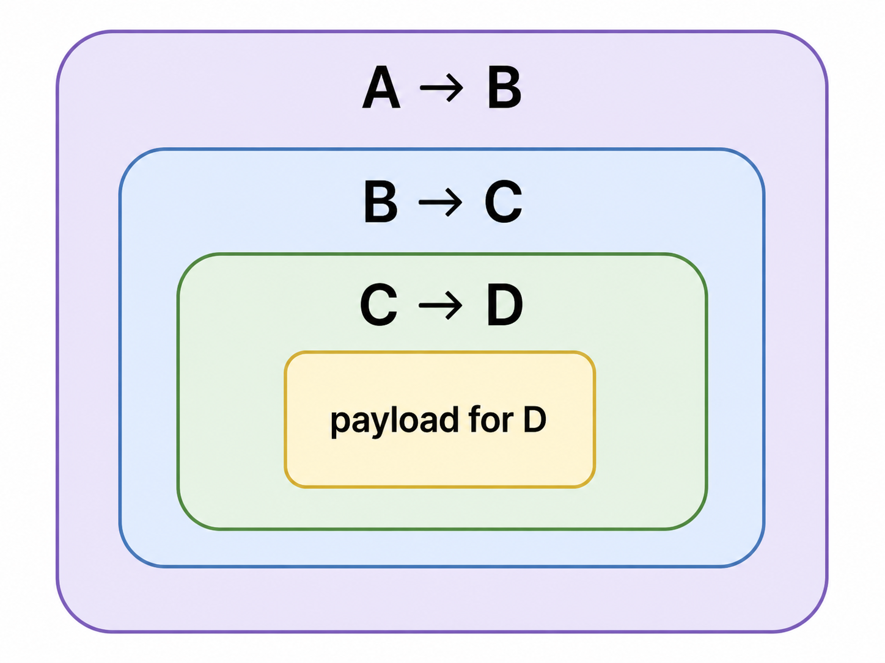

In Lightning_Network abbiamo visto il funzionamento generale della LN tra due nodi, cioè il caso in cui due utenti (ad es. Alice e Bob) aprono un canale di pagamento tramite una Funding Tx sulla blockchain Bitcoin. Dopo l'apertura del canale i due possono aggiornare più volte il bilancio del canale off-chain usando commitment transactions, senza necessità di pubblicare ogni singolo pagamento sulla blockchain.

Questo meccanismo come discusso è **fondamentale per la scalabilità Bitcoin**, poiché permette di effettuare molti pagamenti senza congestionare la blockchain con tantissime transazioni. 

In questa sezione approfondiamo la questione alla vera e propria rete Lightning: non consideriamo più solo un canale tra due nodi ma **una vera e propria rete di canali di pagamento**.

Supponiamo ad esempio di avere tre nodi (Alice, Bob e Carol) con la seguente disposizione dei canali e bilanci:
```text
A 8 ---- 2 B 4 ---- 4 C
```
Quindi il canale tra A e B ha capacità pari a 10 BTC, mentre quello tra B e C ha capacità pari a 8.  
Immaginiamo adesso che A voglia pagare C, ma che A e C non abbiano un canale diretto (aprire un canale LN diretto non è sempre conveniente dal momento che richiede una nuova transazione on-chain --> costi di fee, attesa di conferme, contro scalabilità etc...)

L'idea della Lightning Network è **permettere ad A di pagare C passando per B**, usando quindi B come nodo intermediario (A paga B, e B paga C).  
Immaginando che A voglia pagare 1 BTC a C quindi il nuovo bilancio dei canali dopo il pagamento dovrebbe ipoteticamente essere:
```text
A 7 ---- 3 B 3 ---- 5 C
```

Naturalmente non è così semplice: A vuole essere sicura che, se paga B, allora B pagherà davvero C. Allo stesso tempo B non vuole pagare C se non è sicuro che A gli restituisca i soldi. **Serve quindi un meccanismo che renda il pagamento trustless**.

In particolare l'obiettivo che ci poniamo è costruire un meccanismo **atomico**: *o tutti gli aggiornamenti dei canali coinvolti avvengono correttamente e si passa quindi ai nuovi bilanci visti sopra, oppure nessuno dei canali coinvolti viene aggiornato e si resta con i bilanci iniziali*.

### **Hash Time Locked Contracts (HTLC)**
Affinché si possa effettuare il passaggio ai nuovi bilanci non devono accadere due cose:
- A paga B, ma B non paga C
- B paga C, ma A non paga B

Per ottenere questa garanzia, la LN utilizza gli **Hash Time Locked Contracts (HTLC)**. Introduciamone il meccanismo vedendo prima l'idea che c'è dietro molto ad alto livello.

#### **Idea di base**
L'idea di base dietro HTLC è usare un **segreto** (sia questo $r$) e il suo hash (sia questo $h = H(r)$). Il procedimento è il seguente:
1. Carol (destinataria finale del pagamento) genera un valore casuale segreto $r$ e calcola il suo hash $h = H(r)$.
2. Carol invia ad Alice (mittente del pagamento) il valore $h$, senza comunicarle direttamente il segreto $r$.
3. Alice costruisce un contratto HTLC con Bob con questa logica: **1 BTC sarà di Bob se Bob riesce a mostrarle la preimmagine $r$ dell'hash $h$** (ossia Bob può incassare da Alice solo se le dimostra di conoscere $r$ tale che $H(r) = h$).
4. A sua volta Bob costruisce un contratto HTLC con Carol con la stessa logica: **1 BTC sarà di Carol se Carol riesce a mostrargli la preimmagine $r$ dell'hash $h$** (ossia Carol può incassare da Bob solo se gli dimostra di conoscere $r$ tale che $H(r) = h$).

Il meccanismo funziona perché a questo punto **Carol può rivelare $r$ a Bob per incassare il pagamento da lui**. Una volta che ciò avviene **anche Bob conosce $r$** --> **può rivelarlo ad Alice per incassare da lei arrivando così al nuovo bilancio**.

Ovviamente Bob sa che la $r$ che Carol gli rivela è controimmagine giusta perché ha già stipulato il contratto con Alice e quindi conosce $h$ a partire da lei.

Prima di vedere i dettagli tecnici, per capire come si costruiscono i contratti HTLC dobbiamo introdurre un nuovo opcode di Bitcoin Script: **OP_CHECKLOCKTIMEVERIFY**.

#### **OP_CHECKLOCKTIMEVERIFY (CLTV)**
Gli HTLC combinano in generale due tipi di condizioni:
1. una condizione basata su **hash** (quella descritta nell'idea, per cui serve dimostrare di conoscere la preimmagine di un certo hash $h$ per poter incassare il pagamento)
2. una condizione basata sul tempo (**time lock**), cioè per cui **se il segreto non viene rivelato entro un certo limite, allora il pagamento può essere reclamato dal mittente**

Per questo si chiamano Hash Time Locked Contracts (bloccati sia da un hash che da un time lock).

**Perché ci serve timelock?** L'idea come detto è che Alice paga Bob se Bob mostra $r$ e Bob paga Carol se Carol mostra $r$, e Carol conosce $r$. **Ma se Carol non rivelasse mai $r$ a Bob** --> Bob avrebbe bloccato 1 BTC nel contratto stipulato con Carol, ma Carol non incasserebbe mai.  
Allo stesso modo Bob potrebbe non rivelare $r$ ad Alice, bloccando così 1 BTC di Alice nel contratto con lui. 

Serve quindi un meccanismo di recupero: **se il segreto $r$ non viene rivelato entro un certo tempo --> chi ha bloccato il denaro deve poterlo recuperare**.

Qui entra in gioco OP_CHECKLOCKTIMEVERIFY, che **permette di rendere un output spendibile solo dopo un certo tempo o un certo numero di blocchi**. Per essere precisi permette di costruire script del tipo:
```text
questo output non può essere speso prima del blocco x
``` 
oppure
```text
questo output non può essere speso prima di un certo timestamp t
```

Per capire al volo come funziona ricordiamo la struttura generale di una transazione Bitcoin, questa contiene come campi principali:
```text
version
input
output
nLockTime
```
Ogni input inoltre contiene un campo chiamato nSequence. Finora abbiamo sempre snobbato nSequence, ma questo **serve, tra le altre cose, a stabilire se nLockTime è attivo o meno** (se tutti i valori di nSequence sono il massimo 0xffffffff allora nLockTime viene ignorato, altrimenti è considerato attivo, cioè *una transazione è considerata finalizzata se il suo locktime è già passato oppure se tutti i sequence number degli input sono il massimo*).

nLockTime invece **indica il momento/blocco assoluto prima del quale la transazione non può essere validata**. Può essere interpretato in due modi:
- se **nLockTIme $\lt$ 500kk**: quel numero viene interpetato come numero del blocco.
- se **nLockTime $\geq$ 500kk**: quel numero viene interpretato come timestamp Unix (secondi passati dal 1 gennaio 1970, 500kk è pari a novembre 1985).

Es. nLockTime 900k --> la tx non potrà mai essere confermata prima del blocco 900k.  

Es. nLockTime 800kk viene interpretato come timestamp, quindi la tx non potrà essere confermata prima di quella data espressa in Unix time.
Prima di costruire l'HTLC completo, vediamo lo **script che permette di spendere un output solo se chi lo spende conosce una preimmagine $r$ tale che $SHA256(r) = h$**:
```text
locking script: OP_SHA256 <h> OP_EQUAL
unlocking script: <r>
```
(prima r sulla pila, OP_SHA256 calcola l'hash di r, poi OP_EQUAL confronta h e h e se uguali mette True sulla pila e la transazione è valida).  

Aggiungendoci anche la verifica della firma di Bob (l'output deve poter essere speso solo da Bob ammesso che conosca la preimmagine $r$ di $h$):
```text
locking script: OP_SHA256 <h> OP_EQUALVERIFY <pk_B> OP_CHECKSIG
unlocking script: <sig_B> <r>
```

### **Pending States**
Come anticipato stiamo considerando la situazione iniziale:
```text
A 8 ---- 2 B 4 ---- 4 C
```
e Alice vuole pagare un BTC a Carol passando per Bob, arrivando così a:
```text
A 7 ---- 3 B 3 ---- 5 C
```
Prima del pagamento, il canale tra A e B è nello stato $n$, con Commitment Transactions:
```text
CommitTx_n(Alice)
input: funding transaction

output:
- 8 BTC ad Alice, spendibili da Alice (pkA) dopo 144 blocchi,
  oppure subito da Bob (pkB) con la revocation key dello stato n (pkArn)

- 2 BTC a Bob, spendibili subito da Bob (pkB)

CommitTx_n(Bob)
input: funding transaction

output:
- 2 BTC a Bob, spendibili da Bob (pkB) dopo 144 blocchi,
  oppure subito da Alice (pkA) con la revocation key dello stato n (pkBrn)

- 8 BTC ad Alice, spendibili subito da Alice (pkA)
```
Ricordiamo brevemente il funzionamento: questa struttura serve per impedire che uno dei due pubblichi una commitment vecchia. Se Alice pubblica una vecchia commitment già revocata, Bob ne conosce la revocation key corrispondente e può punire Alice rubandole tutti i fondi del canale. Viceversa se Bob pubblica una vecchia commitment revocata, Alice può punirlo. 

Il ritardo di 144 blocchi serve proprio a lasciare alla controparte il tempo di accorgersi della frode e reagire usando la revocation key.

Ora, nel passaggio di 1 BTC da A a C attraverso B, nel canale tra Alice e Bob, non si passa subito allo stato definitivo 7–3 perché Bob non deve ricevere definitivamente 1 BTC da Alice finché non ha dimostrato di conoscere r, cioè finché non ha la prova che Carol ha potuto incassare il pagamento sul canale Bob-Carol.. Per questo si crea uno stato intermedio, detto **Pending State** per cui:
```text
7 BTC sono di Alice
2 BTC sono di Bob
1 BTC è di Bob se Bob mostra r (e quindi se Carol mostra r a Bob),
altrimenti torna ad Alice dopo un certo timelock
```
dove quell'1 BTC rappresenta il pagamento "pending" (di cui ancora non si è certi che arriverà a Carol).

#### **Costruzione del Pending State (HTLC)**
Per costruire il pending state, Alice, Bob e Carol devono creare un nuovo contratto HTLC rappresentato da una transazione che, se qualcosa dovesse andare storto, sarà pubblicata nella blockchain. Vedremo i contratti HTLC per il canale Alice-Bob, importante tenere a mente che la costruzione è esattamente la stessa anche per il canale Bob-Carol, con la differenza che è Bob a essere il mittente e Carol la destinataria.

**Iniziamo vedendo la HTLC di Alice**:
```text
HTLC_{n+1}(Alice)
input: funding transaction

output:
1. 7 BTC ad Alice (pka) dopo 144 blocchi, oppure subito da Bob (pkb) con la revocation key dello stato n+1 (pkArn+1)

2. 2 BTC a Bob (pkB)

3. 1 BTC, spendibile da:
   - pkB e pkArn+1 (subito)
   - pkB e preimmagine r di h (subito)
   - pkA e pkB (multisig 2-of-2) dopo timelock
```
e inoltre Alice costruisce anche la seguente transazione, e chiede a Bob di firmarla per poterla eventualmente usare:
```text
HTLC_timeout_{n+1}(Alice)
input: HTLC_{n+1}(Alice), output 3

output: 
1. 1 BTC pkB e pkA_{n+1} (subito)
2. pkA dopo 144 blocchi
```

Prima di capire il significato degli output, ricordiamo che idealmente **nessuna delle CommitTx (tra cui anche questa) finisce on-chain**: se tutto va bene Carol rivela $r$ a Bob, Bob rivela $r$ ad Alice, e si passa collaborativamente ai nuovi bilanci senza che nessuna di queste transazioni venga pubblicata sulla blockchain, aggiornando le CommitTx di conseguenza (vedi sempre Refunding, CommitTx e HTLC come **contratti di sicurezza** già pronti).

Approfondendo il significato di ogni output:
1. **Il primo e il secondo output rappresentano quello della classica commitment**: servono affinché se Bob sparisse (magari perché si è perso la skB) allora Alice può riprendersi i suoi fondi (lasciando comunque a Bob i 2 BTC che gli spettano), e affinché se Alice pubblicasse in futuro questa commitment quando ormai fosse revocata, allora Bob (che a quel punto ha ricevuto skArn+1) può punirla prendendosi i 7 BTC.
2. **Il terzo output rappresenta l'HTLC**, contiene tre idee: 
   - se Alice pubblica questa commitment quando ormai è revocata --> Bob può punirla prendendosi anche questo 1 BTC
   - Se Bob ha ricevuto $r$ da Carol --> ha aggiornato il suo bilancio con lei dandole un BTC, ha il diritto di incassarlo da Alice per portare il canale al nuovo stato corretto --> se Alice pubblica questa transazione prima del timeout, allora Bob se conosce $r$ può incassare questo 1 BTC.
   - Se Bob non conosce $r$ entro il timelock e questa transazione non è stata revocata --> Alice per riprendere il suo BTC può pubblicare la transazione HTLC_timeout_{n+1}(Alice) (in quanto l'ha fatta firmare da Bob, può farla puntare all'output 3 di HTLC_{n+1}(Alice)) e aspettare 144 blocchi per incassarlo.  
   **Perché deve aspettare 144 blocchi?** Per tutelare Bob: se Alice fa la furba e pubblica questa transazione quando è stata revocata, allora Bob ha il tempo di punirla prendendosi il BTC.  
   **Perché serve una transazione in più? Non bastava mettere in CommitTx_{n+1}(Alice) che l'output fosse spendibile da Alice dopo il timelock e dopo 144 blocchi?** No, perché Alice deve essere in grado di bloccare il BTC se Bob non le mostra la preimmagine entro un certo timelock. Se infatti avessimo messo tutto insieme, Bob avrebbe potuto prendersi il BTC anche nel caso in cui avesse ottenuto $r$ dopo lo scadere del timelock, prendendo i soldi ad Alice. Invece con il multisig Alice, passato il timelock, "blocca" quel bitcoin e Bob nella nuova transazione lo può spendere solo in caso di revoca (pkArn+1), il fatto che conosca $r$ non gli serve più.  
   **Ma se Alice fa la furba e pubblica questa transazione quando il timelock è scaduto e ancora non ha dato la skArn+1 a Bob, non può fregare Bob?** No, perché come vedremo adesso anche Bob ha un HTLC dalla sua parte, per cui se vede che Alice non collabora quando lui gli fa vedere $r$ entro la fine del timelock, lui si può riprendere il BTC pubblicando la sua di HTLC.

**Vediamo quindi la HTLC di Bob**:
```text
HTLC_{n+1}(Bob)
input: funding transaction

output:
1. 2 BTC a Bob (pkB) dopo 144 blocchi, oppure subito da Alice (pkA) con la revocation key dello stato n+1 (pkBrn+1)

2. 7 BTC ad Alice (pkA)

2. 1 BTC, spendibile da:
   - pkA e pkBrn+1 (subito)
   - pkA dopo timelock 
   - pkA e pkB (multisig 2-of-2, subito)

```
e inoltre Bob costruisce anche la seguente transazione, e chiede ad Alice di firmarla per poterla eventualmente usare:
```text
HTLC_success_{n+1}(Bob)
input: HTLC_{n+1}(Bob), output 3

output: 
1. 1 BTC spendibile da pkB e preimmagine di h, dopo 144 blocchi
2. 1 BTC spendibile da pkA e pkBr_n+1 (subito)
```

Approfondendo il significato di ogni output:
1. **Per il primo e il secondo output vale lo stesso discorso fatto per la commitment di Alice**: servono affinché se Alice sparisce allora Bob può riprendersi i suoi fondi, e affinché se Bob pubblicasse in futuro questa commitment quando ormai fosse revocata, allora Alice (che a quel punto ha ricevuto skBrn+1) può punirlo prendendosi i 2 BTC.
2. **Per il secondo output stiamo guardando il caso in cui la revocation key deve favorire Alice, dal momento che la commitment è di Bob**. In particolare:
   - 1 BTC ad Alice se Bob ha provato a fare il furbo pubblicandola quando ormai è revocata
   - 1 BTC ad Alice se Bob prova a fare il furbo pubblicandola quando non conosce $r$ entro il timelock
   - Se ancora non è passato il timelock e la transazione non è stata revocata --> Bob può creare la nuova transazione HTLC_success_{n+1}(Bob) che punta all'output 3 di HTLC_{n+1}(Bob) per poter incassare il BTC dopo 144 blocchi, se conosce la preimmagine $r$.  
   **Perché dopo 144 blocchi**? Per tutelare Alice: se Bob pubblica entrambe le transazioni quando sono revocate, allora Alice ha il tempo di punirlo prendendosi i soldi.  
   **Perché creare una transazione in più?** Per tutelare Bob. Se avessimo messo tutto insieme, allora Alice avrebbe potuto prendersi il BTC non appena fosse scaduto il timelock. In questo modo invece Bob, pubblicando la nuova transazione, "blocca" quel bitcoin e Alice lo può spendere solo in caso di revoca (pkBrn+1).

Recap roba rispetto HTLC: si deve gestire il caso in cui Bob non abbia mostrato $r$ ad Alice entro il timelock --> Alice può recuperarlo pubblicando la sua HTLC e la HTLC timeout, ma dopo 144 blocchi, perché se invece Bob gliel'aveva mostrata e lei ha provato a fregarlo allora lui deve avere il tempo di punirla.

Allo stesso modo Bob deve potersi riprendere i soldi se ha risolto il contratto con Carol (ha ricevuto $r$) ma Alice non collabora --> Bob pubblica la sua HTLC e HTLC-success e si prende il bitcoin, però dopo 144 blocchi perché se invece Alice è stata collaborativa e lui prova a pubblicare questa commitment quando ormai è revocata, allora Alice ha tempo di punirlo prendendosi anche questo 1 BTC.

Ricorda che prima di confermare l'aggiornamento dei bilanci ovviamente Alice e Bob si scambiano le revocation key corrispondenti affinché tutto funzioni e che si fanno scambiare le tx firmate l'uno dall'altro affinché possano pubblicare le transazioni facendole puntare alla Funding nel caso HTLC o alla HTLC nel caso della timeout/success.

**Per quel che riguarda il canale tra Bob e Carol, la costruzione è esattamente la stessa, con la differenza che è Bob a essere il mittente e Carol la destinataria.** Per esercizio costruiscile.

#### **Timelock diversi**
Importante dire che **non possiamo mettere lo stesso timelock nel canale Alice-Bob e nel canale Bob-Carol**.

Se infatti ad esempio Alice desse un timelock di un'ora a Bob per ricevere $r$, è chiaro che Bob non può usare lo stesso timelock anche per Carol perché se Carol gli rivelasse $r$ all'ultimo Bob non avrebbe il tempo di rivelare $r$ ad Alice prima che scada il suo timelock, e quindi Bob starebbe in competizione con Alice nella pubblicazione della HTLC (da parte sua che prende il bitcoin se mostra $r$, da parte di Alice che lo prende se Bob non mostra $r$ entro il timelock) --> Bob potrebbe perdere i suoi soldi anche se Carol gli ha rivelato $r$.

In generale quindi Bob metterà sempre un timelock più corto nel canale con Carol rispetto a quello che Alice gli ha messo nel canale con lui. Quindi:
```text
Alice → Bob: timeout x
Bob → Carol: timeout x - Δ
```
dove $\Delta$ è un margine di sicurezza che serve a Bob per avere il tempo di reagire se Carol non gli rivelasse $r$ entro il timeout previsto.

**Cosa succede se Carol non rivela $r$ a Bob entro il timeout previsto**? A quel punto Bob non ha mai aggiornato il suo canale con Carol, da parte sua non ha mai dato il bitcoin. Tuttavia non può nemmeno dimostrare ad Alice che Carol non gli ha rivelato $r$ --> Alice aspetta timeout e può potenzialmente recuperare il suo bitcoin, sta tranquilla, e quindi se Bob collabora possono accordarsi per eliminare l'HTLC pending e tornare allo stato precedente

### Ulteriori considerazioni: **Routing Fees** e **Ricerca del Best Path**
Finora abbiamo considerato Bob come un semplice intermediario tra Alice e Carol.  Tuttavia **Bob non ha, di base, alcun interesse gratuito di far passare il pagamento di Alice verso Carol**. Anzi, instradare un pagamento comporta diversi costi e rischi per Bob:
- deve mantenere liquidità bloccata nel canale verso Carol
- deve creare e gestire HTLC
- deve bloccare temporaneamente parte della propria liquidità
- deve restare online per monitorare il canale e reagire in caso di problemi

Inoltre su un canale non si possono creare infiniti HTLC contemporaneamente per via della difficoltà di gestione: attualmente parliamo dell'ordine di circa 500 HTLC per canale. 

Per questi motivi, Bob richiede una **Routing Fee**, ossia una commissione per instradare il pagamento. In generale una Routing Fee è composta da due parti:
1. **Base Fee**: è una commissione fissa decisa da Bob
2. **Proportional Fee PPM (parts per million)**: è una commissione variabile che dipende dall'importo del pagamento, decisa da Bob. Ad esempio se Bob imposta una PPM di 1000, allora per ogni 1 BTC che passa attraverso di lui, Bob chiederà 0.001 BTC di commissione (1000 ppm = 0.001).

Si noti che, mentre nella blockchain la fee dipende soprattutto **dalla dimensione della transazione in byte** (e quindi non dall'importo), nella LN **l'importo del pagamento conta moltissimo** (per questo PPM). Il motivo è che **instradare un pagamento significa usare la liquidità disponibile nei canali**: es. se Bob deve inoltrare 1 BTC a Carol, il suo saldo nel canale Bob-Carol diminuirà di 1 BTC.

Da questo punto di vista quindi un nodo potrebbe anche investire nella LN: se possiede molti bitcoin può aprire diversi canali, distribuire liquidità con diversi nodi molto richiesti e guadagnare routing fees instradando pagamenti.

**N.B** Riguardo le routing fees quindi, in realtà se nell'esempio di prima Alice vuole pagare 1 BTC a Carol, e Bob chiede una fee di 0.001 BTC, allora Alice in realtà deve pagare 1.001 BTC a Bob, che poi gli inoltra 1 BTC a Carol (e si tiene la fee). 

Per quanto riguarda la **Ricerca del Best Path**: come visto quindi per Alice non è più necessario avere un canale diretto con Carol, ma è sufficiente trovare un percorso del tipo:
```text
Alice → Nodo 1 → Nodo 2 → ... → Carol
```
Il problema che a questo punto si pone è: **come fa Alice a trovare un percorso del genere?** Anzitutto è necessario che **alcuni dati della rete siano pubblici e visibili a tutti**, in particolare:
1. **Gli id dei nodi**, che sono sostanzialmente le loro chiavi pubbliche
2. **i canali pubblici esistenti tra i nodi**
3. **la capacità totale di ogni canale**
4. **le fee richieste dai nodi per instradare i pagamenti**
5. eventuali parametri di routing (es. timelock richiesti..)

Affinché la rete funzioni correttamente è necessario che ogni nodo aggiorni regolarmente queste informazioni, e che le mantenga pubbliche.

**Problema**: sono le capacità ad essere pubbliche, **ma non i bilanci nello specifico**. Questo è problematico per il routing perché se Alice vuole ad esempio mandare 1 BTC a Carol e vede che Bob e Carol hanno capacità 10 BTC, ci può provare... ma se poi Bob ha solo 0.5 BTC di liquidità disponibile nel canale con Carol, allora il pagamento fallisce.

Per questo motivo trovare il path non è immediato, ed il routing avviene attraverso un meccanismo di tipo **Trial and Error**: tipicamente un nodo calcola diversi percorsi alternativi verso il nodo di interesse e prova ad usarli magari in ordine di fee, fino a quando non ne trova uno che funziona (un path può fallire per la questione della liquidità, perché il nodo non risponde, perché troppi HTLC già in corso etc..)

In realtà per scegliere i path esistono moltissime strategie. In generale si parla di **Shortest Path** ma in termini di fee, per cui si vuole spendere quanto meno possibile. Esistono però anche altre strategie tipo cammino minimo in termini di hop indipendentemente dalle fee, o cammino più affidabile (es. con nodi che hanno sempre risposto positivamente in passato) etc...

In questo senso è fondamentale per un nodo che **i timelock siano più piccoli possibile**. Questo perché ogni volta che un nodo prova a eseguire un pagamento lungo un certo path vengono creati HTLC lungo i canali coinvolti che bloccano temporaneamente la liquidità. Se il pagamento poi fallisce --> bisogna aspettare che gli HTLC o vengano cancellati collaborativamente o scadano i rispettivi timelock. Timelock troppo lunghi bloccano la liquidità per troppo tempo e rendono costoso provare molti path diversi, rendendo quindi più difficile trovare un percorso che funzioni.

Riguardo la questione delle informazioni pubbliche, si ricorda sempre che due nodi volendo possono fare comunicazione lightning diretta privata, senza entrare nella rete.

**Ma non converrebbe ad Alice di comunicare direttamente con Carol, senza passare per la rete?** Dipende da quanto grande è il pagamento che vogliamo fare. In generale LN è pensata per pagamenti relativamente piccoli. Infatti attraverso LN si paga all'incirca l'1x1000 di fee --> se 50 euro pago solo 5 cent di fee. **Questo è vantaggioso rispetto all'idea di creare direttamente un canale con Carol, per cui avrei dovuto aprire la funding transaction on-chain e le relative fee on-chain**.

Al contrario per pagamenti più grandi è conveniente fare le transazioni on-chain, in quanto la fee della blockchain per una tx arrivano a costare meno di quelle LN a lungo andare per ogni pagamento.


### Breve cenno su **Source Based Onion Routing** 
Si vuole non solo che LN permetta pagamenti veloci e scalabili, ma che **garantisca anche un certo livello di privacy**. Se i pagamenti passassero in chiaro attraverso la rete, dal momento che è relativamente facile associare a una pk l'indirizzo IP, allora sarebbe facile per un osservatore esterno capire chi sta pagando chi e come, con quanti soldi, attraverso quale percorso etc..

Per migliorare la privacy si usa una tecnica chiamata **Source Based Onion Routing**.

Supponiamo di avere un percorso del tipo:
```text
A -> B -> C -> D
``` 
Anzitutto, D genera il segreto $r$ e calcola $h = H(r)$, e invia ad A il valore $h$. A questo punto A costruisce tutto il percorso A-B-C-D (per questo si parla di source based routing: è la sorgente a decidere il path).

Dopodiché Alice non manda a Bob un messaggio in chiaro del tipo: "Bob, devi inoltrare il pagamento a C che lo inoltrerà a D, e D è il destinatario finale", piuttosto costruisce un **pacchetto cifrato a strati** (da qui onion routing) che contiene tutte le informazioni necessarie per ogni nodo, ma cifrate in modo che ogni nodo possa leggere solo le informazioni che lo riguardano e non quelle degli altri nodi. Ogni strato è cifrato con la chiave pubblica del nodo che deve leggerlo.

Quindi A costruisce qualcosa del tipo:
```text
per B: cifrato con la chiave di B
    dentro c’è il prossimo hop C
    e un pacchetto cifrato per C

per C: cifrato con la chiave di C
    dentro c’è il prossimo hop D
    e un pacchetto cifrato per D

per D: cifrato con la chiave di D
    dentro c’è l’informazione finale del pagamento
```



In questo modo **ogni nodo vede solo quello che gli serve per instradare, conoscendo predecessore e successore, senza sapere se questi sono il mittente o il destinatario finale e senza che sappia altro del percorso**. 

Chiaramente Onion Routing e HTLC lavorano insieme: in particolare A costruisce sia la catena di HTLC basata sullo stesso hash $h$ che gli ha inviato D, sia il pacchetto onion con le istruzioni cifrate per ogni nodo. 

Ogni nodo quindi riceve le istruzioni necessarie per creare l'HTLC con il nodo successivo, senza che conosca l'intero percorso.

Interessante in generale notare come Bitcoin sia **stateless** (non è possibile memorizzare alcun tipo di variabile o stato all'interno di Bitcoin Script), mentre la LN permette di simulare un meccanismo **stateful** (dove gli stati rappresentano i bilanci dei canali) grazie all'utilizzo dei contratti Funding, CommitTx e HTLC.

### Qualche limite
Nel funzionamento standard della LN, il destinatario deve prima generare il segreto $r$ e calcolcare $h = H(r)$, e poi inviare $h$ al mittente (oltre che altre informazioni come l'importo richiesto etc..). Questo implica che **i pagamenti classici attraverso la LN non sono completamente spontanei**. 

Nonostante questo sia normale per pagamenti simil fattura, non è ideale nel caso di **donazioni**: se volessi donare a qualcuno vorrei mandargli i soldi direttamente senza aspettare che lui mi generi un invoice --> si perde la dinamica della "sorpresa".

Altro problema è la privacy se usiamo Lightweight Nodes con LN: come detto se voglio fare un pagamento attraverso la rete devo costruire un path e questo è piuttosto costoso (devo conoscere la rete aggiornata e fare diverse operazioni). Se uso un lightweight node da mobile è impensabile --> il lightweight **deve appoggiarsi a nodi esterni e servizi che lo aiutino a costruire i path**. Questo però implica che questi nodi esterni possono vedere i pagamenti che faccio, e quindi la privacy è compromessa.

#### Problema Backup
In Bitcoin normale se salvo la mia seed phrase o la mia chiave privata, posso sempre recuperare i miei fondi perché gli UTXO validi restano nella blockchain.

In LN invece la situazione è diversa: gran parte dello stato del canale è off-chain, il saldo tra Alice e Bob è rappresentato dall'ultima coppia di Commitment Transactions firmate. Quindi il problema non è più soltanto salvare la chiave privata, ma **conservare anche le ultime CommitTx valide**.

Immaginiamo che io abbia un canale Lightning con Bobe che faccia un backup del canale nello stato seguente:
```text
Stato 10: 
Io 5 --- Bob 5
```
Poi il canale continua ad essere usato. Passano pagamenti, magari anche instradati attraverso di me, e arriviamo a:
```text
Stato 20:
io ho 4
l’altro nodo ha 6
```
A questo punto lo stato 10 è vecchio ed è stato revocato. Immaginiamo che il mio nodo crashi, e che il mio ultimo backup sia proprio quello dello stato 10. Allora dal mio punto di vista quella transazione è ancora valida --> se la pubblico sulla blockchain, Bob può punirmi prendendosi i soldi.

Per questo motivo devono esistere dei meccanismi di fiducia in LN tra i nodi. Infatti ciò che faccio in quel caso è chiedere a Bob se il mio CommitTx è effettivamente l'ultimo.  
Se Bob è un bastardo allora potrebbe dirmi di sì quando non è vero, aspettando che io lo pubblichi per poi prendersi i soldi.  
Però io potrei anche bluffare: potrei chiedere a Bob, prendendo volontariamente una commit vecchia, se quella è l'ultima. Se lui mente dicendomi di sì allora posso dimostrare che è disonesto e inoltre aspettarmi che lui pubblichi una commit revocata ma successiva alla mia per prendersi più soldi, ma a quel punto sarei io a poterlo punire prendendomi tutti i soldi del canale.

Per questi motivi i protocolli backup/recovery devono essere progettati con cautela.
