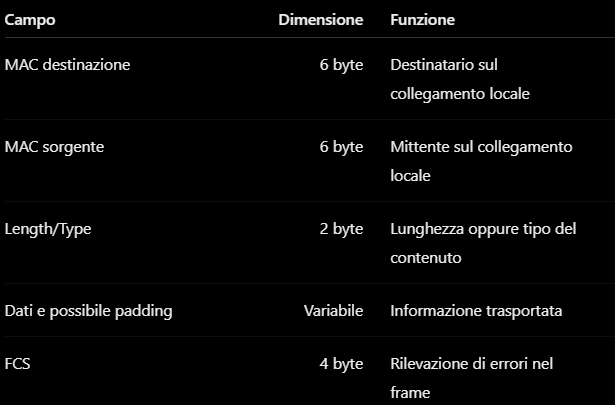
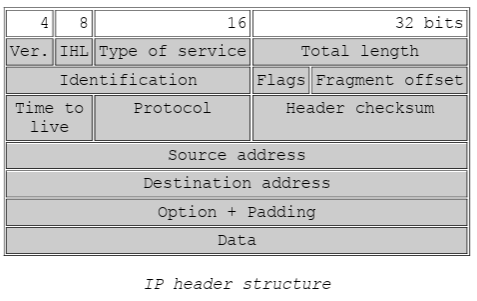
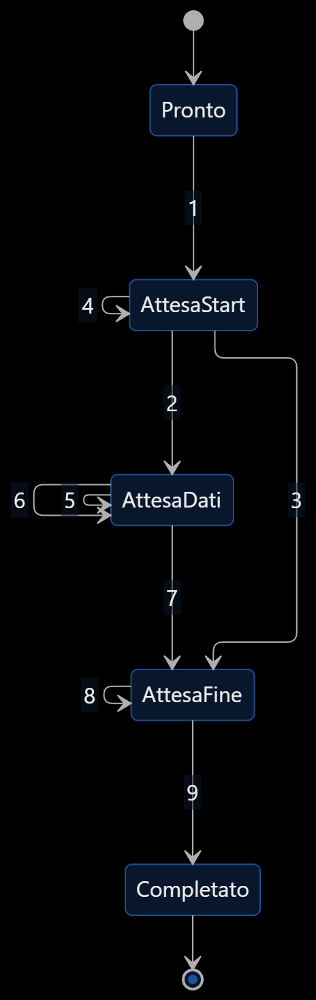
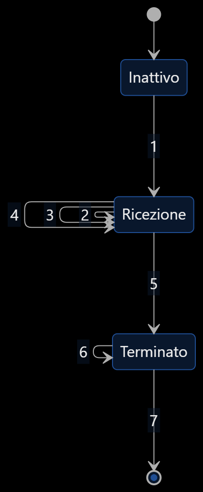

Non possiamo proteggere un sistema senzaa sapere come funziona e attraverso quali componenti passano i suoi dati.

Una **LAN** Local Area Network collega dispositivi interni ad un'area locale (es. ufficio, casa, scuola), **ethernet** è la tecnologia di rete locale che opera ai livelli fisico e di collegamento. In quest'ultimo i dati sono organizzati in unità chiamate **frame**.

Le prime reti Ethernet usavano cavi coassiali, quando un computer trasmetteva il segnale veniva ricevuto da tutti gli altri dispositivi locali. Tre problemi:
1. **Traffico esposto a tutti i partecipanti**
2. **Capacità condivisa**, con eventuali collisioni 
3. **Fragilità fisica**: se uno tagliava un cavo, si poteva compromettere parte significativa della rete

Per evitare le riflessioni del segnale, alle estremità del cavo si usavano **terminatori**.

Per identificare i dispositivi sulla rete, Ethernet usa gli **indirizzi MAC**, normalmente a 6 byte (48 bit) es. 00:1A:2B:3C:4D:5E. Nel frame ethernet compaiono prima MAC di destinazione, poi quello sorgente.  
Ciò ha senso per efficienza: il dispositivo ricevente può confrontare subito l'indirizzo di destinazione con il proprio, e decidere se accettare o scartare il frame senza dover leggere altro.

I MAC devono essere univoci nella stessa LAN.

Diverse modalità di consegna: unicast, broadcast e multicast, con broadcast nel MAC ethernet rappresentato da FF:FF:FF:FF:FF:FF.  
In modalità *promiscua*, un dispositivo può ricevere tutti i frame, anche quelli non destinati a lui, si parla di sniffing.

I tre obiettivi fondamentali della sicurezza:
- **riservatezza**: proteggere i dati da accessi non autorizzati
- **integrità**: garantire che i dati non vengano alterati durante la trasmissione
- **disponibilità**: assicurare che i dati e i servizi siano accessibili quando necessario

Un attacco **DoS** è proprio un attacco che mira a compromettere la disponibilità di un servizio, se proviene da molte sorgenti distribuite si parla di **DDoS**.

Per superare i problemi del cavo unico si passa a una struttura fisica a stella, ogni computer ha collegamento con un dispositivo centrale detto **hub**. L'hub ripete sulle altre porte ciò che riceve da una porta --> se si rompe il collegamento di un singolo computer, gli altri continuano a funzionare. Tuttavia, l'hub non risolve i problemi di sicurezza: il traffico è ancora visibile a tutti i partecipanti.

Il problema è risolto dallo **switch**, che può inoltrare il frame solo verso la porta appropriata.  
Per imparare dove si trovano i dispositivi, lo switch mantiene una tabella che associa $MAC \Rightarrow porta$. Quando riceve un frame, osserva il MAC sorgente e impara che quel MAC è raggiungibile attraverso quella porta di ingresso. 

Per inoltrare il frame invece, cerca il MAC di destinazione: se lo conosce usa la porta associata, se non lo conosce normalmente fa *flooding* sulle altre porte della stessa VLAN, se è broadcast inoltra a tutte le porte.

Un **protocollo di comunicazione** stabilisce le regole con cui due o più partecipanti scambiano msg. Deve definire almeno:
- formato dei msg
- il significato dei campi
- le azioni da seguire alla ricezione
- l'ordine ammesso degli scambi
- il comportamento in caso di errore

Importante quindi distinguere le informazioni di controllo dai dati effettivi.

Un protocollo può essere descritto anche tramite una **macchina a stati finiti**, dove il comportamento dipende dallo stato corrente e dall'evento ricevuto. 

Ripassando i linguaggi formali, la classificazione in tipi di Chomsky è:
- **3** = linguaggi regolari, descritti da automi a stati finiti
- **2** = linguaggi liberi dal contesto
- **1** = linguaggi dipendenti dal contesto
- **0** = linguaggi ricorsivamente enumerabili, descritti da macchine di Turing

Campi frame Ethernet ordinario senza tag VLAN:

Il campo **Length/Type** ha due interpretazioni: fino a 1500 byte indica la lunghezza del payload, mentre da 1536 (0x0600) in poi indica il tipo di protocollo del payload (**EtherType**).  
Tra gli EtherType più importanti abbiamo IPv4 (0x0800), ARP (0x0806), IPv6 (0x86DD).

Esistono anche i **jumbo frame** con dimensioni maggiori, supportati però da specifici apparati e configurazioni, non bisogna quindi assumere che tutti i collegamenti del percorso li accettino.

In generale se vogliamo trasferire un msg più grande della dimensione massima del frame, dobbiamo spezzarlo in parti più piccole, è a questo punto che sorgono tante domande come capire quali pezzi appartengono allo stesso msg, come riassemblarli, come gestire eventuali errori di trasmissione o duplicazioni etc... --> servono ulteriori regole, da collocare in un protocollo di livello superiore nella pila.

Ethernet gestisce la consegna in un dominio di lvl 2, per comunicare attraverso **reti diverse** serve un meccanismo di indirizzamento e inoltro tra reti --> entra in gioco **IP**.  
Un **router** collega reti e inoltra pacchetti in base all'IP di destinazione.

Con IPv4 un indirizzo ha 32 bit, normalmente scritto in notazione decimale puntata con 4 numeri da 0 a 255 (es. 192.168.1.10).  
IPv6 usa invece indirizzi a 128 bit (16 byte).

Gli indirizzi MAC privati possono essere usati in LAN diverse, l'importante è l'unicità all'interno della stessa LAN.  
Con IP invece si deve fare in modo che gli indirizzi pubblici siano univoci affinché si possa gestire il routing globale.

L'header IP è strutturato come segue:

Il campo Protocol indica il protocollo del payload, tra i più importanti abbiamo TCP (6), UDP (17), ICMP (1).

### ARP (Address Resolution Protocol)
Per trasmettere un pacchetto IPv4 su Ethernet, il mittente **deve conoscere l'indirizzo MAC del prossimo nodo sul collegamento locale**.

ARP (Address Resolution Protocol) è il protocollo che permette di ottenere l'associazione $IP locale \Rightarrow MAC$.  
Se $A$ deve raggiungere il dispositivo $B$ sulla stessa rete locale e non ne conosce il MAC --> invia una richiesta broadcast equivalente a "Chi ha l'IP $B$?" Il dispositivo interessato risponde con il proprio MAC, così $A$ può inviare il pacchetto a $B$. L'associazione è normalmente salvata in una cache ARP di modo da evitare di dover fare la richiesta per ogni pacchetto.

ARP quindi opera sulla LAN: non cerca un dispositivo attraversando internet.  
Il procedimento è:
1. Il sistema consulta la tabella di routing per scegliere il prossimo hop
2. se quell'hop è raggiungibile via Ethernet --> ARP ne risolve il MAC se necessario --> il pacchetto viene inserito in un frame indirizzato a quel MAC

Se si deve raggiungere un dispositivo su un'altra rete, il pacchetto viene inviato al router gateway, che si occuperà di inoltrarlo verso la destinazione finale. In questo caso, il MAC del router sarà quello usato nel frame Ethernet, mentre l'IP di destinazione rimane quello del dispositivo finale.

Un attacco **ARP spoofing** (o **poisoning**) consiste nel diffondere associazioni false tra indirizzi IP e MAC, ad es. un attaccante local può cercare di convincere una vittima che il MAC del gateway sia il proprio e intercettare quindi i pacchetti.  
Da distinguere rispetto al **MAC spoofing**, dove l'attaccante cambia il proprio MAC per impersonare un altro dispositivo, ma non altera le associazioni IP-MAC. 

Per quel che riguarda il routing esterno alla LAN, ogni router mantiene una **tabella di routing** che associa intervalli di indirizzi IP a interfacce di uscita. I percorsi sono dinamici e determinati da molti fattori come topologia, politiche di routing e tecniche di balancing --> il percorso di andata può essere diverso da quello di ritorno.

Per impedire che un pacchetto circoli all'infinito, ogni pacchetto IP ha un campo TTL (Time To Live) che viene decrementato ad ogni hop, quando arriva a 0 il pacchetto viene scartato.

### Esercizio
Progettare un protocollo per trasferire dati tra due nodi IP in LAN diverse, con pacchetto IP di max 1500 byte e gestendo quindi il caso di messaggi più grandi. Mostrare il funzionamento tramite macchina a stati finiti. Individua le possibili superfici di attacco.

**Svolgimento**

Siano $A$ e $B$ due nodi IP in reti diverse.  
$A$ invia i dati a $B$ inserendoli nel payload dei pacchetti IP, e il routing/consegna sulla LAN di destinazione sono gestiti dalla rete.

Definiamo quattro tipi di msg per il protocollo:
- `START` inizia un nuovo trasferimento
- `DATA` trasporta un blocco del file
- `END` indica la fine del trasferimento
- `ACK` conferma la ricezione di un blocco di dati

Ogni msg contiene i campi:
- **Tipo** (`START`, `DATA`, `END`, `ACK`)
- **ID di trasferimento** (unico per ogni sessione)
- **Numero di sequenza** (per ordinare i pacchetti)
- **Lunghezza dei dati** (quanti byte di dati sono presenti nel pacchetto, nel caso di `DATA`)
- **Dati** effettivi

Per la numerazione: `START` è sempre 0, poi `DATA` 1, 2, ..., $N$ e `END` è $N+1$. Ogni `ACK` riporta lo stesso ID trasferimento e lo stesso numero del msg confermato.

Ogni msg è diviso in blocchi di dimensione max 1400 byte per lasciare spazio all'header IP e ai campi del protocollo che abbiamo definito.

**Regole del protocollo**:

**A**:
- A invia `START` e aspetta `ACK(0)` da B. Quando riceve `ACK(0)`, inizia a inviare i pacchetti `DATA` in sequenza, aspettando sempre il relativo `ACK` prima di inviare il successivo. Solo dopo l'ultimo blocco inbia `END` e aspetta `ACK(N+1)`.
- Se un `ACK` non arriva entro un timeout, A ritrasmette il pacchetto corrispondente.

**B** conservas il numero del prossimo blocco atteso:
- Se riceve quel blocco, lo salva e invia `ACK` con il numero di sequenza. 
- Se riceve un blocco duplicato allora lo scarta e ritrasmette l'`ACK` corrispondente (serve nel caso in cui si perda l'`ACK`).
- se riceve un msg non valido allora lo scarta

**FSM di A e B**: ogni numero rappresenta rispettivamente **evento/azione**:

1. Inizio trasferimento / Invia `START(0)`
2. Riceve `ACK(0)` e il msg che deve inviare è non vuoto / Invia `DATA(1)`
3. Riceve `ACK(0)` e il msg è vuoto / Invia `END(1)`
4. Timeout / Ritrasmette `START`
5. Riceve `ACK` del blocco corrente e restano altri blocchi / invia `DATA` del blocco successivo
6. Timeout / Ritrasmette `DATA` del blocco corrente
7. Riceve `ACK` dell'ultimo blocco / invia `END`
8. Timeout / Ritrasmette `END`
9. Riceve `ACK(N+1)` / termina trasferimento

1. Riceve `START(0)` / imposta `atteso = 1` e invia `ACK(0)`
2. Riceve `DATA(atteso)` / lo salva, invia `ACK(atteso)` e incrementa `atteso`
3. Riceve un blocco `DATA` duplicato (i.e. con numero < `atteso`) / ritrasmette `ACK` del blocco duplicato senza salvarlo nuovamente
4. Riceve `START` duplicato / ritrasmette `ACK(0)` senza reinizializzare `atteso`
5. Riceve `END(atteso)` / considera il msg completato e invia l'`ACK` finale
6. Riceve `END` duplicato / ritrasmette `ACK(N+1)` 
7. Quando scade un periodo di attesa / termina.

**Possibili superfici di attacco** (superficie --> possibile attacco):
- **Rete Locale** --> possibile attacco **ARP poisoning**: il traffico è deviato verso l'attaccante che cambia le associazioni IP-MAC e intercetta i pacchetti.
- **Traffico in transito** --> lettura dei msg con attacco **man-in-the-middle** (se il msg viaggia in chiaro)
- **Messaggi del protocollo** --> falsificazione di `DATA` (attacco di **spoofing**), si compromette l'integrità 
- **Conferme** --> falsificazione di `ACK` (attacco di **spoofing**): l'attaccante potrebbe far credere a A che B abbia ricevuto un blocco quando non è vero, causando perdita di dati o ritrasmissioni inutili.
- **Messaggi precedenti** --> attacco **replay** di messaggi già inviati, causando duplicazioni o confusione sullo stato del trasferimento.
