# Cybersecurity – HTTP, autenticazione e identità federata

## 1. Il protocollo HTTP

Passando dal livello TCP/IP al livello applicativo, introduciamo HTTP (HyperText Transfer Protocol). HTTP nasce al CERN per la condivisione di documenti, articoli scientifici e informazioni.

### 1.1 Stateless

HTTP è un protocollo **stateless**: ogni richiesta viene elaborata indipendentemente dalle precedenti. Il protocollo non richiede che il server conservi uno stato conversazionale per ogni client.

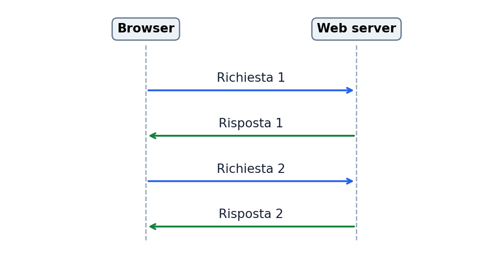

Analogamente a una transazione economica (trasferimento di denaro da A a B), il server riceve la richiesta, esegue l'operazione e restituisce una risposta. La transazione termina.

Questo approccio favorisce la scalabilità e riduce il rischio di esaurimento delle risorse dovuto alla memorizzazione di informazioni temporanee per ogni client. Un attaccante potrebbe infatti generare molte richieste per costringere il server ad allocare memoria inutilmente, provocando un Denial of Service (DoS).

**Nota:** HTTP non impedisce alle applicazioni di mantenere uno stato lato server. REST è uno stile architetturale distinto da HTTP, che prevede tra i propri vincoli l'assenza di stato conversazionale lato server. Stateless non significa che la connessione TCP debba essere chiusa dopo ogni risposta.

### 1.2 Metodi HTTP e CRUD

| Metodo | CRUD | Funzione |
|---|---|---|
| GET | Read | Recuperare una risorsa |
| POST | Create | Creare una risorsa o inviare dati |
| PUT | Update | Sostituire o aggiornare una risorsa |
| DELETE | Delete | Eliminare una risorsa |

La corrispondenza è indicativa: PUT può anche creare una risorsa e POST può essere utilizzato per operazioni diverse dalla creazione.

### 1.3 Risorse

Una risorsa HTTP è identificata mediante una URI.

```http
GET /pregiata HTTP/1.1
Host: web.com
```

Il path `/pregiata` può identificare un file relativo alla root configurata nel web server (non necessariamente la root del filesystem), un'applicazione oppure un servizio web associato alla URI.

## 2. Autenticazione locale

Un web server può gestire risorse pubbliche e risorse privilegiate, accessibili solo a utenti autenticati e autorizzati. Come riconoscere un utente già autenticato se HTTP è stateless?

Indichiamo con BR il browser, con WS il web server e con `/pregiata` la risorsa protetta.

### 2.1 Primo tentativo: username e password

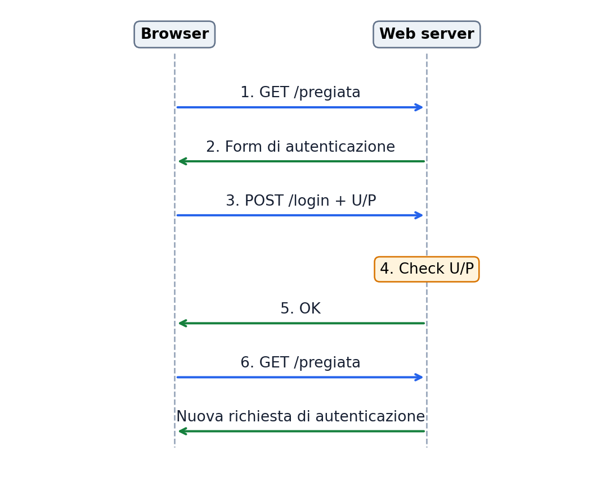

1. BR → WS: richiesta `GET /pregiata`.
2. WS → BR: restituzione di una form HTML per username e password.
3. BR → WS: invio delle credenziali mediante POST.
4. WS: verifica delle credenziali (Check U/P).
5. WS → BR: risposta positiva (OK), se le credenziali sono corrette.
6. BR → WS: nuova richiesta `GET /pregiata`.

Esempio del passo 3:

```http
POST /login HTTP/1.1
Host: web.com
Content-Type: application/x-www-form-urlencoded

username=alpha&password=beta
```

Le informazioni sono contenute nel payload, ossia nel corpo della richiesta. Possono essere trasmesse anche mediante parametri nella URL, ma per le credenziali si utilizza POST su HTTPS, evitando di inserirle nella URL.

Nel modello stateless, alla nuova GET il server non ricorda che le credenziali sono state verificate e richiede nuovamente l'autenticazione. Occorre quindi fornire al browser una prova dell'avvenuta autenticazione.

## 3. Session ID e cookie

Il server genera un testimone dell'avvenuta autenticazione, chiamato **Session ID (SID)**, e lo consegna al browser. Il browser lo conserva e lo presenta nelle successive richieste.

### 3.1 Set-Cookie e Cookie

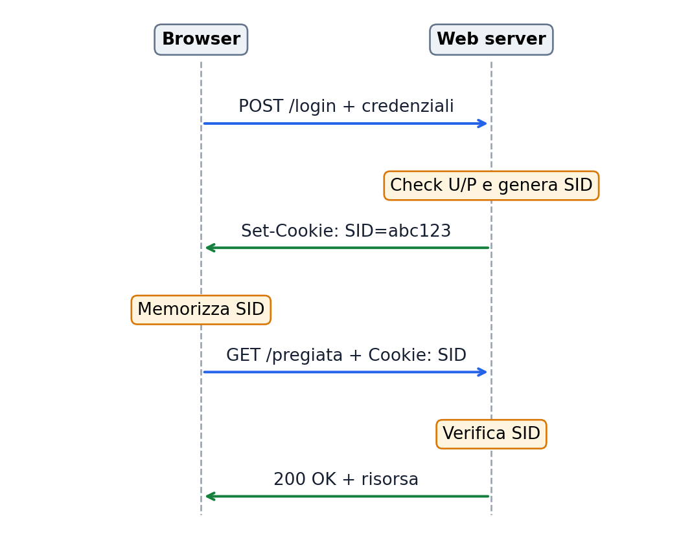

Il server imposta il cookie mediante l'header `Set-Cookie`:

```http
HTTP/1.1 200 OK
Set-Cookie: SID=abc123
```

Il browser restituisce automaticamente il cookie nelle richieste compatibili con il suo ambito di validità:

```http
GET /pregiata HTTP/1.1
Host: web.com
Cookie: SID=abc123
```

| Header | Direzione | Funzione |
|---|---|---|
| Set-Cookie | Server → Browser | Imposta il cookie |
| Cookie | Browser → Server | Restituisce il cookie |

### 3.2 Cookie temporanei e persistenti

| Caratteristica | Temporanei | Persistenti |
|---|---|---|
| Durata | Sessione del browser | Fino alla scadenza |
| Scadenza esplicita | Generalmente assente | Expires o Max-Age |
| Utilizzo tipico | Sessione autenticata | Preferenze, login persistente |

La conservazione temporanea può ridurre l'esposizione dei dati, ma non garantisce che il cookie rimanga esclusivamente in RAM: alcuni browser possono conservarlo per ripristinare la sessione. Un attaccante con privilegi sufficienti sul sistema potrebbe inoltre accedere alla memoria dei processi.

## 4. Recuperare la risorsa richiesta prima del login

Dopo il login si vuole ottenere direttamente la risorsa richiesta inizialmente, senza costringere il server a ricordarne il path. La soluzione consiste nell'appoggiare questa informazione sul browser tramite un campo `hidden` della form HTML.

```html
<form method="POST" action="/login">
    <input type="text" name="username">
    <input type="password" name="password">
    <input type="hidden" name="resource" value="/pregiata">
    <input type="submit">
</form>
```

Il campo hidden non è visibile nell'interfaccia della form, ma viene trasmesso insieme alle credenziali:

```http
POST /login

username=alpha&password=beta&resource=/pregiata
```

Il server dispone quindi di username, password e risorsa originaria. Può verificare le credenziali, generare il SID e restituire direttamente l'HTML richiesto.

### 4.1 Schema completo

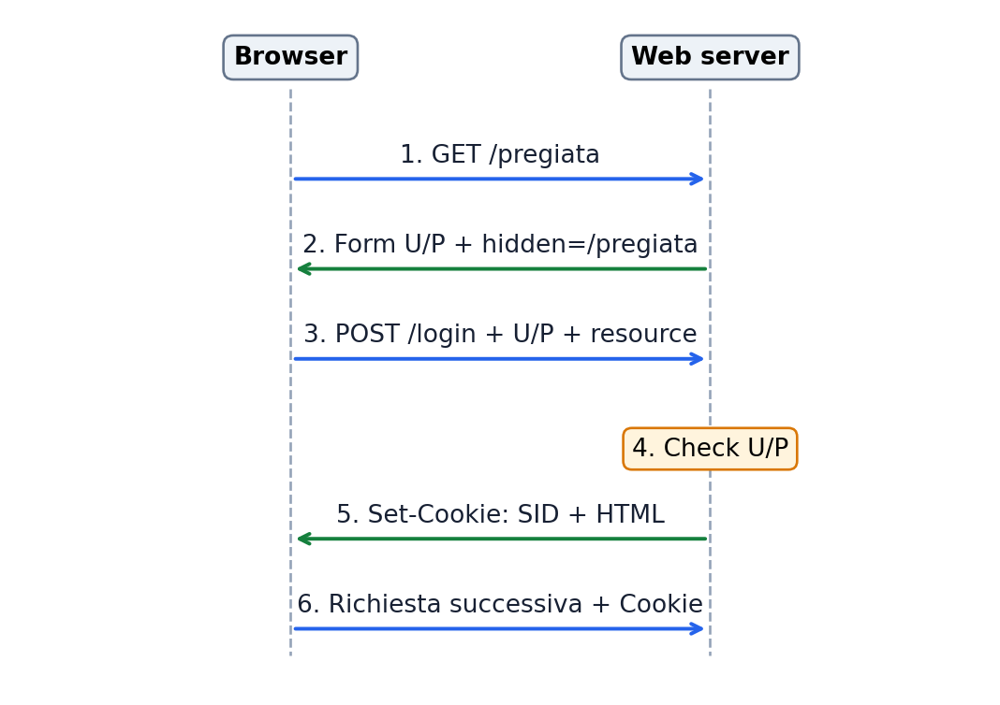

Un campo hidden non è protetto: può essere visualizzato e modificato tramite gli strumenti del browser. Il server deve validarne il contenuto.

## 5. Costruzione di un Session ID sicuro

### 5.1 Username come SID

Se il cookie contenesse solamente `SID=alpha`, un attaccante potrebbe sostituire lo username con quello di un altro utente e impersonarlo. Lo username non costituisce una prova di autenticazione.

### 5.2 Tabella delle sessioni

Una soluzione consiste nel generare un identificativo casuale imprevedibile e associarlo a un utente in una tabella lato server.

| SID | Username | Scadenza |
|---|---|---|
| a83f9c | alpha | 19:30 |
| b92e7d | beta | 20:00 |
| c75a3b | gamma | 20:15 |

Gli identificativi sono puramente illustrativi. Questa soluzione richiede uno stato lato server, con un costo di memoria e gestione proporzionale alle sessioni attive.

### 5.3 Token crittografato

Per evitare una tabella delle sessioni si può costruire un token autosufficiente contenente:

- Username U: identità dell'utente autenticato.
- Data assoluta di scadenza T_exp.
- Valore casuale R: differenzia il contenuto dei token.

Le informazioni vengono cifrate con una chiave segreta k nota al server, ad esempio mediante AES.

$$
SID=E_k(U\parallel T_{\mathrm{exp}}\parallel R)
$$

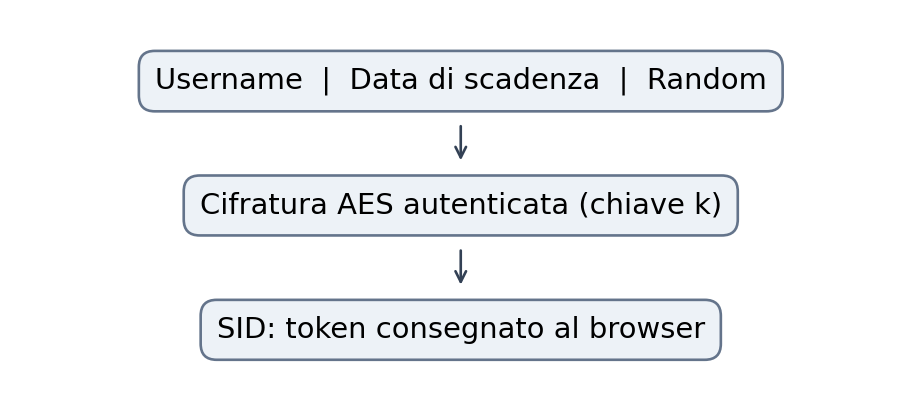

Il browser non deve conoscere il contenuto del token, ma soltanto conservarlo e restituirlo.

### 5.4 Data di scadenza

Una semplice durata (ad esempio 30 minuti) non è sufficiente se il server non ricorda quando ha emesso il token. Una data assoluta di scadenza permette invece di confrontare direttamente l'istante corrente con quello contenuto nel token. In alternativa si potrebbero includere istante di emissione e durata.

La scadenza interna del token è distinta dalla scadenza del cookie impostata attraverso gli header HTTP.

### 5.5 Valore random

Se la cifratura fosse deterministica e il contenuto sempre identico, si otterrebbe sempre lo stesso token. Un valore casuale differenzia il contenuto anche per lo stesso utente e rende più difficile correlare i token osservati. Non garantisce però da solo la sicurezza del token.

### 5.6 Verifica del token

Quando il browser restituisce il SID, il server recupera le informazioni mediante la chiave segreta:

$$
D_k(SID)=U\parallel T_{\mathrm{exp}}\parallel R
$$

Deve verificare autenticità, integrità e scadenza del token, oltre all'autorizzazione dell'utente sulla risorsa richiesta.

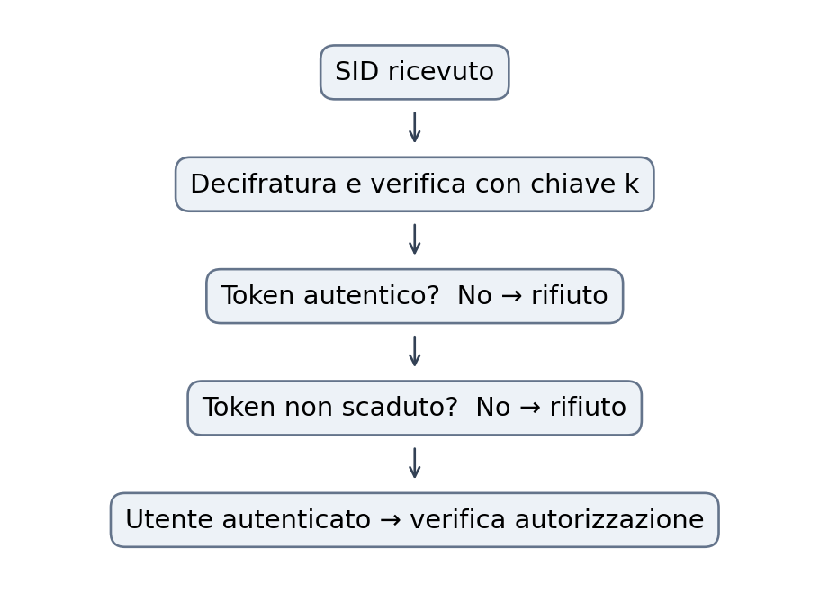

### 5.7 Integrità: AES, CRC e autenticazione

La riservatezza da sola non basta. Occorrono anche integrità (rilevazione di modifiche) e autenticità (prova che il token sia stato generato da un soggetto autorizzato).

**Precisazione tecnica:** AES (Advanced Encryption Standard) è un algoritmo di cifratura simmetrica e da solo non garantisce l'integrità. Un CRC rileva errori accidentali, non modifiche intenzionali. Un MAC, come HMAC, garantisce integrità e autenticità mediante una chiave segreta. Una modalità di cifratura autenticata come AES-GCM garantisce anche la riservatezza.

Una possibile implementazione è:

$$
M=U\parallel T_{\mathrm{exp}}\parallel R
$$

$$
(C,tag)=\operatorname{AES\text{-}GCM}_k(N,M)
$$

Il token contiene nonce N, ciphertext C e tag di autenticazione. Il nonce non deve essere riutilizzato con la stessa chiave.

### 5.8 Limiti del modello stateless

- **Session hijacking:** un token rubato può essere riutilizzato anche senza conoscerne il contenuto o la chiave.
- **Logout e revoca:** cancellare il cookie dal browser non invalida necessariamente una copia rubata. Una revoca immediata può richiedere meccanismi lato server.
- **Protezione dei cookie:** attributi specifici riducono alcuni rischi.

```http
Set-Cookie: SID=...; Secure; HttpOnly; SameSite=Lax
```

| Attributo | Funzione |
|---|---|
| Secure | Limita l'invio del cookie a HTTPS |
| HttpOnly | Impedisce il normale accesso mediante JavaScript |
| SameSite | Limita l'invio nelle richieste cross-site |

## 6. Identità federata (Federated Identity)

L'autenticazione può essere delegata a un'entità esterna: IAM (Identity and Access Management). Ad esempio, un sito può consentire l'accesso tramite un account Google.

Gli attori sono:

- BR: browser dell'utente.
- WEB: server che gestisce le risorse.
- IAM: sistema che gestisce l'identità e verifica le credenziali.

Il WEB si affida all'IAM per ottenere una prova dell'identità dell'utente.

## 7. HTTP Redirect

| Classe | Significato |
|---|---|
| 1xx | Informational |
| 2xx | Success |
| 3xx | Redirection |
| 4xx | Client Error |
| 5xx | Server Error |

Una risposta HTTP 302 Found indica al browser un indirizzo al quale collegarsi attraverso l'header Location.

```http
HTTP/1.1 302 Found
Location: https://iam.com
```

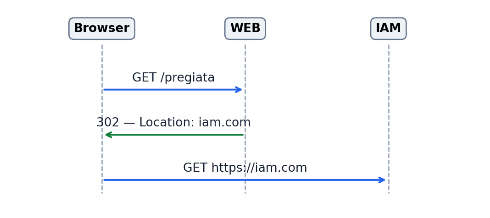

Non è il WEB a inoltrare direttamente la richiesta all'IAM: il browser riceve il redirect ed effettua una nuova richiesta.

## 8. Trasmissione dei parametri HTTP

I parametri possono essere inseriti nel payload della richiesta oppure nella URL mediante una query string.

```text
https://dominio/path?chiave1=valore1&chiave2=valore2
```

`?` introduce la query string, `=` associa una chiave a un valore, `&` separa le coppie.

### 8.1 Percent encoding

Per rappresentare caratteri che potrebbero interferire con la struttura della URI si può usare il percent encoding: `%` seguito da due cifre esadecimali che rappresentano un byte.

| Carattere | Codifica |
|---|---|
| : | %3A |
| / | %2F |
| ? | %3F |
| & | %26 |
| = | %3D |
| Spazio | %20 |

Per passare `https://web.com/pregiata` come parametro `from`:

```text
https://iam.com/?from=https%3A%2F%2Fweb.com%2Fpregiata
```

Il destinatario può decodificare il parametro e recuperare l'indirizzo originale. Il percent encoding non è cifratura.

## 9. Schema completo dell'identità federata

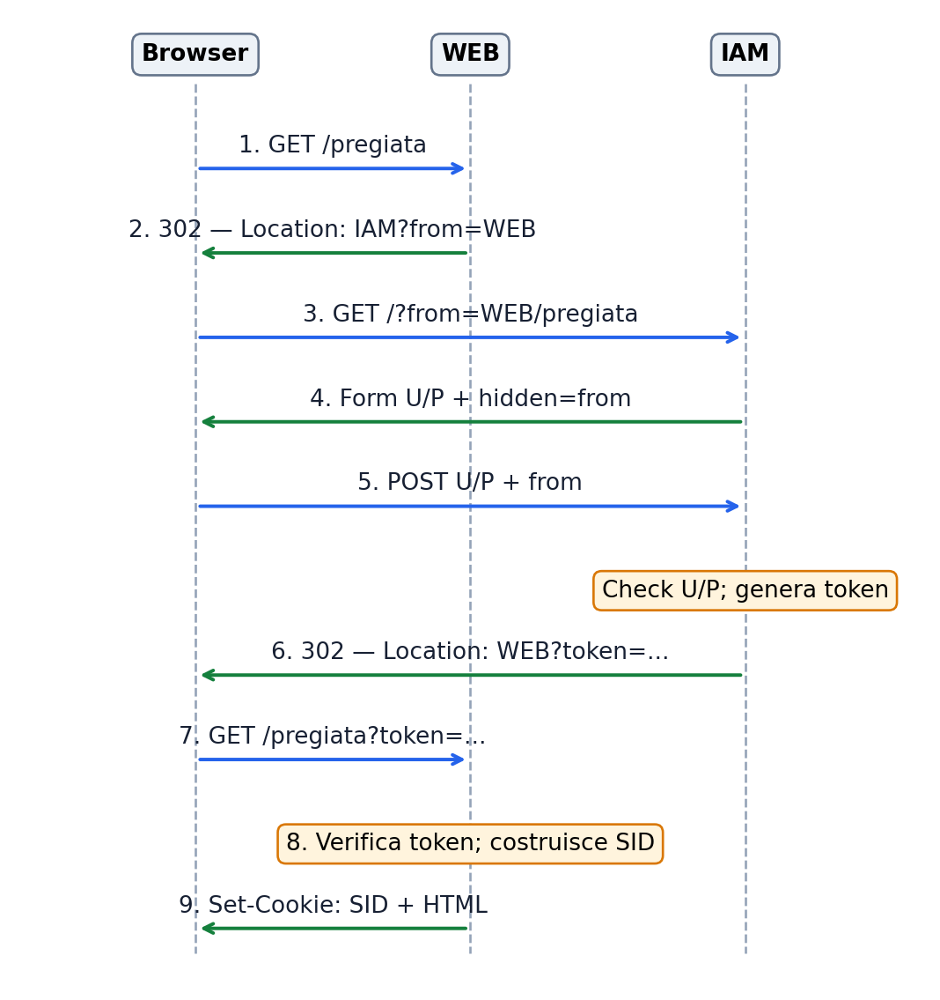

### Passo 1 – BR → WEB: richiesta della risorsa

```http
GET /pregiata HTTP/1.1
Host: web.com
```

Il WEB identifica la risorsa come protetta e delega l'autenticazione all'IAM.

### Passo 2 – WEB → BR: redirect verso IAM

```http
HTTP/1.1 302 Found
Location: https://iam.com/?from=https%3A%2F%2Fweb.com%2Fpregiata
```

Il parametro `from` indica l'indirizzo della risorsa originaria, necessario per reindirizzare successivamente il browser.

### Passo 3 – BR → IAM: richiesta di autenticazione

```http
GET /?from=https%3A%2F%2Fweb.com%2Fpregiata
Host: iam.com
```

### Passo 4 – IAM → BR: form di autenticazione

L'IAM restituisce una form contenente username, password e un campo hidden per conservare la provenienza senza mantenere uno stato conversazionale.

```html
<form method="POST" action="/login">
    <input type="text" name="username">
    <input type="password" name="password">
    <input type="hidden" name="from" value="https://web.com/pregiata">
    <input type="submit">
</form>
```

### Passo 5 – BR → IAM: invio delle credenziali

```http
POST /login

username=alpha&password=beta&from=https%3A%2F%2Fweb.com%2Fpregiata
```

L'IAM verifica le credenziali e genera un token in caso di successo.

### Passo 6 – IAM → BR: redirect verso WEB con token

```http
HTTP/1.1 302 Found
Location: https://web.com/pregiata?token=xyz123
```

Non basta reindirizzare il browser alla risorsa: occorre fornire una prova dell'avvenuta autenticazione.

L'IAM non può impostare direttamente un cookie per un dominio estraneo come `web.com`. Un cookie impostato da `iam.com` non viene inviato a `web.com`.

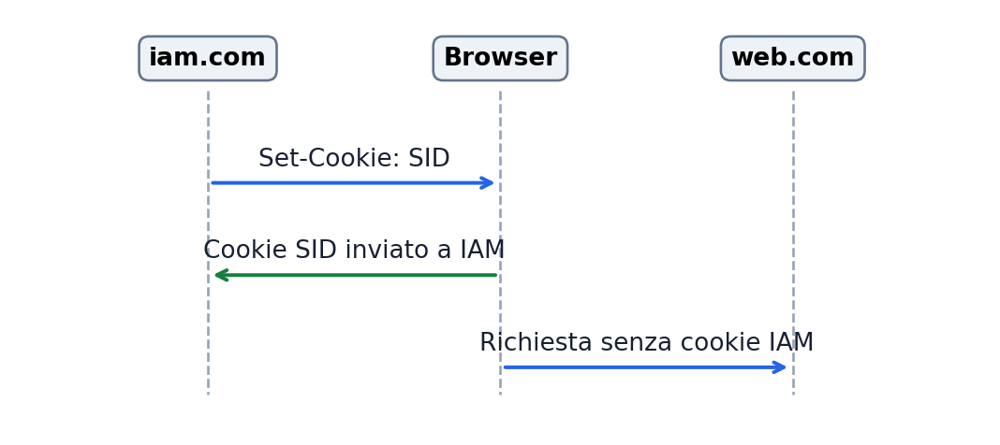

Nel modello semplificato il token viene quindi trasferito mediante la query string.

### Passo 7 – BR → WEB: richiesta con token

```http
GET /pregiata?token=xyz123 HTTP/1.1
Host: web.com
```

### Passo 8 – WEB: verifica del token e costruzione del SID

Esistono due possibili modelli.

**A. Verifica mediante comunicazione con IAM**

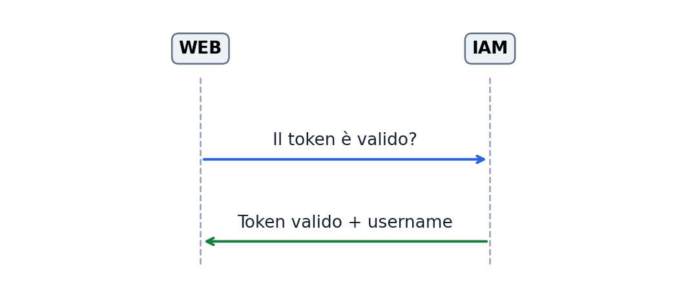

Il WEB contatta l'IAM per verificare il token. L'IAM ne conferma la validità e restituisce le informazioni sull'identità, ad esempio lo username. Si può prevedere un intervallo molto breve (ad esempio tre secondi) per la verifica: è una scelta progettuale, non un vincolo HTTP.

**B. Verifica crittografica locale**

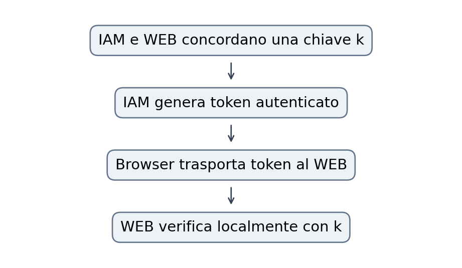

IAM e WEB concordano preventivamente un meccanismo crittografico, ad esempio una chiave simmetrica k. L'IAM costruisce il token:

$$
Token=E_k(U\parallel T_{\mathrm{exp}}\parallel R)
$$

Il WEB lo decifra e verifica autenticità, integrità e validità senza contattare nuovamente l'IAM. In entrambi i modelli il WEB genera il proprio SID dopo aver verificato l'identità e l'autorizzazione.

### Passo 9 – WEB → BR: cookie e risorsa

```http
HTTP/1.1 200 OK
Set-Cookie: SID=abc123
Content-Type: text/html
```

Nel corpo viene inserito l'HTML della risorsa richiesta. Nelle richieste successive il browser utilizza il cookie associato a `web.com`, senza ripetere l'autenticazione presso l'IAM.

## 10. Token IAM e SID WEB

| Caratteristica | Token IAM | SID WEB |
|---|---|---|
| Generato da | IAM | WEB |
| Funzione | Prova dell'autenticazione esterna | Sessione autenticata locale |
| Trasmissione nello schema | Query string | Cookie HTTP |
| Verificato da | WEB, eventualmente con IAM | WEB |
| Utilizzo | Durante il login federato | Richieste successive |

## 11. Ruolo attivo del browser

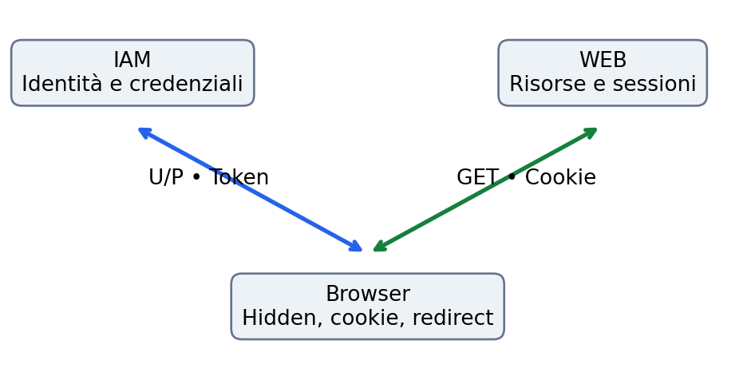

La struttura a Y evidenzia il ruolo del browser: conserva informazioni nei campi hidden e nei cookie, interpreta i redirect, effettua nuove richieste e trasporta parametri e token tra IAM e WEB.

L'interazione è costituita da transazioni HTTP di richiesta e risposta. Il server può evitare di conservare molte informazioni intermedie, favorendo la scalabilità.
