Riprendendo un concetto importante nella scorsa lezione relativamente agli attacchi nelle reti locali, distinguiamo tra:
- **Sniffing**
- **Packet Injection**
- **Man-in-the-Middle (MITM)**

Se due dispositivi $A$ e $B$ comunicano attraverso una rete e un attaccante $M$ riesce ad osservare il traffico senza creare problemi di **disponibilità** o alterare i pacchetti creando problemi di **integrità** --> abbiamo un problema di **confidenzialità**, è il caso dello **Sniffing**.

L'attaccante potrebbe eventualmente immettere un nuovo pacchetto nella rete (**Packet Injection**), ma ciò non implica necessariamente che questo debba sostituire quello originale.

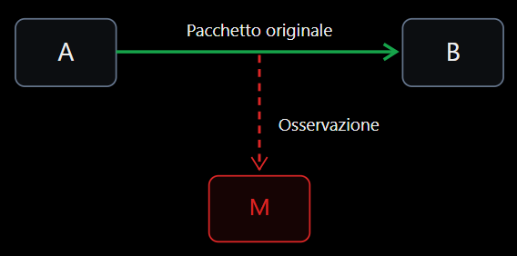

Il **MITM** effettivo avviene se l'attaccante è in grado di interporsi nel flusso della comunicazione. Due situazioni in cui ciò è possibile:
- l'attaccante costituisce un *bridge* tra due reti locali, attraverso il quale devono transitare i pacchetti
- l'attaccante effettua *ARP Spoofing/Poisoning*, inducendo il dispositivo sorgente a credere che il MAC addresso dell'attaccante sia quello del gateway

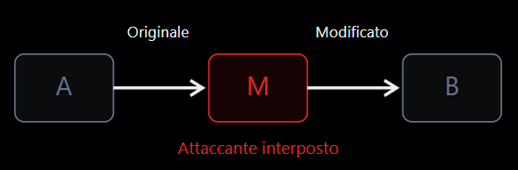

---

### Controllo degli errori: Ethernet, IP e TCP
Un frame Ethernet contiene nella sua parte finale 4 byte dedicati al controllo degli errori, il campo **FCS Frame Check Sequence** che viene calcolato tramite un algoritmo di **CRC** a 32 bit.  
Necessario quindi a identificare eventuali anomalie *accidentali* dei bit durante la trasmissione (accidentali perché un eventuale attaccante può tranquillamente conoscere l'algoritmo e calcolare il CRC corretto per un pacchetto modificato).

Anche il protocollo IPv4 possiede un meccanismo di controllo degli errori: l'**header checksum**. Si tratta di un campo a 16 bit che permette di verificare la correttezza dell'header IP (la differenza rispetto al CRC è che l'header checksum non considera i dati del pacchetto, ma solo l'header).  
Allo stesso modo, anche l'header TCP possiede un campo di checksum a 16 bit che permette di verificare la correttezza dell'header TCP e dei dati trasportati.

In generale è importante osservare che questi meccanismi **non sono strumenti di integrità crittografica** e servono principalmente a rilevare errori accidentali di trasmissione, per lo stesso motivo spiegato sull'FCS.

### Il protocollo TCP
**TCP Trasmisison Control Protocol** è uno dei principali protocolli a livello di trasporto insieme a UDP.  
Come sappiamo, secondo la logica dell'incapsulamento, il segmento TCP è contenuto nella parte dati del pacchetto IP, a sua volta contenuto nel frame Ethernet quando si utilizza questo tipo di rete.

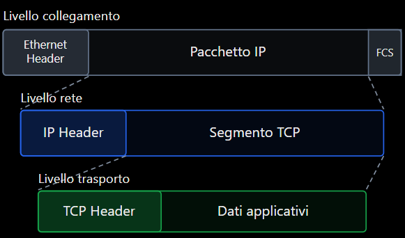

La differenza fondamentale tra IP e TCP è che, mentre *IP è protocollo connectionless* (i.e. ogni pacchetto è trattato indipendentemente dagli altri) **TCP è connection-oriented** --> introduce il concetto di connessione, mantenendo informazioni sullo stato della comunicazione tra due dispositivi.

Quindi TCP deve introdurre dei meccanismi che consentano di identificare, ordinare, confermare e ricostruire i dati scambiati durante una comunicazione. La struttura dell'header TCP è la seguente, con dimensione pari a 20 byte in assenza di opzioni:

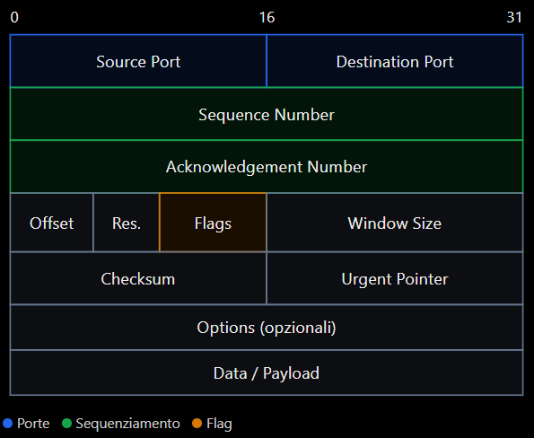

I dati importanti per ciò che interessa questa lezione sono le **porte di ingresso e uscita**, il **Sequence Number** (posizione dei dati nel flusso di uscita) e **ACK number** (prossimo byte atteso dall'interlocutore), e i flag **SYN** e **ACK**.

Un concetto importante è l'**identificazione di una connessione TCP**: mentre un indirizzo IP identifica un'interfaccia a lvl di rete, una porta TCP ha significato solo in relazione all'indirizzo IP al quale è associata (ad es. la porta 80 di un computer è distinta da quella di un altro pc...).  

Un **endpoint TCP** è quindi identificato dalla coppia $(IP, Porta)$, mentre una **connessione TCP** è identificata dalla coppia di endpoint $(IP_S, Porta_S, IP_D, Porta_D)$.  

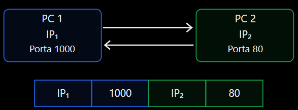

Qui sopra nell'esempio $PC1$ si collega a un server web presente su $PC2$, in ascolto sulla porta 80 --> la connessione è identificata da $(IP_1, 1000, IP_2, 80)$.  
Quando viene creato un socket client, normalmente il programmatore non specifica la porta sorgente, che viene assegnata automaticamente dal sistema operativo tra quelle disponibili (porte effimere).

#### Sequence Number SEQ e Acknowledgment Number ACK
I due campi dell'header TCP SEQ e ACK sono quelli che consentono di mantenere lo stato della comunicazione: infatti come anticipato IP non garantisce che i pacchetti arrivino a destinazione nell'ordine di invio, né che arrivino effettivamente tutti, ci deve pensare TCP.

Il **SEQ number** indica *la posiziione del primo byte contenuto nel segmento all'interno dello spazio di sequenza del mittente*.  
Intuitivamente risponde alla domanda: "quanti byte ho già inviato prima di questo segmento?".

Supponiamo che $A$ abbia già tramsesso a $B$ 1000 byte e voglia inviarne altri 400 --> $A$ invierà un segmento con $SEQ=1000$.  
All'invio di un segmento successivo, supponendo che contenga altri 300 byte, il SEQ sarà 1400 e così via --> **TCP non numera i pacchetti, ma i byte del flusso di dati!**

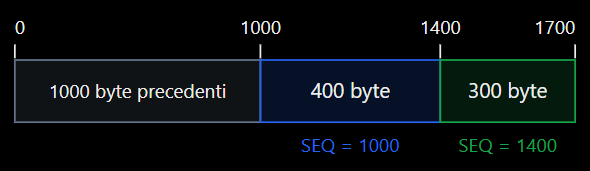

L'**ACK number** indica il numero di sequenza del prossimo byte che il destinatario si aspetta di ricevere.  
Intuitivamente risponde alla domanda: "quanti byte ho già ricevuto correttamente dal mittente?".

Se $B$ riceve un segmento con $SEQ=1000$ e lunghezza $L=400$.  
Se ha già ricevuto correttamente i primi 1000 byte --> potrà rispondere con un segmento con $ACK=1400$, confermando così la ricezione dei primi 1400 byte e il fatto che si aspetta di ricevere un segmento con numero di sequenza $SEQ=1400$.

TCP è protocollo **full-duplex**, i.e. consente comunicazione contemporanea dei dati in entrambe le direzioni --> ogni interlocutore mantiene il proprio SEQ e ACK, che sono indipendenti da quelli dell'altro interlocutore --> SEQ e ACK in uno stesso segmento fanno riferimento a due flussi di dati diversi.

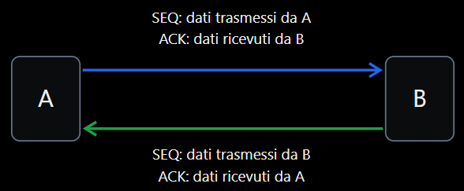

*Esempio applicativo*:

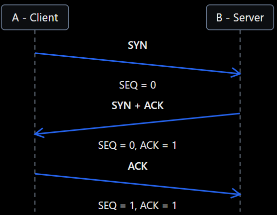

qui $A$ invia 400 byte supponendo di averne già inviati 1000, e di averne ricevuti 1000 (quindi $SEQ_A=1000$ e $ACK_A=1000$).  
Poi $A$ invia altri 300 byte senza necessariamente attendere la conferma del segmento precedente --> $SEQ_A=1400$ e $ACK_A=1000$.  
A questo punto $B$ risponde con $SEQ_B=1000$ e $ACK_B=1500$, confermando quindi di aver ricevuto correttamente i primi 1500 byte e di aspettarsi il prossimo segmento con $SEQ=1500$...

Pare che si siano persi 200 byte, ma qui entra in gioco il **buffer di trasmissione (send buffer)**: quando $A$ trasmette i due segmenti non elimina immediatamente dati dalla propria memoria!

Il SO mantiene i dati ancora non confermati nel buffer di trasmissione, qui nell'esempio quindi aveva mantenuto inizialmente 700 byte e, ricevendo la conferma di $B$, elimina i primi 500 byte e mantiene i restanti 200 in attesa di una nuova conferma.

---

Grazie ai numeri di sequenza, TCP riesce ad affrontare così tre problematiche fondamentali nella comunicazione di rete:
- **Perdita di segmenti**: se $A$ non riceve la conferma entro un **timeout** di trasmissione --> può ritrasmettere i dati non confermati
- **Duplicazione di segmenti**: se $B$ riceve due volte lo stesso segmento, può riconoscerlo grazie al numero di sequenza e scartarlo
- **Arrivo di segmenti fuori ordine**: se $B$ riceve un segmento con numero di sequenza maggiore di quello atteso, può memorizzarlo in un buffer e attendere i segmenti mancanti prima di consegnare i dati all'applicazione.

#### Attacco MITM a livello TCP
Supponiamo un attaccante riesca ad interporsi tra due dispositivi che comunicano tramite TCP. Se la comunicazione non è protetta da meccanismi crittografici d'integrità --> **l'attaccante potrebbe alterare i dati trasportati**.

Una difficoltà che incontrerà l'attaccante è che però (oltre a dover sistemare la checksum), modificando la quantità di dati presente nel flusso, si modificherà anche lo stato della comunicaizione percepito dai due interlocutori --> se l'attaccante vuole continuare a mantenere i dati alterati, dovrà quindi **modificare anche i numeri di sequenza e di conferma aggiungendo in avanti e sottraendo all'indietro il numero di byte alterati** fino eventualmente alla fine della comunicazione.

Comunque sia questa è evidenza del fatto che i numeri di SEQ e ACK da soli non sono sufficienti a garantire l'integrità della comunicazione.

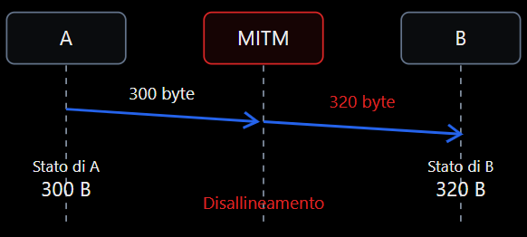

Le strategie difensive devono quindi agire su altri livelli, proteggendo ad es. dagli attacchi ARP Spoofing per evitare che l'attaccante possa intercettare i pacchetti, autenticando gli interlocutori, usano protocolli crittografici come TLS o verificando l'integrità dei dati tramite MAC o firme digitali.

#### Inizializzazione della connessione TCP: il three-way handshake
Prima di poter scambiare i dati, $A$ e $B$ devono stabilire una connessione.  
Quest'operazione avviene tramite il **Three-Way Handshake**, durante il quale vengono usati principalmente due flag dell'header TCP: **SYN** *Synchronize* e **ACK**.

Supponiamo per semplicità che entrambi usino un numero di sequenza iniziale $SEQ=0$.

Anzitutto $A$ invia a $B$ un segmento con il flag SYN attivo e numero di sequenza iniziale $SEQ_A=0$.  
Dopodiché $B$ risponde attivando entrambi i flag *SYN* e *ACK* e comunica il proprio numero di sequenza iniziale $SEQ_B=0$, confermando così la ricezione del segmento di $A$ con $ACK=1$.  
Infine anche $A$ invia un segmento con il flag *ACK* attivo e numero di sequenza $SEQ_A=1$, confermando la ricezione del segmento di $B$ con $ACK=1$ e determinando l'inizio della connessione.

In realtà **l'initial sequence number (ISN)** non vengono fissati a 0, ma scelti in modo u.a.r. affinché siano difficilmente prevedibili. Ciò contribuisce alla sicurezza, non costituisce però un meccanismo di autenticazione crittografica.

---

### Routing e NAT (Network Address Translation)
Vediamo ora un esempio architetturale riguardante la comunicazione tra un dispositivo appartenente a una rete privata e un server pubblico su Internet:

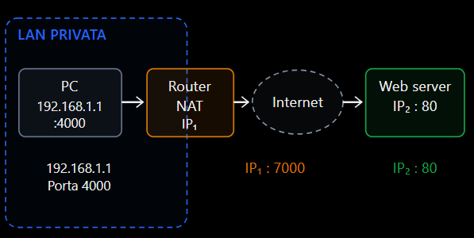

Il PC qui possiede un IP privato, non direttamente instradabile sulla rete Internet pubblica --> si pone quindi il problema di come permettergli di comunicare con il web remoto.

Anzitutto avviene la **comunicazione tra PC e il router**: il PC vuole inoltrare una richiesta al web server $IP_2:80$.  
Il segmento TCP è incapsulato in un pacchetto IP che contiene le seguenti informazioni: $(IP_1, 4000, IP_2, 80)$. Il PC, consultando la propria configurazione di routing, capisce che la destinazione non è parte della LAN --> deve consegnare il pacchetto al proprio default gateway.

Per farlo come sappiamo usa ARP, se necessario, per conoscere il MAC address associato all'IP locale del gateway --> attenzione quindi alla distinzione: **il destinatario del frame Ethernet è il router, ma il destinatario del pacchetto IP resta il server web remoto!**.

Quando il router riceve il pacchetto, non può instradarlo su Internet mantenendo come indirizzo sorgente l'indirizzo privato del PC --> lo sostituisce con il proprio IP publlico. Può inoltre sostituire la porta sorgente 4000 con un'altra porta, ad esempio 7000.  
Il pacchetto viene cioè trasformato nel seguente modo, lasciando invariati gli elementi della destinazione:

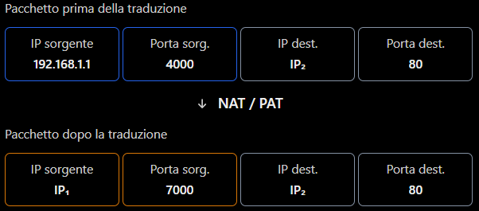

Quando vengono tradotti anche i numeri di porta, si parla di **PAT** (Port Address Translation) o **NAPT** (Network Address Port Translation).

Sorge quindi il problema: quando al router torna la risposta dal server web, come fa a capire a quale PC della LAN inoltrarla?  
Il router deve mantenere una **tabella di traduzione** temporanea, che associa la coppia $(IP_S, Porta_S)$ originale del PC con la coppia $(IP_R, Porta_R)$ tradotta dal router (e può contenere anche altre info, come il protocollo e l'endpoint di destinazione...).  
Grazie alla tabella il router può quindi sostituire nuovamente gli indirizzi e le porte del pacchetto in arrivo e inoltrare così il pacchetto all'interno della LAN.

I router intermedi nella rete normalmente si occupano invece solo dell'instradamento del pacchetto verso la destinazione, senza effettuare ulteriori traduzioni NAT.

#### NAT e disponibilità del servizio
Ricordiamo le tre proprietà fondamentali della sicurezza informatica, la **CIA Triad**:

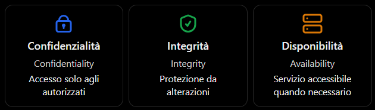

Supponiamo di avere una grande università o azienda nella quale tutti i dispositivi accedono alla rete attraverso un singolo router NAT dotato di un solo IP pubblico, e per ottimistica semplicità assumiamo che ogni associazione attiva occupi una distinta porta pubblica.    
In questo modello il router dispone quindi al massimo di $2^{16} = 65536$ porte.

Se l'università possiede 150k postazioni --> il numero di connessioni contemporanee richieste potrebbe superare le risorse a disposizione del router. Una volta esaurite le porte disponibili quindi il router non potrebbe più essere in grado di creare associazioni NAT!  
Si parla in questo caso di **Port Exhaustion**:

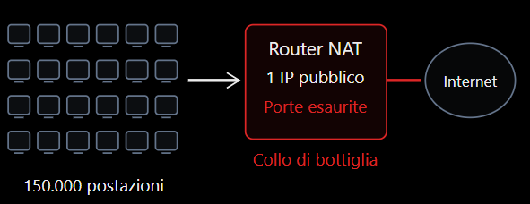

Il problema riguarda strettamente la **disponibilità del servizio**: nota come non c'è nessun attaccante, ma solo la conseguenza di una progettazione architetturale inadeguata rispetto al numero di utenti.

Una **soluzione** consiste nell'usare più IP pubblici, eventualmente distribuendoli attraverso più router NAT. Con $n$ IP pubblici infatti, sempre nel modello ottimistico semplificato, il numero teorico di associazioni disponibili diventa $n * 2^{16}$.

**Numerosità delle comunicazioni**
Un indirizzo IPv4 è rappresentato tramite 32 bit, mentre una porta TCP tramite 16 bit. Abbiamo allora teoricamente un totale di $2^{32} * 2^{16} = 2^{48}$ coppie possibili di destinazioni $(IP, Porta)$ 

#### Firewall e Reverse Proxy
Vediamo una seconda architettura che può introdurre problemi di disponibilità.

Supponiamo che un'azienda possa servirsi di diversi servizi web, attraverso cui fornisce servizi agli utenti esterni:

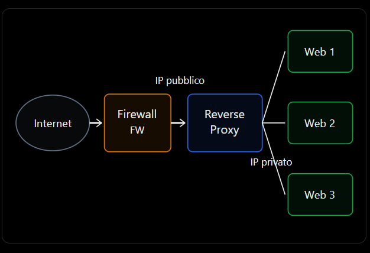

Il **firewall** è un dispositivo hardware o software che controlla il traffico di rete sulla base di determinate regole di sicurezza, decidendo quindi se:
- consentire il passaggio di un pacchetto
- bloccare un pacchetto
- registrare info riguardanti il traffico

Qui ipotizziamo un firewall trasparente rispetto alla connessione TCP, i.e. filtra il traffico senza terminare la connessione tra client e server proxy.

Il **Reverse Proxy** è un intermediario che riceve le richieste dei client per conto di uno o più server.  
Dal punto di vista del client, il RP appare come il server con il quale sta comunicando, mentre dal putno di vista del server, il RP appare come il client.  
Il RP può svolgere diverse funzioni tra cui fare load balancing delle richieste, terminazione di connessioni TLS, caching e protezione dei server interni.  

Per l'esempio la caratteristica che ci interessa è che **le connessioni TCP vengono terminate e ricreate dal Reverse Proxy** --> quando il client effettua una TCP connect stabilisce una connessione con il Reverse Proxy, che può a sua volta aprire una nuova connessione verso il server interno o usarne una già esistente, e viceversa.  
Queste connessioni sono indipendenti e possiedono i propri SEQ, ACK e porte.

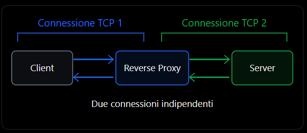

Si osserva come il Reverse Proxy può rappresentare un collo di bottiglia per questo scenario. 

Consideriamo tutte le possibili connessioni provenienti da Internet e dirette verso un RP con un determinato IP pubblico e porta. Allora la quaterna che identifica la connessione è:

$$(IP_S, P_S, IP_D, P_D)$$

Ma in questo caso il numero teorico di possibilità sono $2^{32}$ per l'IP sorgente, $2^{16}$ per la porta sorgente, e **solo 1** rispettivamente per l'IP e la porta di destinazione (quella del RP)!  
Infatti il RP, rappresentando il server della comunicazione, possiede un indirizzo IP e una porta fissati --> il numer oteorico di quaterne distinte in un ingresso è solo $2^{32} * 2^{16} = 2^{48}$.

Consideriamo ora invece le connessioni in uscita. Supponendo che l'RP abbia un solo IP interno e che l'IP del server web sia fissato, così come la porta --> 1 IP sorgente, $2^{16}$ porte sorgente (porte RP), 1 IP destinazione e 1 porta destinazione --> il numero teorico di quaterne distinte in uscita è solo $2^{16} = 65536$.

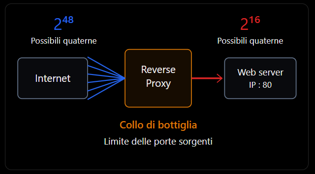

Abbiamo quindi una differenza significativa tra la numerosità teorica delle connessioni di ingresso e quella delle connessioni in uscita verso un singolo endpoint, i.e. se il RP deve creare una connessione distinta verso quel server per ogni connessione client --> potrebbe esaurire le porte sorgenti disponibili.

Una possibile soluzione, similmente a quanto visto nell'esempio prima, è assegnare più IP sorgente al RP:

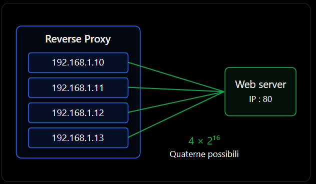

Qunado apre una connessione verso il server web interno, il RP può selezionare esplicitamente l'IP sorgente da usare tra quelli disponibili attraverso un'operazione di bind del socket (es. tramite Round Robin). Con $n$ indirizzi --> $n * 2^{16}$ connessioni teoriche distinte verso il server interno.

Nelle architetture reali anche ulteriori soluzioni come riutilizzo delle connessioni, multiplexing, load balancing con più RP e web server, connection pooling...

Sembra apparentemente che $2^16$ connessioni distinte verso un singolo server interno siano tante... ma ad oggi soprattutto con la diffusione di dispositivi mobili e IoT il numero dei dispositivi connessi alla rete è in continuo aumento.  
A questo proposito è stato anche necessario introdurre il protocollo IPv6, che permette di avere un numero teorico di indirizzi IP disponibili molto più grande rispetto a IPv4 (da 32 bit a 128 bit).

---

### Vulnerabilità architetturali e attacchi Ransomware
Cambiamo tipologia di architettura ma mostriamo sempre come una progettazione inadeguata possa introdurre gravi vulnerabilità di sicurezza.

Supponiamo di avere un ospedale che possiede un archivio digitale contenente immagini mediche: radiografie, risonanze magnetiche, TAC, ecc.

Un operatore ospedaliero usa un PC per inserire nuove img nell'archivio e recuperare quelle già presenti.  
Nell'architettura proposta, si immagina che l'operatore ha **accesso diretto al file system dove sono memorizzati i dati**.

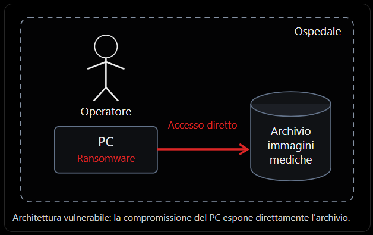

Supponiamo ora che il PC dell'operatore venga compromesso da un **ransomware** --> dato che il PC dispone dei permessi per accedere e modificare i file dell'archivio, anche il malware può operare utilizzando questi stessi privilegi.

Un **ransomware** è un malware che rende indisponibili i dati o i sistemi della vittima, generalmente attraverso la cifratura dei file, chiedendo un riscatto.  

Esempio famosissimo di ransomware è **WannaCry**, che nel 2017 ha colpito oltre 200k computer in 150 paesi, sfruttando una vulnerabilità di Windows (EternalBlue) e cifrando i file delle vittime.

Un aspetto importante è che la cifratura dei dati non implica necessariamente che l'organizzazione perda immediatamente ogni possibilità di recupero: se dispone di backup integri, potrebbe essere in grado di ripristinare le informazioni, tuttavia *anche i backup potrebbero essere compromessi...*

Il rischio in questo caso è che il ransomware resti inosservato per un periodo prolungato --> se il sistema continua a effettuare backup automatici a file già compromessi, anche le copie di backup saranno cifrate e quindi inutilizzabili.

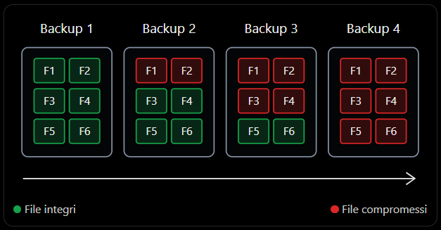

Da qui è evidente l'importanza di backup isolati, immutabili, versionati e periodicamente verificati.

Per correggere l'architettura dell'ospedale ci si chiede: ma perché mai l'operatore dovrebbe avere accesso diretto al file system dell'archivio?  
Per svolgere il proprio lavoro del resto all'operatore servono normalmente solo due operazioni: 
- inserire una nuova immagine nell'archivio
- leggere un'immagine già presente, senza bisogno di modificarla o cancellarla

Il problema sta cioè nel fatto che all'operatore sono stati assegnati pribilegi superiori a quelli necessari, violando al principio di **least privilege** secondo cui **ogni utente o processo dovrebbe avere solo i privilegi strettamente necessari per svolgere le proprie funzioni**.

In questo modo anche se il PC venisse compromesso il malware non avrebbe automaticamente i privilegi necessari per modificare le immagini già archiviate (chiaro che queste restrizioni devono essere implementate a livello SO mediante autorizzazioni e separazione dei privilegi, e non essere solo limitazioni grafiche nell'interfaccia dell'operatore...)

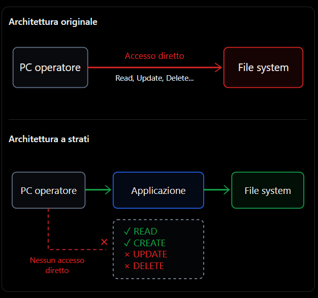

---

La **superficie di attacco** è **l'insieme di punti attraverso i quali un attaccante potrebbe interagire con un sistema e tentare di comprometterlo**.

Rientrano nella superficie di attacco ad es. porte di rete esposte, le interfacce applicative, i servizi accessibili, i permessi degli utenti e le funzionalità software disponibili.

Una cattiva progettazione architetturale può quindi esporre superfici di attacco non necessarie.

Chiaro che nella realtà della progettazione dei sistemi informatici è necessario trovare un compromesso tra tre aspetti:

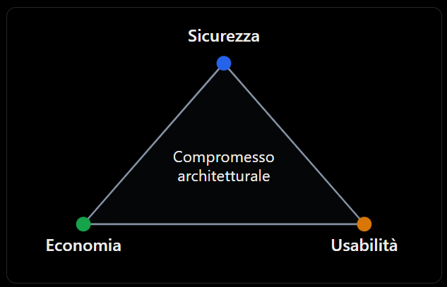

L'introduzione di nuovi meccanismi di sicurezza può introdurre nuovi costi di realizzazione e gestione del sistema e, in alcuni casi, ridurne la semplicità di utilizzo.  

Le aziende possono essere portate a privilegiare gli aspetti economici e operativi rispetto a quelli di sicurezzza, ma il compito dell'esperto di cybersecurity è anche quello di rendere consapevoli le organizzazioni dei rischi derivanti da tali decisioni.

La sicurezza rappresenta un costo immediato, ma anche uno strumento per ridurre rischi economici, operativi e reputazionali a lungo termine.

In questo senso un tema importante sta nel GDPR (General Data Protection Regulation), il regolamento europeo sulla protezione dei dati personali, che sanziona le organizzazioni con multe che possono arrivare fino a 20kk oppure al 4% del fatturato annuo globale in caso di violazioni dei dati personali.